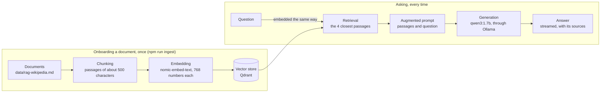

# remix3-local-rag-agent

[](https://codespaces.new/migueldiaz66/remix3-local-rag-agent)

**The smallest complete RAG you can run on your own machine.** A proof of concept of the basic
elements of retrieval-augmented generation (RAG), all of them local: no cloud service and no API
key. A minimal web page draws the RAG pipeline as a diagram, next to a chat where you can ask the
same question three ways and see what each way adds.

The page is also a trial. [Remix 3](https://remix.run), a web framework rebuilt on web
standards, without React, and designed to be built with coding agents, is the candidate this POC
puts to the test, with one question: can a Remix 3 page host a React Flow diagram and a local AI
chat? Here it can, as the measured results below show. The cost is small: React Flow is React, so
the diagram runs as an island inside the page. The project uses Remix 3.1.0, a beta when this was
written, and works from the docs that install with it. No other framework was tried side by side.

By design, no framework is used for the vector generation (the embedding step) or for the chat
UI. Both are plain code written by hand, so that coding them shows how these components work.
[docs/notes-rag-and-frameworks.md](docs/notes-rag-and-frameworks.md) lists the frameworks that
could replace them.

For simplicity, it also reads just one file: `data/rag-wikipedia.md`, the Wikipedia article about
RAG itself. [Which file it is and why it was chosen](#the-one-file-it-reads-and-why) is explained
below.

> **Platform disclaimer.** This project is meant to be platform-agnostic: it relies only on
> Node.js, Docker and Ollama, which run on Windows, macOS and Linux. But it has been **tested on
> Windows 11**, on a 2-core laptop CPU with no GPU, and once in a GitHub codespace on Ubuntu 24.04,
> which is the setup below. Nothing has been verified on macOS or on a Linux machine of its own:
> paths, Docker networking and Ollama's behavior may differ. If you try it on another system, an
> issue with what you found is welcome.


## What it shows

A language model only knows what it was trained on. RAG gives it a document to read before it
answers: the document is cut into passages and stored as vectors; a question is turned into a
vector too; the closest passages are found and put in front of the model with the question. This
project builds that, end to end, with the fewest moving parts, over one public article about RAG
itself (Wikipedia, `data/rag-wikipedia.md`).



[Image of this diagram](docs/diagrams/readme-rag-pipeline.png)

The page shows exactly this diagram, drawn with React Flow, beside the chat. Click a stage and the
chat knows which one you mean; ask the agent a question and it lights up the stage it is about.

### The basic elements, and where each one lives

| Element | What it does | Where | What runs it |
|---|---|---|---|
| Corpus | The document the answers come from | `data/rag-wikipedia.md` | A file |
| Chunking | Cuts the document into passages at its headings, keeping tables whole | `app/ai/chunk.ts` | Plain TypeScript |
| Embedding | Turns text into a vector that stands for its meaning | `app/ai/ollama.ts` | Ollama, `nomic-embed-text` |
| Vector store | Keeps the vectors and finds the closest to a question | `app/ai/qdrant.ts` | Qdrant, in Docker |
| Retrieval and prompt | Embeds the question, fetches passages, builds the prompt | `app/ai/rag.ts` | Plain TypeScript |
| Generation | Writes the answer from the passages, token by token | `app/ai/ollama.ts` | Ollama, `qwen3:1.7b` |
| Agent | Lets the model call tools: look up more passages, point at a stage | `app/ai/agent.ts` | Plain TypeScript |
| UI | The page, the diagram and the chat | `app/actions/` | Remix 3, React Flow |

### The one file it reads, and why

Everything the assistant answers from is a single file, `data/rag-wikipedia.md`: the English
Wikipedia article "Retrieval-augmented generation", at a pinned revision, converted to Markdown.
One file keeps the proof simple. There is no file-type parsing, no choice of which document to
search, one collection in the vector store, and only a path to configure. This article was chosen
because:

- **It is about RAG itself.** The project explains the technique, and you can ask it about the
  technique and check each answer in the same text.
- **Its license allows it.** CC BY-SA 4.0 lets the text be copied and shared with attribution and
  the same terms, so it can live in a public repository. The authors, the revision and the changes
  made are in [data/NOTICE.md](data/NOTICE.md). Two other candidates were dropped for their terms:
  the README of a RAG techniques project, which has a custom license, and an arXiv paper, which is
  a PDF under a non-exclusive license and would also need PDF parsing.
- **It has structure.** Its chapters and sub-sections let the chunker cut at section boundaries,
  and every source in an answer shows its section and lines.
- **It is small.** About 10 KB, cut into 25 passages and stored in 9 seconds on a laptop CPU. You
  can read all of it and verify any answer. The size has a cost: the article fits in the model's
  context window, so here retrieval shows the mechanism and is not needed to cope with length.
- **It is fixed.** A pinned revision gives the same text on every run, so the measured results
  below can be repeated.

To use another file, set `CORPUS_PATH` and run `npm run ingest`. The new text brings its own
license, and the descriptions on the diagram mention this article, so they need editing too: see
"The corpus and how to change it" in part 13 of [docs/architecture.md](docs/architecture.md).

## Three ways to ask

| Mode | What happens | What it shows |
|---|---|---|
| **LLM** | The question goes to the model alone | What the model knows by itself, and how fast it answers |
| **RAG** | Passages are retrieved first, and the model answers from them | A grounded answer, with the section and lines of every source |
| **Agent** | The model also has tools: search for more passages, highlight a stage | An assistant that acts on the page it is part of |

## Try it in your browser

Click the badge at the top to run the whole project in GitHub Codespaces, with nothing installed
on your machine. Codespaces builds a cloud machine from [.devcontainer/](.devcontainer/),
installs Node, Docker, Ollama with both models and Qdrant, ingests the article, starts the app
and opens the page.

- It needs a GitHub account. The copy is private to you and runs on your own account, against
  your own free hours: 120 core-hours a month on a free account, which is 60 hours on the default
  2-core machine. Nothing runs on the author's side.
- The first start installs everything and downloads 1.7 GB of models, so it takes minutes. How long
  it took in Codespaces was not recorded; a local test of the same files, on a slow home
  connection, took about 22 minutes. Later starts of the same codespace skip the installs.
- On the default machine, 2 cores and 7.8 GiB of memory, the page opened by itself and the chat
  streamed word by word. A question took 26.2 s the first time, while the chat model loaded, and
  12.2 s the second time, with about 3.9 GiB of memory in use. A 4-core machine should be faster
  and uses your hours twice as fast; that was not measured.
- Delete the codespace when you finish: a stopped one still keeps its disk.
- The first real run, with screenshots of the editor, the page and the answers, is in
  [docs/codespaces-run.md](docs/codespaces-run.md).
- The steps, the settings and what was not measured are in
  [.devcontainer/devcontainer.json_README.md](.devcontainer/devcontainer.json_README.md).

## Quick start

You need [Node.js 24](https://nodejs.org/), [Docker](https://www.docker.com/products/docker-desktop/)
and [Ollama](https://ollama.com/download). See the platform disclaimer at the top: it was tested
only on Windows 11.

```sh
ollama pull qwen3:1.7b            # the chat model, 1.4 GB
ollama pull nomic-embed-text      # the embedding model, 274 MB
docker compose -f docker/compose.yml up -d    # Qdrant, on port 6335
npm install
npm run ingest                    # cut, embed and store the article
npm run start                     # then open http://localhost:44100
```

Use `npm run start` for demos: in `npm run dev` the file watcher makes answers arrive in bursts.
To stop everything: stop the server, `docker compose -f docker/compose.yml down`, and quit Ollama.

## Things to try

- **Compare LLM and RAG** with the same question: "What is chunking in RAG?" The RAG answer lists
  its sources under it; open the article's section to check them.
- **Ask what only the article says:** "What is RAG poisoning?" or "Why combine vector search with
  keyword search?"
- **Click a stage** of the diagram, such as Chunking: the chat shows "About: Chunking", and your
  next question knows it.
- **Ask the agent** "Where does the vector store fit?": it searches, then lights up the stage.
- **Press Stop** while an answer is arriving: the model stops generating.

## How it works, in short

- One Remix 3 app is the server and the page. The page is rendered on the server; two parts come
  alive in the browser: the chat panel, a Remix component, and the diagram, a React island.
- React Flow is React, and Remix 3 is not. The diagram lives in an island: Remix owns one `<div>`,
  and a small bundle starts React inside it. The chat and the diagram talk through two browser
  events, nothing else.
- The panel posts a question to `/api/chat` and reads back one JSON event per line: tokens,
  sources, tool calls, highlights, done or error.
- The three modes are three small functions behind one endpoint. Everything goes to Ollama and
  Qdrant over plain `fetch`; there is no SDK and no framework for the AI parts.
- The full explanation, in layers for every kind of reader, with the use cases, every protocol,
  every test and fifteen decision records, is in [docs/architecture.md](docs/architecture.md).

## Measured results

Measured on 25 October 2026 on an Intel Core i7-6600U (2 cores) with 32 GB of RAM, CPU only, with
the models already loaded. The raw streams are in [docs/transcripts](docs/transcripts).

| What | Result |
|---|---|
| Onboarding the article | 25 passages, embedded and stored in 9 seconds |
| Retrieval, ten questions about the article | The right passage is among the four returned for 10 of 10, and first for 6 of 10 |
| Passage size | 500 characters, chosen over 800, 1,200 and 1,500 by measuring the same ten questions |
| LLM mode | First word in 0.6 s; "What is chunking in RAG?" answered in 4.2 s |
| RAG mode | Sources shown in 0.4 s; the same question answered in 16.3 s |
| Agent mode | 18.7 s and 46.3 s for two questions; both lit up the right stage |
| In a real browser | The nine stages render; clicking Chunking shows "About: Chunking"; the agent's tool calls and the highlight appear (headless Chrome driving the page) |
| Checks | 86 tests pass; typecheck, the comment check and `remix doctor` are clean |

A 1.7-billion-parameter model makes mistakes. It sometimes cites a passage by its number instead of
its section and pads an answer; the sources list under each answer is what to trust.

## Project layout

```
app/
  actions/        routes: the page, the chat endpoint; public/ holds the browser modules
    public/flow/  the React Flow island: React, bundled by esbuild
  ai/             chunking, Ollama, Qdrant, retrieval, the agent, the chat dispatcher
  fixtures/       the RAG pipeline drawn on the canvas
data/             the corpus and its license notice
docker/           Qdrant
.devcontainer/    the Codespaces setup: the machine config and the script that builds the stack
docs/             the architecture document, its diagrams as images (diagrams/), notes on frameworks
                  that could replace parts, the transcripts and screenshots, the Codespaces run
scripts/          ingest, build the island, the callers index, the comment checker
```

## Decisions in brief

| Decision | Why |
|---|---|
| Local models through Ollama, no key | Free, private, runs offline; the cost is speed on a small CPU |
| `qwen3:1.7b` with thinking off | The fastest model on the test machine that still calls tools correctly |
| Qdrant in Docker | A real vector database, one command to run, cosine distance, filters when needed |
| Passages of about 500 characters, cut at headings | One vector should mean one thing; an answer must point to a place |
| React Flow as an island, bundled | Remix's asset server refuses CommonJS, and React ships it |
| The agent retrieves first and decides one thing | A 1.7B model cannot orchestrate three tools reliably; with one decision it can |
| Answers streamed as JSON lines | The first word shows up at once, and Stop really stops the model |

The reasoning, the alternatives and the evidence of each are in the decision records, part 14 of
[docs/architecture.md](docs/architecture.md).

## What this POC leaves out, on purpose

It covers the basic elements only: one article, no PDF parsing, no keyword search next to the
vectors, no reranking, no evaluation set, no sign-in, one user. Part 15 of the architecture
document lists what would replace or extend each hand-made part, with the open-source options.

## Code and documentation

Every file, function and line is commented, and `npm run check:comments` verifies it; the rules
are in [CONTRIBUTING.md](CONTRIBUTING.md). Run `npm test`, `npm run typecheck` and
`npx remix doctor` before changing anything. In a fresh copy, the first `npm test` right after
`npm install` once failed one test and could not be reproduced in 18 later runs, cold, warm and
under load; if it happens to you, run it again, and an issue with the output is welcome.

## License and credits

The code is MIT, see [LICENSE](LICENSE). The text in `data/rag-wikipedia.md` is the Wikipedia
article "Retrieval-augmented generation", under CC BY-SA 4.0: authors, revision and changes are in
[data/NOTICE.md](data/NOTICE.md). Remix, React, React Flow, Ollama, Qdrant and the models keep
their own licenses.
