# remix3-local-rag-agent: architecture design document

A proof of concept of the basic elements of retrieval-augmented generation (RAG), all of them local:
one Remix 3 page with a React Flow diagram of the RAG pipeline and an assistant that answers from a
local language model, from a retrieval over a Wikipedia article about RAG, or as an agent with
tools. Everything runs on one machine at no cost, with no cloud service and no key. This document
explains the whole of it, in layers, for every reader.

## Contents

0. [Reading guide](#0-reading-guide)
1. [Purpose and scope](#1-purpose-and-scope)
2. [Concepts for every reader](#2-concepts-for-every-reader)
3. [Use cases](#3-use-cases)
4. [Architecture overview](#4-architecture-overview)
5. [Infrastructure and its use cases](#5-infrastructure-and-its-use-cases)
6. [The knowledge pipeline: onboarding a document](#6-the-knowledge-pipeline-onboarding-a-document)
7. [The question pipeline](#7-the-question-pipeline)
8. [Reading a chat response](#8-reading-a-chat-response)
9. [The UI in Remix 3](#9-the-ui-in-remix-3)
10. [The island and React Flow](#10-the-island-and-react-flow)
11. [Interactions and protocols](#11-interactions-and-protocols)
12. [Testing](#12-testing)
13. [Operating the platform](#13-operating-the-platform)
14. [Architecture decision records](#14-architecture-decision-records)
15. [The future](#15-the-future)
16. [Appendices](#16-appendices)

## 0. Reading guide

### 0.1 Who this is for

| Reader | What they need | Parts |
|---|---|---|
| Anyone deciding whether a small local RAG like this is worth building on | What it proves, what it costs, what it does not do | 1, 2, 3, 15 |
| Someone learning how retrieval-augmented generation works | The pipeline stage by stage, over a real article | 2, 6, 7 |
| A product or UX person | The use cases, what the user sees, the rationale for three modes | 1, 3, 7, 8 |
| An engineer who will run it | Infrastructure, operations, troubleshooting | 5, 13 |
| An engineer who will extend it | Everything, with the code open beside it | all |
| A reviewer of the decisions | The decisions and their evidence | 14, 15 |

### 0.2 The three layers

Every part is written in the same three layers, in this order. Stop at the depth you need.

1. **For every reader.** One or two paragraphs in plain words. No code, and no term that part 2
   has not explained.
2. **How it works.** The design: a diagram, the data that moves, the steps in order.
3. **For implementers.** The files, functions, protocols, schemas, numbers and edge cases, with
   the file each claim comes from. The code is fully commented and is the source of truth; when
   this document and the code disagree, the code is right and this document has a bug.

### 0.3 Conventions

- Paths are relative to the repository root, which is the app: there is no folder above `app/`.
  This document is `docs/architecture.md`. The other documents it names are `README.md`,
  `docs/notes-rag-and-frameworks.md`, `CONTRIBUTING.md`, `AGENTS.md` and `data/NOTICE.md`.
- Diagrams are Mermaid, and every one has been rendered. Each also has an image, linked right
  under it and collected in [diagrams/README.md](diagrams/README.md).
- Every number is a measurement, with its date and conditions, never an estimate presented as a
  fact. The conditions, unless stated: 25 October 2026, this machine (Intel i7-6600U, 2 cores,
  32 GB RAM, CPU only), `qwen3:1.7b` with thinking off, temperature 0, the models already
  loaded. A figure worked out from other figures is called arithmetic, and a figure nobody
  measured is marked "not measured".
- "The article" is `data/rag-wikipedia.md`: the English Wikipedia article "Retrieval-augmented
  generation", a pinned revision under CC BY-SA 4.0 (`data/NOTICE.md`). It is the one document
  the assistant answers questions about. At 500 characters per passage it is cut into 25
  passages in 6 chapters; the Chunking passage, `improvements-9`, is the running example of this
  document.
- "The canvas" is the diagram on the left of the page, the RAG pipeline in nine stages. A
  "stage" and a "node" are the same thing, the first word for the reader and the second for the
  code.
- The transcripts of part 8 are the real NDJSON streams, kept in `docs/transcripts/`, with their
  timings in `docs/transcripts/timings.txt`.

### 0.4 How to verify a claim

Open the file the claim names; its header says what the file is for and who uses it, and every
function carries a "Called by" line. `npm run callers` regenerates the index behind those lines.
`npm run check:comments` confirms the code is still fully documented. `npm test` runs the 86
tests, in nine files, that part 12 explains. `npm run typecheck` checks the types, and
`npx remix doctor` checks the Remix configuration.

### 0.5 Platform

This project is meant to be platform-agnostic: it relies only on Node.js, Docker and Ollama,
which run on Windows, macOS and Linux. But it has been tested on Windows 11, on a 2-core
CPU with no GPU, and once in a GitHub codespace on Ubuntu 24.04 (section 13.2.7). Nothing has
been verified on macOS or on a Linux machine of its own: paths, Docker networking and Ollama's
behavior may differ. If you try it on another system, an issue with what you found is welcome
(README, the platform disclaimer).

What this means for the rest of the document: every measurement and every "checked in a browser"
was made on Windows 11, except the dev container and codespace runs in section 13.2.7.
Choices made for portability, such as `cross-env` in the npm scripts and a named Docker volume
for Qdrant's data, are explained where they appear, and they are not evidence that another
system works.

## 1. Purpose and scope

### 1.1 For every reader

This proof of concept asks one question: what is the smallest complete retrieval-augmented
generation (RAG) system you can run on your own machine, and can a Remix 3 page carry it? It is
one web page (README, opening). On the left, a canvas draws the RAG pipeline as nine stages
joined by eight arrows: the top row onboards a document, the bottom row answers a question
(`app/fixtures/rag-pipeline.ts`). On the right, a chat panel answers questions about one
Wikipedia article on RAG itself, in one of three ways chosen with a switch: the language model
alone; the model with the closest passages of the article in front of it; or an agent that
answers and can also light up the stage on the canvas the question is about.

What it proves (README, "What it shows" and "How it works, in short"):

- Every basic element of RAG exists, in a few readable files, and works end to end: a corpus,
  chunking, embedding, a vector store, retrieval, an augmented prompt and generation.
- Three AI paths work from the same input box, so the same question can be asked as LLM, RAG
  and agent and the difference seen: what the model knows by itself, what a grounded answer
  adds, and what a model that can act on the page adds.
- A React component, the React Flow canvas, lives inside a Remix 3 page, although Remix 3 is not
  React.
- Everything runs locally: Ollama for the models, Qdrant in Docker for the vectors, Node for the
  page. No cloud service, no API key, no cost.

What it does not do. The README lists it as left out on purpose: one article, no PDF parsing, no
keyword search next to the vectors, no reranking, no evaluation set, no sign-in, one user. Also
out of scope: more than one corpus at a time, since the ingest reads a single file named in
`app/ai/config.ts` (header of `scripts/ingest.ts`); production hardening such as encryption in
transit, secrets, rate limits and monitoring; and a dark color scheme for the canvas, whose
stylesheet `flow.css` has no rule for it. The proof shows that the pieces fit together and run
on modest hardware; it is a teaching example, not a product.

One honest note on the choice of document. The article is short: about 10 KB, roughly 2,500
tokens (an estimate, not a tokenizer count), which would fit inside the chat model's 4,096-token
window. RAG is built for documents that do not fit, so on this article the pipeline is shown
rather than needed. It still pays in time, as arithmetic: reading 2,500 tokens at 44 tokens per
second would take about 57 s before the first word of an answer, against the 16.3 s measured for
a whole RAG answer that reads four passages.

The constraints were chosen, not suffered (README, "Quick start", "Decisions in brief" and
"Measured results"):

| Constraint | Value |
|---|---|
| Hardware | One machine: Intel i7-6600U, 2 cores, 32 GB RAM, CPU only, no usable GPU |
| Cost | Zero: no cloud service and no key |
| Chat model | `qwen3:1.7b` on Ollama, thinking off, temperature 0 |
| Embedding model | `nomic-embed-text`, vectors of 768 dimensions |
| Vector database | Qdrant 1.20.0 in Docker, host port 6335, container `remix3-rag-qdrant` |
| Web framework | Remix 3.1.0 on Node 24 (`.nvmrc` says 24.22.1; `package.json` needs 24.3 or later) |
| Knowledge | One article: `data/rag-wikipedia.md`, a pinned Wikipedia revision under CC BY-SA 4.0 |
| Platform | Tested on Windows 11 and once in a GitHub codespace on Ubuntu 24.04; meant to be platform-agnostic (section 0.5) |

What was measured, in short (README, "Measured results", 25 October 2026): with the models
loaded, the plain LLM answer shows its first word after 0.6 s and finishes in 4.2 s. The RAG
answer shows its four sources after 0.4 s and finishes in 16.3 s. The agent answered two
questions in 18.7 s and 46.3 s and highlighted the right stage both times. Loading the article
into the vector database took 9 s for 25 passages. The slow part everywhere is the same: a
2-core CPU reading a prompt at 44 tokens per second.

### 1.2 How it works

#### The boundary of the proof

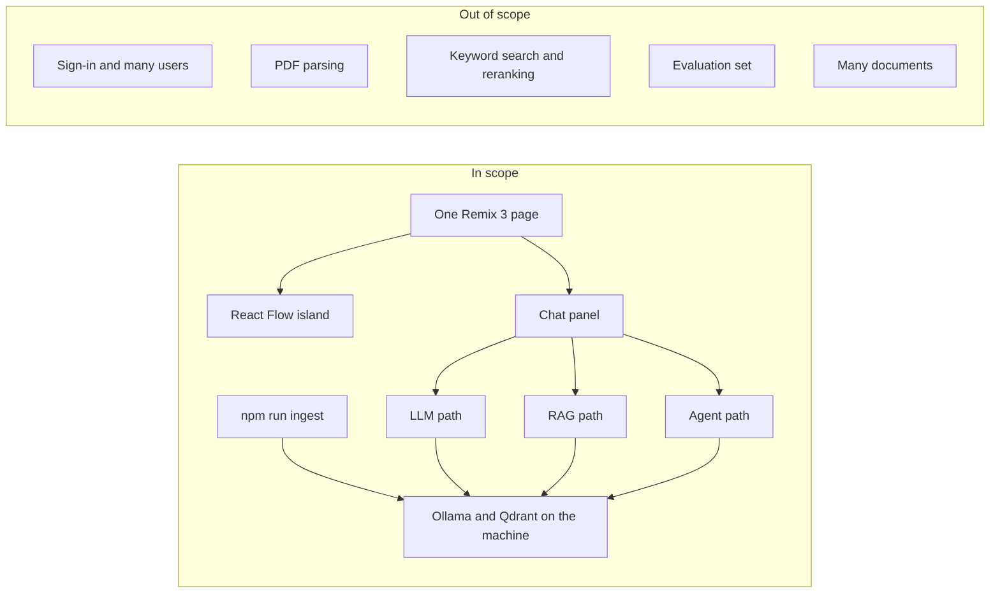

[Image of this diagram](diagrams/p01-d01-purpose-and-scope-the-boundary-of-the-proof.png)

#### The three paths

| Path | What the server does | Who answers | Measured, models loaded |
|---|---|---|---|
| LLM | Sends a short system prompt and the question to Ollama, streams the tokens back (header of `app/ai/chat.ts`) | `qwen3:1.7b`, from what it learned in training | First word 0.6 s, whole answer 4.2 s (`timings.txt`) |
| RAG | Embeds the question, asks Qdrant for the four closest passages, sends them with the question to the model, which names the section of each passage it uses (header of `chat.ts`; `RAG_SYSTEM_PROMPT` in `app/ai/rag.ts`) | `qwen3:1.7b` from four passages | Sources after 0.4 s, whole answer 16.3 s |
| Agent | Retrieves the three closest passages itself, gives the model the passages, the canvas's stages and three tools, and loops at most four rounds (header of `app/ai/agent.ts`) | `qwen3:1.7b`, which may call `highlight_node`, `search_docs`, `get_flow` | First event at once, whole answer 18.7 s and 46.3 s |

#### What was measured

One day, one machine. The README's figures and `docs/transcripts/timings.txt` are the same run of
25 October 2026, in production mode (`npm run start`) with the models loaded; `timings.txt`
records the first byte and the total time of each stream.

| What | Result | Source |
|---|---|---|
| Ingest | 25 passages in 6 chapters, embedded and stored in 9 s | README, Measured results |
| Retrieval, ten questions about the article | The right passage is among the four returned for 10 of 10, and first for 6 of 10 | README, Measured results |
| Passage size | 500 characters, chosen over 800, 1,200 and 1,500 by measuring the same ten questions | README, Measured results |
| LLM | "What is chunking in RAG?": first byte 0.616 s, total 4.169 s | `timings.txt` |
| RAG | The same question: first byte 0.442 s (the sources), total 16.261 s | `timings.txt` |
| Agent, Chunking selected | "Explain this step in one short paragraph.": first byte 0.016 s, total 46.281 s | `timings.txt` |
| Agent, no stage selected | "Where does the vector store fit in the pipeline?": first byte 0.013 s, total 18.655 s | `timings.txt` |
| Bad request | HTTP 400, total 0.016 s | `timings.txt` |
| Generation speed | `qwen3:1.7b` 11 to 13 tokens per second; `qwen2.5:3b` 6.7 | Carried over from the 24 October 2026 model comparison |
| Prompt processing | `qwen3:1.7b` 44 tokens per second; `qwen2.5:3b` 23 | The same comparison |
| Canvas, in a real browser | The nine stages render; a click on Chunking shows "About: Chunking"; the agent's tool lines and the highlight appear (headless Chrome driving the page) | README, Measured results |
| Checks | 86 tests in nine files; `typecheck`, `check:comments` and `remix doctor` clean | README, Measured results |

Model comparison, the one decision measured against an alternative (comment above `chatModel` in
`app/ai/config.ts`, 24 October 2026): with thinking off, `qwen3:1.7b` generates 1.7 times faster
and processes prompts 1.9 times faster than `qwen2.5:3b` on this CPU, with cleaner tool calls.
Thinking mode on costs three times the tokens, so it is off (comment on `chatThink` in
`config.ts`). A cold model's first word was not measured: every figure here has the models
already loaded.

### 1.3 For implementers

#### Where each proof point lives

| Proof point | Files |
|---|---|
| React inside Remix 3 | `app/actions/public/flow-island.tsx` renders the container and loads `app/actions/public/flow/flow-bundle.js`, built by `scripts/build-flow.ts` from `app/actions/public/flow/` (header of `flow-island.tsx`) |
| One endpoint, three modes | `app/ai/chat.ts` validates `{ mode, question, context }`, where `mode` is `llm`, `rag` or `agent`, and streams NDJSON; `app/actions/api/controller.tsx` exposes it as `POST /api/chat` (header of `chat.ts`) |
| The pipeline's elements | Chunking `app/ai/chunk.ts`; embedding and generation `app/ai/ollama.ts`; vector store `app/ai/qdrant.ts`; retrieval and prompt `app/ai/rag.ts`; onboarding `scripts/ingest.ts` (README, "The basic elements") |
| Agent | `app/ai/agent.ts`: `runAgent`, an async generator of `StreamEvent`, with `MAX_TOOL_CALLS` rounds and the tools `highlight_node`, `search_docs`, `get_flow` (header of `agent.ts`) |
| Local only | `app/ai/ollama.ts` over port 11434, `app/ai/qdrant.ts` over port 6335, `docker/compose.yml` for the container `remix3-rag-qdrant` (headers of `ollama.ts`, `qdrant.ts` and `compose.yml`) |
| The canvas's content | `app/fixtures/rag-pipeline.ts`: nine nodes and eight edges, shared by the page, `GET /api/graph` and the agent (header of the fixture) |
| Panel and canvas | `app/actions/public/chat-panel.tsx`, `app/actions/public/events.ts`, `app/actions/public/flow/` (README, "Project layout") |
| The corpus and its license | `data/rag-wikipedia.md`, `data/NOTICE.md` |

#### Conditions behind every number

Unless a row says otherwise: 25 October 2026, Intel i7-6600U, 2 cores, 32 GB RAM, CPU only;
`qwen3:1.7b` with thinking off, temperature 0, models already loaded (section 0.3). Production
mode, `npm run start`, is the measured mode: in development mode the file watcher stalls the
server and the stream arrives in bursts (README, "Quick start"). `timings.txt` states its own
conditions on its first line: 25 October 2026, production mode, `qwen3:1.7b`, thinking off,
temperature 0, model warm, 25 passages. How the first byte was captured is not written in that
file.

#### Known limits, with their files

- A 1.7-billion-parameter model makes mistakes. It sometimes cites a passage by its number
  instead of its section: the recorded RAG answer ends "(2)", and the recorded agent answer for
  Chunking says "section [1]", although the prompts ask for the section's name
  (`RAG_SYSTEM_PROMPT` in `app/ai/rag.ts`; `AGENT_SYSTEM_PROMPT` in `app/ai/agent.ts`). The
  sources list under each answer is what to trust (README, "Measured results").
- Answers can pad. The agent's answer about Chunking adds a second sentence that says chunking
  "is crucial for preparing the text", which none of the three passages says
  (`docs/transcripts/agent-chunking.ndjson`).
- The small agent decides one thing. Left to orchestrate three tools, the model searched in 11
  runs of 12 but highlighted in only 2 of 6 (header of `app/ai/agent.ts`), so the loop retrieves
  first and the model chooses only the stage to highlight. With that design both of this
  project's agent questions highlighted the right stage; two runs are a check, not a rate.
- A tool call the small model writes as JSON text, bare or inside `<tool>` tags, is detected and
  treated as a call, and its text is held back from the panel (`toolCallInText` in
  `app/ai/agent.ts`). How often it happens on this article was not counted.
- The retrieval check is small: ten questions, the right passage first for 6 and in the top four
  for 10 (README). The comment on `DEFAULT_MAX_CHARS` in `app/ai/chunk.ts` quotes another run, 7
  of ten first at 500 characters; this document uses the README's, which names its date.
- On the canvas, the edge from the vector store to retrieval takes a wide route around the
  question stage (`docs/images/03-agent-highlight.png`).
- The canvas is styled for the light color scheme only (`app/actions/public/flow/flow.css`).
- The server never writes to Qdrant; `scripts/ingest.ts` is the only writer, and the server's
  error "run npm run ingest" points to it (header of `ingest.ts`).

## 2. Concepts for every reader

### 2.1 For every reader

Twelve terms are enough to read the rest of this document. Each is explained in plain words, with
the project's own numbers as the example, and most of the examples come from one question asked
three ways: "What is chunking in RAG?" Every number names its source; "README" is the README at
the repository root, "the article" is `data/rag-wikipedia.md`, and `timings.txt` is
`docs/transcripts/timings.txt`. The streams quoted are the files of `docs/transcripts/`.

#### Language model

A language model is a program that, given some text, writes the text most likely to follow it.
Ask it a question and the likely continuation is an answer. It knows only what was in the texts it
was trained on, and it has no memory between requests unless the request carries the earlier
conversation. The project's model is `qwen3:1.7b`, run by Ollama on the machine's CPU; the name
says it has about 1.7 billion parameters, the numbers that make up the model. It writes 11 to 13
tokens per second here (section 1.2). Two settings matter. "Thinking off" stops the model from
writing its reasoning before the answer, which would cost three times the tokens (comment on
`chatThink` in `app/ai/config.ts`). "Temperature 0" makes it take the most likely token every
time, so the same question gives nearly the same answer; the measurements in this document were
taken that way (section 0.3). Asked "What is chunking in RAG?" with nothing else, the model
answers from training alone: "Chunking in RAG is the process of breaking down large text
documents into smaller, manageable pieces called "chunks."" (`llm.ndjson`). It sounds right, and
nothing shows where it came from.

#### Token

A token is the piece a model reads and writes: a short word, a piece of a longer word, a number
or a punctuation mark. Speeds and limits are counted in tokens, not words. The stream of that
answer shows it: "Chunking" arrives as two tokens, "Chunk" and "ing", and "RAG" as "R" and "AG"
(`llm.ndjson`); the whole answer is 43 tokens. The model reads a prompt at 44 tokens per second
(section 1.2), which is why a long prompt is the slow part of every answer here. The article
itself is about 10 KB, roughly 2,500 tokens by an estimate, not a tokenizer count.

#### Context window

The context window is the most tokens a model can hold at once: the instructions, the question,
any passages given to it, and the answer it is writing. Whatever does not fit is not read. The
project sets it to 4,096 tokens (`numCtx` in `app/ai/config.ts`). The article, at roughly 2,500
tokens, would fit in that window, and this is worth saying plainly: the article is short, and
RAG is built for documents that do not fit. The project cuts and searches it anyway, as a real
system must, and the pipeline then does a second job that even a short article shows: the model
reads four passages of about 400 tokens in all instead of 2,500 tokens, and at 44 tokens per
second that is the difference between a 16.3 s answer and one that would wait about 57 s to
begin (arithmetic from the figures above, not a measurement).

#### Embedding and vector

An embedding model reads a text and returns a list of numbers, a vector, that stands for its
meaning. Texts that mean similar things get vectors that are close together; unrelated texts get
vectors far apart. The project's embedding model, `nomic-embed-text`, returns 768 numbers for
each text (`app/ai/config.ts`). For a passage it reads the chapter's name, then the passage:
for the Chunking passage, `search_document: Improvements`, a new line, then "### Chunking" and
its sentence; for a question it reads `search_query: ` and the question (`documentInput` and
`queryInput` in `app/ai/rag.ts`). The prefixes are what the model was trained with, one for
documents and one for queries. Embedding all 25 passages and storing them took 9 s, about a third
of a second for each (README, Measured results). The model reads at most 2,048 tokens of a text
(`docs/notes-rag-and-frameworks.md`); the longest passage here is 945 characters, far below
that, so no passage is cut. A single
vector for the whole article would be another matter: at roughly 2,500 tokens the article is over
that window, and one vector would stand for the whole article and for no particular question.

#### Vector database

A vector database stores vectors with the text and facts they belong to, and answers one question
fast: which stored vectors are closest to this one? The project uses Qdrant 1.20.0 in a Docker
container, `remix3-rag-qdrant`, on host port 6335 (`docker/compose.yml`). Its collection
`rag-article` holds 25 points, one per passage, compared by cosine distance, a measure of the
angle between two vectors (`app/ai/qdrant.ts`). The closer the angle, the higher the score. For
the question "What is chunking in RAG?" it returned four passages with scores from 0.682 down to
0.654, and sources appeared on screen 0.4 s after the question was sent (`rag.ndjson`;
`timings.txt`). Those scores are close together, which is itself a lesson: with a small
article and a small embedding model, the right passage is often near the top rather than at it.

#### Passage

A passage is one slice of the article, the piece the search works with; the code calls it a
chunk.
It is a run of consecutive lines kept with five facts: its id, its chapter, its heading, its
first and last line, and its text exactly as written. The chapter is the title of the `##`
heading above it, and the heading is the nearest `##` or `###` heading, so a passage under
"Chunking" inside "Improvements" has chapter "Improvements" and heading "Chunking".

The worked example is the Chunking passage, `improvements-9`: lines 69 to 71 of the article, 129
characters, the line "### Chunking", a blank line, and one sentence, "Chunking involves
various strategies for breaking up the data into vectors so the retriever can find details in
it." It is cited as "Improvements, Chunking, lines 69-71" (`cite` in `app/ai/rag.ts`). The
article gives 25 passages in 6 chapters, cut at 500 characters. The median is 384 characters,
the shortest 91 (`improvements-1`, the one sentence under "Improvements") and the longest 945
(`rag-and-llm-limitations-1`, a single paragraph, kept whole because a passage never breaks
inside a paragraph); seven passages are over 500 for that reason (counted from the chunker's
output on the article). A passage never crosses a `##` or `###` heading, and a heading stays
with the paragraph under it, so each passage names exactly one section. The short Chunking
passage is not a flaw: it is one idea with its own heading, and cutting it into a longer
passage with its neighbors would have labeled the neighbors' text with its heading, or the other
way round. Why not one vector for the whole article? Because a vector stands for one meaning,
and an article of six chapters has several. Why not larger passages? The size was chosen by
measuring ten questions at 500, 800, 1,200 and 1,500 characters; at 500 the right passage was in
the top four for 10 of 10 and first for 6 of 10 (README, Measured results).

#### Retrieval-augmented generation

Retrieval-augmented generation, RAG, is the way a model answers from documents it was never
trained on. The question is embedded; the vector database returns the passages closest to it;
those passages are placed in the prompt with the question; the model answers from them and says
where it read each thing. The project sends the four closest passages (`ragLimit` in
`app/ai/config.ts`). Four, not twenty, because every passage is prompt text the model must read
at 44 tokens per second.

The recorded run is the example. For "What is chunking in RAG?" Qdrant returned, best first,
`rag-and-llm-limitations-2` (0.682), `improvements-9`, the Chunking passage (0.679),
`process-2` (0.655) and `retrieval-augmented-generation-2` (0.654): the right passage is among
the four but not first. The model answered from them: "Chunking in RAG involves breaking up the
data into vectors so the retriever can find details in it. This is done to improve the retrieval
process and make it easier for the model to access relevant information. (2)". The first
sentence is the Chunking passage almost word for word, and the citation "(2)" points at it by
number, where the prompt asked for the section's name: a weakness of a small model (section
1.3). Measured end to end, the four sources appeared after 0.442 s and the answer completed
after 16.261 s (`timings.txt`). The wait is the prompt, by arithmetic: 45 tokens written at 11
to 13 per second take about 3.5 to 4 s, leaving about 12 s of reading, which at 44 tokens per
second is about 500 tokens, the four passages (1,542 characters) and the instructions.

#### Agent and tool calling

Tool calling lets a program offer a model a list of functions, each with a name and parameters,
and lets the model ask for one to be run instead of answering. The program runs it, returns the
result as a message, and asks the model again. An agent is that loop: ask, run tools, ask again,
until the model answers. The project's agent has three tools, `highlight_node`, `search_docs`
and `get_flow`, and runs at most four rounds of tools (`MAX_TOOL_CALLS` in `app/ai/agent.ts`).
Because a small model orchestrates three tools badly, measured as searching in 11 runs of 12 but
highlighting in only 2 of 6 (header of `agent.ts`), the loop does the retrieval itself and
leaves the model one decision: which stage of the canvas the question is about.

The recorded run for "Where does the vector store fit in the pipeline?" shows it. The loop
announced `search_docs` and found three passages; the model then called `highlight_node` with
the id `vector-store`; the canvas lit that stage; and the model answered that the vector store
comes after the embedding step and stores the passages' embeddings for the retrieval step
(`agent-vector-store.ndjson`). The whole answer took 18.7 s, and the first event, the search
announcement, arrived after 0.013 s (`timings.txt`).

#### Streaming

Streaming means sending the answer as it is produced instead of waiting for the end. The
project's server answers with one JSON object per line, a format called NDJSON, and each line is
an event: a `token` of text, the `sources` found, a `tool` the agent called, a `ui` action for
the canvas, `done`, or `error` (`StreamEvent` in `app/ai/types.ts`). The panel redraws after
every line. The recorded LLM answer is 43 `token` lines and a last line, `{"type":"done",
"model":"qwen3:1.7b","ms":4163}`; the first byte arrived at 0.616 s and the whole answer at
4.169 s (`timings.txt`), so the reader was reading for most of the wait. Streaming also makes
Stop possible: the browser abandons the request, and the server tells Ollama to stop generating
(headers of `app/ai/chat.ts` and `app/actions/public/chat-panel.tsx`).

#### Server rendering and hydration

Server rendering means the server builds the page's HTML and the browser can show it at once,
before any script runs. Hydration is the second step: the browser loads the page's scripts and
attaches behavior to the HTML already on screen, so a button starts to react and a panel starts
to listen. In the project, Remix renders `app/actions/page.tsx` on the server with the canvas's
nine stages as data, and two components then hydrate in the browser: the chat panel and the
island (headers of `page.tsx`, `chat-panel.tsx` and `flow-island.tsx`).

#### Island

An island is a region of a page that one framework hands over to another. Remix renders an empty
container on the server; in the browser, once the container is in the document, the island loads
a bundle holding React, React Flow and the canvas, 396 kB in the build of 25 October 2026
(printed by `npm run build:flow`), and asks React to take over the inside of the container; Remix
is told to leave those children alone (header of `app/actions/public/flow-island.tsx`). The
island and the chat panel never share state. They talk through two ordinary browser events: the
canvas announces a click on a stage such as Chunking, and the panel asks for a highlight (header
of `app/actions/public/events.ts`).

#### Remix 3 against React

React is a library for building a page from components whose state lives in hooks; React Flow,
the canvas, is written for it. Remix 3 is a web framework built on web standards without React:
it has its own component model, in which a component owns real DOM elements and uses no React
hooks (README, "How it works, in short"; `AGENTS.md`). The two cannot share one component tree,
which is why React lives only inside the island's bundle. The bundle exists for a second reason:
React 19 ships only CommonJS modules and Remix's asset server serves ES modules only, so esbuild
packs React and the canvas into one file before the server starts (header of
`scripts/build-flow.ts`). Remix 3.1.0 needs Node 24.3 or later (`engines` in `package.json`).

### 2.2 How it works

The twelve terms meet in one path, the RAG answer, shown here with the recorded question and the
measured numbers (sections 1.2 and 2.1).

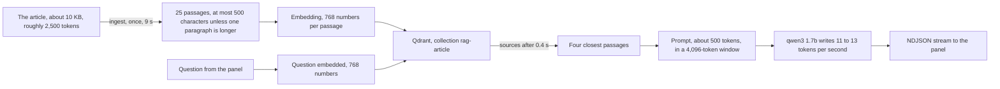

[Image of this diagram](diagrams/p02-d02-concepts-for-every-how-it-works.png)

The agent path adds the tool loop between the prompt and the stream, and the LLM path skips the
left half entirely: the question goes straight to the model. The island and hydration are the
page around all three paths, not part of any of them. The prompt size in the diagram is the
arithmetic of section 2.1, not a count.

| Number | Meaning | Source |
|---|---|---|
| 1.7 billion | Parameters of the chat model, from its name `qwen3:1.7b` | `app/ai/config.ts` |
| 4,096 | Tokens in the context window | `numCtx`, `app/ai/config.ts` |
| 768 | Numbers in one embedding | README, Quick start; header of `rag-pipeline.ts` |
| 2,048 | Most tokens the embedding model reads of one text | `docs/notes-rag-and-frameworks.md` |
| 25 | Passages in the vector database, across 6 chapters | README, Measured results |
| 500 | Characters a passage aims for; median 384, shortest 91, longest 945 | `DEFAULT_MAX_CHARS`; counted from the chunker |
| 4 | Passages per RAG answer; the agent's search returns 3 | `ragLimit`; `SEARCH_LIMIT` in `agent.ts` |
| 44 | Tokens per second of prompt processing | Section 1.2 |
| 11 to 13 | Tokens per second of generation | Section 1.2 |
| 6 | Event types in the stream: token, sources, tool, ui, done, error | `StreamEvent`, `app/ai/types.ts` |
| 396 kB | The island's bundle | `npm run build:flow`, 25 October 2026 |

### 2.3 For implementers

This part defines terms and stops there. The types behind them are in `app/ai/types.ts`
(`ChatRequest`, `StreamEvent`, `Chunk`, `Source`, `FlowGraph`); the cutting rules in
`app/ai/chunk.ts`; the retrieval in `app/ai/rag.ts`; the loop in `app/ai/agent.ts`; the stream in
`app/ai/chat.ts`; the island in `app/actions/public/flow-island.tsx`. The settings that name the
numbers above (models, window, passage size, passages per answer) are all in `app/ai/config.ts`,
each with an environment variable. The later parts go deeper: part 5 for the infrastructure,
part 8 for the recorded streams, part 12 for the tests, parts 14 and 15 for the decisions and
their evidence (section 0.1).

## 3. Use cases

### 3.1 For every reader

Two people use the project. The operator installs and starts it: Node, Ollama, the Qdrant
container, the article's onboarding. The user sits at the browser, asks questions in one of three
modes, clicks stages on the canvas, and stops answers that run long. A third actor is the agent
itself, which acts on the page by lighting up a stage. Ten use cases cover everything the project
does; each one names its actor, what must be true before it starts, the steps, what the user sees
on screen and what happens when something goes wrong. Every number comes from the README, from
`docs/transcripts/timings.txt` (both from 25 October 2026) or from the file headers named in the
steps. Where a case was never measured, it says so.

The examples are the recorded ones: the question "What is chunking in RAG?" in LLM and RAG
modes, the stage Chunking selected on the canvas, and the question "Where does the vector store
fit in the pipeline?" in agent mode.

| Use case | Actor | Measured |
|---|---|---|
| UC-1 Onboard the document | Operator | 25 passages in 6 chapters, 9 s (README) |
| UC-2 Ask the LLM | User | 0.616 s to first byte, 4.169 s total (timings.txt) |
| UC-3 Ask the RAG | User | 0.442 s to the sources, 16.261 s total (timings.txt) |
| UC-4 Ask the agent | User | 18.655 s and 46.281 s total, two runs (timings.txt) |
| UC-5 Give the assistant a stage as context | User | Chip "About: Chunking" seen in headless Chrome (README) |
| UC-6 The agent highlights a stage | Agent | Two highlights in two questions, both the right stage (README) |
| UC-7 Stop an answer | User | Not measured |
| UC-8 Re-onboard after the document changes | Operator | Same path as UC-1, 9 s |
| UC-9 Start and stop the platform | Operator | Cold model not measured |
| UC-10 Change the model | Operator | `qwen3:1.7b` against `qwen2.5:3b` (config.ts comment) |

### 3.2 How it works

Paths are relative to the repository root. The three question cases share one path through the
server.

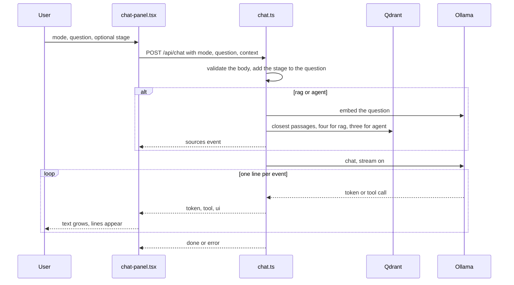

[Image of this diagram](diagrams/p03-d03-use-cases-how-it-works.png)

#### UC-1 Onboard the document

Actor: the operator.

Preconditions: Node 24 active (`.nvmrc` says 24.22.1); Ollama answering on port 11434 with
`nomic-embed-text` pulled; the Qdrant container running on port 6335; `npm install` done
(README, Quick start). The document is the one file `app/ai/config.ts` names as `corpusPath`,
`data/rag-wikipedia.md` unless CORPUS_PATH says otherwise (header of `scripts/ingest.ts`).

Main flow:

1. From the repository root, the operator runs `npm run ingest` (README, Quick start).
2. `scripts/ingest.ts` reads the article from disk (header of `scripts/ingest.ts`).
3. `app/ai/chunk.ts: chunkMarkdown` cuts the text into passages of about `config.chunkMaxChars`,
   500 characters: never across a `##` or `###` heading, a heading kept with the paragraph under
   it, a piece shorter than a quarter of the maximum joined to a neighbor inside the same
   heading, tables and fenced blocks whole, each passage with its 1-based line range (header of
   `app/ai/chunk.ts`). On the article the result is 25 passages in 6 chapters, the longest 945
   characters, one paragraph that a passage never breaks. The script prints that as its first
   line (`main` in `ingest.ts`).
4. It embeds the first passage alone, which proves Ollama and the embedding model are there and
   tells the vector size, 768. Only then does it drop the collection `rag-article` and create it
   again with that size (header of `ingest.ts`).
5. In batches of 16, so two batches for 25 passages, it embeds the passages through
   `app/ai/ollama.ts: embed`, with the text prepared by `app/ai/rag.ts: documentInput`, the same
   function that defines what the search looks for, and writes each batch with
   `app/ai/qdrant.ts: upsert`, cosine distance.
6. It counts the points and compares the count with the passages (header of `ingest.ts`).

What the operator sees: a line with the passage count, the chapters and the longest passage;
the line "embedding with nomic-embed-text"; the line that recreates the collection with its
dimensions; one progress line per batch, "16/25" and "25/25" with the seconds so far; and a last
line that starts "done:". The whole run took 9 s on this CPU (README, Measured results).

Failure paths:

- Ollama or Qdrant not running: the first failed call throws, and the script prints
  "ingest failed: ..." to stderr and exits with 1 (end of `ingest.ts`). Ollama is asked before the
  collection is dropped, so a missing Ollama leaves the old collection alone; a failure in the
  middle of the batches leaves it half filled, and the cure is to run again.
- The embedding model not pulled: Ollama's error says to pull it (`embed` in `app/ai/ollama.ts`;
  a case of `app/ai/rag.test.ts`).
- A wrong path in CORPUS_PATH: the error names the path and the variable (`ingest.ts`).
- Wrong Node version: Remix 3.1.0 needs Node 24.3 or later (`engines` in `package.json`).
- The stored count differs from the passage count: the script ends with an error that names
  both numbers (`ingest.ts`).

#### UC-2 Ask the LLM

Actor: the user.

Preconditions: the server started with `npm run start` and the page open at
`http://localhost:44100` (README, Quick start); Ollama running with `qwen3:1.7b`. Qdrant is not
needed for this mode (header of `app/ai/chat.ts`: `llm` is a plain call to the model).

Main flow:

1. The user picks the mode LLM and types a question in `app/actions/public/chat-panel.tsx`, for
   example "What is chunking in RAG?"
2. The panel posts `{ mode: 'llm', question, context }` as JSON to the href the page gave it,
   `POST /api/chat` (header of `chat-panel.tsx`; `app/actions/api/controller.tsx`).
3. `app/ai/chat.ts: isChatRequest` validates the body, which needs a known mode and a question
   with some text in it; a bad body gets status 400 (header of `chat.ts`).
4. `chat.ts` sends a short system prompt and the question to Ollama through
   `app/ai/ollama.ts: chat` with streaming on.
5. Every chunk Ollama returns becomes one `token` line of NDJSON, written by
   `chat.ts: toNdjson`; the panel's `receive` reads the body line by line and appends the text to
   the answer (headers of `chat.ts` and `chat-panel.tsx`).
6. The stream ends with a `done` event that names the chat model and the milliseconds taken.

What the user sees: the answer grows token by token; a footer derived from `done` names the model
and the time. The recorded run is 43 `token` lines and a `done` with `"ms":4163`: first byte at
0.616 s, total 4.169 s (timings.txt; `docs/transcripts/llm.ndjson`). The answer comes from training
alone and cites nothing.

Failure paths:

- Ollama down or any error while answering: the stream ends with an `error` line instead of
  `done` (header of `chat.ts`), which the panel renders.
- A body that is not a request: 400, with `{"error":"Expected { mode: ..., question: string }"}`,
  in 0.016 s (timings.txt, `docs/transcripts/error-bad-body.ndjson`). That body is one plain JSON
  object, not a stream event, and the panel shows its reason in the answer.
- A cold model: the first question waits while Ollama loads the model; not measured.
- Development mode: the file watcher stalls the server and the answer arrives in bursts; demo in
  production mode (README, Quick start).

#### UC-3 Ask the RAG

Actor: the user.

Preconditions: UC-2's, plus the Qdrant container running and UC-1 done at least once.

Main flow:

1. The user picks the mode RAG and types a question; the panel posts `{ mode: 'rag', ... }` as
   in UC-2.
2. `app/ai/rag.ts: retrieve` embeds the question with `nomic-embed-text` through
   `app/ai/ollama.ts: embed`, with the prefix `search_query: `, and asks Qdrant through
   `app/ai/qdrant.ts: search` for the closest passages; the count is `config.ragLimit`, four
   (header of `chat.ts`).
3. `chat.ts` emits one `sources` event with the passages, each with its chapter, heading, lines
   and score.
4. `rag.ts: buildRagMessages` builds the prompt: the instructions, then the passages numbered
   "[1] Improvements, Chunking, lines 69-71:" followed by the text, then the question; `chat.ts`
   sends it to the chat model with streaming on.
5. Tokens stream as in UC-2; the model is asked to name the section of every passage it uses.

What the user sees: the answer, and under it the sources list with section, lines and score. For
"What is chunking in RAG?" the four sources appeared after 0.442 s and the answer completed after
16.261 s (timings.txt). Qdrant returned `rag-and-llm-limitations-2` (0.682), `improvements-9`
(0.679), `process-2` (0.655) and `retrieval-augmented-generation-2` (0.654), so the Chunking
passage was second, and the answer, built from it, ended "(2)" (`docs/transcripts/rag.ndjson`).
The wait is the prompt: about 500 tokens read at 44 tokens per second (arithmetic, section 2.1).

Failure paths:

- Collection missing because UC-1 never ran: the error says to run `npm run ingest` (`search`
  in `qdrant.ts`) and the stream ends with `error`.
- Qdrant down: the search fails with a message that says so; `error` line.
- The right passage is not always first: over ten questions it was among the four for 10 and
  first for 6 (README). The model reads all four, so the answer usually survives; the sources
  list is where to check.
- A question the article does not answer: the prompt tells the model to say so, and whether a
  1.7-billion-parameter model always does was not measured.
- Everything in UC-2's list.

#### UC-4 Ask the agent

Actor: the user.

Preconditions: UC-3's.

Main flow:

1. The user picks the mode Agent and types a question; the panel posts `{ mode: 'agent', ... }`.
2. `chat.ts` hands the request to `app/ai/agent.ts: runAgent`, an async generator of events
   (header of `chat.ts`).
3. `runAgent` first yields a `tool` event for `search_docs`, then retrieves the three closest
   passages itself with `app/ai/rag.ts: retrieve` and yields a `sources` event (header of
   `agent.ts`; `SEARCH_LIMIT`).
4. It builds the system prompt with the nine stages of the canvas, described as text by
   `describeFlow` from `app/fixtures/rag-pipeline.ts`, and sends it to the model with three
   tools: `highlight_node`, `search_docs`, `get_flow`.
5. Each round the model either answers, and its tokens stream, or asks for tools. A tool call is
   run, emitted as a `tool` event, and for `highlight_node` also as a `ui` event; its result is
   appended as a tool message and the loop goes round again.
6. After `MAX_TOOL_CALLS` rounds with tool calls, four, one last round without tools makes the
   model answer with what it has.
7. A call the model writes as JSON text, bare or in `<tool>` tags, is detected by
   `toolCallInText`, treated as a call and held back from the panel.

What the user sees: tool lines such as "called search_docs: ..." and "called highlight_node:
vector-store", the answer, and the sources. The first event arrives at once, 0.013 s and 0.016 s
in the two runs. The two recorded runs took 18.655 s ("Where does the vector store fit in the
pipeline?", 43 tokens) and 46.281 s ("Explain this step in one short paragraph." with Chunking
selected, 59 tokens); why the second took so much longer was not measured. Its question was
longer, since the stage's description is added to it (UC-5).

Failure paths:

- Padding: the Chunking answer ends with a sentence the passages do not support, and cites
  "section [1]" by number (`docs/transcripts/agent-chunking.ndjson`).
- Text-written calls: how often they happen on this article was not counted; if one escaped
  detection it would show as text in the answer.
- UC-3's list.

#### UC-5 Give the assistant a stage as context

Actor: the user.

Preconditions: the page hydrated, so the canvas is mounted and the panel is listening.

Main flow:

1. The user clicks a stage on the React Flow canvas in `app/actions/public/flow/`, for example
   Chunking.
2. The canvas dispatches the browser event `ui:node-selected` on `document` with the stage's id,
   label and description (`app/actions/public/events.ts`).
3. The panel's `onNodeSelected` handler shows a chip above the input, "About: Chunking", with a
   close button that forgets the stage (header of `chat-panel.tsx`).
4. The next question is posted with that stage as `context.selectedNode` in the `ChatRequest`,
   and the chip goes away: the context is used once.
5. The server, in `chat.ts: withContext`, appends a sentence to the question, in parentheses:
   the user has selected the step "Chunking" in the canvas, followed by the stage's description.
   Every mode then sees it, with no schema, and the retrieval embeds the question together with
   that sentence.

What the user sees: the chip, then an answer about that stage. In the recorded run the question
was "Explain this step in one short paragraph." and the agent's search used the whole extended
text as its query; the Chunking passage came first, with a score of 0.749, against 0.679 when the
plain question was asked in RAG mode (`docs/transcripts/agent-chunking.ndjson`, `rag.ndjson`).
The context is only part of what changed between the two runs, so this is an observation, not a
measurement of the effect.

Failure paths:

- Neither component knows the other's framework; if the canvas bundle failed to load, no click
  can happen and the panel still works (header of `flow-island.tsx`).
- A stage selected and then not used stays in the chip until the next question or its close
  button.
- In a real browser, the click and the chip were seen in headless Chrome (README, Measured
  results).

#### UC-6 The agent highlights a stage

Actor: the agent, inside UC-4.

Preconditions: UC-4 running; the canvas mounted.

Main flow:

1. The model calls `highlight_node(id)` with the id of a stage (header of `agent.ts`). In the
   recorded runs it wrote `vector-store` and, for the other question, `Chunking`, the label
   rather than the id.
2. `highlightNode` in `agent.ts` finds the node by its id, or by its id or label in any case, so
   `Chunking` finds `chunking`. `runAgent` yields a `tool` event and
   `{ type: 'ui', action: 'highlight-node', nodeId: 'chunking' }`.
3. `chat.ts` writes both as NDJSON lines; the panel's `receive` forwards the `ui` event through
   `app/actions/public/events.ts: emitHighlightNode`, which dispatches `ui:highlight-node`.
4. The canvas in `app/actions/public/flow/` restyles that node with `applyHighlight`.

What the user sees: a tool line in the answer and the stage lit on the canvas. Both recorded
questions highlighted the right stage. They are not the same kind of proof: in the Chunking run
the user had already selected the stage, so the model repeated the user's choice; in the vector
store run nothing was selected and the model chose the stage from the question alone.

Failure paths:

- Before the loop was changed to one decision, the model highlighted in 2 runs of 6 (header of
  `agent.ts`). With the current loop a missed highlight has not been observed in two runs; more
  were not measured.
- An unknown id: the tool answers with the list of valid ids and lights nothing (a case of
  `app/ai/agent.test.ts`); an id that reaches the canvas and matches no node highlights nothing
  (`events.ts`).
- A question about no stage: the prompt asks for a highlight only when the question is about one
  of the stages; what the model does otherwise was not measured.

#### UC-7 Stop an answer

Actor: the user.

Preconditions: an answer streaming in any mode.

Main flow:

1. The user presses Stop in the panel.
2. The panel aborts the request's `AbortController`, one per request (header of
   `chat-panel.tsx`).
3. The abort reaches the server's request signal in `chat.ts`, which logs "[chat] ... request
   aborted by the client after N ms", then Ollama's connection, and generation stops (headers of
   `chat.ts` and `ollama.ts`).
4. The panel keeps the text received so far and writes "Stopped" in the answer's footer; the
   stream has no `done` line, since only a stream the client did not cancel ends with `done` or
   `error` (header of `chat.ts`).

What the user sees: the answer stops growing where it was. Not measured in time.

Failure paths:

- If the panel disconnects, its own signal aborts the request the same way (header of
  `chat-panel.tsx`).
- Whether Ollama frees the CPU at once after the abort was not measured.

#### UC-8 Re-onboard after the document changes

Actor: the operator.

Preconditions: UC-1's. A change to the article, to the chunking in `app/ai/chunk.ts`, to
`CHUNK_MAX_CHARS` or to the embedding model (header of `scripts/ingest.ts`).

Main flow:

1. The operator runs `npm run ingest` again.
2. The script drops the collection and fills it again, so the collection always mirrors the
   article.
3. Chunking is deterministic: the same text gives the same passages and the same ids (header of
   `app/ai/chunk.ts`). An id is the chapter's slug and the passage's number inside the chapter,
   such as `improvements-9`, so adding a passage early in a chapter renumbers the ones after it,
   and a citation of a passage by its id is only stable while the text before it is.

What the user sees: the same progress lines as UC-1, and afterwards sources with new line numbers
where the article moved. The measured cost of a run is 9 s for 25 passages (README); every run
starts from an empty collection, so a small change costs a full run, which on this article is
cheap.

Failure paths:

- While the run is in progress the collection is being rebuilt; a RAG or agent question in that
  window is not a measured case.
- A different article in CORPUS_PATH is a different corpus, with its own license; `data/NOTICE.md`
  covers only the Wikipedia article.
- UC-1's list.

#### UC-9 Start and stop the platform

Actor: the operator.

Preconditions: the one-time setup of the README's Quick start done: Node.js 24, Docker and
Ollama installed; `ollama pull qwen3:1.7b` (1.4 GB) and `ollama pull nomic-embed-text` (274 MB);
`npm install`; and UC-1 once. The setup was tested only on Windows 11 (section 0.5).

Main flow, start:

1. Make sure Ollama is running; it listens on port 11434 (`app/ai/config.ts`).
2. Start the container from the repository root: `docker compose -f docker/compose.yml up -d`,
   the container `remix3-rag-qdrant` on port 6335, with its data in the named volume
   `qdrant_data` (`docker/compose.yml`). It restarts with Docker Desktop and after a crash, and
   stays down only when stopped by hand.
3. Start the server: `npm run start`. Its pre-script builds the island's bundle first,
   `build:flow` through `scripts/build-flow.ts`, and `cross-env` then sets `NODE_ENV=production`
   so the same script runs on any system (`package.json`).
4. Open `http://localhost:44100` (README, Quick start).

Main flow, stop: stop the server from its terminal, which closes it cleanly (header of
`server.ts`); run `docker compose -f docker/compose.yml down`, which removes the container and
keeps the volume; quit Ollama (README, Quick start). The index stays in the volume, so stopping
the container does not call for a new UC-1; only `down -v` deletes the volume and then the
operator runs UC-1 again (`docker/compose.yml_README.md`).

What the user sees: the page with the canvas's nine stages and the empty panel. The first
question to a cold model waits while it loads; not measured.

Failure paths:

- A Qdrant you already run on port 6333 is never touched: this project uses host port 6335 and
  its own container name.
- A missing bundle breaks the canvas alone, not the page (header of `flow-island.tsx`).
- `npm run dev` works for coding but stalls the stream (README, Quick start); `npm run hmr` adds
  live browser updates (`AGENTS.md`).
- Checks after any structural change: `npm run typecheck`, `npm test`, `npx remix doctor` and
  `npm run check:comments` (`CLAUDE.md`).
- What happens after a reboot, with Docker Desktop and Ollama starting on their own, was not
  verified for this project.

#### UC-10 Change the model

Actor: the operator.

Preconditions: UC-9's. A second chat model pulled in Ollama; `qwen2.5:3b` is the one the
comparison used.

Main flow:

1. The operator pulls the model with Ollama.
2. The chat model's name is `config.chatModel`, read from the environment variable CHAT_MODEL
   when the server starts (`app/ai/config.ts`); the operator sets it and restarts the server
   (UC-9). Editing the file works as well. `config.ts` reads every setting once at load, so a
   change to `process.env` later changes nothing.
3. Thinking is a setting of the `qwen3` family only: CHAT_THINK=1 turns it on, and for any other
   model the field stays undefined and is left out of the request.
4. If the embedding model changes instead, EMBED_MODEL, UC-8 must follow, since the vectors in
   Qdrant were made by the old model and the question's vector must come from the same one
   (header of `app/ai/rag.ts`).

What the user sees: the footer of each answer names the model, from the `done` event. The
comparison on this CPU: `qwen3:1.7b` generates 11 to 13 tokens per second against 6.7 for
`qwen2.5:3b`, and processes prompts at 44 tokens per second against 23; its tool calls are
cleaner (section 1.2). For the RAG prompt of about 500 tokens, the arithmetic is about 11 s of
reading against about 22 s.

Failure paths:

- Model not pulled: Ollama fails the call and the stream ends with `error` (header of `chat.ts`).
- A larger model may answer better, but the 3-billion-parameter `qwen2.5:3b` already generated
  at 6.7 tokens per second here, so larger ones would be slower still; none was measured.
- Thinking mode on costs three times the tokens (comment on `chatThink`, `config.ts`).

### 3.3 For implementers

#### Files by use case

| File | Use cases |
|---|---|
| `scripts/ingest.ts` | UC-1, UC-8, UC-10 |
| `app/ai/chunk.ts` | UC-1, UC-8 |
| `app/ai/ollama.ts` | UC-1 to UC-4, UC-7, UC-10 |
| `app/ai/qdrant.ts` | UC-1, UC-3, UC-4, UC-8 |
| `app/ai/rag.ts` | UC-1 (`documentInput`), UC-3, UC-4, UC-10 |
| `app/ai/agent.ts` | UC-4, UC-6 |
| `app/ai/chat.ts` | UC-2 to UC-7 (`withContext` in UC-5), UC-10 |
| `app/ai/config.ts` | UC-1, UC-3, UC-8, UC-10 |
| `app/ai/types.ts` | the contract of every stream: `ChatRequest`, `StreamEvent`, `Source`, `FlowGraph` |
| `app/actions/api/controller.tsx` | `POST /api/chat` and `GET /api/graph` |
| `app/actions/page.tsx` | renders `ChatPanel` with `chatHref` and `FlowIsland` with the graph |
| `app/actions/public/chat-panel.tsx` | UC-2 to UC-7, UC-10 |
| `app/actions/public/events.ts` | UC-5, UC-6 |
| `app/actions/public/flow-island.tsx`, `app/actions/public/flow/` | UC-5, UC-6, UC-9 |
| `app/fixtures/rag-pipeline.ts` | the nine nodes and eight edges, UC-4 to UC-6 |
| `scripts/build-flow.ts`, `docker/compose.yml`, `server.ts`, `package.json` | UC-9 |

#### The contract between panel and server

The body is `{ mode, question, context }`, `mode` one of `llm`, `rag`, `agent` (`MODES` in
`app/ai/chat.ts`), `context` optional with `selectedNode`. The response is NDJSON, one
`StreamEvent` per line, of six types: `token`, `sources`, `tool`, `ui`, `done`, `error`. A stream
the client did not cancel always ends with `done` or `error`. Adding an event type touches
`app/ai/types.ts` first, then `chat.ts`, then a branch in the panel's `renderAssistant`, or the
event is kept and never shown (headers of `chat.ts` and `chat-panel.tsx`). `CHAT_TRACE=1` logs
every event with its time since the request (header of `chat.ts`), which is how a timing such as
those in `timings.txt` can be reproduced on the server side.

#### Edge cases the headers state

- `runAgent` reaches Ollama and Qdrant only through `AgentDeps`, so the tests run the loop with
  fakes and no service (header of `agent.ts`). The tool names are the names the model sees and
  the panel shows; renaming one changes the prompt, the tests and the panel together.
- The ingest batches 16 passages per embed call and per upsert, small enough for a progress line
  every few seconds on this CPU (`BATCH` in `scripts/ingest.ts`).
- Passage ids are deterministic, which is what lets a re-ingest replace points instead of adding
  them; Qdrant's point id is a UUID derived from the passage id (`pointId` in
  `app/ai/qdrant.ts`); the ingest drops the collection first anyway (header of `ingest.ts`).
- The stage descriptions in `app/fixtures/rag-pipeline.ts` quote numbers that `app/ai/config.ts`
  holds, the 500 characters, the 768 numbers and the four passages; when one changes, the
  description changes in the same edit (header of the fixture). They matter beyond the canvas:
  a click sends the description to the model (UC-5), and the agent reads all nine.
- The island fills a flex container with `minHeight` 420 px, never reads the graph again after
  mount, never imports React, and loads the bundle dynamically so a missing bundle breaks the
  canvas alone (header of `flow-island.tsx`).
- Everything under `app/actions/public/` is reachable from the browser; everything in `app/ai/`
  runs only on the server, so the browser never talks to Ollama or Qdrant.

## 4. Architecture overview

### 4.1 For every reader

The project is one web page, served by one program on the machine, with two helpers beside it.
Ollama runs the language model, the program that writes the answers, and a second, smaller model
that turns text into numbers. Qdrant keeps the passages of the article in a form that can be
searched by meaning, so the assistant can point to the right section. The browser shows the page:
on the left a diagram of the RAG pipeline, drawn with React Flow, with its two halves,
onboarding a document and then answering a question; on the right the assistant. A question typed
on the right goes to the program; the program asks Qdrant for passages when the mode calls for
it, asks Ollama for the answer, and sends the words back as they are written.

Five things run, all on one machine: the browser, the program (a Node process), Ollama, Qdrant
and Docker, which hosts Qdrant. Nothing leaves the machine and nothing needs a key. Two walls
organize the code. The first separates what runs on the server from what the browser may
download: the modules that talk to Ollama and Qdrant never reach the browser. The second
separates Remix, which owns the page, from React, which owns only the inside of the diagram.

### 4.2 How it works

#### 4.2.1 Context

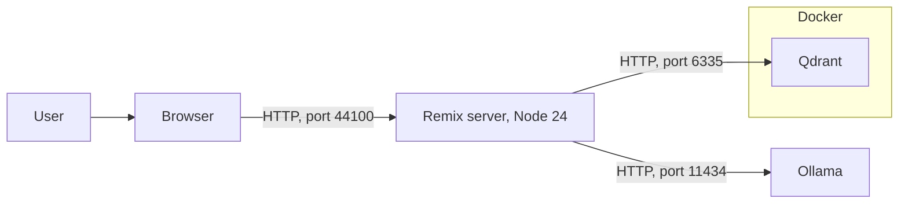

[Image of this diagram](diagrams/p04-d04-architecture-context.png)

The user talks only to the browser, the browser only to the server, and the server is the only
thing that talks to Ollama and Qdrant. Ollama and the server are ordinary programs of the host
system; Qdrant is a container that Docker runs. All four addresses are `localhost`
(`README.md`, Quick start; `app/ai/config.ts`). The project was tested only on Windows 11; part 5
has the platform note.

#### 4.2.2 The five processes and their ports

| Process | What it is | Port | Source |
|---|---|---|---|
| Browser | Opens `http://localhost:44100` and hydrates the two interactive components of the page | none of its own | `README.md`, Quick start |
| Remix server | Node 24 running `server.ts`, started by `npm run start` or `npm run dev` | 44100, or `PORT` | `server.ts` |
| Ollama | The model runner: a program that serves the chat model and the embedding model | 11434, or `OLLAMA_URL` | `app/ai/config.ts` |
| Qdrant | The vector database, the container `remix3-rag-qdrant` from the image `qdrant/qdrant:v1.20.0` | host 6335 to container 6333 | `docker/compose.yml` |
| Docker | Runs the container and brings it back after a restart of Docker (`restart: unless-stopped`) | none used here | `docker/compose.yml` |

`npm run hmr` adds a sixth process, for development only: `hmr.ts` is a proxy on 44100 that
runs `server.ts` as a child on 44102 and opens a browser update channel on 44101; the user still
opens 44100 (`hmr.ts`). `npm run start` is the mode for demos: in `npm run dev` the file watcher
makes answers arrive in bursts (`README.md`, Quick start).

#### 4.2.3 Components

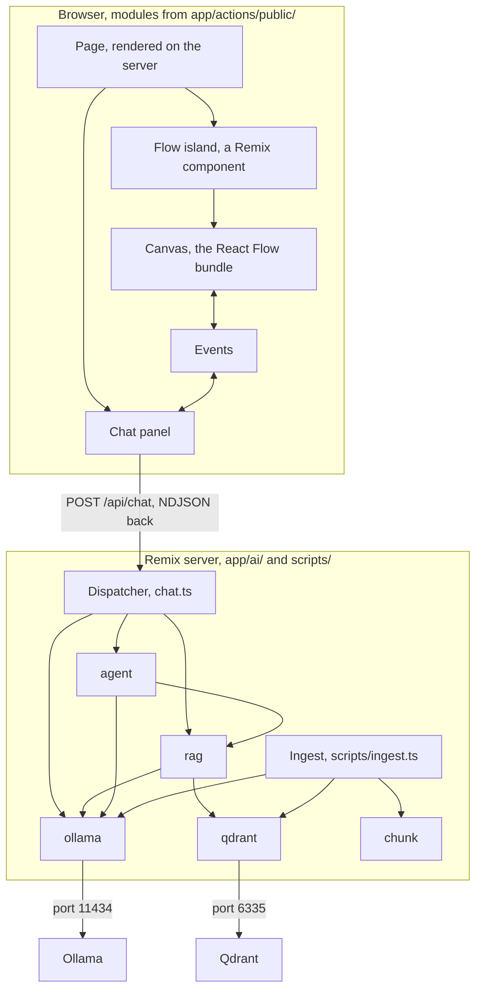

[Image of this diagram](diagrams/p04-d05-architecture-components.png)

In the browser (`README.md`, Project layout; the header of each file):

- **Page** (`app/actions/page.tsx`): a two-column grid, rendered on the server, that passes the
  graph and the chat endpoint down as props and reads no request and no environment. The left
  column carries the graph's title, "A RAG pipeline: onboarding a document, then answering a
  question", and the hint "Click a step to ask the assistant about it."
- **Chat panel** (`app/actions/public/chat-panel.tsx`): the three modes, the streamed answer,
  the sources and the Stop button.
- **Flow island** (`app/actions/public/flow-island.tsx`): a Remix component that renders an
  empty container on the server and, in the browser, loads the bundle and mounts the canvas in
  it.
- **Canvas** (`app/actions/public/flow/`): React and React Flow, one esbuild bundle of 396 kB
  (the build's own output line), nine nodes and eight edges (`app/fixtures/rag-pipeline.ts`).
  The nodes are Documents, Chunking, Embedding, Vector store, Question, Retrieval, Augmented
  prompt, Generation and Answer; the top row onboards a document, the bottom row answers a
  question, and one edge, "closest passages", joins the vector store to retrieval.
- **Events** (`app/actions/public/events.ts`): the DOM events between the island and the panel.
  A click on a node reaches the panel as "About: Chunking"; the agent's highlight reaches the
  canvas the same way (`app/actions/public/chat-panel.tsx`; `app/actions/page.tsx`).

On the server:

- **Dispatcher** (`app/ai/chat.ts`): reads the request, chooses `llm`, `rag` or `agent`, and
  writes the NDJSON stream; a bad body gets a 400.
- **ollama** (`app/ai/ollama.ts`): the only module that talks to Ollama, two calls over `fetch`:
  the streamed chat and the embeddings.
- **qdrant** (`app/ai/qdrant.ts`): the only module that talks to Qdrant: create or drop the
  collection, upsert, search, count.
- **rag** (`app/ai/rag.ts`): `retrieve`, which embeds the question and searches, and
  `buildRagMessages`, which puts the passages into the prompt (`app/ai/rag.ts`, Objective).
- **agent** (`app/ai/agent.ts`): `runAgent`, a tool loop of at most four rounds with
  `highlight_node`, `search_docs` and `get_flow`. It runs the retrieval first, so the model is
  left one decision, which stage to highlight, and calls the model through `ollama.ts`
  (`app/ai/agent.ts`, Objective).
- **chunk** (`app/ai/chunk.ts`): splits the Markdown of the article into passages.
- **Ingest** (`scripts/ingest.ts`): chunk, embed, recreate the collection, upsert
  (`package.json_README.md`, `ingest`).
- **Fixture** (`app/fixtures/rag-pipeline.ts`): the graph. The page draws it, `GET /api/graph`
  returns it, and the agent's system prompt lists its stages, so the three share one vocabulary.

#### 4.2.4 The two boundaries

**Server against browser.** Remix's asset server serves only what an allow list names
(`app/assets.ts`): `app/routes.ts`, every file under a `public/` folder in `app/`, and the
`remix` package; test files are denied. So everything in `app/actions/public/` may be downloaded
by the browser and nothing in `app/ai/` can: how Ollama and Qdrant are called stays on the
server, and a browser module that imported a server file would fail to load rather than leak it
(`app/assets.ts`, "Files outside the allow list are not served even if a browser module imports
them"). The one reference the island makes to `app/ai/` is an `import type`, erased before
anything is served (`app/actions/public/flow-island.tsx`).

**Remix against React.** Remix 3 is not React (`README.md`, How it works, in short).
`flow-island.tsx` is a Remix component: it never imports React and never sets the JSX pragma that
would switch its JSX to React (its header). React, React Flow and the canvas code travel as one
esbuild bundle, `app/actions/public/flow/flow-bundle.js`, built by `scripts/build-flow.ts` before
every start, because the asset server serves ES modules only and React 19 ships CommonJS
(`scripts/build-flow.ts`, Objective; `README.md`, Decisions in brief). Remix owns the container
`<div>`; React owns everything inside it, and Remix is told to leave those children alone
(`flow-island.tsx`, Objective).

#### 4.2.5 The one page

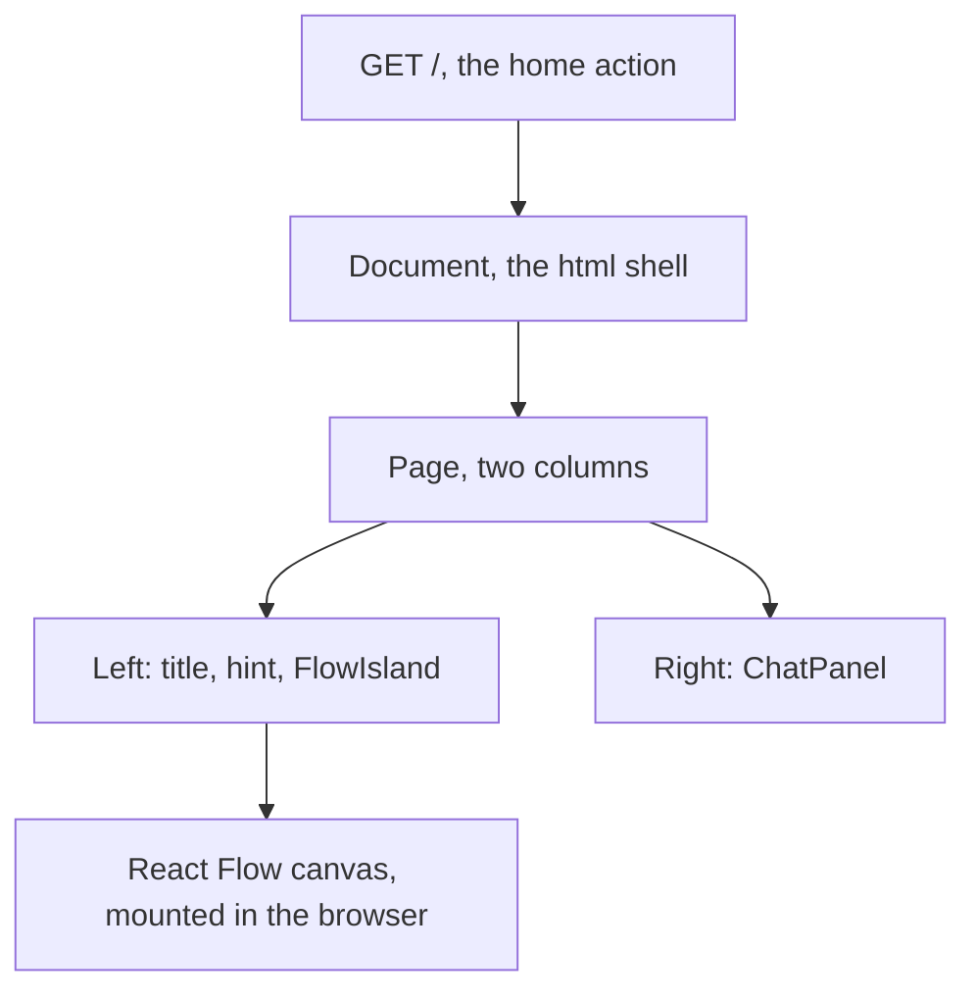

[Image of this diagram](diagrams/p04-d06-architecture-the-one-page.png)

`GET /` runs the `home` action of `app/actions/controller.tsx`, which renders `Page` with the
pipeline graph and the chat endpoint's href, `routes.api.chat.href()` (`app/actions/page.tsx`,
Consumers; `app/routes.ts`, Consumers). `Page` returns the whole document: `Document`
(`app/actions/document.tsx`) is the `<html>` shell with the import map, the preloads and the
entry script (`app/assets.ts`, Consumers); inside it, the left column holds the title, a hint
that selecting a step feeds the assistant, and `FlowIsland`; the right column holds `ChatPanel`
(`app/actions/page.tsx`). The island's stylesheet is linked only when it has been built
(`app/assets.ts`, `flowStyleHref`). In the browser, `app/actions/public/entry.ts` loads and the
two components that hydrate come alive: the panel and the island (`app/actions/page.tsx`;
`flow-island.tsx`, Consumers). Section 8.2.6 shows what the page looks like.

### 4.3 For implementers

#### 4.3.1 Request paths

| Request | Route key | Handled by | Source |
|---|---|---|---|
| any path that names a file under `./public` | none | `staticFiles('./public', { index: false })`, the first middleware | `app/router.ts` |
| `GET /` | `home` | `app/actions/controller.tsx`, renders `Page` | `app/routes.ts`; `app/actions/page.tsx` |
| `GET /assets/*path` | `assets` | `app/actions/controller.tsx`, answered by the asset server | `app/routes.ts`; `app/assets.ts` |
| `POST /api/chat` | `api.chat` | `app/actions/api/controller.tsx`, `handleChat` of `app/ai/chat.ts` | `app/ai/chat.ts`, Consumers |
| `GET /api/graph` | `api.graph` | `app/actions/api/controller.tsx`; the canvas's nodes and edges as JSON | `app/routes.ts`; `app/actions/api/controller.tsx` |

The order is the order of `app/router.ts`: the static middleware, then the render middleware
that gives actions `context.render`, then the two maps. Routes are declared once in
`app/routes.ts`, which is on the allow list, so the browser builds hrefs from the same map
instead of typing paths. The agent's `get_flow` tool describes the same graph, but it reads the
fixture directly through its default dependencies, not through `GET /api/graph`
(`app/ai/agent.ts`, `defaultDeps`).

#### 4.3.2 Start-up and shutdown

1. `server.ts` imports `app/router.ts`, which imports `app/assets.ts`. That module awaits at top
   level: the browser entry `app/actions/public/entry.ts` is built before the server listens
   (`app/assets.ts`, How it relates to them).
2. `flowStyleHref` is resolved once. When `flow-bundle.css` is missing the server warns once,
   `Flow island stylesheet unavailable, run "npm run build:flow"`, and the page renders without
   the link (`app/assets.ts`). The `pre` scripts of `dev`, `hmr` and `start` run the bundle build
   first, so this only happens when the server is started some other way
   (`package.json_README.md`, `scripts`).
3. `server.listen(port)` binds `PORT` or 44100 and logs
   `Server listening on http://localhost:44100` (`server.ts`).
4. SIGINT (Ctrl-C) or SIGTERM closes the listener and every open connection, then exits 0; a
   second signal does nothing (`server.ts`, `shutdown`).

Under `npm run hmr` the child gets `PORT=44102` and `HMR_PROXY_PORT=44100`, and the runner sets
`REMIX_NODE_HMR=1`, which makes `server.ts` trust the proxy's `X-Forwarded` headers and emit
ready; the proxy itself binds `127.0.0.1` only (`hmr.ts`; `server.ts`).

#### 4.3.3 The chat protocol

The panel posts `{ mode, question, context }` to `/api/chat` and reads one JSON event per line:
tokens, sources, tool calls, UI actions, `done` or `error` (`README.md`, How it works, in short;
`app/ai/chat.ts`). A body that is not a `ChatRequest` gets 400; any failure while answering
becomes an `error` line, so a stream the client did not cancel always ends with `done` or
`error` (`app/ai/chat.ts`). Stop aborts the request with an `AbortSignal`; the connection to
Ollama closes and Ollama stops generating (`app/ai/ollama.ts`). The event types live in
`app/ai/types.ts`; a new one is added there first, then in `chat.ts`, then in the panel
(`app/ai/chat.ts`, How it relates to them).

#### 4.3.4 Settings that shape the design

| Setting | Value | Why | Source |
|---|---|---|---|
| Context window | 4096 tokens | prompt processing is the slow part on this CPU | `app/ai/config.ts`, `numCtx` |
| Passage size | about 500 characters | one vector should mean one thing, and four passages stay inside the window | `app/ai/config.ts`, `chunkMaxChars` |
| Passages per RAG prompt | 4 | keeps the prompt short | `app/ai/config.ts`, `ragLimit` |
| Passages per agent search | 3, each cut to 1,200 characters | the agent's prompt also carries the nine stages | `app/ai/agent.ts`, `SEARCH_LIMIT`, `PASSAGE_LENGTH` |
| Temperature | 0 | at Ollama's default the model called `highlight_node` in 2 runs of 6 | `app/ai/config.ts`, `chatTemperature` |
| Thinking | off unless `CHAT_THINK=1`, Qwen 3 only | three times the tokens for a short answer | `app/ai/config.ts`, `chatThink` |
| Embedding dimension | 768 | `nomic-embed-text` | `app/fixtures/rag-pipeline.ts`; `README.md`, What it shows |
| Passages in the collection | 25, in 6 chapters | the whole article | `README.md`, Measured results; the ingest's summary line |
| Collection | `rag-article` | the one collection the ingest fills and the RAG searches | `app/ai/config.ts`, `collection` |
| Island bundle | 396 kB | React, React Flow and the canvas in one file | the build's own output line |
| Island height | at least 420 px | the island fills the flex container the page gives it | `flow-island.tsx`, How it relates to them |

The context window, the passage size, the passages per RAG prompt, the temperature and the
thinking switch each have an environment variable that overrides them (`NUM_CTX`,
`CHUNK_MAX_CHARS`, `RAG_LIMIT`, `CHAT_TEMPERATURE`, `CHAT_THINK`), read once when the server
starts (`app/ai/config.ts`, Objective). The passage count of 25 is the one measured with the default
size of 500 characters: another `CHUNK_MAX_CHARS` and a new `npm run ingest` give another count.

## 5. Infrastructure and its use cases

### 5.1 For every reader

Everything the project needs is installed on one machine, and all of it is free. Node runs the
program. Ollama runs the models: one that writes the answers, one that turns text into the
numbers the search compares, and a third kept only to compare speeds. Docker runs Qdrant, the
search database, in a container. The test machine has two processor cores, 32 GB of memory and no
graphics card the models could use, so the models are small and an answer arrives at about 12
tokens a second, where a token is a word or a piece of one. The data is easy to place: Qdrant
keeps its collection in a named Docker volume, so there is no folder to choose and no drive to
share with Docker, and Ollama keeps the models in its own folder.

The daily routine is short: check that Ollama and Docker are up, switch to Node 24, start the
program, open the page. This part spells that out for five situations: the first install, a
normal day, the morning after a reboot, running low on disk, and changing or adding a model.

**Platform note.** The project is meant to be platform-agnostic: it relies only on Node.js,
Docker and Ollama, which run on Windows, macOS and Linux, its scripts use `cross-env` instead of
a shell-specific prefix, and the Qdrant data sits in a named volume instead of a host path. But
it was **tested only on Windows 11**, on a 2-core CPU with no GPU. On macOS and Linux it should
work and nothing has been verified there: paths, Docker networking and Ollama's behavior may
differ (`README.md`, platform disclaimer). Every command in this part was run on Windows 11
unless it says otherwise.

### 5.2 How it works

#### 5.2.1 What is installed where

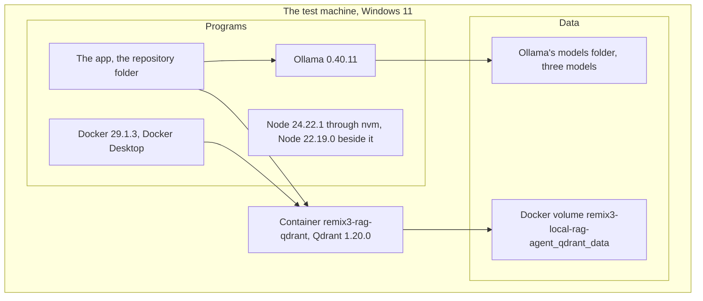

[Image of this diagram](diagrams/p05-d07-infrastructure-and-what-is-installed-where.png)

**Node.**

| Item | Value | Source |
|---|---|---|
| Version used | 24.22.1, installed with nvm-windows on 25 October 2026 | `nvmrc_README.md` |
| Version required | 24.3.0 or newer: Remix 3.1.0 needs it (`engines`) | `package.json_README.md` |
| Also installed | 22.19.0, the machine's default; `nvm list` shows both | `nvm list`, 25 October 2026 |
| Switch | `nvm use 24.22.1` before any npm command; `nvm use 22.19.0` to go back | `nvmrc_README.md` |
| Caveat | nvm-windows does not always read `.nvmrc`, so the command names the version; on macOS and Linux a bare `nvm use` reads it | `nvmrc_README.md` |

**Ollama.**

| Item | Value | Source |
|---|---|---|
| Version | 0.40.11, as `GET /api/version` answered on 25 October 2026 | `curl http://localhost:11434/api/version` |
| Port | 11434, or `OLLAMA_URL` | `app/ai/config.ts` |
| Models folder | Ollama's own default; the project never reads it | `app/ai/ollama.ts` |
| Server | must be running before the first question or the ingest; `ollama serve` in a terminal starts it when the desktop app has not | `app/ai/ollama.ts`, `describeNetworkError` |
| When idle | Ollama unloads a model after 5 idle minutes by default; the load time of a cold start was not measured here | Ollama's default; not measured |
| Hardware | CPU only | `README.md`, platform disclaimer |

**The three models.**

| Model | Role | Size on disk | Source |
|---|---|---|---|
| `qwen3:1.7b` | the chat model, the `CHAT_MODEL` default, thinking off | 1,359 MB | role `app/ai/config.ts`; size `GET /api/tags` |
| `qwen2.5:3b` | kept from the speed comparison; unused unless `CHAT_MODEL` names it | 1,930 MB | `app/ai/config.ts`; size `GET /api/tags` |
| `nomic-embed-text` | the embedding model, 768 dimensions, the `EMBED_MODEL` default | 274 MB | `README.md`, What it shows; size `GET /api/tags` |

Together about 3.6 GB, the sum of the three sizes. The README asks only for the first and the
third (`README.md`, Quick start).

**Qdrant.**

| Item | Value | Source |
|---|---|---|
| Version | 1.20.0, the image `qdrant/qdrant:v1.20.0`, pinned | `docker/compose.yml` |
| Compose project | `remix3-local-rag-agent`, set by the top-level `name:` of the file | `docker/compose.yml` |
| Container | `remix3-rag-qdrant`, service `qdrant` of `docker/compose.yml` | `docker/compose.yml` |
| Port | host 6335 to container 6333, Qdrant's REST API; gRPC 6334 not published | `docker/compose.yml` |
| Data | the named volume `qdrant_data`, mounted at `/qdrant/storage`; its real name is `remix3-local-rag-agent_qdrant_data` | `docker/compose.yml`; `docker volume ls` |
| Restart | `unless-stopped`: back after a crash and when Docker starts | `docker/compose.yml` |
| Neighbours | a Qdrant you already run on 6333 and 6334 is not touched: this one uses 6335 | `docker/compose.yml_README.md` |
| Content | the collection `rag-article`: 25 passages in 6 chapters, loaded in 9 s | `app/ai/config.ts`; `README.md`, Measured results |

**The test machine.**

| Item | Value | Source |
|---|---|---|
| CPU | Intel i7-6600U, 2 cores | `README.md`, Measured results; part 0.3 |
| Memory | 32 GB | `README.md`, Measured results |
| GPU | none usable; everything runs on the CPU | `README.md`, platform disclaimer |
| Generation | 11 to 13 tokens per second with `qwen3:1.7b`; 6.7 with `qwen2.5:3b` | measured 24 October 2026; the ratios are in `app/ai/config.ts` |
| Prompt processing | 44 tokens per second with `qwen3:1.7b`; 23 with `qwen2.5:3b` | the same measurement |
| Disk | models 3.6 GB; Qdrant volume 205.6 MB; Qdrant image 281 MB; `node_modules` 96 MB | `GET /api/tags`; `docker system df -v`; `docker image ls`; `du`, 25 October 2026 |
| Free disk space | not measured | |

#### 5.2.2 Use case: first install

Done once on the test machine, from the repository root (`README.md`, Quick start):

1. Node 24: `nvm install 24.22.1` if it is missing, then `nvm use 24.22.1`
   (`nvmrc_README.md`).
2. Ollama, from <https://ollama.com/download>. If `http://localhost:11434/api/version` does not
   answer, its server is not running: start the app or run `ollama serve` in its own terminal.
   Pull `qwen3:1.7b` and `nomic-embed-text`; `qwen2.5:3b` only for a comparison.
3. Docker running, then `docker compose -f docker/compose.yml up -d`. The first run creates the
   volume `qdrant_data`; there is no folder to prepare and no drive to share
   (`docker/compose.yml_README.md`).
4. `npm install`, then `npm run ingest`: 25 passages in 9 s on this CPU with the models loaded
   (`README.md`, Measured results).
5. Check: `npm run typecheck`, `npm test` (86 tests, part 12), `npx remix doctor` and
   `npm run check:comments` (`CLAUDE.md`, Rules).

#### 5.2.3 Use case: daily start

1. A terminal in the repository root: `nvm use 24.22.1`, then `node --version` to be sure.
2. Ollama: `curl http://localhost:11434/api/version`. Silence means the server is not running:
   start it, with `ollama serve` in its own terminal left open if the app does not.
3. Qdrant: with Docker running the container is already up, because of
   `restart: unless-stopped`; `curl http://localhost:6335/healthz` confirms it and answers
   `healthz check passed` (`docker/compose.yml_README.md`).
4. `npm run start`, which builds the island first, then open `http://localhost:44100`
   (`README.md`, Quick start; `package.json_README.md`, `prestart`).

Use `npm run start` for demos: in `npm run dev` the file watcher makes answers arrive in bursts
(`README.md`, Quick start). The first question after a long pause may wait while Ollama loads the
model again; that wait was not measured, because every timing in this document has the models
loaded. Ctrl-C stops the server (`server.ts`).

#### 5.2.4 Use case: after a reboot

The daily start, with three things that differ:

- Ollama's server may be down although its app is installed: check with the `curl` above and
  start it if it does not answer.
- Qdrant comes back on its own once Docker is running, unless the container was stopped by hand
  (`docker stop` or `docker compose stop`); then run `docker compose -f docker/compose.yml up -d`
  from the repository root (`docker/compose.yml_README.md`). Whether Docker Desktop starts at
  login on the test machine was not recorded.
- The machine's default Node is 22.19.0, so `nvm use 24.22.1` comes first (`nvm list`).

#### 5.2.5 Use case: disk space

| What | Where | Size | How to reclaim | Source |
|---|---|---|---|---|
| The three models | Ollama's models folder | about 3.6 GB | `ollama rm qwen2.5:3b` frees 1.9 GB; the app does not use it | sizes: `GET /api/tags` |
| Qdrant storage | the volume `remix3-local-rag-agent_qdrant_data` | 205.6 MB | `docker compose -f docker/compose.yml down -v`; `npm run ingest` fills it again | `docker system df -v`; `docker/compose.yml_README.md` |
| Qdrant image | Docker's own store | 281 MB | not exercised | `docker image ls` |
| `node_modules` | the repository folder | 96 MB | `npm install` recreates it | `du`; `package.json_README.md` |
| Island bundle | `app/actions/public/flow/` | 396 kB and 16 kB of CSS | `npm run build:flow` recreates it; git ignores it | the build's output line; `.gitignore` |

The vectors themselves take 77 kB (25 passages, 768 numbers of 4 bytes each); the rest of the
volume is Qdrant's own files. `down -v` is the only command here that deletes data, and the data
is rebuilt from `data/rag-wikipedia.md` in 9 s.

#### 5.2.6 Use case: upgrading or adding a model

- **Another chat model.** `ollama pull <name>`, then start the server with
  `CHAT_MODEL=<name>` in its environment (`app/ai/config.ts`). `CHAT_THINK` applies only to
  names that start with `qwen3`; other models never receive the field. No re-ingest. Expect a
  larger model to be slower: `qwen2.5:3b` generates 6.7 tokens per second against 11 to 13
  (measured 24 October 2026). A larger model would answer the agent's questions more evenly,
  but the 2-core CPU rules it out for now.
- **Another embedding model.** `ollama pull <name>`, set `EMBED_MODEL=<name>`, and run
  `npm run ingest` again: the vectors in Qdrant come from the model that embedded them, and the
  ingest recreates the collection (`package.json_README.md`). `rag.ts` adds nomic's task
  prefixes for `nomic-embed-text` (`app/ai/rag.ts`); check whether the new model wants them.
- **Another article, or another passage size.** Set `CORPUS_PATH` or `CHUNK_MAX_CHARS`, and run
  `npm run ingest`: it drops the collection and fills it again (`scripts/ingest.ts`). The
  descriptions of the canvas's stages say "about 500 characters" and "four passages", so they
  change in the same edit as the numbers (`app/fixtures/rag-pipeline.ts`, How it relates to
  them).
- **Qdrant.** Raise the image tag in `docker/compose.yml` on purpose and run `up -d` again.
  Qdrant migrates its storage forward; a newer version's storage may not open under an older
  one, so there is no way back without a new ingest (`docker/compose.yml_README.md`).
- **Node.** Any 24.x from 24.3.0 satisfies the app. `nvm install <version>`, then change
  `.nvmrc` and `nvmrc_README.md` together (`nvmrc_README.md`).
- **Ollama.** Not exercised after the install; the models stay in its models folder.

### 5.3 For implementers

Facts that cite a command (`nvm list`, `docker volume ls`, `GET /api/tags`) were read on the test
machine on 25 October 2026 while this document was written; the rest come from the code and the
sidecar files.

#### 5.3.1 Node and npm

- `engines` is `>=24.3.0`, and the project sets no `engine-strict`: under Node 22 `npm i`
  prints an `EBADENGINE` warning and continues, and the failure comes at run time
  (`package.json_README.md`).
- Node 24 runs a plain `.ts` file by stripping its types, which `npm run hmr` (`node hmr.ts`)
  relies on; `start` and `dev` use `--import remix/node-tsx` instead (`package.json_README.md`).
- npm runs each script with the system's default shell: `sh` on macOS and Linux, `cmd.exe` on
  Windows. The two disagree on `NODE_ENV=x command`, so `dev`, `hmr`, `start` and `test` begin
  with `cross-env`, which sets the variable itself and runs the rest of the command, the same
  way on every system. No `.npmrc` and no particular shell is needed (`package.json_README.md`,
  `scripts`).

#### 5.3.2 Ollama

- `app/ai/ollama.ts` is the only module that calls it: `POST /api/chat` streamed as NDJSON and
  `POST /api/embed`, over plain `fetch`, no SDK.
- `qwen3:1.7b` was chosen over `qwen2.5:3b` on measurements of 24 October 2026: 1.7 times faster
  generation, 1.9 times faster prompt processing, cleaner tool calls; thinking on costs three
  times the tokens (`app/ai/config.ts`, Objective).
- The RAG prompt of the transcript in part 8 is 2,235 characters, about 560 tokens at four
  characters per token, an estimate. At 44 tokens per second that is about 13 s of prompt
  processing, which is most of the 16.3 s the answer took (part 7).
- The embedding model's window is 2,048 tokens. The longest passage has 945 characters, far
  below it, so no passage is cut. Part 6 explains why the whole article would not fit.

#### 5.3.3 Qdrant and Compose

- `app/ai/qdrant.ts` is the only module that calls it, five REST calls over `fetch`; the
  collection is always `config.collection`, and callers never name it.
- The file sets the Compose project name, `name: remix3-local-rag-agent`. Without it Compose
  would name the project after the folder, `docker`, and a second stack kept in another folder
  called `docker` would share its containers; `up` would stop and recreate them
  (`docker/compose.yml_README.md`, `name`). The volume's real name is the project name, an
  underscore and `qdrant_data`.
- `"6335:6333"` is quoted because unquoted YAML 1.1 reads it as a base-60 number
  (`docker/compose.yml`).
- Nothing in the code reads the compose file; the app learns the port from `QDRANT_URL`, and
  the two must agree (`docker/compose.yml_README.md`).
- Health: `curl http://localhost:6335/healthz`; dashboard at `http://localhost:6335/dashboard`;
  logs with `docker compose -f docker/compose.yml logs -f` (`docker/compose.yml_README.md`).

#### 5.3.4 What breaks, from the sidecars

| Change | Effect | Source |
|---|---|---|
| Host port 6335 taken | `up` fails with "port is already allocated" | `docker/compose.yml_README.md` |
| Container port changed from 6333 | every request gets "connection reset" or an empty reply | `docker/compose.yml_README.md` |
| Volume renamed | Qdrant starts empty; the old volume stays where it was | `docker/compose.yml_README.md` |
| `down -v` | the volume is deleted; `npm run ingest` rebuilds it | `docker/compose.yml_README.md` |
| `name:` removed | the project is called `docker` and can share containers with another stack in a folder of that name | `docker/compose.yml_README.md` |
| `restart` removed | after a reboot Qdrant stays down; ingest and retrieval fail with "connection refused" | `docker/compose.yml_README.md` |
| Image tag floating | Qdrant upgrades on any `pull` without a decision | `docker/compose.yml_README.md` |
| `cross-env` removed from a script, on Windows | the script fails: `'NODE_ENV' is not recognized as an internal or external command`; on macOS and Linux it still works, which hides the problem | `package.json_README.md` |
| Node below 24.3 | `EBADENGINE` warning, Remix fails at run time, `node hmr.ts` fails | `nvmrc_README.md` |
| `react`, `react-dom` and their types at different versions | run-time errors in the island or type errors in `typecheck` | `package.json_README.md` |

## 6. The knowledge pipeline: onboarding a document

### 6.1 For every reader

The assistant answers questions about one article, a Markdown file of about 10 KB, roughly 2,500
tokens: the English Wikipedia article "Retrieval-augmented generation", at a pinned revision,
under CC BY-SA 4.0 (`data/rag-wikipedia.md`, `data/NOTICE.md`). Before it can do that, the
article is cut into **passages** and each passage is turned into a **vector**, a list of 768
numbers that places the passage's meaning as a point in a space where texts about the same thing
land close together (`README.md`, What it shows). This part is about that preparation, done once
by `npm run ingest`; the questions themselves are part 7.

A passage is one slice of the article: a run of consecutive lines, about 500 characters at most
(a short paragraph, some 80 words), kept together with where it comes from: its chapter, its
first and last line, and the nearest heading above it. "Chunk" is the usual word and the one the
code uses; the prose says "passage" for the same thing.

**Why the article is not one vector.** A vector stands for one text. Three facts follow, and the
second is weaker here than it would be for a long document:

1. One vector for the whole article would be an average of everything in it. The article has 13
   headed sections. Six are chapters: the introduction, RAG and LLM limitations, Process,
   Applications, Improvements and Challenges. Seven are sub-sections: RAG key stages, Encoder,
   Retriever-centric methods, Language model, Chunking, Hybrid search and RAG poisoning. That
   average would sit in the middle of all of them, and "What is chunking in RAG?" would be no
   nearer to it than "What is RAG poisoning?". A passage about chunking, by contrast, lands next
   to questions about chunking. One honest softening: all 13 sections are about one subject, so
   they are neighbours in the space and the average would be less lost than for a mixed
   document. How much less was not measured: the whole article was never embedded.
2. The limits of the models are a weaker argument here. The embedding model reads at most 2,048
   tokens of a text, and the article is about 2,500, so embedding it whole would drop about a
   fifth. If characters and tokens are spread evenly, the cut would fall near the start of the
   "Hybrid search" section (line 73), and that section and all of "Challenges" would not count
   in the vector; this is an estimate, the tokenizer was not run. The chat model's context
   window is 4,096 tokens (`app/ai/config.ts`, `numCtx`), so the whole article would fit in it,
   with about 1,600 tokens left for the instructions, the question and the answer. What rules it
   out here is time, not size: at 44 tokens per second (measured, part 5) processing 2,500
   tokens takes about 57 s per question, against about 13 s for the four-passage prompt of the
   transcript in part 8 (both derived). A second article of the same size, or a long document,
   would not fit at all.
3. An answer has to point somewhere. The panel shows "Improvements, Chunking · lines 69-71"
   because the thing that was found is a small, located piece. A document-level hit would say
   "it is in the article". This argument does not depend on the length of the text.

So for an article this short a plain RAG is not strictly necessary: a model with a larger window
could read all of it. The project keeps passages because it demonstrates the pipeline a corpus of
thousands of pages needs, where the limits in point 2 decide, and because points 1 and 3 hold at
any size.

**Why about 500 characters.** Two forces pull against each other: a smaller passage matches a
question more precisely, because its vector is about one thing; a larger passage gives the model
more context to answer from. The size was settled by measuring: the same ten questions about the
article were run at 500, 800, 1,200 and 1,500 characters, and 500 was chosen (`README.md`,
Measured results). At 500 the right passage is among the four returned for 10 of the 10
questions, and first for 6 of 10. The difference between sizes is a question or two out of ten,
so the choice rests on a small sample. A third force settles it on this machine: every passage
handed to the chat model is prompt text processed at about 44 tokens per second, so four passages
of 500 characters cost about 11 s of prompt processing, and four of 1,500 would cost about 34 s
(both derived, at four characters per token). That is why the RAG sends four passages, not
twenty, and why they are short.

**What a small passage costs.** Some passages are very short. The "Chunking" passage of the
worked example below is one sentence of 129 characters, and the model can say little more than
that sentence: the transcripts of part 8 show answers that repeat it and then pad.

**The other ways to split, and what production adds.** Fixed windows of N tokens with an overlap
between neighbours are the simplest and are blind to structure. Splitting by headings and
paragraphs, as this project does, keeps each passage a coherent piece and gives it a chapter and
a line range for free; there is no overlap here, the passages are disjoint line ranges. Smarter
schemes exist: "small-to-big", small passages for the search and their larger parent section for
the model; a short summary per passage embedded beside it; a hierarchy where a chapter-level
vector narrows the search before the passage-level one. Production services keep the same
passage idea and add the layers around it: parsers for PDFs and scans, tested chunk sizes with
overlap, a note per passage saying what it is about within the document, keyword search merged
with vector search, a reranker over more candidates, filters by user and permission, and an
evaluation set. The article itself names several of them under "Improvements": chunking, hybrid
search and reranking. `docs/notes-rag-and-frameworks.md` records the options already weighed,
and part 15 has the detail and the order in which they would be added.

### 6.2 How it works

The ingest is three stages: extraction (the article becomes passages), vectors (each passage
becomes 768 numbers), loading (each passage and its vector become one point in Qdrant).

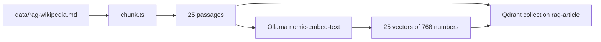

[Image of this diagram](diagrams/p06-d08-the-knowledge-how-it-works.png)

#### Extraction: the rules

The rules, from the header of `chunk.ts`:

- A passage never crosses a `## ` heading, so each belongs to exactly one chapter. The chapter
  is the nearest `## ` heading above; the heading line itself belongs to no passage.
- Nor does a passage cross a `### ` heading: a sub-section is its own run of passages, even a
  short one, named by its own heading, so a citation never labels text with the heading of its
  neighbour. A heading with nothing under it yields no passage.
- A heading stays with the paragraph under it: the `### ` line is the first line of its
  passage, and a passage never ends on a heading whose text starts the next one.
- A long group of text is cut at block boundaries into pieces of about 500 characters, balanced
  so that the last piece is not a crumb. The balancing and the crumb rule work inside one
  heading and never across two: nothing is ever merged across a heading.
- A table or a fenced block is never split, even when longer than the limit. Neither is a single
  paragraph: a passage never breaks inside a block. The article has no table and no fence, so
  here only paragraphs matter, and 7 of the 25 passages are single paragraphs longer than 500
  characters.
- Every passage keeps its 1-based line range, and its text is exactly those lines of the source.
- A section that is only a table of contents, lines of links to anchors, is skipped wherever it
  is. The text before the first `## ` heading is kept, under the document title, unless it is
  one; here it is the article's four introductory paragraphs, under "Retrieval-augmented
  generation".

#### Extraction: the algorithm, step by step

`chunkMarkdown` in `chunk.ts` does the following:

1. **Lines.** The text is split on `\n` or `\r\n`, so a Windows copy of the file cites the same
   line numbers as a Unix one. A measuring function is built once from prefix sums, so the length
   of any line range is known in constant time.
2. **Sections.** One pass cuts the article at every `## ` heading that is outside a fenced block;
   a `## ` inside a fence is code. The `# ` title cuts nothing but names the text before the
   first chapter; without a title that text is called "Preamble". Deeper headings cut nothing in
   this step. The article has five `## ` chapters, so with the introduction there are six
   sections.
3. **Table of contents.** A section whose content lines are, four in five or more, links to
   anchors in the same article, with no table or fence among them, is skipped. None is skipped
   here.
4. **Blocks.** The section is read into blocks, the units a passage never breaks: a paragraph, a
   top-level list item (a bullet, or a number of up to three digits followed by `.` or `)`), a
   whole table (consecutive lines starting with `|`), or a whole fenced block. A blank line
   separates blocks. A heading of level 2 or deeper opens a text block, so it travels with the
   text under it, and the blank line after it does not close that block. Every block remembers
   the nearest heading above it, and a block that opens a heading of level 2 or 3 is marked as a
   place to cut. An indented list item does not start a block, so a nested list stays with its
   parent item.
5. **Groups.** The blocks are grouped by heading: a new group begins at every block marked in
   step 4, which means at every `### ` heading, and the blocks before the first one, the lead-in
   under the chapter heading, form a group of their own. A group that is only a heading line,
   with nothing under it, is dropped. A heading of level 4 or deeper cuts nothing.
6. **Packing with the balanced target.** Inside each group the blocks are packed into pieces.
   The target is the group's length divided evenly into as few pieces of at most 500 characters
   as possible, so a 600-character group gives two pieces of about 300 rather than 500 and 100
   (`chunk.ts`, `pack`). A piece closes when the next block would push it past 500 or when it
   has already reached its share. A block longer than 500 is a piece of its own.
7. **Crumbs.** A piece shorter than a quarter of the limit, 125 characters, joins a neighbour
   of the same group: the previous piece when the result still fits in 500, else the next one
   when that fits, else the next one anyway (a one-line lead-in captions what follows), or the
   previous one at the end of the group. A crumb that is its group's only piece stays as it is,
   so a short sub-section remains a small passage of its own.
8. **Ids and ranges.** The chapter heading becomes a slug: lower case, accents removed, every
   run of other characters one hyphen; "RAG and LLM limitations" gives
   "rag-and-llm-limitations". A second chapter with the same slug gets "-2" appended. Pieces are
   numbered from 1 inside their chapter, across its sub-sections, so the id is
   `improvements-9`. Each passage carries its chapter, the heading of its first block, its line
   range, and the source lines joined with `\n`.

The result is deterministic: the same text gives the same passages and the same ids, which is
what lets a re-ingest replace points instead of adding them.

#### The worked example: `improvements-9`, the Chunking passage

The passage that the agent transcript of part 8 returns first, and the RAG transcript second,
for questions about chunking (`agent-chunking.ndjson`, `rag.ndjson`):

| Field | Value |
|---|---|
| `id` | `improvements-9` |
| `chapter` | `Improvements` |
| `heading` | `Chunking`, the `### ` sub-section the passage opens |
| `lines` | `[69, 71]`, three lines of `data/rag-wikipedia.md`: the heading, a blank line, one paragraph |
| `text` | 129 characters: `### Chunking`, a blank line, then `Chunking involves various strategies for breaking up the data into vectors so the retriever can find details in it.` |
| embedded as | `search_document: Improvements`, a newline, then the text above |
| point id | `fe10d58c-754a-53f3-962b-0892c195a43d`, computed with the algorithm of `qdrant.ts` |

How the algorithm arrived at it. The section under `## Improvements` is lines 39 to 75. Its
first block is the lead-in sentence on line 39, "Improvements to the basic process above can
be applied at different stages in the RAG flow." Then five `### ` headings follow: Encoder,
Retriever-centric methods, Language model, Chunking and Hybrid search. Step 5 cuts the section
into six groups at those headings. The Chunking group is the heading line, which opens a text
block and keeps it open across the blank line, and the one paragraph under it: one block, lines
69 to 71, 129 characters. The group's target is 129, so it is one piece. At 129 characters it is
just above the crumb threshold of 125; and as its group's only piece it would stay in any case.
The rule that nothing merges across a heading is what keeps it short: the neighbouring sections
are "Language model" and "Hybrid search", and the passage cannot borrow from either.

Numbering explains the 9. The pieces of "Improvements", in order, are: the lead-in (1, 91
characters, a group of its own and so left alone though it is below 125), three for Encoder
(2 to 4), two for Retriever-centric methods (5 and 6), two for Language model (7 and 8), this
one (9) and Hybrid search (10). The slug of "Improvements" is `improvements`, so this passage is
`improvements-9`. The id's number counts across sub-sections; the sub-section is in `heading`.

#### Extraction: the counts

| Measure | Value | Source |
|---|---|---|
| Article | 10,310 characters, 85 lines, about 2,500 tokens | `data/rag-wikipedia.md`; the token count is the project's estimate |
| Passages | 25 | `README.md`, Measured results; the ingest's summary line |
| Chapters | 6: the introduction and five `## ` chapters | the ingest's summary line |
| Sub-sections | 7 `### ` headings | `data/rag-wikipedia.md` |
| Passages per chapter | introduction 4, RAG and LLM limitations 2, Process 5, Applications 1, Improvements 10, Challenges 3 | the chunker run on the article, 25 October 2026 |
| Median length | 384 characters; mean 405 | the same run |
| Shortest | 91 characters, `improvements-1`, the lead-in of Improvements | the same run |
| Longest | 945 characters, `rag-and-llm-limitations-1`, one paragraph | the ingest's summary line |
| Longer than 500 characters | 7, all single paragraphs of 523 to 945 characters | the same run |

All 25 passages, in document order (the same run):

| id | chapter | heading | lines | characters |
|---|---|---|---|---|
| retrieval-augmented-generation-1 | Retrieval-augmented generation | Retrieval-augmented generation | 3-3 | 689 |
| retrieval-augmented-generation-2 | Retrieval-augmented generation | Retrieval-augmented generation | 5-5 | 621 |
| retrieval-augmented-generation-3 | Retrieval-augmented generation | Retrieval-augmented generation | 7-7 | 338 |
| retrieval-augmented-generation-4 | Retrieval-augmented generation | Retrieval-augmented generation | 9-9 | 213 |
| rag-and-llm-limitations-1 | RAG and LLM limitations | RAG and LLM limitations | 13-13 | 945 |
| rag-and-llm-limitations-2 | RAG and LLM limitations | RAG and LLM limitations | 15-15 | 436 |
| process-1 | Process | Process | 19-19 | 601 |
| process-2 | Process | RAG key stages | 21-23 | 356 |
| process-3 | Process | RAG key stages | 25-25 | 241 |
| process-4 | Process | RAG key stages | 27-27 | 339 |
| process-5 | Process | RAG key stages | 29-29 | 229 |
| applications-1 | Applications | Applications | 33-35 | 374 |
| improvements-1 | Improvements | Improvements | 39-39 | 91 |
| improvements-2 | Improvements | Encoder | 41-43 | 384 |
| improvements-3 | Improvements | Encoder | 45-47 | 422 |
| improvements-4 | Improvements | Encoder | 49-51 | 445 |
| improvements-5 | Improvements | Retriever-centric methods | 53-57 | 280 |
| improvements-6 | Improvements | Retriever-centric methods | 59-61 | 463 |
| improvements-7 | Improvements | Language model | 63-65 | 523 |
| improvements-8 | Improvements | Language model | 67-67 | 172 |
| improvements-9 | Improvements | Chunking | 69-71 | 129 |
| improvements-10 | Improvements | Hybrid search | 73-75 | 442 |
| challenges-1 | Challenges | Challenges | 79-79 | 183 |
| challenges-2 | Challenges | Challenges | 81-81 | 542 |
| challenges-3 | Challenges | RAG poisoning | 83-85 | 680 |

The last paragraph of "RAG poisoning" was omitted from the file, and why is in `data/NOTICE.md`.

#### The size comparison

The same ten questions about the article were run against the collection at four passage sizes
(`README.md`, Measured results). What the repository records:

| Passage size | Right passage among the four returned | Right passage first | Source |
|---|---|---|---|
| 500 characters, chosen | 10 of 10 | 6 of 10 | `README.md`, Measured results |
| 800 characters | not recorded | 6, in the comment on `DEFAULT_MAX_CHARS` | `app/ai/chunk.ts` |
| 1,200 characters | not recorded | not recorded | |
| 1,500 characters | not recorded | 5, in the comment on `DEFAULT_MAX_CHARS` | `app/ai/chunk.ts` |

Two caveats. The comment on `DEFAULT_MAX_CHARS` in `chunk.ts` says 7, 6 and 5 for 500, 800 and
1,500 characters, while the README's final measurement says 6 of 10 for 500; this document uses
the README's figure, and with it 500 and 800 tie on first places. And the list of the ten
questions is not kept in the repository, so none of these counts could be re-run from it. What
the table does support is the direction: the smaller sizes found the right passage first at
least as often as the larger ones, and they cost far less prompt time. It does not support a
precise ranking.

One real case shows the difference between "among the four" and "first". For "What is chunking
in RAG?" the Chunking passage is not first: it comes second, 0.679, three thousandths behind
`rag-and-llm-limitations-2`, 0.682 (`rag.ndjson`). The right passage was returned, and the model
still answered from it.

#### Vectors

Each passage goes to Ollama's embedding model, `nomic-embed-text`, which returns 768 numbers
(`README.md`, What it shows). Two details decide what the vector stands for (`rag.ts`):

- The chapter is prefixed to the text, on its own line, so the passage carries its context:
  `Improvements`, a newline, then the passage. Note that the passage text already starts with its
  `### ` heading line, so the section's name appears twice in what is embedded.
- `nomic-embed-text` was trained with a task prefix on every text, one for documents and another
  for queries. A passage is embedded as `search_document: ` followed by the text above; at
  question time the question is embedded as `search_query: ` followed by the question. The two
  prefixes are two halves of one contract: a passage stored under one is found by a question
  embedded under the other. Changing either, or the model, needs a new ingest.

The embedding model reads at most 2,048 tokens of a text. The longest passage has 945 characters,
roughly 240 tokens at four characters per token (an estimate), so no passage is cut; the long
tables that make this a limit for other documents do not exist in this article. Embedding time
per passage was not measured on its own: the whole ingest takes 9 s (below).

#### Loading

Each passage becomes one **point** in the Qdrant collection `rag-article` (`qdrant.ts`,
`ingest.ts`):

- **Id.** Qdrant accepts unsigned integers or UUIDs as point ids, so the chunk id is mapped to a
  UUID version 5, the SHA-1 of a fixed namespace and the id. The same chunk always lands on the
  same point. For `improvements-9` the point id is `fe10d58c-754a-53f3-962b-0892c195a43d`,
  computed with the algorithm of `qdrant.ts`.
- **Vector.** The 768 numbers.
- **Payload.** The whole passage, with its chunk id, chapter, heading, lines and text, stored and
  returned untouched, so what the panel shows is what the ingest wrote.

The collection is created with **cosine** distance, which suits text embeddings. Every ingest
drops the collection first and creates it again, so the collection always mirrors the article.
Passages are embedded and written in **batches of 16**, in document order. At the end the ingest
asks Qdrant for an exact count and fails if it differs from the number of passages.

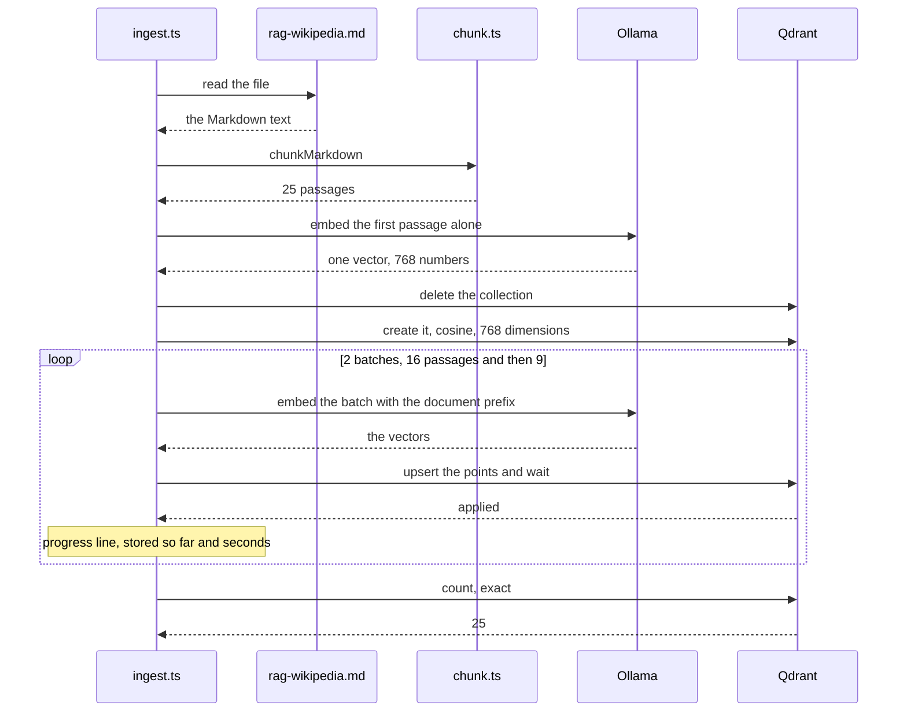

[Image of this diagram](diagrams/p06-d09-the-knowledge-loading.png)

The first passage is embedded alone, before the collection is touched: that call proves Ollama
and the model are there and gives the vector size to create the collection with. 2 batches is 25
divided by 16, rounded up.

#### Measurements

| What | Value | Source |
|---|---|---|
| Whole ingest, 25 passages | 9 s | `README.md`, Measured results |
| Per passage, average | about 0.36 s, derived from the two numbers above | derived |
| One batch of 16 | not measured separately; the progress lines show it when the ingest runs | |
| Chunking alone, without the network | not measured | |

Conditions, as in section 0.3: Intel i7-6600U with 2 cores, 32 GB, CPU only, models loaded,
25 October 2026.

### 6.3 For implementers

#### `app/ai/chunk.ts`

- `chunkMarkdown(markdown, options)` returns `Chunk[]` in document order and never throws. The
  one option is `maxChars`, default `DEFAULT_MAX_CHARS = 500`; the ingest passes
  `config.chunkMaxChars`, whose default is the same 500 and which `CHUNK_MAX_CHARS` overrides.
  Called by `scripts/ingest.ts` and the tests.
- Patterns: `HEADING = /^(#{1,6})\s+(.+?)\s*$/`, `FENCE = /^(```|~~~)/` (a block opened with
  backticks is closed only by backticks, one opened with tildes only by tildes),
  `TABLE_ROW = /^\|/`, `LIST_ITEM = /^(?:[-*+]|\d{1,3}[.)])\s+/`, `ANCHOR_LINK = /\]\(#/`.
- `splitSections(lines)` returns `Section { chapter, start, end }`, 1-based and inclusive, with
  `end < start` for an empty section. The first section covers what precedes the first `## `.
- `isTableOfContents(body)` ignores blank lines and headings, returns false when a fence or a
  table row is present, and true when `links / content.length >= 0.8`.
- `parseBlocks(lines, section)` returns `Block { kind: 'text' | 'table' | 'fence', start, end,
  heading, opens? }`. A heading line opens a text block with `headingOnly` set, so the blank
  line after it keeps the block open until the paragraph arrives; `opens` is true when the
  heading has level 2 or 3. A line that is not a row closes an open table; a non-matching fence
  inside a fenced block is content.
- `groupByHeading(blocks)` starts a group at every block with `opens`, or at the first block,
  and drops a group that is a lone heading line (one block, `opens`, `start === end`).
- `pack(blocks, span, maxChars)`: `target = total / Math.max(1, Math.ceil(total / maxChars))`; a
  piece closes when `withBlock > maxChars || current >= target`. The crumb threshold is
  `maxChars / 4`. After a merge the index steps back so the piece that moved into position `i`
  is checked too. A merge backwards keeps the previous piece's heading; a merge forwards gives
  the next piece the crumb's start and heading, which is the heading that introduces it. The
  caller runs it once per group: `groups.flatMap((group) => pack(group, span, maxChars))`.
- `spanMeasure(lines)` returns `(start, end) => offsets[end] - offsets[start - 1] - 1`: the
  characters of the lines plus the newlines between them.
- `slugify(text)`: lower case, `normalize('NFKD')`, combining marks U+0300 to U+036F removed,
  `[^a-z0-9]+` to one hyphen, hyphens trimmed at both ends; an empty result becomes `section`.
  `uniqueSlug` appends `-2`, `-3` and so on from the second use of a slug.
- The `Chunk` shape (`types.ts`): `id`, `chapter`, `heading`, `lines: [start, end]`, `text`.

#### `app/ai/rag.ts`, the embedding inputs

- `documentInput(chunk)` returns `` `${chunk.chapter}\n${chunk.text}` `` prefixed with
  `search_document: ` when `config.embedModel` matches `/^nomic-embed-text/`; `queryInput(q)`
  returns `search_query: ${q}` under the same condition. Other models get the text as is. The
  model name is read at call time so tests can switch it.

#### `app/ai/ollama.ts`, `embed`

- `embed(texts, { signal })` posts `{ model: config.embedModel, input: texts }` to
  `POST {ollamaUrl}/api/embed` and returns `data.embeddings`, one vector per text in order. An
  empty list makes no request. A 404 means the model is not pulled and the error ends with
  `Run: ollama pull nomic-embed-text`; a count of vectors that differs from the count of texts is
  an error (`Ollama returned <n> embeddings for <m> texts`). A refused connection becomes
  `Ollama is not running at http://localhost:11434`.

#### `app/ai/qdrant.ts`

- `pointId(id)`: numbers pass through, a UUID in any case is lower-cased, any other string becomes
  `uuidV5(NAMESPACE, id)` with `NAMESPACE = '5c8e3a6e-0b1d-4a0b-9d6a-2f3f1e7c9b11'`. `uuidV5` is
  SHA-1 over the namespace's 16 raw bytes then the UTF-8 name, first 16 bytes kept, version 5 in
  the high nibble of byte 6, the RFC 4122 variant in the two high bits of byte 8. Changing the
  namespace changes every point id, which only matters across an ingest.
- `ensureCollection(dimensions)`: `GET /collections/rag-article`; if it exists with a
  different `config.params.vectors.size` the error says both sizes and `run "npm run ingest"`;
  if it does not exist, `PUT` with `{ vectors: { size, distance: 'Cosine' } }`.
- `deleteCollection()`: `DELETE /collections/rag-article`; a 404 is ignored.
- `upsert(points)`: `PUT /collections/rag-article/points?wait=true` with
  `{ points: [{ id: pointId(id), vector, payload }] }`. `wait=true` makes Qdrant answer after the
  write is applied, so the count right after sees the points. A 404 means the collection is
  missing and the error says to run the ingest.
- `count()`: `POST /collections/rag-article/points/count` with `{ exact: true }`; a missing
  collection counts as 0, not as an error.
- `request()` is the one HTTP function: a rejected fetch becomes `Qdrant is not running at
  http://localhost:6335 (ECONNREFUSED)`; any status other than 2xx or 404 throws
  `Qdrant <method> <path> answered <status>: <detail>` with Qdrant's `status.error`; a 404 comes
  back as `ok: false` for the caller to interpret. No client library: five calls over `fetch`.
- The collection name is `config.collection`, default `rag-article`, overridden by
  `QDRANT_COLLECTION`; the code spells it nowhere else.

#### `scripts/ingest.ts`

- Run from the repository root with Node 24: `npm run ingest`. It reads `config.corpusPath`, by
  default `data/rag-wikipedia.md`, resolved against the working directory, as UTF-8; a failure to
  read it says `Cannot read the corpus at <path> (CORPUS_PATH)`.
- Order: read, `chunkMarkdown`, fail if zero chunks, print the summary (`25 chunks in 6
  chapters from <path> (longest 945 chars)`), embed the first chunk alone to learn the
  dimensions, `deleteCollection`, `ensureCollection(dimensions)`, then for each batch of
  `BATCH = 16`: `embed(batch.map(documentInput))`, `upsert` with `id: payload.id`, a progress
  line `n/25 (12.3s)`, and finally `count()`, which must equal the chunk count or the run fails
  with `Qdrant holds <stored> points but <n> chunks were sent`. The last line is
  `done: <stored> points in "rag-article" at http://localhost:6335 in <seconds>s`.
- A failure is one line on stderr, `ingest failed: <reason>`, and exit code 1.
- The server never writes to Qdrant; this script is the only writer, so its errors that say
  `run "npm run ingest"` point here. Run it again after every change to the article, the
  chunking or the embedding model.

#### Edge cases worth knowing

- The article has no table, no fence, no list and no heading of level 4, so the rules for those
  are exercised only by the tests (`app/ai/chunk.test.ts`), not by this corpus.
- A `## ` heading followed directly by the next heading yields no passage; a passage is never a
  lone line unless it is its group's only piece, as `improvements-1` (91 characters) is.
- The passage text keeps its `### ` heading line, and the panel's snippet shows it as it is, for
  example "### Chunking Chunking involves various strategies" (`docs/images/02-rag-answer.png`).
- Two chapters with the same heading text get distinct slugs (`notes`, `notes-2`), so ids never
  collide; the final count check would catch a collision anyway, since two chunks with one id
  would be one point.
- Dependencies at ingest time: Ollama on port 11434 with `nomic-embed-text` pulled, and Qdrant
  on port 6335 (`config.ts`; `README.md`, Quick start). Qdrant 1.20 runs as the container
  `remix3-rag-qdrant` (`docker/compose.yml`).

## 7. The question pipeline

### 7.1 For every reader

The assistant panel answers a question in one of three **modes**, chosen by the user before
sending:

- **LLM.** The question goes to the local language model alone, with one sentence of instructions.
  The answer is whatever the model knows by itself. This is the baseline: it shows what the model
  can do with no help, and how fast it is.
- **RAG.** The question is first used to find the four passages of the article that are closest
  to it (part 6). The model is told to answer only from those passages and to name the section
  of each one it uses. The panel lists the passages as sources. This shows **grounding**: the
  same question, answered from the article instead of from memory, with a place to check.
- **Agent.** The passages are found the same way, three of them, and the model is also given the
  stages of the pipeline on the left and three **tools**, actions it may ask the program to run.
  One of them highlights a stage in the diagram. This shows the assistant **acting on the UI**,
  not only writing.

Why three modes rather than one agent that does everything: the demo's purpose is to show.
Asking the same question in the three modes lets an audience see the difference between an answer
from memory, an answer from the article, and an answer that also acts on the screen. The three
also form a cost ladder, measured on this machine with the model loaded (`timings.txt`, 25
October 2026; `README.md`, Measured results): the LLM mode answered "What is chunking in RAG?" in
4.2 seconds, with the first word after 0.6 s; the RAG mode showed its sources after 0.4 s and
finished the same answer in 16.3 s; the agent mode took 18.7 s and 46.3 s for two questions. The
panel offers all three so that a user picks the cost they need: a quick check, a grounded
answer, or an action.

Everything streams: the words appear as the model writes them, and the panel shows each event,
sources found, tool called, stage highlighted, as it happens. A Stop button cancels the request
and the model stops generating.

### 7.2 How it works

#### What moves

The panel sends one request, `POST /api/chat`, with a JSON body of three fields: the `mode`, the
`question`, and an optional `context`, the stage currently selected in the diagram. The server
answers with a **stream of JSON lines** (NDJSON): one event per line, written while the model
works. The event types (`types.ts`, `chat.ts`):

| Event | Carries | Who emits it |
|---|---|---|
| `token` | `text`, a piece of the answer | every mode |
| `sources` | `sources`, the passages found, each with chapter, heading, lines, text and score | RAG and agent |
| `tool` | `name` and `args` of a tool about to run | agent |
| `ui` | `action: 'highlight-node'` and `nodeId` | agent, from `highlight_node` |
| `done` | `model` and `ms`, the whole answer's time | the dispatcher, last line of a success |
| `error` | `message` | the dispatcher, last line of a failure |

A stream the client did not cancel always ends with `done` or `error`.

#### The dispatcher

`chat.ts` receives the request and does four things:

1. **Validation.** The body must be JSON, else a 400 with `{ "error": "The body must be JSON" }`.
   It must have a `mode` among `llm`, `rag`, `agent` and a non-blank `question`, else a 400 with
   `{ "error": "Expected { mode: \"llm\" | \"rag\" | \"agent\", question: string }" }`. The
   `context` is not checked.
2. **Context.** If the panel sent a selected stage, it is written into the question as plain
   text, for every mode alike (`withContext`):

   > `<question>`
   >
   > `(The user has selected the step "<label>" in the canvas: <description>)`

   The panel forgets the selection as soon as it sends the question, so it applies to one
   question only (`app/actions/public/chat-panel.tsx`, `ask`).
3. **Dispatch.** One branch per mode produces the events (below).
4. **Framing.** `toNdjson` turns the events into lines, appends `done` with the model's name and
   the elapsed milliseconds, or turns a thrown error into an `error` line, and closes. The stream
   is pull-based: a slow reader slows the model. The response is
   `Content-Type: application/x-ndjson; charset=utf-8` with `Cache-Control: no-store`.

**Cancellation.** The Stop button aborts the browser's fetch. The abort reaches the request's
signal on the server, which is passed to Ollama's connection; closing it makes Ollama stop
generating. The stream's `cancel` closes the event generator and nothing more is written; the
generator's own rejection from the aborted upstream call is then expected and produces no
`error` line. The server logs `[chat] <mode> request aborted by the client after <n> ms` and
`[ollama] chat aborted after <n> chunks, <n> ms`.

#### The LLM mode, step by step

1. Two messages are built: the system prompt and the question (with the context sentence if a
   stage is selected). The system prompt, exactly (`chat.ts`, `SYSTEM_PROMPT`):

   > You are the assistant of a UI that teaches retrieval-augmented generation (RAG). Answer
   > briefly and plainly, in English.

2. They go to Ollama's `/api/chat` with streaming on; every line Ollama returns with text becomes
   a `token` event.
3. When Ollama's stream ends, `done` closes the response.

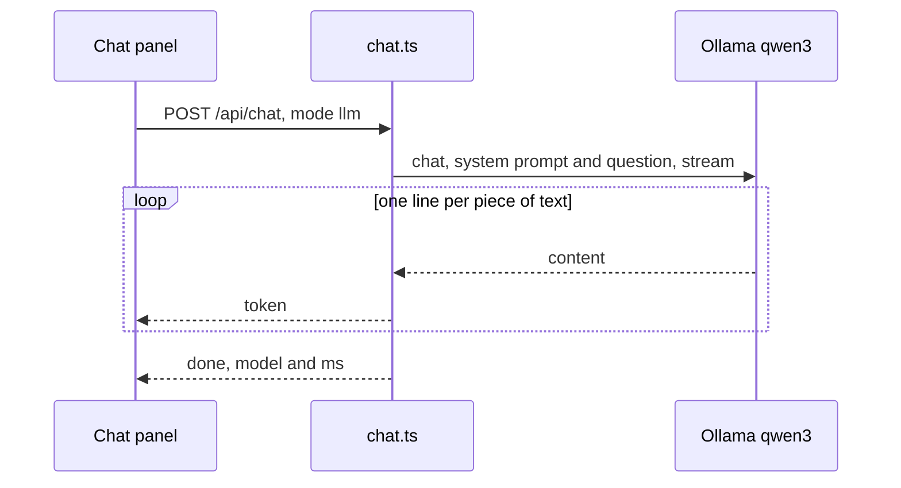

[Image of this diagram](diagrams/p07-d10-the-question-the-llm-mode-step-by-step.png)

Measured with the model loaded: first byte at 0.62 s, 43 tokens, done at 4,163 ms (`llm.ndjson`,
`timings.txt`). The 42 tokens after the first took 3.55 s, about 12 tokens per second, inside the
11 to 13 measured for this model (derived). With a cold model the first word would wait for the
load; that was not measured.

#### The RAG mode, step by step

1. The question is embedded with `nomic-embed-text` under the `search_query: ` prefix, and Qdrant
   returns the four closest passages, best first (`rag.ts`, `retrieve`; `config.ragLimit = 4`).
2. A `sources` event with those four passages goes out at once, so the panel lists them before
   the answer starts.
3. Two messages are built (`rag.ts`, `buildRagMessages`). The system prompt, exactly
   (`RAG_SYSTEM_PROMPT`, 468 characters):

   > You answer questions about retrieval-augmented generation (RAG). The user gives you
   > numbered passages from an article about it. Answer only from those passages; do not add
   > outside knowledge. After each statement that uses a passage, name that passage in
   > parentheses by the section in its label, copied exactly and without the line numbers. If
   > the passages do not contain the answer, say plainly that the passages do not cover it. Be
   > brief: a few sentences, in English.

   The prompt gives no example of a name on purpose: a small model copies an example instead of
   reading the label (`rag.ts`, `RAG_SYSTEM_PROMPT`). The user message is the passages, numbered
   and labelled by `cite` (the chapter, then the sub-heading when it differs, then the lines),
   then the question:

   ```
   Passages:

   [1] RAG and LLM limitations, lines 15-15:
   <the passage's text>

   [2] Improvements, Chunking, lines 69-71:
   <the passage's text>

   ...

   Question: <the question>
   ```

   When nothing was found the passages block is the sentence `No passages were found.`, so the
   model does not invent some.
4. The messages go to Ollama; the text streams as `token` events; `done` closes.

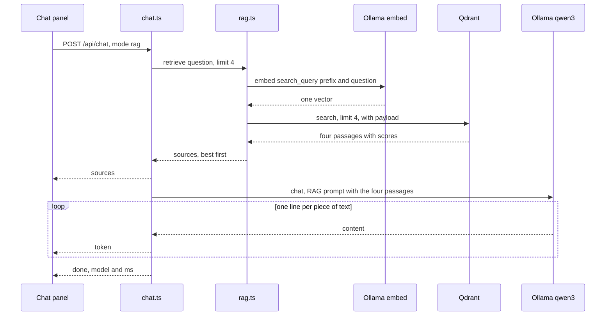

[Image of this diagram](diagrams/p07-d11-the-question-the-rag-mode-step-by-step.png)

Measured for "What is chunking in RAG?": the four sources appear at 0.44 s, the time of one
embedding and one search, and the answer completes at 16.3 s, 45 tokens (`rag.ndjson`,
`timings.txt`). The prompt of that run is 2,235 characters, 468 of system prompt and 1,767 of
passages and question. At four characters per token that is about 560 tokens, an estimate; at 44
tokens per second the model needs about 13 s to read it, and 45 tokens at 12 per second take
about 3.7 s, which with the 0.4 s of retrieval comes to about 17 s, close to the 16.3 s
measured (derived). So the prompt is the slow part, as it is in every mode that sends passages.

#### The agent mode, step by step

**Retrieve first, and why.** The loop does not leave the search to the model. Left to orchestrate
three tools, the 1.7B model searched in 11 runs of 12 but highlighted in 2 runs of 6 (`agent.ts`,
Objective). With the passages already in front of it and one decision left, which stage to
highlight, the model has far less to get wrong. So the loop itself retrieves the passages for the
question and puts them, with the stages of the pipeline, in the first user message. In the two
runs captured for this document the model highlighted the right stage both times (part 8); a
larger count was not measured for this project.

The steps (`agent.ts`, `runAgent`):

1. A `tool` event announces the search: `search_docs` with the whole question as query
   (including the context sentence, when there is one). The search returns at most 3 passages,
   each cut to 1,200 characters for the model, and a `sources` event goes to the panel. With
   passages of about 500 characters the cut never applies: the longest passage has 945.
2. The conversation is built: the system prompt with the pipeline's stages appended, then a user
   message `Passages:` with the numbered passages, then `Question:` and the question. The fixed
   part of the system prompt, exactly (`AGENT_SYSTEM_PROMPT`, 514 characters):

   > You are the assistant of a UI that teaches retrieval-augmented generation (RAG). The user
   > gives you numbered passages from an article about it and a question. If the question is
   > about one of the canvas steps listed below, call highlight_node with the id of that step
   > before you answer. Then answer from the passages, briefly, in English, naming in
   > parentheses the section of each passage you use, copied from its label; if the passages do
   > not cover the question, say so. You may call search_docs for more passages.

   Then a blank line, `The canvas shows:`, and the graph as text (`describeFlow`): the title,
   `Steps:`, one line per stage as `id: label — description`, `Transitions:`, one line per edge
   as `source -> target (label)`. The canvas has nine stages and eight transitions
   (`app/fixtures/rag-pipeline.ts`), and the whole system prompt is 2,113 characters. Its
   beginning and end, as the model reads them:

   ```
   The canvas shows:
   A RAG pipeline: onboarding a document, then answering a question
   Steps:
   documents: Documents — The external data the answers come from. Here it is one Wikipedia
   article about retrieval-augmented generation, kept as a Markdown file.
   chunking: Chunking — The article is cut into passages of about 500 characters that never
   cross a section heading, so the retriever can find details in it.
   ...
   Transitions:
   documents -> chunking
   ...
   vector-store -> retrieval (closest passages)
   ...
   generation -> answer
   ```

   (Each step is one line in the prompt; they are wrapped here.) The prompt gives no example of
   a section name: a small model copied the example instead of the passage's label.
3. **The three tools**, offered to the model in Ollama's function-calling shape:

   | Tool | Argument | What it does | Event |
   |---|---|---|---|
   | `highlight_node` | `id`, "The id of the step, such as \"retrieval\"" | finds the stage by id, or by id or label ignoring case, and asks the panel to highlight it | `ui` |
   | `search_docs` | `query`, "What to look for, as a short question or phrase" | the RAG's `retrieve`, 3 passages | `sources` |
   | `get_flow` | none | the pipeline as text; the system prompt already carries it | none |

4. **The loop.** Up to 4 rounds (`MAX_TOOL_CALLS`). Each round sends the conversation with the
   tools to Ollama. The model either answers in text, whose tokens stream to the panel and end
   the loop, or asks for tools. For each call: a `tool` event, the tool runs, its events go to the
   panel (`sources` or `ui`), and its text result joins the conversation as a tool message. Then
   the next round. If the model asked for tools in all 4 rounds, one last round without tools
   makes it answer with what it has.
5. **Calls written as text.** The small model sometimes writes the call as text instead of a
   structured call (`agent.ts`, `toolCallInText`): a bare JSON object at the start of its answer,
   sometimes followed by text it made up without the result, or an object inside `<tool>` or
   `<tool_call>` tags, sometimes after a preamble. Both count as the call, and the surrounding
   text is dropped. To keep that text off the screen, tokens are **held** while the round's text
   so far could still be a call: it starts with `{` or `<tool`. They are released as soon as it
   cannot be one, released at the end if the round turned out to be a short answer, and dropped
   if it was a call. An unclosed object is given 600 characters to close. Neither capture shows
   a call written as text.
6. **Temperature 0.** At Ollama's default temperature the model called `highlight_node` in 2 runs
   of 6 (`config.ts`, `chatTemperature`); at 0 the decision is repeatable.
7. `done` closes the response.

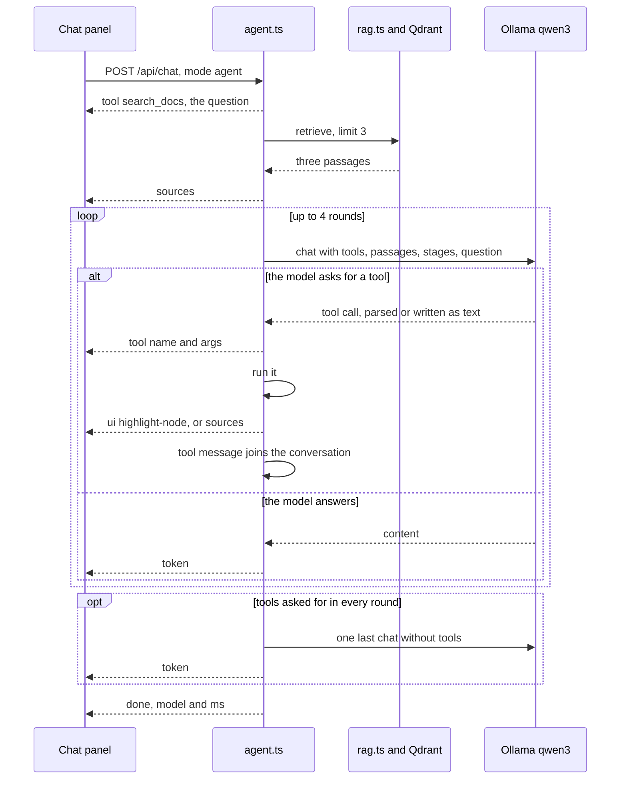

[Image of this diagram](diagrams/p07-d12-the-question-the-agent-mode-step-by.png)

Measured: two questions, two highlights of the right stage. "Where does the vector store fit in
the pipeline?" took 18.7 s and highlighted `vector-store`; "Explain this step in one short
paragraph.", asked with the Chunking stage selected, took 46.3 s and highlighted `chunking`. The
first event of each arrives within 16 ms, and each stream has one search and one `highlight_node`
and then the answer (`agent-vector-store.ndjson`, `agent-chunking.ndjson`, `timings.txt`).
Why the second took 2.5 times as long is not recorded: its prompt was not larger, 3,421
characters against 3,498 (derived by rebuilding both prompts from the transcripts), and the
streams do not show round boundaries. The 18.7 s run is even shorter than 3,498 characters would
need at four characters per token and 44 tokens per second, about 20 s, so either that estimate
is high or Ollama reused part of an earlier prompt; neither was measured.

### 7.3 For implementers

#### `app/ai/chat.ts`

- `handleChat(request)`: `await request.json()` in a try, 400 on failure; `isChatRequest(body)`,
  400 on failure; an `abort` listener on `request.signal` that logs the elapsed time; then
  `new Response(toNdjson(answer(body, request.signal)), { headers })`.
- `isChatRequest(value)`: an object with `mode` in `MODES = new Set(['llm', 'rag', 'agent'])` and
  a `question` string whose `trim()` is not empty. `context` is not checked.
- `withContext(body)`: `body.question` alone, or, when `body.context?.selectedNode` is set,
  the question, `\n\n`, and
  `` `(The user has selected the step "${node.label}" in the canvas: ${node.description})` ``.
- `answer(body, signal)`: `llm` yields `tokens(ollama.chat(messages, { signal }))`; `rag`
  awaits `retrieve(question, config.ragLimit)`, yields `{ type: 'sources', sources }`, then
  `tokens(ollama.chat(buildRagMessages(question, sources), { signal }))`; `agent` yields
  `runAgent(question, body.context, signal)`. No branch yields `done`; `toNdjson` adds it.
- `tokens(chunks)`: `{ type: 'token', text: chunk.content }` for each chunk with content.
- `toNdjson(events)`: a `ReadableStream<Uint8Array>` whose `pull` awaits `events.next()`;
  `done` enqueues `{ type: 'done', model: config.chatModel, ms: Date.now() - started }` and closes;
  a thrown error enqueues `{ type: 'error', message }` and closes; `cancel` sets a flag so no
  more lines are written and calls `events.return(undefined)`. `CHAT_TRACE=1` logs
  `[chat] +<ms> <type>` per event.
- The controller `app/actions/api/controller.tsx` passes the `Request` and returns the `Response`
  untouched; the panel `app/actions/public/chat-panel.tsx` reads the lines with the `StreamEvent`
  type from `types.ts`. A new event type is added there first, then here, then in the panel.

#### `app/ai/ollama.ts`, `chat`

- `POST {ollamaUrl}/api/chat` with `{ model: config.chatModel, messages, stream: true, options: {
  num_ctx: config.numCtx, temperature: config.chatTemperature } }`; `tools` only when non-empty;
  `think: false` for `qwen3` models (`config.chatThink`; thinking on costs three times the
  tokens, `config.ts`). Defaults: `qwen3:1.7b`, `num_ctx 4096`, temperature `0`.
- Yields `ChatChunk { content?, toolCalls?, done }` per NDJSON line; an `error` field in a line
  throws `Ollama: <error>`; a non-2xx status throws `Ollama answered <status>: <detail>`; a
  refused connection throws `Ollama is not running at http://localhost:11434`; an abort rethrows
  fetch's own `AbortError`. `lines()` splits the body on `\n` with a stateful `TextDecoder`, so a
  multi-byte character split across reads decodes correctly, and releases the reader in `finally`.

#### `app/ai/rag.ts`, the RAG messages

- `retrieve(question, limit = config.ragLimit)`: `embed([queryInput(question)])`, then
  `search(vector, limit)`; throws `Ollama returned no embedding for the question` if the vector
  is missing; an empty result is an empty list, not an error.
- `buildRagMessages(question, sources)`: `[{ role: 'system', content: RAG_SYSTEM_PROMPT },
  { role: 'user', content: `Passages:\n\n${passages}\n\nQuestion: ${question}` }]` where each
  passage is `` `[${i + 1}] ${cite(source)}:\n${source.text}` `` joined by blank lines.
- `cite(source)`: the chapter, then `, <heading>` when the heading differs from the chapter, then
  `` `, lines ${source.lines[0]}-${source.lines[1]}` ``: "Process, lines 19-19" for a passage
  directly under a chapter heading, "Improvements, Chunking, lines 69-71" under a sub-heading.
  The panel's source list uses the same place with the score and middle dots
  (`chat-panel.tsx`, `describeSource`).

#### `app/ai/agent.ts`

- Constants: `MAX_TOOL_CALLS = 4`, `SEARCH_LIMIT = 3`, `PASSAGE_LENGTH = 1200`,
  `HOLD_LIMIT = 600`.
- `runAgent(question, _context, signal, deps = defaultDeps)`: `_context` is unused because
  `chat.ts` already wrote the selected node into the question. `deps` is `{ chat, retrieve,
  graph }`, by default Ollama's `chat`, the RAG's `retrieve` and the fixture `ragPipeline`;
  tests pass fakes. `signal?.throwIfAborted()` runs before each round, between tool calls and
  before the last round.
- `systemPrompt(graph)`: `AGENT_SYSTEM_PROMPT`, then `\n\nThe canvas shows:\n`, then
  `describeFlow(graph)`.
- `complete(chunks)`: streams one round, returns `{ content, toolCalls }`. `mayBeToolCall(text)`
  decides the hold: empty text, hold; starts with `<tool`, hold until the closing tag or past
  `HOLD_LIMIT`; does not start with `{`, release; starts with `{`, hold until `leadingObject`
  closes or the text passes `HOLD_LIMIT`, and once closed it is a call only if `asCall` names a
  known tool. At the end of a round that stayed undecided with no call, parsed or written, the
  held tokens are released.
- `toolCallInText(content)`: the `WRAPPED` form first, anywhere in the text,
  `/<tool(?:_call)?>\s*([\s\S]*?)\s*<\/tool(?:_call)?>/`, then `leadingObject` at the start. A
  bare object in the middle of prose is not a call. `asCall` accepts `{ name, arguments }` and
  `{ function: { name, arguments } }` and only a known tool name; invalid JSON is not a call.
- `normalize(call)`: arguments as a string are parsed as JSON, or wrapped under the tool's first
  required parameter when they are a bare value; anything that is not a record becomes `{}`.
- `runTool(name, args, deps)`: `search_docs` calls `searchDocs(argument(args, 'query'))`;
  `get_flow` returns `describeFlow(graph)` and no event; `highlight_node` calls
  `highlightNode(argument(args, 'id'), graph)`; an unknown name returns
  `unknown tool "<name>"; the tools are highlight_node, search_docs, get_flow` so the model can
  correct itself. `argument` takes the named value or the first string value under any other
  name.
- `searchDocs(query, deps)`: an empty query returns `search_docs needs a query` without
  searching; otherwise `retrieve(query, 3)`, each passage as `[n] <cite>:` then a newline and
  `trim(s.text, 1200)` (cut with `…`), or `No passages found for "<query>".`; the event is
  `{ type: 'sources', sources }`.
- `highlightNode(id, graph)`: exact id, then id or label lower-cased; found returns
  `highlighted <label>` and `{ type: 'ui', action: 'highlight-node', nodeId }` with the stage's
  real id; not found returns `unknown node id "<id>"; valid ids: <ids>` and no event. The Chunking
  capture shows the second path of the lookup: the model wrote `{"id":"Chunking"}`, the label,
  and the `ui` event carries `"nodeId":"chunking"` (`agent-chunking.ndjson`, lines 2 and 3).
- Tool messages are `{ role: 'tool', content: text, tool_name: name }`; the model's turn is pushed
  as `{ role: 'assistant', content, tool_calls: calls }` before them.
- Renaming a tool changes the prompt, the tests and the panel together: the panel imports `tools`
  from this file.

#### Edge cases

- The first `tool` event of the agent mode is yielded before any network call, which is why its
  first byte arrives in 13 and 16 ms in `timings.txt` while the RAG's takes 0.44 s.
- The agent's first search uses the whole question as the query, context sentence included
  (`agent-chunking.ndjson`, line 1), so the embedding sees the stage's label and description
  too. That is why, with Chunking selected, the Chunking passage scores 0.749 and leads
  (`agent-chunking.ndjson`, line 2), while the plain RAG question puts it second at 0.679.
- A model that calls `search_docs` with the same query the loop already ran would get the same
  three passages again and spend a round on it. Nothing in the loop prevents it, and neither
  capture shows it.
- The RAG passages are sent whole and the agent's are cut to 1,200 characters. The two prompts
  differ in that respect, though with this corpus no passage is long enough to be cut.
- The agent's prompt is larger than the RAG's, 3.4 to 3.5 thousand characters against 2.2
  thousand, because it carries the nine stages; the tool definitions come on top, and their
  size was not measured. The agent may also run more than one round (derived).
- With a cold model the first word waits for the load in every mode; Ollama unloads a model after
  5 idle minutes by default. The load time was not measured for this project.

## 8. Reading a chat response

### 8.1 For every reader

When a question is sent, the panel shows the question in a bubble, then the answer appearing word
by word, and around it a few lines that tell what happened: which passages were found, which
tool the assistant called, which stage of the diagram it highlighted, which model answered and
how long it took. Every one of those lines comes from one event in the stream of part 7.

This part reads five real streams, captured on 25 October 2026 from the project in production
mode, `qwen3:1.7b` with thinking off, temperature 0, model loaded, 25 passages in the collection
(`docs/transcripts/timings.txt`). One per mode, a second agent one with a selected stage, and one
failed request. Each is reproduced condensed, the first tokens, the events and the last line, and
every line the panel shows is explained beside it. Then it reads the two screenshots of the page,
`docs/images/02-rag-answer.png` and `docs/images/03-agent-highlight.png`. The weaknesses the
transcripts reveal are stated at the end: the RAG answer ends with a bare "(2)", and the agent
answer says "section [1]", though both were asked to name the section. A demo that hides them
would be misleading.

### 8.2 How it works

#### The five captures

| File | Mode | First byte | Total | Lines | Source |
|---|---|---|---|---|---|
| `llm.ndjson` | LLM | 0.615838 s | 4.168931 s | 43 tokens, 1 done | `timings.txt` |
| `rag.ndjson` | RAG | 0.441546 s | 16.260785 s | 1 sources, 45 tokens, 1 done | `timings.txt` |
| `agent-chunking.ndjson` | agent | 0.016253 s | 46.280967 s | 2 tool, 1 sources, 1 ui, 59 tokens, 1 done | `timings.txt` |
| `agent-vector-store.ndjson` | agent | 0.013174 s | 18.655434 s | 2 tool, 1 sources, 1 ui, 43 tokens, 1 done | `timings.txt` |
| `error-bad-body.ndjson` | none | 0.014194 s | 0.015625 s | one JSON body, status 400 | `timings.txt` |

The line counts were taken from the files. The first byte is the moment the first line of the
response arrived. It differs by mode for a reason visible in the code: in LLM mode the first line
is the model's first token, so it waits for Ollama; in RAG mode the first line is the `sources`
event, after the embedding and the search; in agent mode the first line is the `tool` event the
loop yields before any network call (`agent.ts`, `runAgent`), hence 13 and 16 ms.

A stream is the response only. The request body, with the mode and the question, and the system
prompt the model received are not in these files. Where the question can be read from the stream
itself, it is quoted. The question of the LLM and RAG captures, "What is chunking in RAG?", was
recorded with the capture, not in the stream; the agent captures carry theirs in their first
line. The capture's request bodies were kept apart from the transcripts, so a reader who has
only `docs/transcripts/` cannot tell what was asked of `llm.ndjson` and `rag.ndjson` except
from the answers.

#### 8.2.1 LLM mode, `llm.ndjson`

The stream, condensed: 44 lines, the first three tokens, the last two, and `done`.

```
{"type":"token","text":"Chunk"}
{"type":"token","text":"ing"}
{"type":"token","text":" in"}
...
{"type":"token","text":" task"}
{"type":"token","text":"."}
{"type":"done","model":"qwen3:1.7b","ms":4163}
```

The 43 tokens joined read:

> Chunking in RAG is the process of breaking down large text documents into smaller, manageable
> pieces called "chunks." These chunks are then used to improve the efficiency and effectiveness
> of retrieving relevant information for a specific task.

What the panel shows, line by line:

- **The user's bubble.** The question as typed, "What is chunking in RAG?", shown by the panel
  when it is sent, before any line of the stream arrives.
- **The tokens arriving.** Each `token` line is appended to the answer bubble as it arrives; a
  token is a piece of a word or a word with its leading space, as the lines show: "Chunking" is
  the two tokens "Chunk" and "ing". The 42 tokens after the first took 3.55 s, about 11.8
  tokens per second, derived from `timings.txt`; the project measured 11 to 13 tokens per second
  for this model (part 5).
- **The footer.** The `done` line gives the model, `qwen3:1.7b`, and the elapsed milliseconds,
  4,163, which the panel shows as the model and the seconds, "qwen3:1.7b · 4.2 s".
- **No sources, no tool lines.** The LLM mode emits neither. The answer is what the model knows
  by itself: a generic and correct definition, with no place in the article to check it
  against, and without the article's own angle, which is breaking the data into vectors for the
  retriever. That is what the baseline is for.

#### 8.2.2 RAG mode, `rag.ndjson`

The stream, condensed: 47 lines. The first line is the `sources` event, one line in the file,
broken here over several lines with the text fields shortened to their first words (`...`):

```
{"type":"sources","sources":[
  {"id":"rag-and-llm-limitations-2","chapter":"RAG and LLM limitations",
   "heading":"RAG and LLM limitations","lines":[15,15],
   "text":"LLMs with RAG are programmed to prioritize new information. ...",
   "score":0.68194664},
  {"id":"improvements-9","chapter":"Improvements","heading":"Chunking","lines":[69,71],
   "text":"### Chunking\n\nChunking involves various strategies for breaking up ...",
   "score":0.67917335},
  {"id":"process-2","chapter":"Process","heading":"RAG key stages","lines":[21,23],
   "text":"### RAG key stages\n\nTypically, the data to be referenced is converted ...",
   "score":0.65506184},
  {"id":"retrieval-augmented-generation-2","chapter":"Retrieval-augmented generation",
   "heading":"Retrieval-augmented generation","lines":[5,5],
   "text":"RAG improves LLMs by incorporating information retrieval ...",
   "score":0.6544572}]}
{"type":"token","text":"Chunk"}
{"type":"token","text":"ing"}
{"type":"token","text":" in"}
...
{"type":"token","text":" ("}
{"type":"token","text":"2"}
{"type":"token","text":")"}
{"type":"done","model":"qwen3:1.7b","ms":16252}
```

The 45 tokens joined read:

> Chunking in RAG involves breaking up the data into vectors so the retriever can find details in
> it. This is done to improve the retrieval process and make it easier for the model to access
> relevant information. (2)

What the panel shows:

- **The user's bubble.** "What is chunking in RAG?", as for the LLM capture.
- **The "Sources" list.** From the single `sources` event, one numbered entry per passage, in the
  server's order, each with its place, the score to two decimals and the first 120 characters of
  the passage on one line:
  1. `RAG and LLM limitations · lines 15–15 · 0.68`
  2. `Improvements, Chunking · lines 69–71 · 0.68`
  3. `Process, RAG key stages · lines 21–23 · 0.66`
  4. `Retrieval-augmented generation · lines 5–5 · 0.65`

  The score is the cosine similarity between the question's vector and the passage's; higher is
  closer, and the list is best first. The first two differ by 0.003, 0.682 against 0.679, so the
  two decimals cannot tell them apart. The list appears at 0.44 s, before any word of the
  answer, because the event is emitted as soon as Qdrant answers. The Chunking passage is not
  first: a passage about "prompt stuffing" leads by a hair, a case of "right passage among the
  four, not first" (part 6).
- **The tokens arriving.** The first token came after the four passages, about 560 tokens of
  prompt at four characters per token (an estimate, part 7), had been processed; that is where
  most of the 16.3 s went.
- **The citation.** The answer ends with " (", "2", ")": three tokens. The prompt asked the model
  to name each passage it used in parentheses by the section in its label, copied exactly, and
  passage 2's label is "Improvements, Chunking, lines 69-71". The model wrote the number.
  Section 8.3 lists this as a weakness.
- **The footer.** "qwen3:1.7b · 16.3 s".

The answer is grounded in its first sentence, which is the Chunking passage's own sentence with
"various strategies for" dropped. Its second sentence, "This is done to improve the retrieval
process and make it easier for the model to access relevant information", is in none of the four
passages: padding that the instruction "do not add outside knowledge" did not prevent.

#### 8.2.3 Agent mode with a selected stage, `agent-chunking.ndjson`

Before this question the user clicked the stage "Chunking" in the diagram. The panel showed the
chip **"About: Chunking"** and sent the stage as `context`; the dispatcher wrote it into the
question (part 7, `withContext`). The question typed was "Explain this step in one short
paragraph." The proof is line 1, where the query carries the sentence. The stream, condensed:
64 lines. Lines 1 and 2 are one line each in the file, broken here.

```
{"type":"tool","name":"search_docs","args":{"query":"Explain this step in one short
 paragraph.\n\n(The user has selected the step \"Chunking\" in the canvas: The article is
 cut into passages of about 500 characters that never cross a section heading, so the
 retriever can find details in it.)"}}
{"type":"sources","sources":[
  {"id":"improvements-9", ... "lines":[69,71], ... "score":0.749323},
  {"id":"rag-and-llm-limitations-2", ... "lines":[15,15], ... "score":0.6873487},
  {"id":"process-2", ... "lines":[21,23], ... "score":0.6789788}]}
{"type":"tool","name":"highlight_node","args":{"id":"Chunking"}}
{"type":"ui","action":"highlight-node","nodeId":"chunking"}
{"type":"token","text":"The"}
{"type":"token","text":" passage"}
{"type":"token","text":" about"}
...
{"type":"token","text":" information"}
{"type":"token","text":"."}
{"type":"done","model":"qwen3:1.7b","ms":46267}
```

The 59 tokens joined read:

> The passage about Chunking is from section [1], which explains that chunking involves breaking
> down data into smaller passages to help the retriever find details. The step "Chunking" in the
> RAG pipeline is crucial for preparing the text so that the retriever can efficiently locate
> relevant information.

What the panel shows, in order:

- **The user's bubble.** "Explain this step in one short paragraph." The sentence the server
  added is not in the bubble; it is seen here only because the query echoes it. The chip is gone
  once the question is sent.
- **"called search_docs: …"**, the first tool line, at 16 ms. The loop announces its own
  retrieval as a tool call, so the panel shows the search the same way whether the loop or the
  model asked for it. The `…` is the query: the question and the stage's sentence.
- **The "Sources" list**: `Improvements, Chunking · lines 69–71 · 0.75`,
  `RAG and LLM limitations · lines 15–15 · 0.69`, `Process, RAG key stages · lines 21–23 · 0.68`.
  Three passages, the agent's limit, against four in RAG mode. With the stage's description in
  the query the Chunking passage leads at 0.749; without it, in the RAG capture, it came second
  at 0.679.
- **"called highlight_node: Chunking"**: the model's decision, the one the loop leaves to it. The
  model wrote the stage's label, not its id; `highlightNode` accepts a label in any case, and
  the `ui` event carries the real id, `chunking`. Then the **highlight of a node**: the `ui`
  event makes the panel dispatch a browser event, and the canvas gives the stage `chunking` an
  orange ring. The right stage for the question.
- **The tokens arriving**: the model answered right after the highlight, with no second search.
- **The footer**: "qwen3:1.7b · 46.3 s".

The answer names its source as "section [1]". `[1]` is the passage's number in this one prompt,
and the section is "Improvements, Chunking"; the prompt asked to copy the section from the
label. And "smaller passages" and "crucial for preparing the text" are not in the passage, which
speaks of "breaking up the data into vectors"; "passages" is the vocabulary of the stage's
description in the system prompt. Which source the words came from cannot be told from the
stream.

#### 8.2.4 Agent mode without a selected stage, `agent-vector-store.ndjson`

No stage was selected, so the query is the question as typed, "Where does the vector store fit in
the pipeline?". The stream, condensed: 48 lines.

```
{"type":"tool","name":"search_docs",
 "args":{"query":"Where does the vector store fit in the pipeline?"}}
{"type":"sources","sources":[
  {"id":"process-2", ... "lines":[21,23], ... "score":0.61994207},
  {"id":"improvements-2","chapter":"Improvements","heading":"Encoder",
   ... "lines":[41,43], ... "score":0.60800076},
  {"id":"improvements-10","chapter":"Improvements","heading":"Hybrid search",
   ... "lines":[73,75], ... "score":0.5914649}]}
{"type":"tool","name":"highlight_node","args":{"id":"vector-store"}}
{"type":"ui","action":"highlight-node","nodeId":"vector-store"}
{"type":"token","text":"The"}
{"type":"token","text":" vector"}
{"type":"token","text":" store"}
...
{"type":"token","text":" question"}
{"type":"token","text":"."}
{"type":"done","model":"qwen3:1.7b","ms":18644}
```

The 43 tokens joined read:

> The vector store fits in the pipeline after the embedding step. It stores the embeddings of the
> passages in a vector database, which is then used in the retrieval step to find the most
> relevant passages for answering the question.

What the panel shows:

- **The user's bubble**, **"called search_docs: Where does the vector store fit in the
  pipeline?"** at 13 ms, and the **"Sources" list**: `Process, RAG key stages · lines 21–23 ·
  0.62`, `Improvements, Encoder · lines 41–43 · 0.61`, `Improvements, Hybrid search · lines
  73–75 · 0.59`.
- **"called highlight_node: vector-store"** with the id this time, and the highlight of the
  stage `vector-store`: the right one.
- **The tokens arriving**, then **the footer**: "qwen3:1.7b · 18.6 s". The table above says
  18.7 s because it is the client's clock, 18.655 s, and the footer is the server's, 18,644 ms.

The answer is correct, and its shape, "after the embedding step", "used in the retrieval step",
matches the list of stages and transitions in the system prompt (`embedding -> vector-store`,
`vector-store -> retrieval`) at least as well as the passages. The first passage says the
embeddings "are then stored in a vector database to allow for document retrieval"; the other two
say how vectors are compared and searched, not where the store sits, and their scores, 0.61 and
0.59, are the lowest of any capture. The answer names no section at all, although the prompt
asked for one.

#### 8.2.5 The failed request, `error-bad-body.ndjson`

A request whose body is JSON but not a valid request, `{"mode": "x"}`, gets no stream at all: a
status 400 with one JSON body, 78 bytes, no newline at the end, in 15.6 ms (`timings.txt`):

```
{"error":"Expected { mode: \"llm\" | \"rag\" | \"agent\", question: string }"}
```

A body that is not JSON gets the same status with `{"error":"The body must be JSON"}`
(`chat.ts`, `handleChat`). Validation happens before anything is streamed, so the panel reads a
normal error response, not events; it shows the server's own words with the status, "The server
answered 400: Expected ...", as an error line (`chat-panel.tsx`, `describeFailure`).

An **`error` event** is the other failure: something went wrong after the stream had started, for
example Ollama not running. It is the last line of the stream, after any lines already sent, and
there is no `done`. None was captured; its shape, from `chat.ts` (`toNdjson`) and the message
`ollama.ts` builds for a refused connection, is:

```
{"type":"error","message":"Ollama is not running at http://localhost:11434"}
```

The panel shows the message in place of the rest of the answer, in a red box that starts with
"Error:". Other messages the code produces in the same way: `Collection "rag-article" does not
exist at http://localhost:6335; run "npm run ingest"` (`qdrant.ts`), `Ollama answered 404: ...`
for a model that is not pulled (`ollama.ts`).

#### 8.2.6 The two screenshots

The screenshots show the whole page, not the stream. Both are of the same session, one after the
other, in a browser window of 1,400 by 900 pixels.

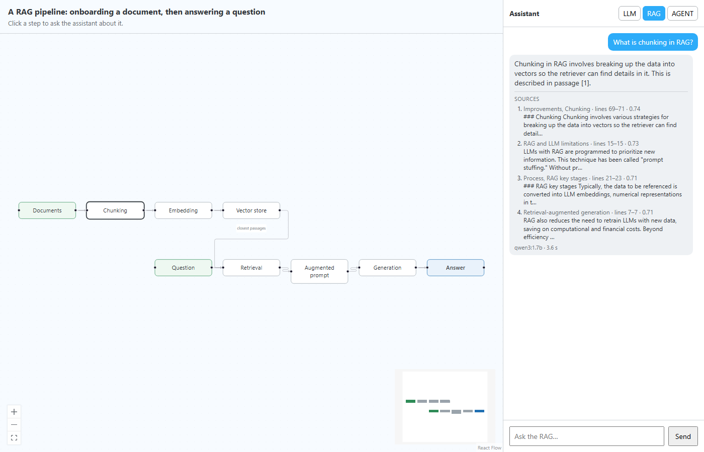

`docs/images/02-rag-answer.png`. The left column holds the title, "A RAG pipeline: onboarding a
document, then answering a question", the hint "Click a step to ask the assistant about it.",
and the diagram: the top row Documents, Chunking, Embedding and Vector store, the bottom row
Question, Retrieval, Augmented prompt, Generation and Answer. The start stages, Documents and
Question, are outlined in green and Answer in blue; Chunking has a thin dark ring, the mark of
the selected stage. A mini-map sits at the bottom right, the zoom buttons at the bottom left, and
the label "React Flow" below the map. The right column is the assistant: the mode buttons LLM,
RAG and AGENT, with RAG active; the question bubble "What is chunking in RAG?"; the answer; the
numbered sources, each with its place, its score and the first words of its text; the footer
"qwen3:1.7b · 3.6 s"; and the input, "Ask the RAG…", with its Send button. The answer reads:

> Chunking in RAG involves breaking up the data into vectors so the retriever can find details in
> it. This is described in passage [1].

The sources read `Improvements, Chunking · lines 69–71 · 0.74`, `RAG and LLM limitations · lines
15–15 · 0.73`, `Process, RAG key stages · lines 21–23 · 0.71` and `Retrieval-augmented generation
· lines 7–7 · 0.71`. The first snippet begins "### Chunking Chunking involves various
strategies": the passage text keeps its heading line, and the panel shows it as it is.

This is not the run of `rag.ndjson`: the scores, the order, the fourth passage (lines 7-7 against
lines 5-5), the answer and the time (3.6 s against 16.3 s) all differ. The dark ring on Chunking
and the missing chip explain the retrieval. The panel drops the chip when it sends a question,
and the ring stays on the canvas, so the question was sent with the Chunking stage selected and
the dispatcher added the stage's sentence to it (part 7). Retrieving "What is chunking in RAG?"
with that sentence, on 25 October 2026, gave `improvements-9` 0.744, `rag-and-llm-limitations-2`
0.729, `process-2` 0.713 and `retrieval-augmented-generation-3`, lines 7-7, 0.712: the four
sources of the screenshot, in its order. Without the sentence it gave the four of `rag.ndjson`.
So the two captures are the same question asked two ways. Why the answer took 3.6 s here and
16.3 s there was not recorded, and whether Ollama reused part of an earlier prompt was not
measured; the screenshot is no evidence of a typical time, and the transcripts are the measured
ones.

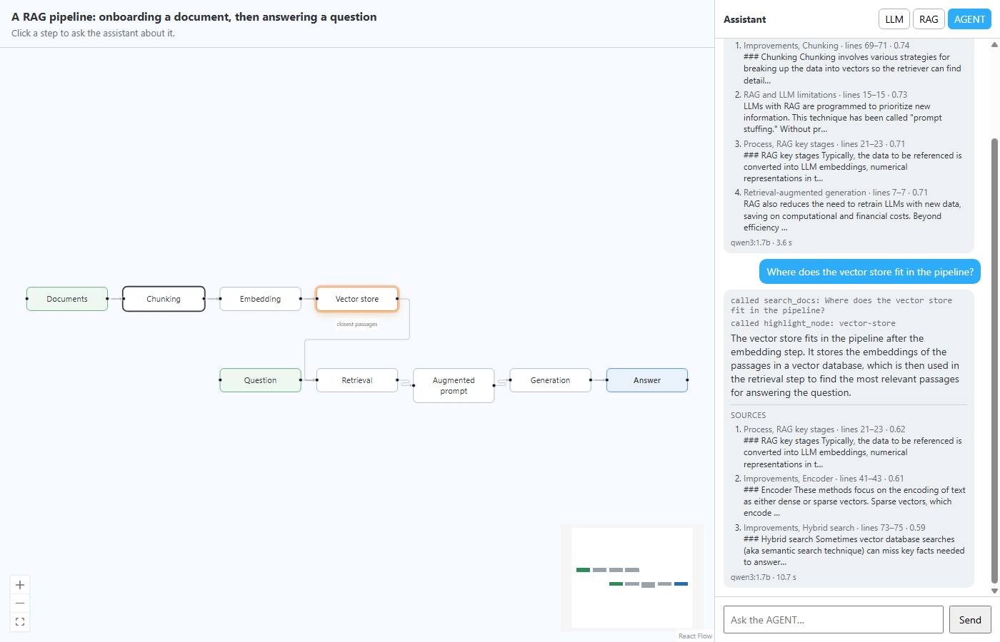

`docs/images/03-agent-highlight.png`. The same page after an agent question, with AGENT active
and the list scrolled: the four sources of the previous answer at the top, then the question
"Where does the vector store fit in the pipeline?", then the assistant's bubble. It starts with
two lines in monospace, `called search_docs: Where does the vector store fit in the pipeline?` and
`called highlight_node: vector-store`, then the answer text, then the sources, `Process, RAG key
stages · lines 21–23 · 0.62`, `Improvements, Encoder · lines 41–43 · 0.61` and
`Improvements, Hybrid search · lines 73–75 · 0.59`, and the footer "qwen3:1.7b · 10.7 s". On the
canvas the Vector store stage has an orange ring: the highlight the assistant asked for.
Chunking keeps its thin dark ring from the earlier click. This is the same question as
`agent-vector-store.ndjson` and, at temperature 0, the same sources, scores and answer text; the
time differs, 10.7 s against 18.7 s, again for a reason that was not recorded.

One weakness is visible in both pictures: the edge from Vector store to Retrieval, labelled
"closest passages", leaves the right side of the Vector store, drops down and runs back left, and
joins the line into Retrieval from the side of Question. It takes a wide route, and its label sits
under the Vector store, far from Retrieval.

#### The Stop button

While a stream is open the panel shows a Stop button. Pressing it aborts the fetch; the server
sees the request's signal fire, Ollama's connection closes and the model stops generating; the
stream writes nothing more, not even `done` or `error` (`chat.ts`, `toNdjson`, `cancel`). The
panel marks the answer "Stopped". The server logs how far it got:
`[ollama] chat aborted after <n> chunks, <n> ms`. No Stop was captured in these transcripts.

### 8.3 For implementers

#### Event to panel element

The mapping, as the events define it (`types.ts`, `chat.ts`, `agent.ts`); the rendering and the
exact strings of each element live in `app/actions/public/chat-panel.tsx`.

| Event | Fields | Panel element |
|---|---|---|
| `token` | `text` | appended to the answer bubble |
| `sources` | `sources[]`: `id`, `chapter`, `heading`, `lines`, `text`, `score` | the "Sources" list: place, lines and score to two decimals, then the first 120 characters of the text |
| `tool` | `name`, `args` | a monospace "called `<name>`: ..." line, the argument values joined by commas |
| `ui` | `action: 'highlight-node'`, `nodeId` | a browser event `ui:highlight-node` the canvas obeys (`events.ts`) |
| `done` | `model`, `ms` | the footer, model and seconds with one decimal |
| `error` | `message` | a red "Error: ..." line after the text |
| 400 body | `error` | an error line, "The server answered 400: ..." |

The `sources` payload is the stored chunk plus the score, untouched from the ingest (`qdrant.ts`,
`search`), so the lines a reader sees point into `data/rag-wikipedia.md` on disk.

#### Reading the numbers

- `ms` in `done` is measured by `toNdjson` from the moment the stream object was created to the
  `done` line; `timings.txt` measures from the client, which is why `rag.ndjson` says 16,252 ms
  and `timings.txt` says 16.26 s, and why the vector-store capture's footer reads 18.6 s while
  the table says 18.7 s.
- Scores are cosine similarities (`qdrant.ts`, `ensureCollection`, `distance: 'Cosine'`). The
  four RAG scores span 0.654 to 0.682; the Chunking agent's three span 0.679 to 0.749; the
  vector-store agent's span 0.591 to 0.620. The ranges are not comparable across questions, only
  within one list, and a query that carries a stage's description scores higher across the board
  (0.744 against 0.682 for the best passage in section 8.2.6).
- The panel rounds a score to two decimals, so two neighbours can look equal.
- The agent's first byte (13 and 16 ms) is the `tool` line yielded before `retrieve` is awaited.

#### Capture conditions

From the header of `timings.txt`: production mode (`npm run start`), `qwen3:1.7b` with thinking
off, temperature 0, model loaded, 25 October 2026, 25 passages. Hardware as in section 0.3. The
capture tool is not recorded. The screenshots are from the same day; their request bodies were
not kept, and section 8.2.6 reconstructs what the first one asked.

#### Known weaknesses, with the evidence

- **A bare "(2)".** The RAG prompt asks for the section copied from the label; the answer in
  `rag.ndjson` ends with `(2)`. The number is right, since source 2 is the Chunking passage, and
  the sources list is numbered the same way, so a reader can resolve it. But it is not the
  section, it breaks the promise of the Answer stage ("cites the section of each passage it
  used"), and the screenshot's "passage [1]" repeats it.
- **"Section [1]".** The agent answer in `agent-chunking.ndjson` says "from section [1]": the
  number of a passage in one prompt, used as if it were a section name. The agent's prompt asks
  for the section in parentheses, copied from the label, and the answer has neither.
- **No citation at all.** `agent-vector-store.ndjson` names no section, in or out of
  parentheses. Of the four distinct answers with passages in this part, two RAG and two agent,
  none names a section as asked.
- **Padding.** The second sentence of the RAG answer is in none of the four passages, and the
  agent's "crucial for preparing the text so that the retriever can efficiently locate relevant
  information" is in none of the three. The sources list under each answer is what to trust, as
  the README says.
- **The right passage is not always first.** For "What is chunking in RAG?" the Chunking passage
  is second by 0.003. Across the ten questions of the size comparison the right passage was among
  the four for 10 of 10 and first for 6 of 10 (part 6). The RAG mode sends all four, which is
  why it still answered from the right one.
- **A one-sentence passage.** The Chunking passage is 129 characters, so even the right passage
  gives the model little to say; the answers repeat it and then add generalities (part 6).
- **A small agent.** The model decides one thing, which stage to highlight; the loop retrieves.
  In both captures it called `highlight_node` once, never `get_flow` and never a second
  `search_docs`, and highlighted the right stage; two runs say little about how often.
- **An unexplained cost.** The Chunking question took 46.3 s and the vector-store question
  18.7 s with prompts of similar size. The streams do not show round boundaries and the cause was
  not measured (part 7).
- **Loose sources.** The vector-store question found one passage that says where embeddings
  are stored; the other two, about the encoder and hybrid search, say how vectors are compared
  and searched, and have the lowest scores of any capture.
- **A wide edge.** The vector-store to retrieval edge on the canvas takes a wide route, as
  section 8.2.6 describes.
- **The raw heading in the snippet.** Sources show "### Chunking Chunking involves ...", because
  the passage text keeps its Markdown heading line.
- **The stream is not self-contained.** Neither the request nor the system prompt is in it, so
  an audit of an answer needs the request body, which the capture kept apart, and the prompt,
  which `rag.ts` and `agent.ts` build from the sources in the stream; part 7 rebuilt them to
  count characters. `CHAT_TRACE=1` logs only the type and the time of each event
  (`chat.ts`).

## 9. The UI in Remix 3

### 9.1 For every reader

The page is served by Remix 3, the framework this project is built on. Remix 3 is a rebuild of a
web framework on the standards every browser already has: a request comes in, a response goes
out, and the pages are written as ordinary functions. It does not use React. The server writes
the whole page as HTML; the browser then wakes up only the two pieces that have to react to the
user: the assistant panel on the right, and the box on the left that holds the canvas (part 10).

The panel is where the user works. Three buttons pick how a question is answered (LLM, RAG or
AGENT), the question goes to the server, and the answer arrives one small piece at a time, so the
text grows on the screen while the model is still writing. A Stop button cuts an answer short.
Under a RAG or agent answer the panel lists the passages of the article the answer was built
from: for each one the chapter and, when there is one, the sub-heading, the lines of the article
and a similarity score. When the user clicks a step of the canvas, a small chip above the input
says "About: Chunking", and the next question is asked about that step. When the agent wants to
point at a step, the panel passes the request on to the canvas, which lights the step up.

### 9.2 How it works

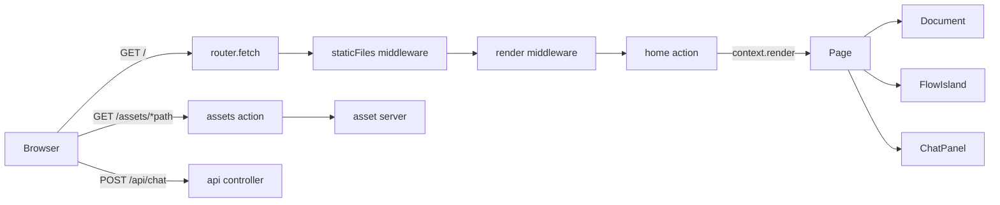

[Image of this diagram](diagrams/p09-d13-the-ui-in-remix-3-how-it-works.png)

Three kinds of request reach the one server (`app/routes.ts`):

| Request | Who makes it | What comes back |
|---|---|---|
| `GET /` | The browser, on page load | The page as HTML, with the marks the browser needs to hydrate the two components |
| `GET /assets/*path` | The browser, from the HTML's import map, preloads and entry script | A browser module, a stylesheet or a source map, built by the asset server |
| `POST /api/chat`, `GET /api/graph` | The chat panel; the agent's `get_flow` tool | One JSON event per line (NDJSON); the graph as JSON |

The steps, in order:

1. The browser asks for `/`. The router runs its two middleware first: `staticFiles` answers
   requests for files under `public/` (the favicon ends there), and the render middleware gives
   the action a `context.render` function (`app/router.ts`). The `home` action renders `Page`
   with two props, the RAG pipeline graph and the href of the chat route
   (`app/actions/controller.tsx`).
2. `Page` wraps its two columns in `Document`, the `<html>` shell. The head carries the title
   "Remix 3 Local RAG Agent", the island's stylesheet link, the import map, one `modulepreload`
   link per module and the one `<script type="module">` of the page, `entry.ts`
   (`app/actions/document.tsx`). The body has the canvas column with the island's placeholder
   text and the assistant column with the panel's markup (`app/actions/page.tsx`).
3. The browser runs `entry.ts`, which starts the Remix component runtime with `run`. The runtime
   finds the two client entries in the HTML, imports their modules through the asset server and
   starts each with the props the server rendered (`app/actions/public/entry.ts`, guide
   `05-interactivity.md`). The panel subscribes to clicks on the canvas; the island loads the
   React bundle (part 10).
4. The user asks. The panel posts `{ mode, question, context }` to the chat href and reads the
   body line by line; every line is one event, applied to the answer being built, and the panel
   re-renders after each one (`app/actions/public/chat-panel.tsx`).

### 9.3 For implementers

#### Remix 3 in this project

The app runs Remix 3.1.0 on Node 24 (`package.json`: `engines` asks for 24.3.0 or newer, and
`.nvmrc` names 24.22.1). Three properties shape everything below. `router.fetch` is a Request to
Response function, so the Node server and the tests call it alike (`app/router.ts`). A component
is a setup function that receives a handle and returns a render function
(`app/actions/page.tsx`). The JSX is Remix's own, not React's; React appears only inside the
island's bundle (`app/actions/public/flow-island.tsx`, README decision "React Flow as an island,
bundled"). The parts of the package the app imports, from the import lines of the files:

| Import | Used in | For |
|---|---|---|
| `remix/routes`: `route`, `get`, `post` | `app/routes.ts` | The route map |
| `remix/router`: `createRouter`, `createController`, `RouterContext` | `app/router.ts`, the controllers | The router, the controllers, the context type |
| `remix/middleware/static`: `staticFiles` | `app/router.ts` | `public/`, served as is |
| `remix/middleware/render`: `render` | `app/router.ts` | `context.render` |
| `remix/assets`: `createAssetServer` | `app/assets.ts` | The browser modules under `/assets` |
| `remix/component-hmr/assets`, `remix/node-hmr/runtime` | `app/assets.ts` | Hot module replacement |
| `remix/component`: `clientEntry`, `css`, `on`, `ref`, `run`, `Handle`, `RemixNode` | The components, `entry.ts` | The component model |
| `remix/component/server`: `ImportMap` | `app/actions/document.tsx` | The import map script |
| `remix/multiple-import-maps-polyfill` | `entry.ts`, `app/assets.ts` | Several import maps in one page |
| `remix/node-tsx` | `package.json` scripts | Runs the TypeScript sources in Node |

#### The route map

`app/routes.ts` declares every URL once, with its method:

```ts
export const routes = route({
  assets: get('/assets/*path'),
  home: get('/'),
  api: route('/api', {
    chat: post('/chat'),
    graph: get('/graph'),
  }),
})
```

The keys are the contract: a controller implements a map by giving one action per key, and a
route added here needs an action with the same key (`app/routes.ts`, "How it relates to them").
Hrefs are built, never typed: the `home` action passes `routes.api.chat.href()` to the page, which
hands it to the panel as `chatHref`, so the panel never hard-codes a path
(`app/actions/controller.tsx`). The file is on the asset server's allow list, so browser modules
may import it too (`app/assets.ts`, `allowFiles`).

#### The router and its middleware

`app/router.ts` builds the one router and maps the two route maps:

```ts
export const router = createRouter({
  middleware: [staticFiles('./public', { index: false }), render({ assets })],
})
router.map(routes, controller)
router.map(routes.api, apiController)
```

`staticFiles` serves `./public` unchanged and, with `index: false`, no directory index. The order
of the array is the order a request is handled in: the middleware first, then the maps. Two type
declarations make the actions typed without annotations: `AppContext = RouterContext<typeof
router>`, and a `declare module 'remix'` block that sets `RouterTypes.context` to it, so
`createController` infers the context of every action. Importing the module has effects: it
imports `app/assets.ts`, which awaits its browser entry at top level, so the server pays that once
before it listens.

#### The controllers

The root controller (`app/actions/controller.tsx`) is `createController(routes, { actions })`
with one action per top-level key:

- `assets(context)` returns `assets.fetch(context.request)`, or `404 Not Found` when the asset
  server has no such file.
- `home(context)` returns `context.render(<Page graph={ragPipeline}
  chatHref={routes.api.chat.href()} />)`. The graph is the fixture
  `app/fixtures/rag-pipeline.ts`; the page never reaches for the request itself.

The nested `api` map has its own controller, `app/actions/api/controller.tsx`, mapped with
`router.map(routes.api, apiController)`; it implements `chat` (the NDJSON stream) and `graph`
(`app/routes.ts`, README "Project layout"). Its inside belongs to the server-side parts of this
document.

#### The render middleware and `context.render`

`render({ assets })` adds `context.render` to the request context; it needs the asset server to
resolve the browser entry (`app/router.ts`, "Dependencies"). An action hands it a component
element and gets back the HTML Response of that component (`app/actions/controller.tsx`, `home`).
Because the type of `context` is derived from the middleware list, `context.render` is typed in
every action (`app/router.ts`, `AppContext`).

#### The asset server

`app/assets.ts` creates the server that compiles the browser modules and serves them under
`/assets`; the `assets` action hands it every `GET /assets/*path`. It compiles ES modules one by
one and refuses CommonJS, which is why React arrives as a bundle (`scripts/build-flow.ts`, part
10). Its options, from the file:

| Option | Value | Effect |
|---|---|---|
| `basePath` | `/assets` | The URL prefix of every built file |
| `rootDir` | `process.cwd()` | The root the allow lists are relative to |
| `allowFiles` | `['app/routes.ts', 'app/**/public/**']` | The files the browser may load: the route map and everything under a `public/` folder in `app/` |
| `allowPackages` | `['remix']` | The one package it may serve |
| `denyFiles` | `['app/**/*.test.*']` | Test files are never served |
| `sourceMaps` | `'external'` in development, else undefined | Separate map files in development only |
| `minify` | `!isDevelopment` | Minified in production only |
| `watch` | `isDevelopment` | A file watcher in development only |
| `hmr`, `scripts.loaders` | Set only under `npm run hmr` | See HMR below |

The `public/` convention follows from `allowFiles`: files outside the list are not served even if
a browser module imports them, so new client code goes under a `public/` folder (`app/assets.ts`,
"How it relates to them"). `isDevelopment` is `NODE_ENV === 'development'`, with `development` as
the default. README advises `npm run start` for demos, because under `npm run dev` the file
watcher makes answers arrive in bursts; `start` sets `NODE_ENV=production` through `cross-env`
(`package.json`).

The module resolves two things once, at top level, so pages read them synchronously:

- `scriptEntry = await assets.getScriptEntry('app/actions/public/entry.ts')`: the entry's href,
  the import map of every module it reaches and the modules to preload.
- `flowStyleHref = await assets.getHref('app/actions/public/flow/flow-bundle.css')`, with a catch
  that logs `Flow island stylesheet unavailable, run "npm run build:flow"` and the reason, and
  returns `null`. Before the first build the page renders without the link instead of failing.

#### The import map and preloads

`Document` (`app/actions/document.tsx`) is the `<html>` shell. Its props are `children` (the
body), `head` (extra head elements) and `title`, which defaults to the display name `remix new`
wrote into the file, "Remix 3 Local RAG Agent", through `readAppDisplayName`; `Page` passes the
same title explicitly. The head, in order: the UTF-8 charset, the viewport, `color-scheme: light
dark`, the icon `/favicon.svg` (served from `public/` by `staticFiles`), the title, the page's
`head`, `<ImportMap value={importMap} />`, one `<link rel="modulepreload">` per entry of
`preloads`, and `<script type="module" src={href}>` with the entry's href. All three values come
from `scriptEntry`. The body has `margin: 0`, so the page controls the whole viewport.

#### `clientEntry` and hydration boundaries

`clientEntry(import.meta.url, Component)` marks the smallest component that needs to run in the
browser. On the server it renders like any component; in the browser the runtime loads the same
module and starts it with the props from the server-rendered page. Props cross from the server to
the browser, so they must be serializable: strings, numbers, booleans, `null`, `undefined`, plain
objects, arrays and JSX elements, never functions or class instances (guide
`05-interactivity.md`, "Hydration boundaries with clientEntry"). The app has two:

- `ChatPanel`, with `{ chatHref: string }` (`app/actions/public/chat-panel.tsx`).
- `FlowIsland`, with `{ graph: FlowGraph }` (`app/actions/public/flow-island.tsx`).

`Page` and `Document` are not client entries: static ancestors do not hydrate because an
interactive child does (the same guide section).

#### The component model

The rules the two components follow, each from the guide `05-interactivity.md` unless another
source is named:

- **Setup, then render.** The component function receives the `handle` and returns the render
  function, which reads `handle.props` each time it runs ("State, updates, and post-render
  tasks"; `app/actions/page.tsx`).
- **State in variables.** UI state lives in setup scope: `let mode`, `let messages`, `let busy`
  in the panel. A change is followed by `handle.update()`, which schedules a render and returns a
  promise; the panel awaits it when the next step needs the new DOM (its `finally` block). Calling
  `update()` during setup warns, and during render throws.
- **`handle.queueTask(task)`** runs a task during the commit after the next update, for DOM work
  such as scrolling, and for browser-only setup after the client commit ("DOM references, global
  events, and cleanup").
- **`mix`** attaches behaviour and styles to an element: one mixin or an array. The app uses
  `css` (static scoped styles), `on` (a typed event handler) and `ref` (a callback that runs when
  the element is inserted, with a signal that aborts when the node is removed). `attrs` and
  `link` exist too but are not used here ("Composing behavior with mix").
- **`handle.signal`** aborts when the component disconnects; it is the signal for
  component-lifetime listeners ("Async work and cancellation", the table of signals).
- **Keys.** A list keyed by a stable id lets the runtime move existing DOM instead of pairing
  state with the wrong item. The panel keys messages by `message.id`, and gives the Stop and Send
  buttons the keys `stop` and `send` so they are two elements, not one reused.

#### The browser entry

`app/actions/public/entry.ts` is the one script module the document loads. It calls `run` once,
with two callbacks: `loadModule(moduleUrl, exportName)` imports the module through the polyfill's
`importModule` and returns the named export, throwing `Unknown component: url#name` when it is
not a function; `processClientEntryPreloads(preloads)` returns the preloads unchanged when the
browser supports several import maps (`detectMultipleImportMapSupport`), otherwise shims them with
`preloadShim` and returns none. The returned `app` has `ready()`, `flush()` and `dispose()`
(guide, "Booting the browser runtime with run"). `run()` hydrates the server-rendered page; it is
not a second router, and browser requests still go to the route actions (the same section).

#### The page

`Page(handle: Handle<{ graph: FlowGraph; chatHref: string }>)` (`app/actions/page.tsx`) renders:

- `<Document title="Remix 3 Local RAG Agent" head={...}>`, with `<link rel="stylesheet">` to
  `flowStyleHref` when it is not `null`.
- `<main>` as a grid of two columns, `minmax(0, 1fr) 400px`, `height: 100vh`, the system font.
- The left `<section aria-label="RAG pipeline">`, a vertical flex with `minWidth: 0`: a
  `<header>` with `<h1>{graph.title}</h1>`, which reads "A RAG pipeline: onboarding a document,
  then answering a question", and the hint "Click a step to ask the assistant about it.", then
  `<FlowIsland graph={graph} />`, which takes the remaining height.
- The right `<aside>` with a left border, white background and `minHeight: 0`, holding
  `<ChatPanel chatHref={chatHref} />`.

The page reads no request and no environment; the island and the panel talk through the DOM
events of `app/actions/public/events.ts`, not through the page.

#### The chat panel

`ChatPanel` (`app/actions/public/chat-panel.tsx`) keeps its state in eight setup-scope variables:

| Variable | Initial value | Meaning |
|---|---|---|
| `mode: ChatMode` | `'llm'` | The mode of the next question |
| `messages: Message[]` | `[]` | The conversation, oldest first |
| `nextId` | `1` | The next message id, incremented per question and per answer |
| `busy` | `false` | An answer is streaming: the input is disabled and Stop replaces Send |
| `selected: NodeSelectedDetail \| undefined` | `undefined` | The clicked canvas node, shown as a chip and sent as context |
| `controller: AbortController \| undefined` | `undefined` | The request in flight |
| `input: HTMLInputElement \| undefined` | `undefined` | The question field, captured by `ref` |
| `list: HTMLOListElement \| undefined` | `undefined` | The message list, captured by `ref` |

A `Message` has `id`, `role` (`user` or `assistant`), `text` (the question, or the tokens
concatenated so far), `events` (every `StreamEvent` received, in order) and an optional `stopped`.

**The mode buttons.** `MODES` lists `llm`, `rag` and `agent` with a tooltip each ("The LLM alone",
"The LLM over passages of the article", "The LLM with tools over the article and the canvas").
Each is a `type="button"` with `aria-pressed={mode === m.id}`, which the style reads to fill the
pressed one, and an `on('click')` that sets `mode` and calls `handle.update()`. The input's
placeholder follows: `Ask the LLM…`, `Ask the RAG…` or `Ask the AGENT…`.

**The request.** The form's `on('submit')` calls `preventDefault()`, reads the `question` field
from `FormData`, trims it, ignores an empty question or a submit while `busy`, resets the form
and calls `ask(question)` without awaiting. `ask` builds a `ChatRequest`
`{ mode, question, context: selected ? { selectedNode: selected } : undefined }`, pushes the
user's message and an empty assistant message together, clears `selected`, sets `busy`, creates
the `AbortController`, and posts the JSON to `handle.props.chatHref` with
`Content-Type: application/json` and the combined signal. A status outside 2xx or a missing body
becomes an `error` event in the answer, worded by `describeFailure`: `The server answered 400:`
followed by the server's JSON `error` string, or `The server answered 400` alone when the body is
not that JSON (400 stands for the status received).

**The NDJSON reader.** `readEvents(body)` is an async generator over the response body. It takes
a reader, decodes bytes with one `TextDecoder` in streaming mode so a multi-byte character cut by
a chunk boundary survives, appends to a buffer, splits on `\n`, keeps the incomplete tail, yields
`JSON.parse(line)` for each complete non-blank line, parses the last line when the body ends and
releases the reader's lock in `finally`. `ask` applies each event with `receive` and re-renders.

**What each event becomes.** `receive` pushes every event into `reply.events` and extends
`reply.text` on a `token`. `renderAssistant` derives the bubble from the events:

| Event type | Rendered as |
|---|---|
| `token` | The answer's text, whitespace kept; an ellipsis while the newest answer has no token yet |
| `tool` | One monospace line above the text, `called <name>: <values>`, through `describeArgs`, for instance `called highlight_node: vector-store` |
| `sources` | A "Sources" block: one numbered item per passage, `chapter, sub-heading · lines from–to · score` (`describeSource`) and the first 120 characters of the passage (`snippet`, `SNIPPET_LENGTH`) |
| `error` | A red box with `role="alert"`: `Error: <message>` |
| `done` | A footer with the model's name and `ms / 1000` to one decimal, in seconds |
| `ui` | Not rendered; forwarded to the canvas (below) |

An answer with `stopped` set shows the footer "Stopped" instead.

**The source line.** `describeSource` writes the place a passage comes from: the chapter, then a
comma and the sub-heading when the passage sits under one (the sub-heading differs from the
chapter), then ` · lines from–to · ` and the score with two decimals. It is the same place that
`cite()` in `app/ai/rag.ts` names in the prompt, so the user sees what the model saw, with the
score added. Take the passage `improvements-9`, the Chunking sub-section of the chapter
Improvements, lines 69 to 71 (129 characters, `tmp/chunks-table.md`). In the RAG run of
`docs/transcripts/rag.ndjson` it scored 0.67917335, so the panel shows `Improvements, Chunking ·
lines 69–71 · 0.68`, and under it the snippet: the passage's text on one line, cut at 120
characters, `### Chunking Chunking involves various strategies for breaking up the data into
vectors so the retriever can find detail…`. A passage of a chapter's opening, such as lines 15 to
15 of "RAG and LLM limitations", shows the chapter alone: `RAG and LLM limitations · lines 15–15 ·
0.68`.

**The Stop button and `AbortSignal.any`.** The request's signal is
`AbortSignal.any([controller.signal, handle.signal])`: Stop calls `controller.abort()`, and the
panel's own teardown aborts the request too. In the `catch`, `signal.aborted` means the user
stopped or the panel left, so `reply.stopped = true`; any other failure (network, bad JSON)
becomes an `error` event. The `finally` resets `busy` and `controller` and, unless
`handle.signal` is aborted, awaits `handle.update()`, scrolls and refocuses the input.

**The selected-node chip.** In a `handle.queueTask` run after the client commit, the panel calls
`onNodeSelected(listener, handle.signal)`: each click stores the detail in `selected`, calls
`handle.update()` and focuses the input. The chip renders `About: {selected.label}`, for instance
"About: Chunking", with a round close button (`aria-label="Clear the selected step"`) whose click
clears `selected`. The next `ask` sends the node as `context.selectedNode` and clears it, so the
chip goes with the question.

**Forwarding `ui` events.** When `receive` sees `{ type: 'ui', action: 'highlight-node' }`, it
calls `emitHighlightNode({ nodeId: event.nodeId })` at once; the canvas listens through
`events.ts` (part 10).

**Auto-scroll.** `refresh()` calls `handle.update()` and queues `scrollToEnd` with
`handle.queueTask`, so the scroll runs after the commit, when the list has its new height;
`scrollToEnd` sets `list.scrollTop = list.scrollHeight`. The list is an `<ol aria-live="polite">`
so screen readers read new content as it arrives.

The helpers below the component (`readEvents`, `describeFailure`, `describeArgs`,
`describeSource`, `snippet`) are pure and could be tested without a browser (the file's header).

#### How the components relate

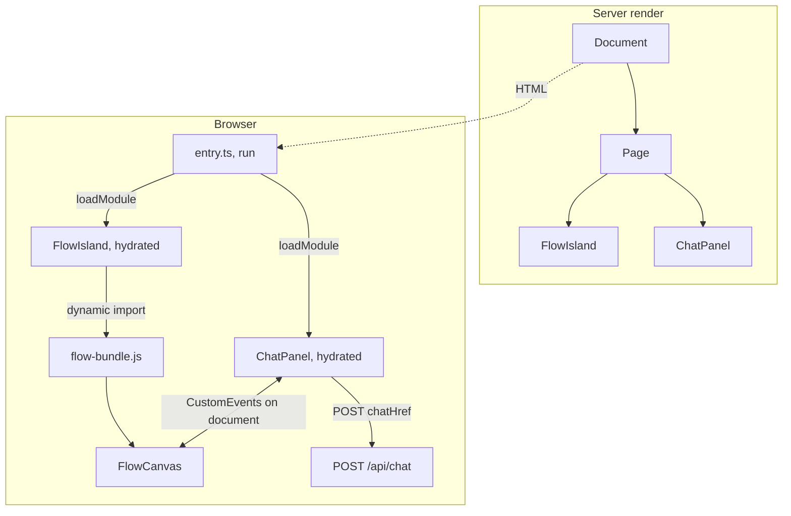

[Image of this diagram](diagrams/p09-d14-the-ui-in-remix-3-how-the-components-relate.png)

The server renders the whole tree once. In the browser only the two client entries are started,
each from the same module the server used. The island then loads a second program, the React
bundle, and the two programs share nothing but the document and its events (`app/actions/public/
events.ts`).

#### HMR

`npm run hmr` runs `hmr.ts` with `NODE_ENV=development`, after `prehmr` builds the island
(`package.json`); AGENTS.md describes it as live server and browser updates, where `npm run dev`
only watches and restarts the server. Two files react to it. `app/assets.ts` sets `isHmr` when
the environment is development and `REMIX_NODE_HMR` is set, which the file says happens under
`npm run hmr`; it then gives the asset server an `hmr` channel (`createBrowserHmrChannel` from
`remix/node-hmr/runtime`), the import map polyfill as `moduleImporter`, and the `componentHmr`
script loader that makes components hot-replaceable. `app/actions/public/entry.ts` sees
`import.meta.hot` only then: on `server:update` it awaits `app.ready()` and calls
`app.frames.top.reload()`, which fetches and renders the top frame again in place; a failure is
logged and the channel stays open. The island's `data-rmx-preserve-dom` matters here: on a frame
reload, matched elements keep their children, so React's canvas survives (component README,
"Preserving Client-Owned DOM"; part 10).

## 10. The island and React Flow

### 10.1 For every reader

The canvas on the left is drawn by React Flow, a library for diagrams of boxes and arrows that
works only inside React. Remix 3 is not React, and the rest of the page is not React. The project
joins the two the way one puts a plant in a pot: Remix places an empty box on the page and
promises never to touch what grows inside it; React is handed the box and draws the canvas in it.
Until the canvas is ready, the box says "Loading the canvas…". This arrangement is called an
island.

The two sides never call each other. They talk the way two strangers in a room do, by speaking
out loud: "the user clicked Chunking" is one message, from the canvas to the panel; "light up
Vector store" is the other, from the panel to the canvas. Either side can be missing and nothing
breaks; the message is simply not heard.

The React code travels to the browser as one pre-built file, because Remix's own loader cannot
serve React as it is packaged. One command builds that file before the app starts, so the user
never notices.

### 10.2 How it works

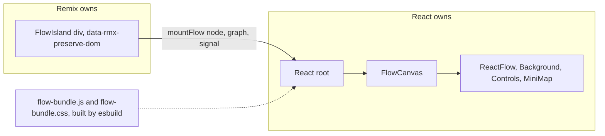

[Image of this diagram](diagrams/p10-d15-the-island-and-react-how-it-works.png)

The island is a Remix component that renders one `<div>` with a placeholder. In the browser, once
the element is in the document, the component loads the bundle and hands the element, the graph
and an abort signal to `mountFlow`, which creates a React root in the element and renders the
canvas. The signal aborts when the element leaves the document, and the root is unmounted on it.
Remix is told, through `data-rmx-preserve-dom`, to leave the element's children alone from then
on (`app/actions/public/flow-island.tsx`, `app/actions/public/flow/mount.ts`).

Three sequences cover the whole life of the island.

**Page load to mounted canvas.**

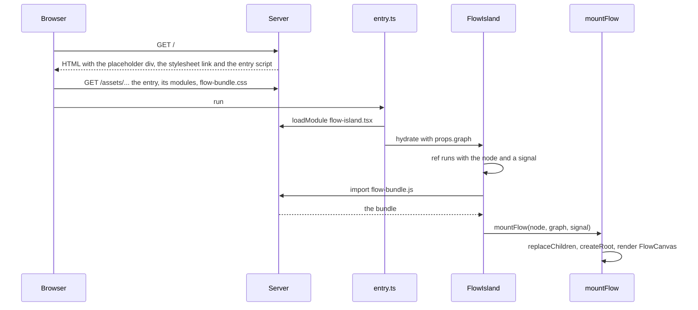

[Image of this diagram](diagrams/p10-d16-the-island-and-react-how-it-works.png)

**A click to the chip.**

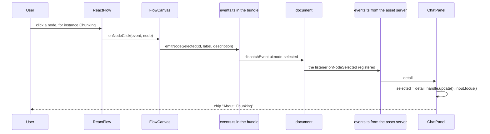

[Image of this diagram](diagrams/p10-d17-the-island-and-react-how-it-works.png)

**A highlight from the agent to the node.**

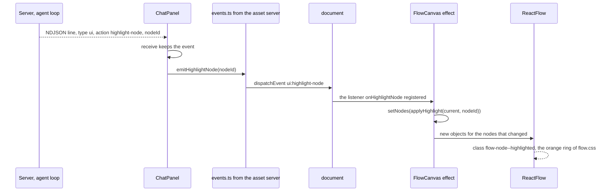

[Image of this diagram](diagrams/p10-d18-the-island-and-react-how-it-works.png)

### 10.3 For implementers

#### The island

`FlowIsland` (`app/actions/public/flow-island.tsx`) is a `clientEntry` with the prop
`graph: FlowGraph`. Its render returns one `<div data-rmx-key="flow-canvas" data-rmx-preserve-dom>`
with the text "Loading the canvas…" and a `mix` of `containerStyle` and a `ref`. The key gives the
element a stable identity across renders; `data-rmx-preserve-dom` tells the runtime that, on later
frame reloads, the element keeps its current attributes and children instead of accepting incoming
DOM updates, while the server still renders its children (component README, "Preserving
Client-Owned DOM"). The style fills the section (`flex: 1 1 auto`), guarantees `minHeight: 420px`
so React Flow, which sizes to its parent, has room, and centres the grey placeholder.

The `ref` callback runs in the browser only, once the element is inserted, with the node and a
signal that aborts when the node is removed (guide `05-interactivity.md`, "DOM references, global
events, and cleanup"). It imports `./flow/flow-bundle.js` dynamically and, when the import
resolves, returns if `signal.aborted` and otherwise calls
`flow.mountFlow(node, handle.props.graph, signal)`. On failure it writes `The canvas could not
load. Run "npm run build:flow" and reload.` into the node and logs the error. The bundle is
loaded, not imported statically, so a missing bundle breaks the canvas alone and not the page.
The file never imports React and never writes the JSX import-source pragma (its header; see the
pragma section below).

`mountFlow(container, graph, signal)` (`app/actions/public/flow/mount.ts`) returns at once if the
signal is already aborted, so a container that left the document during the import is never
touched. Otherwise it calls `container.replaceChildren()` to drop the placeholder, creates the
root with `createRoot(container)` from `react-dom/client`, renders
`createElement(StrictMode, null, createElement(FlowCanvas, { graph }))` and registers
`root.unmount()` on the signal's `abort`, `once: true`. It uses `createElement` instead of JSX so
the file stays plain `.ts`. `StrictMode` double-invokes effects in React's development build,
which checks that the effect in `FlowCanvas` cleans its listener up (the file's comments); the
default build is the production one (below). The server renders only the placeholder.

#### Why a bundle

README's decision "React Flow as an island, bundled" states it: "Remix's asset server refuses
CommonJS, and React ships it". `scripts/build-flow.ts` names the error code: the asset server
compiles ES modules one by one and refuses CommonJS with `COMMONJS_NOT_SUPPORTED`, and `react`,
`react-dom` and `react/jsx-runtime` ship CommonJS only. esbuild turns `mount.ts` and everything it
imports into one ES module, which the asset server then serves unchanged, plus one stylesheet. The
result is self-contained, so no import map entry is needed for `react`. The production build of
25 October 2026 printed `build:flow production: app/actions/public/flow/flow-bundle.js (396 kB),
app/actions/public/flow/flow-bundle.css (16 kB) in 175 ms`: the 396 kB hold React, React Flow
and the canvas. The versions, from `package.json`: `react` and `react-dom` 19.3.1,
`@xyflow/react` 12.12.0, `esbuild` 0.27.7.

#### The esbuild build

`scripts/build-flow.ts` calls `esbuild.build` once, as a library, with these options:

| Option | Value | Why (from the file's comments) |
|---|---|---|
| `entryPoints` | `['app/actions/public/flow/mount.ts']` | The entry and everything it reaches: the canvas, `events.ts`, `graph-to-flow.ts`, the packages |
| `outfile` | `app/actions/public/flow/flow-bundle.js` | Next to the island that loads it; the CSS becomes `flow-bundle.css` beside it |
| `bundle` | `true` | Inline every import, CommonJS ones included |
| `format` | `'esm'` | The only format the asset server serves |
| `platform`, `target` | `'browser'`, `['es2022']` | Browser globals and the packages' browser entries; syntax current browsers understand |
| `jsx`, `jsxImportSource` | `'automatic'`, `'react'` | JSX compiles to `react/jsx-runtime` calls; `flow-canvas.tsx` repeats the choice in its first line for `tsc` |
| `define` | `process.env.NODE_ENV` as `"production"`, or `"development"` with `--dev` | React reads it to pick its build; the browser has no `process` |
| `minify` | `!dev` | Small output in production, readable with `--dev` |
| `sourcemap` | `'linked'` with `--dev`, else `false` | A `.map` file only in development |
| `legalComments` | `'none'` | No license comments in the output |
| `metafile`, `logLevel` | `true`, `'warning'` | The sizes for the log line; quiet unless something is wrong |

The one log line reads `build:flow production: <file> (<size> kB), ... in <ms> ms`. esbuild throws
on a build error, which fails the npm script and the pre-script that called it. `package.json`
runs the script as `build:flow` and as the hooks `predev`, `prehmr` and `prestart`, so the bundle
is never stale when the server starts; `--dev` is passed as `npm run build:flow -- --dev`. The
three outputs, `flow-bundle.js`, `flow-bundle.js.map` and `flow-bundle.css`, are listed in
`.gitignore`, and `scripts/check-comments.ts` skips `flow-bundle.*` (the build script's header).

#### The stylesheet

`mount.ts` imports `@xyflow/react/dist/style.css` and `./flow.css` as its first two lines, so
esbuild emits both, in that order, as `flow-bundle.css` rather than into the JavaScript.
`app/assets.ts` resolves that file's href under `/assets` as `flowStyleHref` (or `null` before
the first build, with a warning), and `Page` puts `<link rel="stylesheet" href={flowStyleHref}>`
in the document head through `Document`'s `head` prop (`app/actions/page.tsx`). Because React
Flow's own rules come first in the bundle, `flow.css` pairs each of its selectors with a React Flow
class, which gives its rules precedence (`flow.css`, "How it relates to them"). Its rules, from
the file:

- `.flow-node.react-flow__node-default`: a 160px white card with 12px padding, a `1.5px` grey
  border, radius 8px, 16px system font, pointer cursor, 150ms transitions on the shadow and the
  border.
- `--start`: green border and tint (Documents and Question); `--end`: blue, bold (Answer);
  `--failure`: red, dashed (no node of this kind is in the fixture).
- `.selected` (added by React Flow on click): a 2px dark ring.
- `.flow-node--highlighted`: an orange border and a 4px glowing ring, stronger than the selection
  so both can show at once.
- `.react-flow__edge-text`: 11px grey; under `.flow-edge`, text and its background box are moved
  up 30px, clear of the line, which is where "closest passages" sits.

The colours are fixed light ones, and neither `flow.css` nor the page has a rule for the dark
colour scheme, so the canvas is styled for the light scheme only.

#### The type declarations

Two ambient files make `tsc` accept what esbuild handles at build time:

- `app/actions/public/flow/css.d.ts` declares `module '*.css' {}`, so the two stylesheet imports
  in `mount.ts` compile; the module shape is empty on purpose, so importing a value from a
  stylesheet still fails.
- `app/actions/public/flow/flow-bundle.d.ts` is `export * from './mount.ts'`: the island's
  `import('./flow/flow-bundle.js')` resolves to it, so `flow.mountFlow(...)` is typed although the
  bundle is ignored by git and may not exist. The declaration is true only while `mount.ts` stays
  the single entry of `build-flow.ts`; a second entry or a renamed output changes all three files
  together (the file's header).

#### The per-file JSX pragma

The project's JSX is Remix's, so a file whose JSX must be React's says so in its first line.
`flow-canvas.tsx` begins with exactly this line, before its header comment:

```tsx
/** @jsxImportSource react */
```

It is there for `tsc`: esbuild already compiles the bundle's JSX with `jsx: 'automatic'` and
`jsxImportSource: 'react'`, and `build-flow.ts` says the first line repeats that choice for the
type checker. `mount.ts` avoids the question by using `createElement`.

The trap: the compiler reads that pragma text wherever it appears in a comment, an ordinary one
included. A Remix component whose header merely mentioned the text would have its JSX switched to
React and would break. That is why `flow-island.tsx` describes the pragma in words ("it never
writes the JSX import-source pragma, which would switch this file's JSX to React") and why this
document shows the text only in a code block.

#### The graph the canvas draws

The graph is the fixture `app/fixtures/rag-pipeline.ts`: the title "A RAG pipeline: onboarding a
document, then answering a question", nine nodes and eight edges. Positions are fixed in canvas
pixels, not computed. The layout is compact: every x is a multiple of 190, and a card is 160px
wide (`flow.css`), so neighbours in a row are 30px apart.

| Row | Nodes, left to right (x from -380 to 760, steps of 190) | y |
|---|---|---|
| Onboarding a document, once | `documents` (start, x -380), `chunking`, `embedding`, `vector-store` (x 190) | 60 |
| Answering a question | `question` (start, x 0), `retrieval`, `augmented-prompt`, `generation`, `answer` (end, x 760) | 220 |

The eight edges are `documents` to `chunking`, `chunking` to `embedding`, `embedding` to
`vector-store`, `question` to `retrieval`, `vector-store` to `retrieval` (labelled "closest
passages"), `retrieval` to `augmented-prompt`, `augmented-prompt` to `generation` and `generation`
to `answer`. The kinds in use are `start` (two nodes), `step` (six) and `end` (one). Each
description says how this app does the step, for example Chunking: "The article is cut into
passages of about 500 characters that never cross a section heading, so the retriever can find
details in it." The node ids are the vocabulary the agent and the canvas share: `highlight_node`
receives one of them.

One weakness shows in `docs/images/01-canvas.png`: `vector-store` and `retrieval` have the same
x, one above the other, but the arrows leave a node on its right and enter the next on its left
(`graph-to-flow.ts`). The edge between them therefore takes a wide route: out to the right, down,
back left across the gap beside Question, and into Retrieval's left side. It is correct and
legible, but longer than the picture needs.

#### `graph-to-flow.ts`

`app/actions/public/flow/graph-to-flow.ts` translates the server's neutral `FlowGraph` (ids,
labels, kinds, positions; `app/ai/types.ts`) into React Flow's objects. It imports only the types
`Edge`, `Node` and `Position` from `@xyflow/react`, no React and no DOM, so it runs in the server
test `graph-to-flow.test.ts` as well as in the bundle. Its exports:

- `FlowNodeData`: `label`, `description`, `kind` (`start`, `step`, `end` or `failure`) and
  `highlighted`; `CanvasNode = Node<FlowNodeData, 'default'>`, `CanvasEdge = Edge`.
- `NODE_CLASS = 'flow-node'`, `HIGHLIGHTED_CLASS = 'flow-node--highlighted'`, and
  `kindClass(kind)`, which returns `flow-node--<kind>` in BEM style.
- `toCanvasNodes(graph, highlightedId)`: one node per graph node, type `'default'`, the fixture's
  position, `sourcePosition: 'right'` and `targetPosition: 'left'` (the pipeline reads left to
  right), the data above, the class list `flow-node flow-node--<kind>` plus the highlight class
  on the one matching id, `draggable: false`, `connectable: false`.
- `toCanvasEdges(graph)`: one edge per graph edge, type `'smoothstep'`, `markerEnd` of type
  `'arrowclosed'`, the graph's label and the class `flow-edge`.
- `applyHighlight(nodes, highlightedId)`: a new array in which a node whose state is already
  right is the same object, and a node that changes is a new object with `data.highlighted` and
  the class list both updated; React compares by identity, so React Flow re-renders only the
  nodes whose highlight moved.

The class names are the contract with `flow.css`; a rename on either side turns a rule off with no
error (both files' headers). The project draws no custom node component: the look comes from the
classes.

#### `flow-canvas.tsx`

`FlowCanvas({ graph })` (`app/actions/public/flow/flow-canvas.tsx`) owns React Flow's state:
`useNodesState(toCanvasNodes(graph, null))` and `useEdgesState(toCanvasEdges(graph))`. The graph
prop is read once, at mount; a new graph needs a new mount (the file's header). Its `<ReactFlow>`
props: `nodes`, `edges`, `onNodesChange`, `onEdgesChange`, `onNodeClick`, `fitView` with
`fitViewOptions={{ padding: 0.08 }}`, `nodesDraggable={false}`, `nodesConnectable={false}`,
`elementsSelectable`, `minZoom={0.4}`, `maxZoom={1.5}`. The padding of 0.08 keeps the margin
around the nine nodes small, which suits the compact spacing of the fixture. Its children:
`<Background gap={20} color="#d0d4d8" />`, `<Controls showInteractive={false} />` and
`<MiniMap pannable zoomable>` coloured by node kind through `kindColor`, a record keyed by
`CanvasNode['data']['kind']` with the border colours of `flow.css`, so a new kind is a type error.

`onNodeClick` is a `useCallback` with no dependencies that calls `emitNodeSelected` with the node's
`id`, `data.label` and `data.description`; position and kind stay on the canvas. The highlight
effect is a `useEffect` with `[setNodes]` as its dependency: it creates an `AbortController`,
subscribes with `onHighlightNode(({ nodeId }) => setNodes((current) => applyHighlight(current,
nodeId)), controller.signal)` and returns `() => controller.abort()` as its cleanup, so the DOM
listener leaves with the effect. The functional `setNodes` reads the latest nodes, so the effect
needs no dependency on `nodes`.

#### What was seen in a real browser

README's measured results record a run in headless Chrome driving the page: the nine nodes
render; a click on Chunking shows "About: Chunking" in the panel; the agent's tool lines and the
highlight appear. `docs/images/03-agent-highlight.png` is the picture of that last step: after
the question "Where does the vector store fit in the pipeline?", the panel shows the lines
`called search_docs: Where does the vector store fit in the pipeline?` and `called
highlight_node: vector-store`, and the Vector store card has the orange highlight, while Chunking
still carries the dark selection ring; the two marks show together, as `flow.css` intends. Only
headless Chrome was used; other browsers were not tried.

#### The browser-event bridge

`app/actions/public/events.ts` is the only thing the two programs share. It names two events and
types their payloads:

| Name | Constant | Direction | Detail |
|---|---|---|---|
| `ui:node-selected` | `NODE_SELECTED` | Canvas to panel | `NodeSelectedDetail = Pick<FlowNode, 'id' \| 'label' \| 'description'>` |
| `ui:highlight-node` | `HIGHLIGHT_NODE` | Panel to canvas | `HighlightNodeDetail = { nodeId: string \| null }`; `null` clears the highlight, an unknown id highlights nothing |

The `ui:` prefix keeps the names clear of any DOM or library event. `emitNodeSelected` and
`emitHighlightNode` dispatch a `CustomEvent` on `document` with the detail as payload, fire and
forget: with nobody listening the event is lost, which the file calls the right outcome.
`onNodeSelected(listener, signal)` and `onHighlightNode(listener, signal)` add a listener on
`document` with `{ signal }` and hand the listener the detail already typed, so neither side spells
an event name or casts an `Event` by hand. Every listener takes an `AbortSignal`: the panel passes
`handle.signal`, the canvas the signal of a controller its effect aborts on cleanup.

Two copies of this module run in the browser. The bundle inlines it, because `flow-canvas.tsx`
imports `../events.ts` and esbuild bundles everything reachable from `mount.ts`; the panel imports
it as a module served by the asset server. That is safe only because the module holds no state:
the contract is the event names and the detail shapes, plain strings and objects on `document`.
The file's header ends with the rule that follows: never add module state here.

#### Hydration order and timing

What the code fixes, and what it leaves open:

1. The stylesheet link is in the document head, so the browser requests `flow-bundle.css` with the
   page, before any script runs (`app/actions/document.tsx`, `app/actions/page.tsx`).
2. `entry.ts` runs `run()`, which hydrates the client entries found in the HTML. Nothing in the
   app orders the panel and the island; each is started by the runtime from its own module.
3. The panel's `onNodeSelected` subscription runs in a `handle.queueTask`, after the client
   commit (`chat-panel.tsx`). The island's `ref` runs when its element is inserted, then waits for
   the dynamic import of the bundle, a network round trip; `mountFlow` runs only after that
   (`flow-island.tsx`). The canvas's `onHighlightNode` subscription runs in a `useEffect`, after
   React has mounted `FlowCanvas` (`flow-canvas.tsx`).
4. Both sides check their signal after the asynchronous step: the island before calling
   `mountFlow`, and `mountFlow` again before touching the container, so a navigation during the
   import mounts nothing.

An event dispatched before the other side's listener exists is lost (`events.ts`). In practice
neither order matters: a user cannot click a node before the canvas is mounted, and the agent
cannot highlight before a question was asked from the mounted page. Once mounted, the island never
reads `graph` again (`flow-island.tsx`, "How it relates to them"); the React root lives until the
island's signal aborts, which happens when the element leaves the document, and on a frame reload
under HMR the element is preserved instead (part 9, HMR).

## 11. Interactions and protocols

### 11.1 For every reader

Four programs take part in one answer: the browser, the Node server that serves the page, Ollama
(the language model) and Qdrant (the passage index, in Docker). They all run on the same machine
and talk to each other in the plainest way there is: HTTP requests, the same kind a web page
makes. The browser asks the server; the server asks Ollama and Qdrant; no other program is
involved and no cloud service is called. Inside the browser, the chat panel and the canvas are
two separate programs on one page, and they talk through browser events, like a click.

This part lists every one of those conversations: who starts it, what goes in, what comes back,
with one real example each, and how long each took when it was measured.

### 11.2 How it works

#### 11.2.1 The processes and their ports

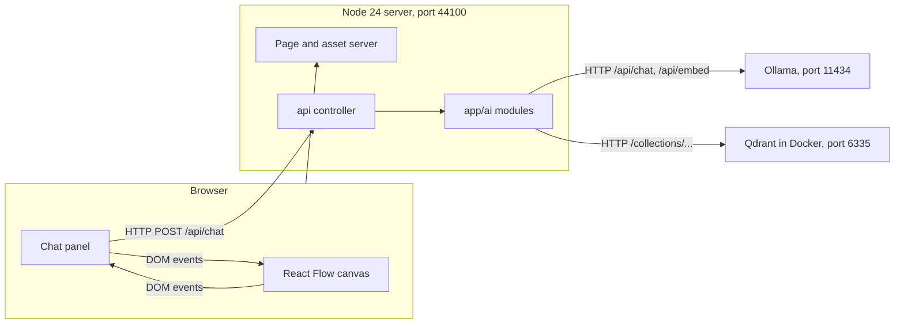

[Image of this diagram](diagrams/p11-d19-interactions-and-the-processes-and-their.png)

| Process | Listens on | Source of the port |
|---|---|---|
| Node server (Remix 3.1.0) | `http://localhost:44100` | `server.ts`, `PORT` with 44100 as default; `README.md`, Quick start |
| Ollama | `http://localhost:11434` | `app/ai/config.ts`, `ollamaUrl` default |
| Qdrant 1.20.0, container `remix3-rag-qdrant` | `http://localhost:6335`, forwarded to 6333 inside the container | `docker/compose.yml`; `app/ai/config.ts`, `qdrantUrl` default |
| Browser | nothing; it only calls | |

Ollama listens on 127.0.0.1 only, as installed; this project does not change that. The Remix
server binds every interface of the machine (`server.ts` calls `listen(port)` without a host) and
Docker publishes Qdrant's port on every interface too (`"6335:6333"` names no host address in
`docker/compose.yml`), so both can be reached from the local network unless a firewall blocks
them. The project does nothing to expose them further, and whether a firewall blocks them was
not checked. Neither the server nor Qdrant asks for a key. The ingest script is a fifth process
that runs once, before any demo, and talks to Ollama and Qdrant the same way the server does
(`scripts/ingest.ts`, header).

#### 11.2.2 How the processes communicate, the explicit answer

- Browser to server: HTTP, three kinds of request: the page, the browser modules, the two API
  routes (`app/routes.ts`).
- Server to Ollama and server to Qdrant: HTTP over TCP, with the built-in `fetch`
  (`app/ai/ollama.ts`, `app/ai/qdrant.ts`), to the addresses of `app/ai/config.ts`: `localhost`
  port 11434, where Ollama listens on the loopback address only, and `localhost` port 6335,
  the port Docker publishes for Qdrant. The browser never reaches either; everything in
  `app/ai/` runs on the server only (`app/actions/public/chat-panel.tsx`, header: "The server,
  not the panel, talks to Ollama and Qdrant").
- Panel to canvas and back, inside the browser: DOM `CustomEvent`s dispatched on `document`
  (`app/actions/public/events.ts`).
- Nothing else: no shared memory, no message queue, no WebSocket, no socket other than the HTTP
  connections above. The only long-lived connection is the chunked HTTP response of
  `POST /api/chat`, open while the model writes.

#### 11.2.3 The sequences, with measured times

Times come from `docs/transcripts/timings.txt`, captured on 25 October 2026 in production mode,
`qwen3:1.7b` with thinking off, temperature 0, model loaded, on an Intel i7-6600U with 2 cores
and 32 GB of RAM, CPU only. "First byte" is the time to the first byte of the response; "total"
the time to its end.

Loading the page:

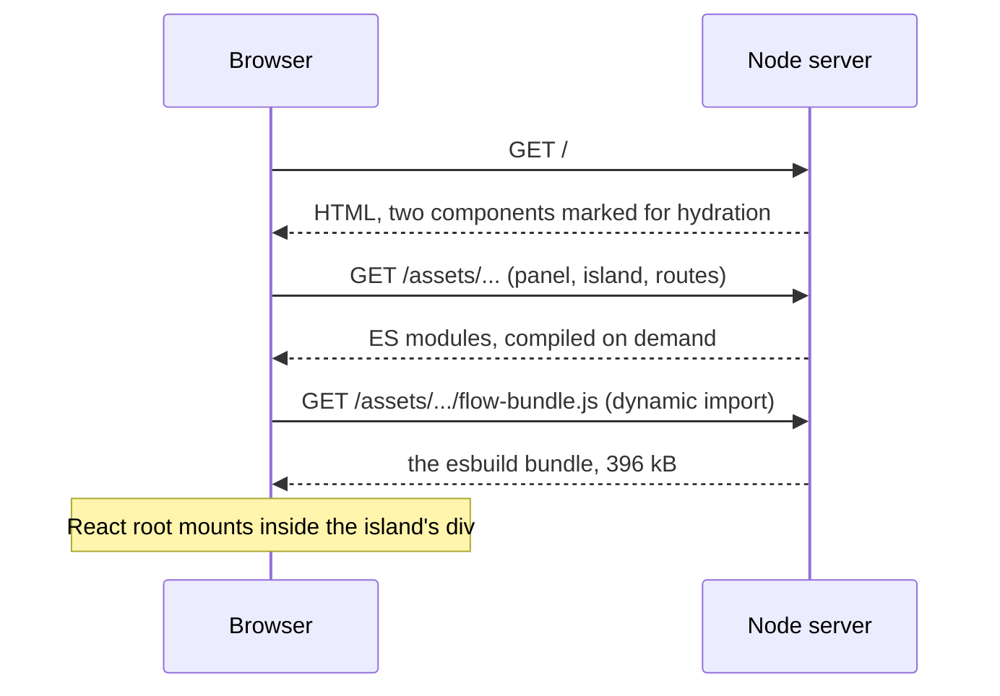

[Image of this diagram](diagrams/p11-d20-interactions-and-the-sequences-with.png)

LLM mode, "What is chunking in RAG?", first byte 0.62 s, total 4.17 s (`timings.txt`, line 2;
the stream is `docs/transcripts/llm.ndjson`):

```mermaid
sequenceDiagram
  participant P as Chat panel
  participant S as Node server
  participant O as Ollama
  P->>S: POST /api/chat {mode: llm, question}
  S->>O: POST /api/chat, stream: true
  O-->>S: one JSON line per token
  S-->>P: token lines (NDJSON)
  O-->>S: done: true
  S-->>P: done {model, ms}
```

[Image of this diagram](diagrams/p11-d21-interactions-and-the-sequences-with.png)

RAG mode, the same question, first byte 0.44 s, total 16.26 s (`timings.txt`, line 3; the stream is
`docs/transcripts/rag.ndjson`):

```mermaid
sequenceDiagram
  participant P as Chat panel
  participant S as Node server
  participant O as Ollama
  participant Q as Qdrant
  P->>S: POST /api/chat {mode: rag, question}
  S->>O: POST /api/embed (the question)
  O-->>S: one vector of 768 numbers
  S->>Q: POST /collections/rag-article/points/search, limit 4
  Q-->>S: four hits with payload and score
  S-->>P: sources line
  S->>O: POST /api/chat with the four passages
  O-->>S: token lines
  S-->>P: token lines
  S-->>P: done
```

[Image of this diagram](diagrams/p11-d22-interactions-and-the-sequences-with.png)

Agent mode, "Explain this step in one short paragraph." with the Chunking step selected, first
byte 0.016 s, total 46.28 s (`timings.txt`, line 4; the stream is
`docs/transcripts/agent-chunking.ndjson`). The agent retrieves first and then lets the model
decide:

```mermaid
sequenceDiagram
  participant P as Chat panel
  participant C as Canvas
  participant S as Node server
  participant O as Ollama
  participant Q as Qdrant
  P->>S: POST /api/chat {mode: agent, question, context}
  S-->>P: tool search_docs, written before any call
  S->>O: POST /api/embed
  S->>Q: points/search, limit 3
  S-->>P: sources
  S->>O: POST /api/chat with the passages, the canvas steps and the tools
  O-->>S: message.tool_calls: highlight_node
  S-->>P: tool highlight_node, then ui highlight-node
  P->>C: ui:highlight-node {nodeId: chunking}
  S->>O: POST /api/chat with the tool result
  O-->>S: token lines
  S-->>P: token lines, then done {ms: 46267}
```

[Image of this diagram](diagrams/p11-d23-interactions-and-the-sequences-with.png)

The second agent run, "Where does the vector store fit in the pipeline?", took 18.66 s with a
first byte at 0.013 s (`timings.txt`, line 5; `docs/transcripts/agent-vector-store.ndjson`).
Both runs highlighted the right step. A bad request body is answered in 0.016 s
(`timings.txt`, line 6).

Stop, pressed in the panel:

```mermaid
sequenceDiagram
  participant P as Chat panel
  participant S as Node server
  participant O as Ollama
  P->>S: abort the fetch
  Note over S: request.signal fires, the stream's cancel() runs
  S->>O: the fetch to Ollama is aborted, the connection closes
  Note over O: generation stops
  Note over S: logs "[chat] ... aborted by the client after N ms"
```

[Image of this diagram](diagrams/p11-d24-interactions-and-the-sequences-with.png)

### 11.3 For implementers

#### 11.3.1 The catalog

| Interface | Caller | Callee | Transport | Defined in |
|---|---|---|---|---|
| `GET /` | browser | Node server | HTTP, HTML | `app/routes.ts` (`home`), `app/actions/controller.tsx` |
| `GET /assets/*path` | browser | Node server | HTTP, ES modules | `app/routes.ts` (`assets`), `app/assets.ts` |
| `GET /api/graph` | browser, tests | Node server | HTTP, JSON | `app/routes.ts`, `app/actions/api/controller.tsx` |
| `POST /api/chat` | chat panel | Node server | HTTP, NDJSON response | `app/routes.ts`, `app/ai/chat.ts` |
| NDJSON events | Node server | chat panel | lines in the response body | `app/ai/types.ts` (`StreamEvent`) |
| Ollama `POST /api/chat` | `app/ai/ollama.ts` | Ollama | HTTP, NDJSON response | `app/ai/ollama.ts` (`chat`) |
| Ollama `POST /api/embed` | `app/ai/ollama.ts` | Ollama | HTTP, JSON | `app/ai/ollama.ts` (`embed`) |
| Qdrant REST | `app/ai/qdrant.ts` | Qdrant | HTTP, JSON | `app/ai/qdrant.ts` |
| `ui:node-selected` | canvas | chat panel | DOM CustomEvent | `app/actions/public/events.ts` |
| `ui:highlight-node` | chat panel | canvas | DOM CustomEvent | `app/actions/public/events.ts` |
| `import('./flow/flow-bundle.js')` | flow island | asset server | HTTP, dynamic import | `app/actions/public/flow-island.tsx` |

The route map, as declared (`app/routes.ts`):

```ts
export const routes = route({
  assets: get('/assets/*path'),
  home: get('/'),
  api: route('/api', {
    chat: post('/chat'),
    graph: get('/graph'),
  }),
})
```

The browser builds hrefs from this map (`routes.api.chat.href()`) instead of typing paths; the
file is on the asset server's allow list so browser modules may import it (`app/routes.ts`).

#### 11.3.2 `GET /`

- Caller: the browser. Callee: the `home` action of `app/actions/controller.tsx`.
- Request: no body, no parameters.
- Response: `text/html`, server-rendered by `app/actions/page.tsx` with the fixture's graph as
  data; two components are marked for hydration, the chat panel and the flow island. The `home`
  action passes `routes.api.chat.href()` to the page, which hands it to the panel through its
  props (`app/actions/controller.tsx`, `home`).
- Example: open `http://localhost:44100` (`README.md`, Quick start).

#### 11.3.3 `GET /assets/*path`

- Caller: the browser, for every module the page's HTML references and for every module those
  modules import. Callee: the asset route, served by `app/assets.ts`, which owns the server-side
  asset pipeline (`AGENTS.md`, "Starter Layout").
- Request: the path of a source file under the app, after `/assets/`.
- Response: "the browser modules, stylesheets and source maps the asset server builds, by path"
  (`app/routes.ts`, comment on `assets`). Only files under `app/actions/public/` and the files on
  the allow list (`app/routes.ts` is one) may be loaded (`app/assets.ts`, `allowFiles`).
- Constraint: the asset server serves ES modules only; React ships CommonJS, so the React code
  arrives as one esbuild bundle, `app/actions/public/flow/flow-bundle.js`, built by
  `scripts/build-flow.ts` and typed by `flow/flow-bundle.d.ts` (`app/actions/public/flow-island.tsx`
  header). The bundle holds React, React Flow and the canvas: 396 kB of JavaScript and 16 kB of
  CSS in the production build of 25 October 2026 (the line `npm run build:flow` prints).
- Example: the island's module is loaded by its URL and export name, because `clientEntry`
  registers it with `import.meta.url` (`flow-island.tsx`, line 37).

#### 11.3.4 `GET /api/graph`

- Caller: the browser, the tests; the agent's `get_flow` tool describes the same graph to the
  model (`app/routes.ts`, comment on `graph`). Callee: `graph()` in
  `app/actions/api/controller.tsx`.
- Request: no body.
- Response: `Response.json(ragPipeline)`, the fixture serialised as is, a `FlowGraph`
  (`app/actions/api/controller.tsx`, line 56).

The schema (`app/ai/types.ts`):

```ts
interface FlowGraph { title: string; nodes: FlowNode[]; edges: FlowEdge[] }
interface FlowNode {
  id: string            // unique; edges point at it and the agent highlights it by this id
  label: string         // the short text drawn in the node
  description: string   // sent to the model as context when the node is selected
  kind: 'start' | 'step' | 'end' | 'failure'
  position: { x: number; y: number }
}
interface FlowEdge { id: string; source: string; target: string; label?: string }
```

- Example: `curl http://localhost:44100/api/graph` returns the title "A RAG pipeline: onboarding a
  document, then answering a question", nine nodes and eight edges (`app/fixtures/rag-pipeline.ts`).
  The Chunking node and the one edge that has a label, as the fixture holds them (the description
  is shortened here with `...`):

```json
{"id":"chunking","label":"Chunking","kind":"step","position":{"x":-190,"y":60},
 "description":"The article is cut into passages of about 500 characters that never ..."}
```

```json
{"id":"e5","source":"vector-store","target":"retrieval","label":"closest passages"}
```

  The node ids seen in the transcripts are `chunking` (`agent-chunking.ndjson`, line 4) and
  `vector-store` (`agent-vector-store.ndjson`, line 4).

#### 11.3.5 `POST /api/chat`

- Caller: the chat panel, `app/actions/public/chat-panel.tsx`. Callee: `handleChat` in
  `app/ai/chat.ts`, through the `chat` action of `app/actions/api/controller.tsx`.
- Request: `application/json`, a `ChatRequest` (`app/ai/types.ts`, line 46):

```ts
interface ChatRequest {
  mode: 'llm' | 'rag' | 'agent'
  question: string
  context?: { selectedNode?: Pick<FlowNode, 'id' | 'label' | 'description'> }
}
```

- Validation (`isChatRequest`, `app/ai/chat.ts`, lines 118 to 130): an object, a `mode` among
  the three, a `question` that is a string with some text. The `context` is not checked.
- Response, success: status 200, `Content-Type: application/x-ndjson; charset=utf-8`,
  `Cache-Control: no-store`, the body an NDJSON stream (`app/ai/chat.ts`, lines 103 to 108).
- Response, bad request: status 400, `application/json`, one of two bodies (`app/ai/chat.ts`,
  lines 77 and 82 to 85):

```json
{"error":"The body must be JSON"}
```

```json
{"error":"Expected { mode: \"llm\" | \"rag\" | \"agent\", question: string }"}
```

  The second is the whole of `docs/transcripts/error-bad-body.ndjson`: a body that is JSON but
  not a request, here `{"mode": "x"}`.
- The selected node is not a separate field for the model: `withContext` appends it to the
  question as a sentence, `(The user has selected the step "<label>" in the canvas:
  <description>)`, for every mode alike (`app/ai/chat.ts`, lines 187 to 197).
- Example request, a question asked in the agent mode with the Chunking step selected, the one
  behind `docs/transcripts/agent-chunking.ndjson` (its first line shows the question with the
  sentence `withContext` added; the description is shortened here):

```json
{"mode":"agent","question":"Explain this step in one short paragraph.",
 "context":{"selectedNode":{"id":"chunking","label":"Chunking",
  "description":"The article is cut into passages of about 500 characters ..."}}}
```

  And one without context, behind `docs/transcripts/agent-vector-store.ndjson`:

```json
{"mode":"agent","question":"Where does the vector store fit in the pipeline?"}
```

- Measured: a bad body is answered in 0.016 s (`timings.txt`, line 6).

#### 11.3.6 The NDJSON event protocol

One JSON object per line, each a `StreamEvent` (`app/ai/types.ts`, lines 70 to 76):

```ts
type StreamEvent =
  | { type: 'token'; text: string }
  | { type: 'sources'; sources: Source[] }
  | { type: 'tool'; name: string; args: Record<string, unknown> }
  | { type: 'ui'; action: 'highlight-node'; nodeId: string | null }
  | { type: 'done'; model: string; ms: number }
  | { type: 'error'; message: string }
```

`Source` is a stored `Chunk` plus its cosine `score` (`app/ai/types.ts`, lines 85 to 109): `id`,
`chapter`, `heading` (the sub-heading, or the chapter again), `lines` (first and last line in the
source file, 1-based, inclusive), `text`, `score`.

Every variant, as it appears in `docs/transcripts/agent-vector-store.ndjson`:

```json
{"type":"tool","name":"search_docs",
 "args":{"query":"Where does the vector store fit in the pipeline?"}}
```

```json
{"type":"tool","name":"highlight_node","args":{"id":"vector-store"}}
```

```json
{"type":"ui","action":"highlight-node","nodeId":"vector-store"}
```

```json
{"type":"token","text":" vector"}
```

```json
{"type":"done","model":"qwen3:1.7b","ms":18644}
```

The `sources` line of that transcript (line 2), with the passage texts shortened here to `...`;
the real line carries them whole, on one line:

```json
{"type":"sources","sources":[
  {"id":"process-2","chapter":"Process","heading":"RAG key stages",
   "lines":[21,23],"text":"### RAG key stages\n\nTypically, the data ...","score":0.61994207},
  {"id":"improvements-2","chapter":"Improvements","heading":"Encoder",
   "lines":[41,43],"text":"### Encoder\n\nThese methods focus on ...","score":0.60800076},
  {"id":"improvements-10","chapter":"Improvements","heading":"Hybrid search",
   "lines":[73,75],"text":"### Hybrid search\n\nSometimes vector database ...","score":0.5914649}]}
```

The `error` variant carries the message of the thrown `Error` as is, for example
`Ollama is not running at http://localhost:11434` (`app/ai/ollama.ts`, line 222) or
`Collection "rag-article" does not exist at http://localhost:6335; run "npm run ingest"`
(`app/ai/qdrant.ts`, lines 347 to 350):

```json
{"type":"error","message":"Ollama is not running at http://localhost:11434"}
```

Ordering guarantees (`app/ai/chat.ts`, `answer` and `toNdjson`):

- `llm`: `token` lines only, then `done`. In `llm.ndjson`: 43 `token` lines, then `done`.
- `rag`: one `sources` line first, then `token` lines, then `done`. In `rag.ndjson`: `sources`,
  45 `token` lines, `done`.
- `agent`: whatever `runAgent` yields, in order: `tool`, `sources`, `ui` and `token` lines, then
  `done`. In both agent transcripts the order is `tool` (`search_docs`), `sources`, `tool`
  (`highlight_node`), `ui`, then the `token` lines (59 in `agent-chunking.ndjson`, 43 in
  `agent-vector-store.ndjson`), `done`.
- Exactly one terminator ends a stream the client did not cancel: `done` after the generator
  returns, with the model's name and the milliseconds since the stream started, or `error` when
  the generator threw. After `error` the stream is closed; no `done` follows (`app/ai/chat.ts`,
  lines 252 to 275).
- A 400 is not a stream: it is a JSON body with an `error` field and no `type`.
- The stream is pull-based: the server produces the next event only when the reader asks for
  one, so a slow reader slows the model (`toNdjson` doc comment).
- With `CHAT_TRACE=1` the server logs the type of every event with its time since the start,
  not its text (`app/ai/chat.ts`, line 263).

A whole stream, the RAG answer of `rag.ndjson`: the `sources` line with four passages
(`rag-and-llm-limitations-2` at 0.68194664, `improvements-9` at 0.67917335, `process-2` at
0.65506184 and `retrieval-augmented-generation-2` at 0.6544572), 45 `token` lines that add up to
"Chunking in RAG involves breaking up the data into vectors so the retriever can find details in
it. This is done to improve the retrieval process and make it easier for the model to access
relevant information. (2)", and `{"type":"done","model":"qwen3:1.7b","ms":16252}`. The answer
cites its source as "(2)", the passage's number, not its section, although the prompt asks for
the section: a weakness of the small model (README, "Measured results"); the panel's sources list
is what to trust.

Cancellation: the panel aborts its `fetch`; the server's `request.signal` fires and logs
`[chat] <mode> request aborted by the client after <ms> ms` (`app/ai/chat.ts`, lines 91 to 98);
the `ReadableStream`'s `cancel()` sets `cancelled` and calls `events.return()`, which closes the
generator and with it the call to Ollama (lines 283 to 288); the same `request.signal` was passed
to `ollama.chat` (lines 154 and 165) and, in the agent mode, to `runAgent`, which checks it
before each round and each tool (`app/ai/agent.ts`), so the `fetch` to Ollama aborts and the
connection closes, which makes Ollama stop generating (`app/ai/ollama.ts`, lines 110 to 115);
Ollama's module logs `[ollama] chat aborted after <n> chunks, <ms> ms` (line 154). After a
cancel nothing more is written to the response.

#### 11.3.7 Ollama `POST /api/chat`

- Caller: `chat()` in `app/ai/ollama.ts`, for `app/ai/chat.ts` (modes `llm` and `rag`) and
  `app/ai/agent.ts` (mode `agent`). Callee: Ollama at `config.ollamaUrl`.
- Request (`app/ai/ollama.ts`, lines 94 to 103, values from `app/ai/config.ts`). The example is
  the one the question "What is chunking in RAG?" sends in the LLM mode (`app/ai/chat.ts`,
  `SYSTEM_PROMPT` and `answer`; the system prompt is shortened here with `...`, and goes on
  "(RAG). Answer briefly and plainly, in English."):

```json
{
  "model": "qwen3:1.7b",
  "messages": [
    {"role": "system",
     "content": "You are the assistant of a UI that teaches retrieval-augmented generation ..."},
    {"role": "user", "content": "What is chunking in RAG?"}
  ],
  "stream": true,
  "options": {"num_ctx": 4096, "temperature": 0},
  "think": false
}
```

  - `tools` is added only when the caller passes a non-empty list, so a plain request looks like
    one without tool support (`app/ai/ollama.ts`, line 101).
  - `think` is added only when `config.chatThink` is defined, that is, when the model name starts
    with `qwen3`; it is `false` unless `CHAT_THINK=1` (`app/ai/config.ts`, line 55). Models
    without the capability must not receive the field.
  - `num_ctx` 4096 and `temperature` 0 are the defaults, overridable by `NUM_CTX` and
    `CHAT_TEMPERATURE` (`app/ai/config.ts`, lines 59 and 61).
  - In the RAG mode the user message is `Passages:`, the four passages numbered `[1]` to `[4]`,
    each headed by its place (`Improvements, Chunking, lines 69-71:`), then `Question: ...`
    (`buildRagMessages` and `cite`, `app/ai/rag.ts`, lines 118 to 149); the system prompt asks to
    answer only from the passages and to name each one by its section.
- Message schema (`ChatMessage`, `app/ai/types.ts`): `role` in `system | user | assistant | tool`,
  `content`, optional `tool_calls` on an assistant message, optional `tool_name` on a tool message.
- Tool schema (`ToolDefinition`, `app/ai/types.ts`): `{ type: 'function', function: { name,
  description, parameters: { type: 'object', properties, required? } } }`.
- Response: 200 with an NDJSON body; the fields read per line (`ChatLine`, `app/ai/ollama.ts`,
  lines 64 to 71):

```ts
interface ChatLine {
  message?: { role?: string; content?: string; tool_calls?: ToolCall[] }
  done?: boolean
  error?: string
}
interface ToolCall { function: { name: string; arguments: Record<string, unknown> } }
```

  Each line becomes a `ChatChunk` `{ content?, toolCalls?, done }`; empty content becomes
  `undefined` (lines 143 to 147). Tool calls come already parsed in `message.tool_calls`, nested
  under `function` in the OpenAI shape (`app/ai/types.ts`, line 135).
- Errors (`app/ai/ollama.ts`):
  - `fetch` rejects with `ECONNREFUSED`: `Ollama is not running at http://localhost:11434`; any
    other code: `Ollama is not reachable at <url>: <code>` (lines 211 to 228).
  - A non-2xx status: `Ollama answered <status>: <detail>`, the detail being Ollama's
    `{"error": "..."}` body when it is JSON, for example a model not pulled (lines 238 to 255).
  - An `error` field on a stream line, after a 200: `Ollama: <error>` (line 139).
  - An abort is rethrown unchanged so callers recognise it (line 119).

##### The tools of the agent mode

The agent declares three tools in the `tools` field (`app/ai/agent.ts`, lines 131 to 170). Two
of them, as declared (the longer descriptions shortened here with `...`; the second one goes on
"the closest passages with their section."):

```json
{"type":"function","function":{"name":"highlight_node",
 "description":"Highlights one step in the canvas, by its id.",
 "parameters":{"type":"object","properties":{"id":{"type":"string",
  "description":"The id of the step, such as \"retrieval\""}},"required":["id"]}}}
```

```json
{"type":"function","function":{"name":"search_docs",
 "description":"Searches the article on retrieval-augmented generation and returns ...",
 "parameters":{"type":"object","properties":{"query":{"type":"string",
  "description":"What to look for, as a short question or phrase"}},"required":["query"]}}}
```

| Tool | Arguments | What runs | What the stream shows |
|---|---|---|---|
| `search_docs` | `query` | Embeds the query, searches Qdrant for the 3 closest passages (`SEARCH_LIMIT`), cuts each at 1,200 characters (`PASSAGE_LENGTH`) and gives the model `[n] <place>:` and the text | A `tool` line, then one `sources` line |
| `highlight_node` | `id` | Finds the node by id, else by id or label without regard to case; unknown ids answer `unknown node id "<id>"; valid ids: ...` | A `tool` line, then one `ui` line with the node's real id |
| `get_flow` | none | Returns the title, the steps with their descriptions and the transitions of the fixture as text | A `tool` line only |

The loop is "retrieve first" (`runAgent`, `app/ai/agent.ts`, lines 187 to 247): before the
model is called, the loop itself emits a `tool` line for `search_docs` with the user's question
as `query` and runs it, so the first byte leaves in about 15 ms (0.016 s and 0.013 s in
`timings.txt`). It then calls the model with the passages, the question and the list of canvas
steps (`describeFlow`), and runs the tool calls the model asks for, at most four rounds
(`MAX_TOOL_CALLS`). The model decides one thing in the recorded runs: which step to highlight.
In `agent-chunking.ndjson` the model called `highlight_node` with `{"id":"Chunking"}`, the label
with a capital, and the `tool` line shows exactly that (line 3); the tool matched it to the node
`chunking`, and the `ui` line carries the real id (line 4). The model never called `get_flow` or
asked for more passages in either run. A small model may also write a tool call as text instead of
in `tool_calls`; `toolCallInText` and `mayBeToolCall` hold such text back, recognise the call and
run it (`app/ai/agent.ts`).

#### 11.3.8 Ollama `POST /api/embed`

- Caller: `embed()` in `app/ai/ollama.ts`, for `retrieve` in `app/ai/rag.ts` (the question) and
  `scripts/ingest.ts` (the passages, in batches of 16).
- Request (line 283): `{"model":"nomic-embed-text","input":["<text 1>","<text 2>"]}`. The list
  may hold many texts; an empty list makes no request (line 274). The texts carry nomic's task
  prefixes (`app/ai/rag.ts`, `queryInput` and `documentInput`). The question "What is chunking in
  RAG?" is sent as:

```json
{"model":"nomic-embed-text","input":["search_query: What is chunking in RAG?"]}
```

  and the passage `improvements-9`, at ingest, as its chapter, a newline and its text:

```json
{"model":"nomic-embed-text",
 "input":["search_document: Improvements\n### Chunking\n\nChunking involves various ..."]}
```

- Response: `{"embeddings":[[...768 numbers...],[...]]}`; one vector per text, in order. The
  dimension is 768 (`README.md`, "What it shows"). A count that differs from the texts' is an
  error: `Ollama returned <n> embeddings for <m> texts` (lines 311 to 316).
- Errors: 404 means the model is not pulled: `Ollama answered 404: <detail>. Run: ollama pull
  nomic-embed-text` (lines 297 to 302); the network and other HTTP errors as in 11.3.7.
- Measured: the 25 passages were embedded and stored in 9 s (README, "Measured results"). The
  model reads 2,048 tokens; the longest passage is 945 characters (`tmp/chunks-table.md`), well
  inside that. One question, embedded and searched, shows as the 0.44 s before the first byte of
  the RAG mode (`timings.txt`, line 3).

#### 11.3.9 Qdrant REST

- Caller: `app/ai/qdrant.ts`, the only module that talks to Qdrant; `search` for `app/ai/rag.ts`,
  the rest for `scripts/ingest.ts`. Callee: Qdrant at `config.qdrantUrl`. The collection is always
  `config.collection`, `rag-article` by default, URL-encoded in the path (lines 334 to 337).
- Every call goes through `request()` (lines 277 to 326): `fetch` with a JSON body when there is
  one; the reply is Qdrant's envelope, `result` on success, `status.error` on failure; a 404 is
  returned as `ok: false` for the caller to interpret; any other failure throws
  `Qdrant <method> <path> answered <status>: <detail>`; a rejected `fetch` throws
  `Qdrant is not running at http://localhost:6335 (<code>)`.

| Call | Request body | Response read | Used by |
|---|---|---|---|
| `GET /collections/rag-article` | none | `result.config.params.vectors.size` | `ensureCollection` |
| `PUT /collections/rag-article` | `{"vectors":{"size":768,"distance":"Cosine"}}` | status only | `ensureCollection` |
| `DELETE /collections/rag-article` | none | status only; 404 ignored | `deleteCollection` |
| `PUT /collections/rag-article/points?wait=true` | `{"points":[{"id":"<uuid v5>","vector":[...],"payload":{...Chunk}}]}` | 404 means the collection is missing | `upsert` |
| `POST /collections/rag-article/points/search` | `{"vector":[...],"limit":4,"with_payload":true}` | `result[]`: `id`, `score`, `payload` | `search` |
| `POST /collections/rag-article/points/count` | `{"exact":true}` | `result.count`; 0 for a missing collection | `count` |

- Point ids: Qdrant accepts unsigned integers or UUIDs, so a chunk id such as `improvements-9`
  becomes a UUID v5 (SHA-1 of the namespace `5c8e3a6e-0b1d-4a0b-9d6a-2f3f1e7c9b11` and the id),
  here `fe10d58c-754a-53f3-962b-0892c195a43d`; the chunk id itself travels in the payload
  (lines 73 to 112). The payload is the `Chunk`:

```json
{"id":"improvements-9","chapter":"Improvements","heading":"Chunking","lines":[69,71],
 "text":"### Chunking\n\nChunking involves various strategies for breaking up the data ..."}
```

- `wait=true`: Qdrant answers after the write is applied, so a `count` right after sees the
  points (line 179). The ingest relies on it to check that Qdrant holds as many points as chunks
  were sent (`scripts/ingest.ts`).
- `with_payload: true`: without it Qdrant sends ids only (line 199). `search` drops hits without a
  payload, attaches the score and sorts by score descending (lines 205 to 208).
- `ensureCollection` refuses an existing collection whose vector size differs from the embeddings'
  (lines 123 to 144).
- Example: the search behind `rag.ndjson` returned the four payloads of its `sources` line with
  scores 0.68194664, 0.67917335, 0.65506184 and 0.6544572; the agent's search asks for 3. The
  collection holds 25 points after the ingest (README, "Measured results"). The passage
  `improvements-9`, the Chunking sub-section, is second for "What is chunking in RAG?" and first
  when the question is asked about the selected Chunking step (0.749323 in
  `agent-chunking.ndjson`); over ten questions the right passage was among the four for 10 of 10
  and first for 6 of 10 (README).

#### 11.3.10 The DOM CustomEvents

Both events are dispatched and listened to on `document`; the names and detail shapes are the
whole contract (`app/actions/public/events.ts`).

| Event | Dispatched by | Listened to by | `detail` |
|---|---|---|---|
| `ui:node-selected` | `FlowCanvas` (`flow/flow-canvas.tsx`), on a node click, via `emitNodeSelected` | `ChatPanel`, via `onNodeSelected` | `{ id, label, description }` of the node (`NodeSelectedDetail`) |
| `ui:highlight-node` | `ChatPanel`, via `emitHighlightNode`, on a `ui` stream event | `FlowCanvas`, via `onHighlightNode` | `{ nodeId: string \| null }`; null clears (`HighlightNodeDetail`) |

- Fire and forget: when no one listens the event is lost, which is the right outcome
  (`emitNodeSelected`, doc comment).
- Every listener takes an `AbortSignal`, so it leaves with the component that registered it
  (`onNodeSelected`, `onHighlightNode`).
- Two copies of `events.ts` run in the browser, one inside `flow-bundle.js` and one from the asset
  server; that is fine only because the module holds no state. "Never add module state here"
  (header, "How it relates to them").
- Example, from the agent run: the `ui` line `{"type":"ui","action":"highlight-node","nodeId":
  "vector-store"}` (`agent-vector-store.ndjson`, line 4) becomes `emitHighlightNode({ nodeId:
  'vector-store' })`, a `CustomEvent('ui:highlight-node', { detail: { nodeId: 'vector-store' } })`
  on `document`. In the other direction, a click on the node labelled Chunking shows the chip
  "About: Chunking" in the panel and travels as `context.selectedNode` with the next question, as
  in the request behind `agent-chunking.ndjson` (11.3.5).

#### 11.3.11 The dynamic `import()` of the bundle

- Caller: `FlowIsland` in `app/actions/public/flow-island.tsx`, in the browser, once its `<div>` is
  in the document. Callee: the asset server, which serves `./flow/flow-bundle.js`.
- The bundle is loaded with a dynamic `import()`, not a static one, so a missing bundle breaks the
  canvas alone and not the page (header, "How it relates to them"). It exports `mountFlow`, which
  takes the element and the graph and mounts a React root; from then on the children belong to
  React and Remix is told to leave them alone (header, "Objective").
- The island never imports React and never writes the JSX import-source pragma, so it stays a
  Remix component (header, "How it relates to them"). The container fills its flex parent with a
  minimum height of 420 px (`containerStyle`).
- The bundle is built before every `npm run start`, `npm run dev` and `npm run hmr` by
  `build:flow`, through the `prestart`, `predev` and `prehmr` scripts (`package.json`).

#### 11.3.12 Measured times in one table

| Request | First byte | Total | Source |
|---|---|---|---|
| `POST /api/chat`, `llm`, "What is chunking in RAG?" | 0.615838 s | 4.168931 s | `timings.txt`, line 2 |
| `POST /api/chat`, `rag`, the same question | 0.441546 s | 16.260785 s | `timings.txt`, line 3 |
| `POST /api/chat`, `agent`, Chunking selected | 0.016253 s | 46.280967 s | `timings.txt`, line 4 |
| `POST /api/chat`, `agent`, vector store | 0.013174 s | 18.655434 s | `timings.txt`, line 5 |
| `POST /api/chat`, bad body (400) | 0.014194 s | 0.015625 s | `timings.txt`, line 6 |

Conditions: 25 October 2026, production mode, `qwen3:1.7b` with thinking off, temperature 0,
model loaded, 25 passages, Intel i7-6600U (2 cores), 32 GB of RAM, CPU only (`timings.txt`,
line 1). The `done` lines report the server's own count from the start of the stream: 4,163 ms,
16,252 ms, 46,267 ms and 18,644 ms. The RAG first byte is the `sources` line, which waits for the
embedding and the search; the agent's first byte is its first `tool` line, written before any
call to a service. On this CPU `qwen3:1.7b` generates 11 to 13 tokens per second and reads a
prompt at 44 tokens per second, and `qwen2.5:3b` 6.7 and 23; thinking on costs three times the
tokens. Reading a longer prompt at that rate is the likely reason the RAG answer, whose prompt
holds four passages, takes about four times as long as the LLM answer. The longer agent run had
59 `token` lines against 43 and a question that carried the selected step's description, and took
about two and a half times as long. The prompt sizes were not measured, so the split of the 46
seconds between reading the prompt and writing the answer is not known.

## 12. Testing

### 12.1 For every reader

The POC carries 86 automated checks. One command, `npm test`, runs them all in about eight
seconds (the runner reported 7.96 s on the last run) and without the network: no Ollama, no
Qdrant, no browser. Each check is a small story with a title that says what it proves, such as
"says plainly when Qdrant is not running" or "keeps tables and fenced blocks whole, even when they
exceed maxChars". Together they pin down the contracts the parts rely on: what the server sends to
the two local services, what it streams back to the panel, how the article is cut into passages,
and how the canvas lights a node.

What the checks cannot do is talk to the real models or click in a real browser. Those two
things, the quality of an answer and the behavior of the page in Chrome, were verified by hand;
the results are the measurements and the known limits of part 16.

### 12.2 How it works

#### The strategy

Every network call is replaced by a fake, so a test decides what the service answers and then
checks what the code did with it. Three kinds of fake cover the whole code:

| Boundary | Fake | Where |
|---|---|---|
| HTTP to Ollama and Qdrant | `globalThis.fetch` replaced for the duration of one case; the fake records every call (method, URL, body) and answers with what the case decides | `ollama.test.ts` with `t.mock.method(globalThis, 'fetch', …)`; `qdrant.test.ts` and `rag.test.ts` with a hand-written `fakeFetch` that `t.after` restores |
| The chat model and the retrieval inside the agent | A scripted chat that plays one round per call and records the messages it was given, and a retrieve that returns fixed passages; both injected through `runAgent`'s `deps` argument | `agent.test.ts` |
| HTTP into the server | The real router run in process with `router.fetch(new Request(…))`: the route map, the controllers and the render middleware, with no port opened | `actions/controller.test.ts`, `actions/api/controller.test.ts` |

Pure functions are called directly with no fake at all: the chunker, the slug function, the
graph mapping, the request guard, the NDJSON encoder, the point-id mapping, the text-call
detector, the citation label and the prompt builders.

```mermaid
flowchart LR
  T["test case"] --> M["module under test"]
  M --> F["fake fetch, scripted chat or in-process router"]
  F --> T
  M -. never .-> O["Ollama, port 11434"]
  M -. never .-> Q["Qdrant, port 6335"]
```

[Image of this diagram](diagrams/p12-d25-testing-the-strategy.png)

The fakes also make the failures reproducible that a hand cannot stage reliably: a refused
connection, a 404 for a model never pulled, an error line in the middle of a stream, an abort
while tokens arrive, a collection built for another embedding size.

#### What only a hand can verify

- The browser interactions: the click on a node that shows the chip "About: Chunking", the
  highlight a `ui` event produces, the answer arriving word by word, the Stop button. The tests
  cover the data mapping (`graph-to-flow.test.ts`) and the server side of every event, not the
  DOM. The next section lists what a real browser run did and did not check.
- How the canvas draws an edge. The mapping test pins an edge's two ends and its label, not the
  path React Flow draws; the edge from the vector store to retrieval takes a wide route, which
  no test can see.
- The real models: whether `qwen3:1.7b` answers well, cites the right section and highlights the
  right stage. The scripted chat proves the loop, not the model. README's Measured results are
  the hand measurements: on ten questions the right passage is among the four returned 10 times
  and first 6 times, and the two agent questions both lit the right stage. The faults seen
  there, a passage cited by its number instead of its section and padded answers, are the kind
  no scripted round can reveal.
- `handleChat` and the happy path of `POST /api/chat`, which need Ollama. Their pure parts are
  tested in `chat.test.ts` and their request guards through the router (`api/controller.test.ts`).
- The ingest end to end, `npm run ingest`. The chunker is tested on the real article and the
  Qdrant client against a fake; the run itself was timed by hand: 25 passages embedded and
  stored in 9 s (README, Measured results).

#### Verified by hand in a real browser, and what was not

A headless Chrome, driven over the DevTools protocol, loaded the running page. It showed what
the tests cannot see:

- The nine nodes of the canvas render (the nine of `app/fixtures/rag-pipeline.ts`).
- A click on the Chunking node shows the chip "About: Chunking" above the input.
- An agent question shows the agent's tool lines in the panel, and the stage it picked is
  highlighted on the canvas.

Two things were not verified:

- The Stop button in a browser. Its server side is tested: cancelling the reader returns the
  generator (`chat.test.ts`), `ollama.chat` forwards the signal and surfaces the abort
  (`ollama.test.ts`), and the agent loop stops and calls the model no more
  (`agent.test.ts`). Pressing the button in a real browser and watching the model stop was not
  done.
- macOS and Linux. The project and its tests were run only on Windows 11. The scripts use
  `cross-env` and no Windows-only configuration, so it is meant to run on any system, but that
  is a design intent here, not a result (README, disclaimer).

The run used Chrome only; no other browser is claimed.

#### The tools

- `npm test` is `cross-env NODE_ENV=test remix test` (`package.json`): `cross-env` sets the
  variable on any system, and `remix test` is Remix 3's test runner. It reports "Found 9 test
  file(s) (9 server, 0 browser, 0 e2e)": all nine files run in Node 24, and there are no browser
  or end-to-end tests. The files import `describe` and `it` from `remix/test`; the `it` callback
  receives a context `t` with `t.mock.method`, which replaces a global for the duration of the
  case, and `t.after`, which runs when the case ends, passed or failed.
- The assertions come from `remix/assert`: `equal`, `notEqual`, `deepEqual`, `ok`, `match`,
  `doesNotMatch` and `rejects`.
- A test file sits beside its module as `<module>.test.ts`. It carries the same file header as
  any module (objective, dependencies, consumers, how it relates to them), and every `it(...)`
  has a header that says what it proves and which function it covers (`CONTRIBUTING.md`, "The
  three levels"). Nothing imports a test file; `npm test` is its only consumer.
- `chunk.test.ts` reads the article from disk, `data/rag-wikipedia.md`, two levels above
  `app/ai/`. It is the one test that depends on a file outside the source: the passage count,
  the sizes and the line numbers it checks change when the article does.

### 12.3 For implementers

Nine files, 86 cases: `app/ai/agent.test.ts` 19, `app/ai/chat.test.ts` 5,
`app/ai/chunk.test.ts` 17, `app/ai/ollama.test.ts` 6, `app/ai/qdrant.test.ts` 15,
`app/ai/rag.test.ts` 15, `app/actions/controller.test.ts` 1,
`app/actions/api/controller.test.ts` 4, `app/actions/public/flow/graph-to-flow.test.ts` 4.
The runner groups them in 22 `describe` suites. For every case: what it proves, how (the fake and
the assertion), and why it matters.

#### app/ai/agent.test.ts (19 cases)

The agent loop without Ollama or Qdrant. The model is a script of rounds, each round some tokens
and, optionally, structured tool calls; the retrieval returns two fixed passages (from the
sub-sections "Chunking" of Improvements and "RAG key stages" of Process); the graph is a
three-step pipeline (question, retrieval, answer), not the app's own fixture, so these cases do
not change when that one does; its textual description is written by hand as `FLOW_TEXT`. The
two passages borrow real section names and the real line range of Chunking, 69 to 71, but their
ids (`improvements-3`, `process-1`) are made up: the ingest gives that passage the id
`improvements-9`. The helpers `kinds` (one label per event, tool events tagged by name) and
`tokens` (the texts of the token events) let a case pin a whole sequence in one `deepEqual`. The
question every run asks is "How does retrieval find the closest passages?". Three groups:
`agent.tools`, `agent.runAgent`, `agent.toolCallInText`.

#### agent.test.ts: declares the three tools, the highlight first, with their required parameters

- Proves: `tools` is three function tools, in order `highlight_node` (requires `id`),
  `search_docs` (requires `query`), `get_flow` (nothing required).
- How: no fake; `deepEqual` on `[type, name, required]` mapped from the exported `tools`.
- Why: the small model favors the first tool, so the order is a decision; the required fields
  are what Ollama forwards to the model.

#### agent.test.ts: asks the LLM for one decision, briefly, and how to cite

- Proves: `AGENT_SYSTEM_PROMPT` says "call highlight_node", names `search_docs`, says "section of
  each passage", names "retrieval-augmented generation" and says "in English"; it contains none
  of the section names `Improvements`, `Process`, `Chunking`, `Applications`; and it is under 800
  characters.
- How: `match` and `doesNotMatch` on the exported constant; `ok` on its length.
- Why: a small model repeats an example name in every answer; every character of the prompt is
  processed at about 44 tokens per second on this CPU, about 23 ms per token.

#### agent.test.ts: puts the canvas steps in the system prompt

- Proves: `describeFlow(graph)` equals `FLOW_TEXT` line for line (the title "A mini RAG pipeline,
  test graph", "Steps:" as `id: Label — description`, "Transitions:" as `a -> b (label)`, such
  as `retrieval -> answer (passages)`), and `systemPrompt(graph)` starts with the fixed prompt
  and ends with that text.
- How: `equal`, then `ok` on `startsWith` and `endsWith`.
- Why: this text is what the model reads to pick a stage, and what `get_flow` returns.

#### agent.test.ts: retrieves first and gives the LLM the passages, the steps and the tools

- Proves: the events are `tool:search_docs, sources, token, token`; the first event carries the
  question as the query; the sources event carries the two fake passages; retrieve was called
  once with limit 3; one chat call, whose messages are the system prompt with the steps and a
  user turn in the RAG layout (`Passages:`, `[1] Improvements, Chunking, lines 69-71:`, `[2]
  Process, RAG key stages, lines 21-25:`, then `Question: …`), and whose `options.tools` is the
  very `tools` array.
- How: `run([{ tokens: ['The retrieval ', 'step.'] }])`; `collect`, `kinds`, `tokens`;
  `deepEqual` on the recorded chat and retrieve calls.
- Why: README's decision, the agent retrieves first and decides one thing, is pinned here; three
  passages instead of the RAG mode's four (`config.ragLimit`) keep the prompt short.

#### agent.test.ts: runs a highlight call, lights the node and feeds the result back

- Proves: `search, sources, tool:highlight_node, ui, token, token`; the ui event is
  `{ type: 'ui', action: 'highlight-node', nodeId: 'retrieval' }`; two chat calls; the second
  carries an assistant turn with empty content and the `tool_calls`, then a tool turn
  `{ role: 'tool', content: 'highlighted Retrieval', tool_name: 'highlight_node' }`.
- How: two scripted rounds, the first with a structured `toolCalls`; `deepEqual` on `kinds`, on
  `all[3]` and on the messages of the second call.
- Why: the ui event is what lights the canvas; the two turns are what Ollama expects back.

#### agent.test.ts: treats a call written as text inside <tool> tags as a call, and never shows it

- Proves: `<tool> {"name": "highlight_node", "arguments": {"id": "retrieval"}} </tool>`, cut in
  two tokens, runs like a structured call; only `Done.` reaches the user.
- How: scripted tokens with the JSON split mid-object; `deepEqual` on `kinds` and `tokens`.
- Why: a small model sometimes writes its call as text instead of a structured call, and the
  panel must not show that JSON as the answer.

#### agent.test.ts: treats bare JSON naming a known tool as a call too

- Proves: `{"function": {"name": "highlight_node", "arguments": {"id": "retrieval"}}}`, Ollama's
  own nested shape, is executed with the ui effect.
- How: one token round then an answer round; `deepEqual` on `kinds`.
- Why: a second text form the model produces.

#### agent.test.ts: drops the text a model adds after a call it wrote as JSON

- Proves: text following a JSON call in the same round (`\n\nThe step is retrieval.`) is not
  shown; only the second round's `Retrieval finds them (Process).` is.
- How: two tokens in round one, one in round two; `deepEqual` on `kinds` and `tokens`.
- Why: text written before the tool ran is a guess, not an answer.

#### agent.test.ts: finds a <tool> block after a preamble

- Proves: `First, let me look. ` followed by a tagged call still lights `retrieval`, and the
  final answer, `Retrieval.`, is the last token.
- How: `ok` on some ui event with `nodeId: 'retrieval'`; `tokens(all).at(-1)` equals
  `Retrieval.`.
- Why: models narrate before calling.

#### agent.test.ts: releases held text at the end of a round when it was an answer after all

- Proves: `{not json` and ` answer` both reach the user, untouched and in order.
- How: one round of two tokens; `deepEqual` on `tokens`.
- Why: a brace does not make a call; held text must never be lost.

#### agent.test.ts: releases held text as soon as it is too long to be a call

- Proves: a token of `{` plus 650 characters, then ` more`, both arrive in order.
- How: `'{' + 'x'.repeat(650)`; `deepEqual` on `tokens`.
- Why: a long answer that opens with a brace streams instead of waiting for the round's end.

#### agent.test.ts: streams an ordinary answer as it arrives

- Proves: `Retrieval `, `does it`, ` (Process).` arrive as three pieces, unchanged.
- How: one round; `deepEqual` on `tokens`.
- Why: the common path, with no brace and no tag.

#### agent.test.ts: stops asking for tools after the cap and makes the LLM answer

- Proves: after `MAX_TOOL_CALLS` (4) rounds of `get_flow`, one more call without tools; the user
  sees only `Final`; `calls.length` is `MAX_TOOL_CALLS + 1`; the last call's `options.tools` is
  `undefined`; its messages count `2 + MAX_TOOL_CALLS * 2`; the first `get_flow` result is
  `FLOW_TEXT`.
- How: rounds built with `Array.from({ length: MAX_TOOL_CALLS })`, then a token round.
- Why: without the cap a model could loop forever; the last call must leave it no tool to call.

#### agent.test.ts: answers an unknown tool with the list of tools

- Proves: a call to `nope` is still emitted as `{ type: 'tool', name: 'nope', args: {} }`, and
  the tool turn reads
  `unknown tool "nope"; the tools are highlight_node, search_docs, get_flow`.
- How: `deepEqual` on `all[2]`; `equal` on `tool_name`; `match` on the content.
- Why: the run continues and the model learns the valid names.

#### agent.test.ts: refuses an unknown node id without lighting anything

- Proves: `highlight_node` with `id: 'x'` emits no ui event and the tool turn reads
  `unknown node id "x"; valid ids: question, retrieval, answer` (the ids of the test graph).
- How: `ok` that no event has type `ui`; `equal` on the tool turn's content.
- Why: the canvas is never asked to light a node that is not there.

#### agent.test.ts: accepts arguments as a JSON string and a label in another case

- Proves: arguments given as the string `'{"id":"retrieval"}'` and as `{ id: 'ANSWER' }` resolve
  to `retrieval` and `answer`; the tool event shows the parsed arguments; the assistant turn fed
  back carries the normalized call.
- How: one round with two `toolCalls`; `deepEqual` on the ui nodeIds, on `all[2]` and on
  `assistant.tool_calls[0]`.
- Why: two tolerances for small models, and the model sees the form it should have used.

#### agent.test.ts: runs a second search when the LLM asks, with a sources event

- Proves: `search, sources, search, sources, token`; retrieve was called with the question and
  then with `embeddings`, both with limit 3; the tool result starts with
  `[1] Improvements, Chunking, lines 69-71:`.
- How: a `search_docs` round then an answer; `deepEqual` on `kinds` and `retrieveCalls`.
- Why: the explicit search is the second tool; its result reuses the numbered layout the model
  already knows.

#### agent.test.ts: stops when the signal aborts during the stream

- Proves: aborting on the first token rejects the loop with an abort error, no second chat call
  is made, and the search, its sources and at least one token were delivered before the stop.
- How: an `AbortController` passed to `run`; the scripted chat calls `signal.throwIfAborted()`
  between tokens; `rejects` with `/abort/i`; `equal` on `calls.length`.
- Why: Stop in the panel aborts the fetch, the abort reaches the request signal and Ollama; the
  loop must not call the model again.

#### agent.test.ts: recognizes the wrapped and the bare forms, and nothing else

- Proves: `toolCallInText` parses ` <tool_call>{"name":"get_flow","arguments":{}}</tool_call> `,
  bare JSON without arguments (an empty object is assumed), and JSON with a brace inside a string
  value followed by prose (found whole); it returns `undefined` for an unknown tool, for JSON
  after prose and for plain text.
- How: no fake; `deepEqual` and `equal` on six inputs.
- Why: the detector decides what is held back from the panel; a false positive would hide an
  answer, a false negative would show JSON.

#### app/ai/chat.test.ts (5 cases)

The dispatcher's pure parts: `isChatRequest`, the guard on the body the panel posts, and
`toNdjson`, the encoder from an event generator to a byte stream of JSON lines. `handleChat`
needs Ollama and is not run here. The helper `readLines` drains a stream through `Response`,
asserts the trailing newline and parses one event per line. Two groups: `isChatRequest`,
`toNdjson`.

#### chat.test.ts: accepts the three modes, with or without context

- Proves: `{ mode: 'llm' | 'rag' | 'agent', question }` passes, with and without
  `context.selectedNode`; the agent body carries the node `retrieval`.
- How: no fake; `ok` on three bodies.
- Why: these are exactly the bodies `chat-panel.tsx` sends.

#### chat.test.ts: rejects anything else

- Proves: `null`, a bare string, `{}`, an unknown mode, a missing question, a whitespace
  question and a numeric question are all refused.
- How: `equal(…, false)` on seven inputs.
- Why: validation happens before any model call; `null` is an object to `typeof`.

#### chat.test.ts: writes one line per event and closes with a done line

- Proves: two token events become three lines; the events pass unchanged and in order; the last
  line is `done` with `model === config.chatModel` and a non-negative numeric `ms`.
- How: a two-event generator; `readLines`, which also proves every line ends in a newline.
- Why: the panel splits on newlines and shows the model and the elapsed time from the done line.

#### chat.test.ts: turns a thrown error into an error line and ends the stream

- Proves: a token then a thrown `Error('Ollama is not running at http://localhost:11434')`
  give exactly `[token 'partial', error with that message]`, and no done line.
- How: a generator that yields once and throws; `deepEqual` on the parsed lines.
- Why: the panel gets a readable error instead of a broken connection, and keeps the partial
  output.

#### chat.test.ts: returns the generator when the reader cancels

- Proves: cancelling the byte stream's reader runs the generator's `finally` block.
- How: an endless generator with a `finished` flag; `getReader()`, one `read()`, `cancel()`;
  `equal(finished, true)`.
- Why: an aborted request must not leave a model call running.

#### app/ai/chunk.test.ts (17 cases)

The Markdown chunker, in two groups. The first runs on a hand-made sample: a title with front
matter, a "Contents" section, a table, a fence containing a fake `## ` heading, a long chapter
of six 300-character paragraphs, an empty chapter, and a `### ` heading over a list with a
continuation line; three more cases build tiny documents on the spot. `assertInvariants` is the
contract checked at every size tried: line ranges inside the file, no `## ` heading inside a
chunk, the text equal to its source lines, no blank chunk, unique ids, and each table or fence
inside exactly one chunk. The second group runs on the real article, `data/rag-wikipedia.md`
(about 10 KB, five `## ` chapters and seven `### ` sub-headings under the title), where the
default size is 500 characters and the cut falls at every `##` and `###` heading.

#### chunk.test.ts: keeps the front matter under the document title and skips the table of contents

- Proves: the first chunk is `{ id: 'sample-document-1', chapter: 'Sample document',
  heading: 'Sample document', lines: [3, 3], text: 'Front matter paragraph, …' }`; no chunk has
  chapter `Contents`; no chunk contains `](#`.
- How: `chunkMarkdown(SAMPLE)`; `assertInvariants`; `deepEqual` on the first chunk; `ok` on two
  negative searches.
- Why: the preamble is retrievable; a table of contents is not a chapter anyone should get. The
  real article has none, so only this sample exercises the rule.

#### chunk.test.ts: names the chapter from the nearest "## " heading and gives deterministic ids

- Proves: chapter one's ids are `1-one-1`, `1-one-2`, … in order; chunking the same input twice
  gives the same chunks; the empty chapter `3. Empty` yields nothing.
- How: `deepEqual` on the ids and on a second `chunkMarkdown(SAMPLE)`; `ok` on the absence.
- Why: re-ingesting must produce the same points, and a heading alone has nothing to index.

#### chunk.test.ts: keeps tables and fenced blocks whole, even when they exceed maxChars

- Proves: with `maxChars: 30`, the table is one chunk at lines `[14, 16]` and the fence one
  chunk at `[18, 23]`, both in chapter `1. One`; the fake heading inside the fence stayed inside
  it.
- How: `chunkMarkdown(SAMPLE, { maxChars: 30 })`; `assertInvariants`; `find` by the first line;
  `deepEqual` on `lines`; `match` on the fence text.
- Why: a cut inside a table or a diagram leaves a passage unreadable on its own. The article
  today has no table and no fence, so this rule is guarded by the sample alone.

#### chunk.test.ts: splits a long section at paragraph boundaries into balanced pieces

- Proves: with `maxChars: 700`, six 300-character paragraphs make three pieces of two, each
  between 500 and 700 characters, cut on blank lines, at lines `[27, 29]`, `[31, 33]`,
  `[35, 37]`; joined back they equal the six paragraphs exactly.
- How: `equal` on the count; a loop of `ok` on sizes and edges; `deepEqual` on `lines`; `equal`
  on the joined text.
- Why: balanced pieces, no crumbs, nothing lost or duplicated.

#### chunk.test.ts: splits long lists between items and takes the heading from a "### " line

- Proves: with `maxChars: 80`, the list is split into at least two chunks whose `heading` is
  `Details`, each starting at the heading or at `- item`; the indented continuation line stays
  with its item.
- How: `filter` by chapter; `equal` and `match` in a loop; `match` on the first piece.
- Why: a piece that starts mid-item is not a thought; the `### ` heading is finer than the
  chapter and travels with the passage.

#### chunk.test.ts: keeps a sub-heading with the paragraph under it

- Proves: with two 500-character paragraphs, the second under `### Sub`, and `maxChars: 600`,
  there are two chunks; the first does not contain `### Sub`; the second starts with
  `### Sub\n\nb` and has heading `Sub`.
- How: a document built in the case; `equal` on the count; `ok` on `includes` and `startsWith`;
  `equal` on the heading.
- Why: a chunk that ended on a heading would leave its paragraph in the next one and be useless
  alone.

#### chunk.test.ts: keeps a short sub-section as its own small passage

- Proves: three sub-sections of 100 characters each (`One`, `Two`, `Three`), with `maxChars: 600`
  that would hold all three, give three chunks named by their headings, each starting with
  `### `.
- How: a document built in the case; `deepEqual` on the headings; `every` on `startsWith`.
- Why: one vector should mean one thing, and a citation should point to one section. This is why
  a few passages of the article are small, such as Chunking at 129 characters.

#### chunk.test.ts: yields no chunk for a heading with nothing under it

- Proves: `### Empty` right before `### Full` produces one chunk,
  `['Full', '### Full\n\ntext of the full one']`.
- How: a document built in the case; `deepEqual` on `[heading, text]` pairs.
- Why: a heading alone has nothing to index, and it must not swallow the section after it.

#### chunk.test.ts: accepts CRLF line endings

- Proves: the sample with `\r\n` gives the same ids and line ranges as with `\n`, and no `\r`
  remains in any text.
- How: `deepEqual` on `[id, lines]` pairs; `ok` on the absence of `\r`.
- Why: the article may be edited on Windows; a stray CR would end up in the prompt.

#### chunk.test.ts: returns nothing for an empty document

- Proves: `''` and `'## Only a heading\n'` both give `[]`.
- How: `deepEqual` on two calls.
- Why: nothing is produced from nothing.

#### chunk.test.ts: slugifies headings

- Proves: `RAG and LLM limitations` → `rag-and-llm-limitations`; `2. Process` → `2-process`;
  `Ñandú & Co.` → `nandu-co`; `***` → `section`.
- How: `equal` on four inputs to `slugify`.
- Why: ids are lowercase ASCII with single hyphens, and never empty; the first is the id prefix
  of the passages of that chapter.

#### chunk.test.ts: yields a reasonable number of chunks that never cross a chapter

- Proves: the real article gives between 20 and 35 chunks (25 today) with a median between 200
  characters and `DEFAULT_MAX_CHARS` (384 today); no chunk ends on a heading line; every chunk
  over 1.25 times the limit (625 characters) is a table, a fence or a single paragraph; and
  `assertInvariants` holds.
- How: `readFile` of `data/rag-wikipedia.md`; `ok` on the count and the median; a loop over all
  chunks and a second check on the outliers. Today they are three single paragraphs:
  `retrieval-augmented-generation-1` (689 characters), `rag-and-llm-limitations-1` (945, the
  longest) and `challenges-3` (680).
- Why: the RAG depends on these sizes; the measured count is 25 (README, Measured results).

#### chunk.test.ts: never puts two headings of level 2 or 3 in one chunk

- Proves: after its first line, no chunk holds a `## ` or `### ` line; a chunk that starts on a
  heading line is named by that heading.
- How: a loop over the chunks of the real article; `ok` on the rest of the lines; `equal` on the
  heading.
- Why: the sub-heading that names a passage is then the heading of all its text, so a citation
  such as "Improvements, Chunking" is never wrong about a sentence inside it.

#### chunk.test.ts: gives more chunks for a smaller maxChars, with the contract intact

- Proves: half the default size (250 characters) gives more chunks than the default (30 against
  25 today), and `assertInvariants` holds at that size too.
- How: two calls to `chunkMarkdown`; `ok` on the counts; `assertInvariants`.
- Why: this is what `CHUNK_MAX_CHARS` changes in the ingest, and the size was chosen by
  measuring (README, Measured results).

#### chunk.test.ts: covers every chapter, the title and the sub-headings

- Proves: every `## ` heading of the article has chunks (there are five, plus the introduction
  kept under the title's name, `Retrieval-augmented generation`); every chunk's heading is its
  chapter or a sub-heading the article declares; at least one chunk is named by a sub-heading.
- How: the set of chapters from the chunks against the headings read from the file; `ok` per
  heading and per chunk.
- Why: a chapter without chunks could never be cited, and the sub-headings are what citations
  show.

#### chunk.test.ts: puts the definition of RAG in the first chunk

- Proves: the first chunk starts with `Retrieval-augmented generation (RAG) is a technique`, has
  chapter `Retrieval-augmented generation`, id `retrieval-augmented-generation-1` and starts on
  line 3.
- How: `chunkMarkdown` on the article; `ok` on `startsWith`; `equal` on chapter, id and line.
- Why: the question "What is RAG?" has one obvious place to be answered from, with the id and
  lines its citation will use.

#### chunk.test.ts: places the chunking passage under Improvements, Chunking

- Proves: the chunk containing `Chunking involves various strategies` has chapter
  `Improvements`, heading `Chunking`, text starting with `### Chunking`, an id matching
  `^improvements-\d+$` (`improvements-9` today) and lines inside the span of the Improvements
  chapter.
- How: `find` on the text; `equal`, `ok`, `match`; the span is found in the file from
  `## Improvements` to the next `## ` heading.
- Why: it is the passage the question "What is chunking in RAG?" looks for in the transcripts,
  and the one the agent test borrows its section names from.

#### app/ai/ollama.test.ts (6 cases)

`ollama.chat` against a fake fetch installed with `t.mock.method(globalThis, 'fetch', …)` and
restored after the case. The helper `streamed` builds a `Response` whose body arrives in given
pieces, one per turn of the event loop, so a line can be cut across two reads; `ndjson`
serializes objects one per line; `collect` drains the generator. The request carries one tool,
`search_docs`. `embed` is covered in `rag.test.ts`. One group: `ollama.chat`.

#### ollama.test.ts: posts the request Ollama expects and yields one chunk per line

- Proves: one POST to `${config.ollamaUrl}/api/chat` with `model: config.chatModel`,
  `stream: true`, the messages unchanged, the tools as given and
  `options: { num_ctx: config.numCtx, temperature: config.chatTemperature }`; four NDJSON lines
  become four chunks (`Hel`, `lo`, a tool call, done) although the text was cut in the middle of
  `lo`; the tool call is parsed with name `search_docs` and arguments `{ query: 'chunking' }`.
- How: the mock records `url` and `init` and answers `streamed([text.slice(0, cut), …])`;
  `deepEqual` on the body fields and on `[content, toolCalls?.length, done]` per chunk.
- Why: this body is what a real Ollama on port 11434 accepts; buffering across reads is what
  makes streaming correct.

#### ollama.test.ts: omits tools from the request when there are none

- Proves: `'tools' in body` is `false` when `chat` is called without options.
- How: the mock records the body and answers one done line.
- Why: some models refuse an empty tool list.

#### ollama.test.ts: passes the signal to fetch and surfaces the abort

- Proves: `init.signal` is the very `controller.signal`; the first line arrives as a chunk;
  after `controller.abort()` the next `generator.next()` rejects with an `AbortError`.
- How: a mock whose body's `pull` hangs until the signal fires, then errors the stream with the
  abort reason; `rejects` with a check on `error.name`.
- Why: Stop in the panel must reach Ollama's connection, and the error must be recognizable. The
  runner prints `[ollama] chat aborted after 1 chunks, 1 ms` during this case: it is the
  module's own log line, not a failure.

#### ollama.test.ts: says Ollama is not running when the connection is refused

- Proves: a `TypeError('fetch failed')` whose cause has `code: 'ECONNREFUSED'` becomes
  `Ollama is not running at ${config.ollamaUrl}`.
- How: the mock throws Node's shape of the error; `rejects` with an exact message check.
- Why: the panel shows a message the user can act on.

#### ollama.test.ts: reports the status and the error text of an HTTP error

- Proves: a 404 with `{ error: "model 'nope:1b' not found, try pulling it first" }` rejects
  with a message containing `404` and that text.
- How: the mock returns `Response.json(…, { status: 404 })`; `rejects` with two regexes.
- Why: a missing model is diagnosed from the message.

#### ollama.test.ts: turns an error line in the stream into a rejection

- Proves: a good line (`a`) then `{ error: 'runner crashed' }` give one chunk and then a
  rejection `Ollama: runner crashed`.
- How: `streamed` with both lines in one read; `generator.next()` twice; `rejects`.
- Why: Ollama reports a crashed runner inside the stream, not as an HTTP status.

#### app/ai/qdrant.test.ts (15 cases)

The Qdrant REST client against the hand-written `fakeFetch`, which records method, URL and
parsed body, delegates to the case's handler and restores `globalThis.fetch` with `t.after`.
`json(status, data)` builds Qdrant-shaped responses; `notFound` is its 404 for a missing
collection; `refused` is Node's `ECONNREFUSED`; `base` is the URL of the configured collection
(`rag-article` on port 6335 by default). The fixture chunk is the Chunking passage
(`improvements-3` here, a made-up id, lines 69 to 71). Six groups: `qdrant.pointId`,
`qdrant.ensureCollection`, `qdrant.deleteCollection`, `qdrant.upsert`, `qdrant.search`,
`qdrant.count`.

#### qdrant.test.ts: turns a chunk id into the same UUID every time

- Proves: `pointId('improvements-3')` is a lowercase version 5 UUID, identical on a second call,
  and different from `pointId('improvements-4')`.
- How: no fake; `match` on the UUID regex; `equal`; `notEqual`.
- Why: Qdrant accepts only integers and UUIDs as point ids; determinism makes a re-ingest
  overwrite instead of duplicate.

#### qdrant.test.ts: passes integers and UUIDs through

- Proves: `42` stays `42`; an upper-case UUID comes back lowercased.
- How: `equal` on two inputs.
- Why: an id Qdrant already accepts is not hashed.

#### qdrant.test.ts: creates the collection with cosine distance when it is missing

- Proves: `ensureCollection(768)` does `GET base` then `PUT base` with
  `{ vectors: { size: 768, distance: 'Cosine' } }`.
- How: a handler that answers 404 to GET and 200 to the rest; `deepEqual` on `[method, url]`
  pairs and on the PUT body.
- Why: cosine suits normalized text embeddings; 768 is `nomic-embed-text`'s size.

#### qdrant.test.ts: leaves an existing collection of the same size alone

- Proves: a collection whose vectors are already 768 wide causes exactly one GET and no write.
- How: a handler describing `{ config: { params: { vectors: { size: 768 } } } }`; `equal` on
  the count and the method.
- Why: the server start must not touch a good index.

#### qdrant.test.ts: refuses an existing collection of another size

- Proves: a 384-dimensional collection rejects `ensureCollection(768)` with a message matching
  `/384 dimensions.*768.*npm run ingest/`.
- How: `rejects` on the promise.
- Why: stale vectors from another embedding model are never mixed with new ones; the fix is in
  the message.

#### qdrant.test.ts: says plainly when Qdrant is not running

- Proves: on `ensureCollection`, `ECONNREFUSED` becomes `Qdrant is not running at
  ${config.qdrantUrl}`.
- How: a handler that throws `refused()`; `rejects` with a regex built from the config.
- Why: "fetch failed" tells the user nothing. The same title appears in the `qdrant.search`
  group below.

#### qdrant.test.ts: deletes, and accepts that the collection was not there

- Proves: `deleteCollection()` sends one `DELETE base` and resolves on a 404.
- How: a handler answering `notFound()`; `deepEqual` on `[method, url]`.
- Why: a first ingest has nothing to drop.

#### qdrant.test.ts: sends UUID point ids, keeps the chunk id in the payload, and waits

- Proves: `upsert` does one `PUT ${base}/points?wait=true`; the point's id is
  `pointId(chunk.id)`, its vector passes through and its payload is the whole chunk.
- How: a handler answering `{ result: { status: 'completed' } }`; `equal` and `deepEqual` on
  the recorded body.
- Why: `wait=true` makes the ingest's final count right; the payload is what search cites.

#### qdrant.test.ts: sends nothing for no points

- Proves: `upsert([])` makes no request.
- How: `equal(calls.length, 0)`.
- Why: an empty ingest must not fail on Qdrant.

#### qdrant.test.ts: reports a Qdrant error with its message

- Proves: a 400 with `Wrong input: vector size 2, expected 768` rejects with a message matching
  `/400.*vector size 2, expected 768/`.
- How: `rejects` on `upsert` with one point.
- Why: a vector of the wrong size is diagnosed from the error.

#### qdrant.test.ts: asks for the payload and returns sources best first

- Proves: `search([0.1, 0.2], 3)` does `POST ${base}/points/search` with
  `{ vector, limit: 3, with_payload: true }` and returns `[chunk + 0.83, other + 0.41]` although
  Qdrant sent the weaker hit first (`other` is the "RAG key stages" passage).
- How: a handler with two hits in the wrong order; `deepEqual` on the body and on the result.
- Why: the RAG and the agent number the passages best first.

#### qdrant.test.ts: tells the user to ingest when the collection does not exist

- Proves: a 404 on search rejects with `/does not exist.*npm run ingest/`.
- How: `notFound()`; `rejects`.
- Why: a question before the first ingest gets the command, not a bare 404.

#### qdrant.test.ts: says plainly when Qdrant is not running

- Proves: on `search`, `ECONNREFUSED` rejects with `/Qdrant is not running at .*ECONNREFUSED/`.
- How: a throwing handler; `rejects`.
- Why: the service, the URL and the code are all in the message.

#### qdrant.test.ts: returns the exact count

- Proves: `count()` does `POST ${base}/points/count` with `{ exact: true }` and returns `289`
  unwrapped (a number the fake invents; the real index holds 25 passages).
- How: a handler answering `{ result: { count: 289 } }`; `equal` and `deepEqual`.
- Why: the ingest compares the count with the number of chunks it wrote.

#### qdrant.test.ts: returns 0 when the collection does not exist

- Proves: a 404 on count gives `0`, not a rejection.
- How: `notFound()`; `equal(await count(), 0)`.
- Why: a status check before the first ingest works.

#### app/ai/rag.test.ts (15 cases)

The retrieval path: `ollama.embed`, `rag.retrieve`, `rag.documentInput`/`queryInput`,
`rag.buildRagMessages` and `rag.cite`, with the same `fakeFetch`, `json` and `refused` helpers as
`qdrant.test.ts`. The handler `services(hits)` answers Ollama's `/api/embed` with one fixed
vector and Qdrant's `/points/search` with the given hits, and throws on any other URL, so an
unexpected request fails the case instead of passing silently. Three fixtures: `chunking`
(Improvements, Chunking, lines 69-71), `stages` (Process, RAG key stages, lines 21-25) and
`applications` (Applications, no sub-heading, lines 33-35). Five groups: `ollama.embed` (which
lives here, not in `ollama.test.ts`), `rag.retrieve`, `rag.documentInput`,
`rag.buildRagMessages`, `rag.cite`.

#### rag.test.ts: posts the texts to /api/embed and returns one vector per text

- Proves: `embed(['one', 'two'])` makes one `POST ${config.ollamaUrl}/api/embed` with
  `{ model: config.embedModel, input: ['one', 'two'] }` and returns the two vectors in order.
- How: a handler answering two embeddings; `deepEqual` on the vectors and the body.
- Why: one batched request, not one per text; the ingest relies on the order.

#### rag.test.ts: returns nothing for no texts without calling Ollama

- Proves: `embed([])` returns `[]` and makes no request.
- How: `deepEqual` and `equal(calls.length, 0)`.
- Why: an empty batch short-circuits.

#### rag.test.ts: says plainly when Ollama is not running

- Proves: `ECONNREFUSED` on embed rejects with `Ollama is not running at ${config.ollamaUrl}`.
- How: a throwing handler; `rejects`.
- Why: the user learns which service to start.

#### rag.test.ts: tells the user to pull the embedding model when it is missing

- Proves: a 404 `model "…" not found` rejects with a message matching
  `/not found.*ollama pull ${config.embedModel}/`.
- How: a handler answering Ollama's 404; `rejects`.
- Why: the fix, the exact pull command, is in the message.

#### rag.test.ts: refuses an answer with the wrong number of vectors

- Proves: one vector for two texts rejects with `/1 embeddings for 2 texts/`.
- How: a handler answering a single embedding; `rejects`.
- Why: a silent misalignment of chunks and vectors would corrupt the index.

#### rag.test.ts: embeds the question and searches with it, best first

- Proves: `retrieve('What is chunking?', 2)` makes exactly `POST /api/embed` then
  `POST …/points/search`; the embed input is `[queryInput('What is chunking?')]`, ending with
  the question; the search body is `{ vector: [0.1, 0.2, 0.3], limit: 2, with_payload: true }`;
  the sources come back `chunking` (0.81) before `stages` (0.52) although Qdrant sent them
  reversed.
- How: `services([...])`; `deepEqual` on `[method, url]` pairs, on both bodies and on the
  result.
- Why: the two-step sequence and the query prefix are what make the vectors comparable.

#### rag.test.ts: asks for config.ragLimit passages by default

- Proves: `retrieve(question)` without a limit searches with `limit === config.ragLimit` (4 by
  default); no hits give `[]`.
- How: `services([])`; `equal` on the recorded limit.
- Why: the four passages of the RAG mode are a configured decision (README, Decisions in brief).

#### rag.test.ts: fails with the Ollama message when the embedding is not available

- Proves: `ECONNREFUSED` during `retrieve` rejects with `/Ollama is not running at/`.
- How: a throwing handler; `rejects`.
- Why: the user learns which of the two services is down.

#### rag.test.ts: puts the chapter before the text

- Proves: `documentInput(chunking)` ends with `Improvements\n<text>`; `queryInput('q')` ends
  with `q`.
- How: `ok` on `endsWith`, twice.
- Why: the vector carries where the passage is from, and the question stays whole after its
  prefix.

#### rag.test.ts: confines the answer to the passages and asks for section citations

- Proves: the first message is a system turn equal to `RAG_SYSTEM_PROMPT`, matching
  `/only from those passages/`, `/in parentheses by the section in its label/`,
  `/retrieval-augmented generation/`, `/do not cover it/` and `/brief/`, and containing none of
  the section names `Improvements`, `Process`, `Chunking`, `Applications`.
- How: `buildRagMessages('What is chunking?', sources)`; `equal`, `match` and a negative regex.
- Why: the model must not answer from its own knowledge, must cite by section, may decline, and
  must be short on this CPU; an example name in the prompt would be copied into every answer.
  The test pins the request, not the obedience: the small model still sometimes cites a passage
  by its number.

#### rag.test.ts: numbers the passages with their section and lines, then asks the question

- Proves: two messages; the user turn contains `[1] Improvements, Chunking, lines 69-71:\n<text>`
  and `[2] Process, RAG key stages, lines 21-25:\n<text>`, `[1]` before `[2]`, and ends with
  `Question: What is chunking?`.
- How: `equal` on the length and role; `ok` on `includes`, `indexOf` and `endsWith`.
- Why: the layout the model sees in both modes; the question last is where it attends.

#### rag.test.ts: says so when there are no passages

- Proves: with `[]` the user turn matches `/No passages were found\./` and still ends with the
  question.
- How: `match` and `ok`.
- Why: a blank would invite the model to answer from memory.

#### rag.test.ts: keeps the prompt short

- Proves: everything in both turns besides the passages' own text is under 800 characters.
- How: total length minus the sum of the source texts; `ok` with the measured size in the
  failure message.
- Why: the model processes prompts at about 44 tokens per second on this CPU, so every extra
  token costs about 23 ms before the first word.

#### rag.test.ts: names the chapter and the lines when there is no sub-heading

- Proves: `cite(applications)` is `Applications, lines 33-35`.
- How: `equal` on one passage whose heading equals its chapter.
- Why: `cite` is the label the prompt, the agent's search tool and the panel all use, and a
  repeated name would read badly.

#### rag.test.ts: adds the sub-heading when it differs from the chapter

- Proves: `cite(chunking)` is `Improvements, Chunking, lines 69-71` and `cite(stages)` is
  `Process, RAG key stages, lines 21-25`.
- How: `equal` on two passages.
- Why: the sub-heading is the finer place a reader can find the passage in the article.

#### app/actions/controller.test.ts (1 case)

The root controller's smoke test: the real router, in process, serving the page from the
`ragPipeline` fixture, with no service contacted.

#### controller.test.ts: GET / returns the home page

- Proves: `router.fetch(new URL(routes.home.href(), 'http://localhost'))` gives a 200, a
  `text/html` Content-Type and a body matching `/<html[\s>]/`.
- How: no fake; the router runs the route map, the controller, the page and the render
  middleware.
- Why: a redirect, a fragment or JSON would fail here; the typed href keeps the test honest if
  the path changes. It is the slowest case of the run (1.17 s in the last one).

#### app/actions/api/controller.test.ts (4 cases)

The API controller through the real router: the request guards of `POST /api/chat` and the
graph endpoint. The helper `postChat(body, contentType)` builds the `Request` a browser would
send. Every case ends before Ollama or Qdrant would be contacted.

#### api/controller.test.ts: POST /api/chat answers 400 to a body that is not a ChatRequest

- Proves: `{ mode: 'nope', question: 'x' }` gets a 400 whose JSON `error` matches `/mode/`.
- How: `postChat(JSON.stringify(…))`; `equal` on the status; `match` on the parsed error.
- Why: validation before any work, and the message names the offending field. The capture
  `docs/transcripts/error-bad-body.ndjson` shows the real answer: a 400 in 0.016 s with
  `Expected { mode: "llm" | "rag" | "agent", question: string }`.

#### api/controller.test.ts: POST /api/chat answers 400 to an empty question

- Proves: `{ mode: 'llm', question: '  ' }` gets a 400.
- How: `postChat`; `equal` on the status.
- Why: a blank question is refused like a missing one, before any model call.

#### api/controller.test.ts: POST /api/chat answers 400 to a body that is not JSON

- Proves: `mode=llm&question=hi` under `text/plain` gets a 400 whose JSON `error` matches
  `/JSON/`.
- How: `postChat(body, 'text/plain')`; `equal`; `match`.
- Why: a parse failure is a client error with a JSON answer, not a 500.

#### api/controller.test.ts: GET /api/graph returns the canvas

- Proves: a 200 whose JSON has a `title` matching `/RAG pipeline/`, a non-empty `nodes` array
  and an `edges` array.
- How: `router.fetch(new Request(…routes.api.graph.href()…))`; `match` and `ok`.
- Why: the canvas needs at least one node; the fixture's content is pinned in
  `graph-to-flow.test.ts`.

#### app/actions/public/flow/graph-to-flow.test.ts (4 cases)

The pure mapping from the `FlowGraph` fixture to React Flow nodes and edges, with no DOM and no
React. The fixture's shape is pinned here: nine nodes in the order Documents, Chunking,
Embedding, Vector store, Question, Retrieval, Augmented prompt, Generation, Answer; eight edges;
the second node at (-190, 60). The fixture has no failure node, so that kind is tested on a
small graph made in the file. One group: `graph-to-flow`.

#### graph-to-flow.test.ts: maps every node with its label, kind class and position

- Proves: `toCanvasNodes(ragPipeline, null)` gives nine nodes with the labels in the fixture's
  order; the first has class `flow-node--start`, the last `flow-node--end`; the second sits at
  `{ x: -190, y: 60 }`; every node has `draggable === false` and no highlight.
- How: `equal`, `deepEqual`, `ok` on `className`, `position` and `every`.
- Why: the fixture decides the layout; the canvas is read-only; nothing starts lit.

#### graph-to-flow.test.ts: maps edges with their labels and an arrow head

- Proves: eight edges; the fifth goes from `vector-store` to `retrieval` with label
  `closest passages`; every edge has a `markerEnd`.
- How: `equal` on four fields; `ok` on `every`.
- Why: the pipeline reads as a direction, not a line, and the edge that joins the two rows keeps
  its meaning.

#### graph-to-flow.test.ts: highlights exactly the requested node, and none for null

- Proves: `applyHighlight(nodes, 'retrieval')` flags only `retrieval`, mirrors it as
  `HIGHLIGHTED_CLASS` on the sixth node, and keeps untouched nodes as the same objects;
  `applyHighlight(lit, null)` removes every flag and class.
- How: `deepEqual` on the lit ids; `ok` on the class; `equal(lit[0], nodes[0])`; `every` twice.
- Why: React Flow skips re-rendering nodes whose identity did not change; the style goes with
  the flag. This is the function behind the highlight the agent's `highlight_node` produces.

#### graph-to-flow.test.ts: gives a failure node its own class

- Proves: a graph of one node of kind `failure` maps to a node whose class includes
  `flow-node--failure`.
- How: a `FlowGraph` written in the case; `ok` on `className`.
- Why: the CSS styles that kind in red, and the fixture cannot show it because the pipeline has
  no failure node.

## 13. Operating the platform

### 13.1 For every reader

This part is the run book: what to type to install, start, check, stop and repair the project,
and what to expect from it while it runs. Three services run on the machine, each started by hand
and each checked with one web request: the app itself, Ollama for the models, and Qdrant for the
search, inside Docker. The failures seen so far have a handful of causes, and each is listed with
its symptom and its fix. The timings at the end tell a slow answer from a stuck one. The last
section says plainly what this is not: a production system.

One caution applies to the whole part. The project is meant to be platform-agnostic, because it
relies only on Node.js, Docker and Ollama, which run on Windows, macOS and Linux. But it was
tested only on Windows 11, on a 2-core CPU with no GPU (`README.md`, platform disclaimer). The
commands below are given for all three systems where they differ, and only the Windows ones were
run.

### 13.2 How it works

#### 13.2.1 Install once

Done on 25 October 2026 (`README.md`, Quick start). You need Node.js 24, Docker and Ollama. From
the repository root:

1. Node.js 24.3 or newer (`package.json`, `engines`: Remix 3.1.0 needs it). `.nvmrc` names 24.22.1,
   the version `npm test` and `npm run typecheck` were run with; with nvm on macOS or Linux,
   `nvm use` reads it, and with nvm-windows the command is `nvm use 24.22.1` (`nvmrc_README.md`).
2. Ollama (its version was not recorded in this repository), then the two models. If
   `http://localhost:11434/api/version` does not answer afterwards, start Ollama: its app, or
   `ollama serve` in a terminal.
3. Docker, running; then Qdrant.
4. `npm install`, then `npm run ingest`: 25 passages, 9 s.
5. `npm run typecheck`, `npm test` and `npx remix doctor`; `CLAUDE.md` also asks for
   `npm run check:comments` before work is reported done.

The commands of steps 2 to 4, and the start, as the README gives them:

```sh
ollama pull qwen3:1.7b            # the chat model, 1.4 GB
ollama pull nomic-embed-text      # the embedding model, 274 MB
docker compose -f docker/compose.yml up -d    # Qdrant, on port 6335
npm install
npm run ingest                    # cut, embed and store the article
npm run start                     # then open http://localhost:44100
```

Part 5 has each step with its reasons.

#### 13.2.2 Start and stop each service

| Service | Start | Stop | Source |
|---|---|---|---|
| Ollama | Its app, or `ollama serve` in its own terminal when `/api/version` does not answer | Quit the app, or Ctrl-C in the terminal that runs `ollama serve` | `README.md`, Quick start |
| Qdrant | Docker running, then from the repository root: `docker compose -f docker/compose.yml up -d` | `docker compose -f docker/compose.yml stop` keeps the container; `down` removes it, the data stays in the volume `qdrant_data`; `down -v` deletes the data too | `docker/compose.yml_README.md` |
| The server | from the repository root, with Node 24: `npm run start` | Ctrl-C: SIGINT closes the listener and every connection, exit 0 | `server.ts`; `README.md` |

The server starts without Ollama or Qdrant: `config.ts` talks to neither, and a missing service
shows up when a question is asked, as an `error` line that names the cause (`app/ai/config.ts`;
`app/ai/ollama.ts`; `app/ai/chat.ts`). Start Ollama and Qdrant first anyway, so the first
question works. To stop everything, the README's order is: the server, `docker compose -f
docker/compose.yml down`, then Ollama.

#### 13.2.3 Health checks

```sh
curl http://localhost:11434/api/version    # Ollama answers with its version
curl http://localhost:6335/healthz         # Qdrant is alive
curl http://localhost:6335/collections     # the list must include rag-article
curl -I http://localhost:44100/            # the server answers with the page
curl http://localhost:44100/api/graph      # the canvas's nodes and edges, as JSON
```

In Windows PowerShell 5.1 `curl` is an alias of another command, so write `curl.exe` there.
Sources: `/api/version`, Ollama's own API; `/healthz`, `docker/compose.yml_README.md`; the two
routes, `app/routes.ts`; the collection name, `app/ai/config.ts`. `ollama list` shows the pulled
models and `docker ps` the container `remix3-rag-qdrant`. Qdrant's dashboard is at
`http://localhost:6335/dashboard`.

#### 13.2.4 Production mode against development mode

| | `npm run start` | `npm run dev` | `npm run hmr` |
|---|---|---|---|
| `NODE_ENV` | `production` | `development` | `development` |
| Builds the island first | yes, `prestart` | yes, `predev` | yes, `prehmr` |
| Restarts | none | `node --watch` restarts the server on a file change | the runner restarts the child; the browser updates over a channel |
| Assets | minified, no source maps, no watcher | source maps, a file watcher | the same, plus hot replacement |
| Streaming | word by word | the file watcher makes answers arrive in bursts | not measured |
| Ports | 44100 | 44100 | 44100 proxy, 44101 channel, 44102 child |
| Use it for | the demo | coding | coding |

Sources: `package.json_README.md`, `scripts`; `app/assets.ts`; `README.md`, Quick start;
`AGENTS.md`; `hmr.ts`. There is no separate build step for production: the same
`--import remix/node-tsx` loader runs the TypeScript (`package.json_README.md`, `start`). Every
script that sets `NODE_ENV` begins with `cross-env`, so the same line works on Windows, macOS and
Linux (`package.json_README.md`, `scripts`).

#### 13.2.5 Ingest and re-ingest

`npm run ingest` from the repository root reads the corpus, splits it into passages
(`app/ai/chunk.ts`), embeds each passage through Ollama (`app/ai/ollama.ts`), recreates the
collection and upserts the points (`app/ai/qdrant.ts`): 25 passages in 6 chapters, 9 s on the
test machine (`package.json_README.md`, `ingest`; `README.md`, Measured results). It needs Ollama
on 11434 and Qdrant on 6335. The script prints one line per step: the number of chunks, the
chapters and the longest chunk (945 characters here), the embedding model, the collection and the
vector size, a progress line per batch of 16 passages, and a closing line `done: 25 points in
"rag-article" ...` with the time (`scripts/ingest.ts`). It checks that Qdrant holds as many points
as chunks were sent, and exits with 1 and a message on stderr when anything fails.

Run it again when the corpus changed, when `CHUNK_MAX_CHARS` or `EMBED_MODEL` changed, or when the
Qdrant volume was deleted. Because the ingest drops the collection before refilling it, RAG and
agent questions fail with "does not exist; run npm run ingest" until it finishes, which takes
about 9 s here (`app/ai/qdrant.ts`, "How it relates to them"). A passage's id depends only on its
heading and its position, so a re-ingest of the same file gives the same ids (`app/ai/types.ts`,
`Chunk`).

**The corpus and how to change it.** The corpus is `data/rag-wikipedia.md`: the English Wikipedia
article "Retrieval-augmented generation", a pinned revision, under CC BY-SA 4.0, about 10 KB
(`data/NOTICE.md`). It has six chapters, the introduction under the title and five `##` chapters,
some with `###` sub-sections. The last paragraph of "RAG poisoning" was omitted (`data/NOTICE.md`).
To use another Markdown file, set `CORPUS_PATH` (relative to the repository root, where npm runs
the ingest) and run `npm run ingest`. Five things follow from the code, not from a test with
another document:

- The chunker breaks at every `##` and `###` heading and never merges across one, and a heading
  stays with the paragraph under it; a piece shorter than a quarter of the maximum is joined to a
  neighbour inside the same heading (`app/ai/chunk.ts`, header). A file without such headings is
  one section, split at block boundaries into pieces of about the maximum; that was not tried.
- `CHUNK_MAX_CHARS` (500 by default) is the size a passage aims for. A single paragraph, table or
  code block is never cut, so a passage can be longer: the longest here is 945 characters.
- The canvas describes this corpus and these numbers ("one Wikipedia article", "about 500
  characters", "four passages"); the descriptions are sent to the model when a step is selected.
  After a change of corpus or settings, edit `app/fixtures/rag-pipeline.ts` in the same change
  (its header).
- The licence of the new text travels with it: replace `data/NOTICE.md` as well.
- The embedding model reads 2,048 tokens, so a passage far above the default size may be cut.

#### 13.2.6 Logs

| Service | Where | What it carries | Source |
|---|---|---|---|
| The server | its stdout, the terminal that ran `npm run start` | `Server listening on http://localhost:44100`; the one-time warning when the island's stylesheet is missing; with `CHAT_TRACE=1`, the type of every stream event with its time since the request; `[chat] ... aborted by the client` when Stop is pressed | `server.ts`; `app/assets.ts`; `app/ai/chat.ts` |
| Ollama | Depends on the platform and on how it was started; a terminal running `ollama serve` prints it. Not recorded in this repository | the log of Ollama's server | |
| Qdrant | `docker compose -f docker/compose.yml logs -f` | the container's log | `docker/compose.yml_README.md` |

#### 13.2.7 Running in a GitHub codespace

The repository can also run in the browser, with nothing installed locally, through GitHub
Codespaces (`README.md`, Try it in your browser; `.devcontainer/devcontainer.json_README.md`).
`.devcontainer/devcontainer.json` asks for an Ubuntu 24.04 machine with Node 24 and a Docker
daemon, at least 8 GB of memory and 32 GB of disk. `.devcontainer/codespace.sh create` runs once
and installs Ollama, the npm packages, the Qdrant image and the two models. `codespace.sh start`
runs on every start: Qdrant from `docker/compose.yml`, Ollama if nothing answers on port 11434,
`npm run ingest`, then `npm run start`, with the logs in `/tmp/ollama.log` and `/tmp/app.log`.

The copy belongs to the visitor, on their own account and their own free hours, so the project
needs no shared server, no login and no rate limit of its own.

Checked once on 26 October 2026 in a local dev container, built from a copy of the repository
with the dev containers CLI on Docker Desktop for Windows (a Docker VM of 4 vCPUs and 15.6 GB).
The build and both lifecycle commands succeeded. Ollama and the app kept running after the
commands ended. The page answered with status 200, `npm run ingest` stored 25 passages, and a RAG
question streamed, with its sources after 0.1 s. From nothing to a working page took about 22
minutes on this connection: 8 minutes to build the image, 14 for `create`, of which 6 went to
Ollama's download, and 24 seconds for `start`. The first question took 48 s while the model
loaded and the second 8 s. After a restart of the container, `start` finished in 24 s and the
app was listening about 45 s after it was launched.

Then checked once in a real codespace on 26 October 2026, on the default machine: 2 cores and
7.8 GiB of memory. The page opened by itself through the forwarded port, over HTTPS, with the
nine stages drawn and the chat panel beside them. A RAG question about chunking streamed word by
word, so the Codespaces port proxy does not buffer the response, and it came back with four
sources. It took 26.2 s the first time, while the chat model loaded, and 12.2 s the second
time. With both models loaded, 3.9 GiB of the 7.8 GiB were in use, so the default machine is
enough.

Not measured: the time a codespace takes to be created, the speed of a 4-core machine, and the
idle timeout and retention period of a codespace. The run, with the author's screenshots of the
editor, the page and the answers, is written up in `docs/codespaces-run.md`.

#### 13.2.8 Running everything in Docker

`docker compose -f docker/compose.stack.yml up --build` starts the whole project as containers,
with Docker as the only requirement (`README.md`, Run it with Docker; `Dockerfile_README.md`;
`docker/compose.stack.yml_README.md`). The app image is built by `Dockerfile` in two stages: the
first installs every dependency and builds the island bundle, the second keeps the runtime
dependencies, the source and the bundle, and runs as the user `node`. It does not contain Ollama,
Qdrant or the models. Compose starts those from their official images and orders the services so
that the app starts only after the models are downloaded and the article is stored.

Measured once on 26 October 2026 in a Docker VM of 4 cores: the app image is 471 MB, the official
Ollama image 8.43 GB, the first start took 18 min 33 s on a slow connection, a start with
everything downloaded 39 s, and a RAG question 53 s the first time and 10 s after that. Two later
runs on a busier laptop gave 61 and 103 s, and 12 to 31 s: the raw numbers, the three sizes of the
image and the CPU and memory of each container are in `docs/docker-run.md`. The image is not
published to a registry. The sidecar compares `ghcr.io` with Docker Hub.

### 13.3 For implementers

The numbers in this part come from `README.md`, `docs/transcripts/` and the measurements of 25
October 2026 listed in 13.3.3. What was not measured is said so.

#### 13.3.1 Environment variables

All of `app/ai/config.ts`. They are read once when the module loads, so they must be set before
the process starts; changing `process.env` later changes nothing. Number fields are already
numbers.

| Variable | Default | Effect |
|---|---|---|
| `OLLAMA_URL` | `http://localhost:11434` | where `ollama.ts` and the ingest reach Ollama |
| `CHAT_MODEL` | `qwen3:1.7b` | the chat model, as Ollama names it; also decides whether `CHAT_THINK` applies |
| `CHAT_THINK` | unset, thinking off | `1` turns thinking on, for models whose name starts with `qwen3` only; other models never receive the field. Thinking costs three times the tokens |
| `EMBED_MODEL` | `nomic-embed-text` | the embedding model for passages and questions; `rag.ts` adds nomic's task prefixes for it |
| `NUM_CTX` | `4096` | the context window; small because prompt processing is the slow part on this CPU |
| `CHAT_TEMPERATURE` | `0` | the sampling temperature; at Ollama's default the model called `highlight_node` in 2 runs of 6 |
| `QDRANT_URL` | `http://localhost:6335` | where `qdrant.ts` and the ingest reach Qdrant's REST API |
| `QDRANT_COLLECTION` | `rag-article` | the collection the ingest fills and the RAG searches |
| `CORPUS_PATH` | `data/rag-wikipedia.md` | the text the RAG answers from, relative to the repository root |
| `CHUNK_MAX_CHARS` | `500` | the size, in characters, a passage aims for when the ingest cuts the corpus |
| `RAG_LIMIT` | `4` | passages per RAG prompt |

The runtime reads a few more:

| Variable | Default | Effect | Source |
|---|---|---|---|
| `PORT` | `44100` | the server's port; under `npm run hmr`, the proxy's | `server.ts`; `hmr.ts` |
| `HMR_PORT` | `PORT` plus one, 44101 | the browser update channel of `npm run hmr` | `hmr.ts` |
| `APP_PORT` | `HMR_PORT` plus one, 44102 | the child server's port under `npm run hmr` | `hmr.ts` |
| `HMR_PROXY_PORT`, `REMIX_NODE_HMR` | set by the HMR runner, never by hand | the URL to print; trust the proxy's headers and emit ready | `server.ts`; `hmr.ts` |
| `NODE_ENV` | `development`; the scripts set it | `production` minifies and drops the watcher; `test` marks a test run | `app/assets.ts`; `package.json_README.md` |
| `CHAT_TRACE` | unset | `1` logs the type of every stream event with its time since the request | `app/ai/chat.ts` |

Setting one for a single run, from the repository root, for the example `CHAT_MODEL`:

| Shell | Command |
|---|---|
| macOS, Linux (POSIX shell) | `CHAT_MODEL=qwen2.5:3b npm run start` |
| Windows PowerShell | `$env:CHAT_MODEL='qwen2.5:3b'; npm run start` |
| Windows cmd.exe | `set CHAT_MODEL=qwen2.5:3b && npm run start` |
| Any shell | `npx cross-env CHAT_MODEL=qwen2.5:3b npm run start` (`cross-env` is a dev dependency) |

npm hands its environment to the script it runs. Only the Windows lines were tried, and only for
variables of this kind; `qwen2.5:3b` is the comparison model the speed figures in 13.3.3 name, and
has to be pulled first (`ollama pull qwen2.5:3b`).

#### 13.3.2 Troubleshooting

| Symptom | Cause | Fix | Source |
|---|---|---|---|
| `npm run start` dies with `EADDRINUSE` on 44100 | a stale server, or another program, holds the port | find what holds it and stop it, with the commands in the table below; or start on another port with `PORT` | `server.ts` |
| A question ends with `Ollama is not running at http://localhost:11434`, or `curl http://localhost:11434/api/version` gets nothing | Ollama's server is not running, for instance after a reboot | start Ollama: its app, or `ollama serve` in its own terminal | `app/ai/ollama.ts`; `README.md` |
| The error line says Ollama answered 404, "model not found"; for embeddings it ends with `Run: ollama pull <model>` | the model named by `CHAT_MODEL` or `EMBED_MODEL` is not pulled | `ollama pull <name>`; `ollama list` to confirm | `app/ai/ollama.ts`, `embed` |
| RAG or agent mode ends with an error that the collection does not exist and says to run `npm run ingest` | the collection was never created, an ingest is in progress, or the volume was deleted | wait for the ingest, or run `npm run ingest` (about 9 s) | `app/ai/qdrant.ts`; `docker/compose.yml_README.md` |
| The canvas is empty and the island says to run `npm run build:flow`; the server log warns the stylesheet is unavailable | the bundle was not built | `npm run build:flow`, or `npm run start`, which builds it first | `app/actions/public/flow-island.tsx`; `app/assets.ts`; `package.json_README.md` |
| The answer arrives in bursts, seconds apart | `npm run dev`: the file watcher makes answers arrive in bursts | demo with `npm run start` | `README.md`, Quick start |
| Ingest or retrieval fails with `Qdrant is not running at http://localhost:6335` | the container is down: Docker not running, or the container stopped by hand | start Docker; `docker compose -f docker/compose.yml up -d` | `app/ai/qdrant.ts`; `docker/compose.yml_README.md` |
| `docker compose up` fails with "port is already allocated" | host port 6335 taken | change the host side of `ports` and `QDRANT_URL` together | `docker/compose.yml_README.md` |
| The ingest says `Cannot read the corpus at <path> (CORPUS_PATH)` or `No chunks came out of <path>` | the path is wrong, relative to the directory the command runs from, or the file is empty | run it from the repository root, or fix `CORPUS_PATH` | `scripts/ingest.ts` |
| A script fails with `'NODE_ENV' is not recognized as an internal or external command` | a script that sets `NODE_ENV` lost its `cross-env` prefix, or `cross-env` is not installed | restore the prefix; `npm install` | `package.json_README.md` |
| `npm i` warns `EBADENGINE`, or Remix fails at run time | Node below 24.3 | switch to Node 24 (`.nvmrc`) | `package.json_README.md`; `nvmrc_README.md` |
| The first question after a long idle is slow | Ollama unloads a model after a period without use and loads it again from disk on the next question | nothing; the cold start was not measured here | not measured |

What holds port 44100, and how to stop it:

| System | Find the program | Stop it |
|---|---|---|
| Windows (cmd.exe or PowerShell) | `netstat -ano \| findstr :44100` | `taskkill /PID <pid> /F` |
| macOS | `lsof -nP -iTCP:44100 -sTCP:LISTEN` | `kill <pid>` |
| Linux | `ss -ltnp 'sport = :44100'`, or `lsof -nP -iTCP:44100 -sTCP:LISTEN` | `kill <pid>` |

Only the Windows row was used on this project. The same applies to the ports 44101 and 44102 of
`npm run hmr`, and to 6335, which Docker holds and `docker compose` releases.

#### 13.3.3 Performance expectations

Measured on 25 October 2026 on an Intel i7-6600U (2 cores) with 32 GB of RAM, CPU only, in
production mode, with `qwen3:1.7b`, thinking off, temperature 0, and the models already loaded
(`README.md`, Measured results; `docs/transcripts/timings.txt`). Another machine will differ, and
a machine with a GPU will differ a lot.

| What | Expect |
|---|---|
| Ingest | 25 passages embedded and stored in 9 s |
| Retrieval, ten questions about the article | the right passage among the four returned for 10 of 10, and first for 6 of 10 |
| Passage size | 500 characters, chosen over 800, 1,200 and 1,500 by measuring the same ten questions |
| LLM mode | the first word after 0.6 s; "What is chunking in RAG?" answered in 4.2 s |
| RAG mode | the four sources after 0.4 s; the same question answered in 16.3 s |
| Agent mode | the first event at once (about 15 ms); the whole answer in 18.7 s and 46.3 s for two questions, both highlighting the right step |
| Generation | 11 to 13 tokens per second |
| Reading a prompt | 44 tokens per second |
| Cold start, an idle model | not measured |
| `npm run dev` and `npm run hmr` | answers in bursts under `dev` (`README.md`); not measured |

On this CPU `qwen2.5:3b` runs at 6.7 tokens per second of generation and 23 of prompt reading,
which is why `qwen3:1.7b` is the default (`app/ai/config.ts`); thinking on costs three times the
tokens; the chat context is 4,096 tokens and the embedding model reads 2,048. Reading the prompt
is the slow part of RAG and agent answers: the four passages of the RAG run add up to 1,542
characters, and their size in tokens was not measured.

Anything far beyond these is a stall, not a slow answer: check the mode (13.2.4) and the
services (13.2.3).

#### 13.3.4 Security notes

- No key, token or password exists anywhere: the configuration is URLs, names and numbers
  (`app/ai/config.ts`).
- Every address is `localhost`. Ollama listens on 127.0.0.1 only, as installed; this project does
  not change that. `server.ts` calls `listen(port)` without a host, so Node's default binding
  applies and the server answers on every interface, while the printed URL is `localhost`; only
  the HMR proxy binds `127.0.0.1` explicitly (`hmr.ts`). Docker publishes Qdrant's port as
  `"6335:6333"`, which names no host address, so it answers on every interface too
  (`docker/compose.yml`). Whether a firewall exposes 44100 or 6335 to the network was not
  checked.
- Qdrant runs without an API key: whoever reaches the port can read and rewrite the collection.
  The server has no sign-in either.
- The only data is the Wikipedia article and the questions typed into the panel; both stay on the
  machine. With `CHAT_TRACE=1` the server logs the type and time of every event, not the text
  (`app/ai/chat.ts`).

#### 13.3.5 What is not production-grade

- One process, started by hand in a terminal, with no service manager and no restart on a crash;
  only the Qdrant container restarts on its own (`docker/compose.yml`).
- No authentication, no sign-in, one user, no TLS (`README.md`, "What this POC leaves out").
- One article of about 10 KB, roughly 2,500 tokens. That fits the 4,096-token context window, so
  retrieval is here to show the mechanism, not because the text is too long to read whole; by
  arithmetic from the figures above, reading it whole would take about a minute of prompt
  processing at 44 tokens per second, which was not measured. How retrieval behaves over thousands
  of passages was not measured either.
- No PDF parsing, no keyword search next to the vectors, no reranking, no evaluation set beyond
  the ten questions (`README.md`).
- The retrieval, the prompts, the agent loop and the chat panel are hand-made; the options for
  replacing them are weighed in `docs/notes-rag-and-frameworks.md` (`README.md`, "How it works,
  in short").
- A 1.7-billion-parameter model on two cores: it sometimes cites a passage by its number, not by
  its section, and answers can pad; the agent decides one thing, which step to highlight; a larger
  model is ruled out by the CPU (`README.md`, Measured results; `docs/transcripts/`).
- The edge from Vector store to Retrieval takes a wide route on the canvas (part 10), and the
  canvas is styled for the light colour scheme only.
- The ingest drops the collection before refilling it, so the RAG and agent modes are down for
  the length of an ingest, about 9 s (`app/ai/qdrant.ts`).
- Tested only on Windows 11. On macOS and Linux it should work and nothing has been verified:
  paths, Docker networking and Ollama's behavior may differ (`README.md`, platform disclaimer).
- `@types/node` and `typescript` are at `latest`; a release may break the build until they are
  pinned (`package.json_README.md`).
- Development mode makes the stream arrive in bursts, so coding and demoing use different modes
  (`README.md`).

## 14. Architecture decision records

### 14.1 For every reader

A decision record is a short note that says what was decided, why, what else was on the table and
what the choice costs. Sixteen were made while building this proof of concept on 24 and 25 October
2026. None of them is final: each record names the evidence it rests on, so whoever revisits it
can see whether that evidence still holds. The records answer the questions a reviewer asks first:
why Remix 3, why a model that runs on this machine, why that model, why the answer arrives word by
word, why the agent is allowed only one decision, why passages of 500 characters, and why the
scripts begin with `cross-env`.

### 14.2 How it works

Each record has the same six fields: Context (what was true when the choice was made), Decision,
Alternatives considered (only the ones the sources show were weighed), Consequences (what the
choice costs and allows), Evidence (the measurement or the file behind it), and Status, with the
date. "Accepted" means the code does it today; nothing here is proposed.

| Record | Decision | Date |
|---|---|---|
| ADR-01 | Remix 3 as the framework | 24 October 2026 |
| ADR-02 | Local models with Ollama, no cloud key | 24 October 2026 |
| ADR-03 | `qwen3:1.7b` with thinking off | 24 October 2026 |
| ADR-04 | Qdrant in its own container on port 6335, data in a named volume | 25 October 2026 |
| ADR-05 | The React island as an esbuild bundle | 24 October 2026 |
| ADR-06 | Plain `fetch` instead of SDKs | 24 October 2026 |
| ADR-07 | NDJSON streaming for answers | 24 October 2026 |
| ADR-08 | Three modes in one panel | 24 October 2026 |
| ADR-09 | The retrieve-first agent with one decision | 24 October 2026 |
| ADR-10 | Temperature 0 | 24 October 2026 |
| ADR-11 | DOM events as the bridge between the panel and the canvas | 24 October 2026 |
| ADR-12 | Passages of about 500 characters, never across a heading | 25 October 2026 |
| ADR-13 | Hand-written chunking instead of a framework | 24 October 2026 |
| ADR-14 | Production mode for demos | 24 October 2026 |
| ADR-15 | Full code documentation with sidecar READMEs and a checker | 25 October 2026 |
| ADR-16 | `cross-env` instead of a shell setting, so the scripts run anywhere | 25 October 2026 |

How the decisions lean on each other: the machine and the "nothing leaves it" rule fix the model
size; the model size forces the small context, the few and short passages, the single agent
decision and temperature 0; Remix 3's asset server forces the bundle, and the bundle forces the
DOM events; the wish to run on any system, with a first test on Windows, gives `cross-env`.

```mermaid
flowchart TD
  A01[ADR-01 Remix 3] --> A05[ADR-05 esbuild bundle]
  A05 --> A11[ADR-11 DOM events]
  A01 --> A06[ADR-06 plain fetch]
  A02[ADR-02 local Ollama] --> A03[ADR-03 qwen3 1.7b]
  A03 --> A09[ADR-09 one decision]
  A03 --> A10[ADR-10 temperature 0]
  A03 --> A12[ADR-12 passage size]
  A02 --> A04[ADR-04 Qdrant 6335]
  A12 --> A13[ADR-13 hand-written chunking]
  A07[ADR-07 NDJSON] --> A14[ADR-14 production mode]
  A08[ADR-08 three modes] --> A09
  A14 --> A16[ADR-16 cross-env]
```

[Image of this diagram](diagrams/p14-d26-architecture-how-it-works.png)

### 14.3 For implementers

#### ADR-01 Remix 3 as the framework

- Context. The project asks whether a Remix 3 page can host a React Flow canvas and a local AI
  chat. Remix 3 (a beta in October 2026, 3.1.0 here) is a rebuild on web standards, without
  React, and comes with its docs and an agent skill installed in the app (`AGENTS.md`;
  `.agents/skills/remix/SKILL.md`).
- Decision. Build the page on Remix 3.1.0, working from the docs installed with the app
  (`node_modules/remix/INDEX.md`), never from memory; no Remix 2 or React Router patterns; React
  only inside the React Flow island (`CLAUDE.md`, Rules).
- Alternatives considered. A React framework, the implicit alternative: every chat UI kit surveyed
  on 25 October is built for React (`docs/notes-rag-and-frameworks.md`, question 5). No
  side-by-side comparison was run; this project is the trial of Remix 3 itself.
- Consequences. Node 24.3 or later is required (`engines` in `package.json`; `.nvmrc` pins
  24.22.1; `README.md`, Quick start). React cannot be served by Remix's asset server (ADR-05).
  The chat panel is hand-written as a Remix component rather than taken from a React kit.
- Evidence. `npm run typecheck`, `npm run check:comments` and `npx remix doctor` clean and 86
  tests passing on 25 October (`README.md`, Measured results). The nine nodes render inside a
  Remix page, and the three AI paths work (`README.md`, Measured results; `docs/transcripts/`).
- Status. Accepted, 24 October 2026.

#### ADR-02 Local models with Ollama, no cloud key

- Context. The project had to cost nothing and keep the article, the questions and the answers on
  this machine. It is an Intel i7-6600U, 2 cores, 32 GB RAM, CPU only (`README.md`,
  Measured results).
- Decision. Ollama serves both the chat model and the embedding model (`nomic-embed-text`, 768
  dimensions) on `http://localhost:11434`; no cloud service and no key, ever (`README.md`,
  first paragraph; `CLAUDE.md`, Rules; `app/ai/config.ts` header).
- Alternatives considered. Hosted models and embeddings (OpenAI, Cohere, Voyage and Google are the
  commercial embedding options listed in `docs/notes-rag-and-frameworks.md`, question 4). Ruled
  out by the no-cloud rule.
- Consequences. The model must be small enough for two cores (ADR-03), so answers are uneven,
  above all in agent mode, and a larger model is out of reach for now. The measurements are taken
  with the models already loaded; the delay of loading a model on the first request was not
  measured. If Ollama is not running, every AI path says so with a sentence (ADR-06). One tool
  does both jobs: the ingest embeds the 25 passages in 9 s (`README.md`, Measured results).
- Evidence. `app/ai/ollama.ts` and `app/ai/config.ts`: every URL defaults to localhost; the
  measurements of ADR-03.
- Status. Accepted, 24 October 2026.

#### ADR-03 `qwen3:1.7b` with thinking off

- Context. Two candidate chat models were pulled, `qwen3:1.7b` and `qwen2.5:3b`, and compared on
  this CPU on 24 October 2026 (`app/ai/config.ts`, lines 28 to 36).
- Decision. `qwen3:1.7b` is the default `CHAT_MODEL`; `think` is sent as `false` unless
  `CHAT_THINK=1`, and only to models whose name starts with `qwen3` (`app/ai/config.ts`, lines 36
  and 55). The context window is 4096 tokens, `NUM_CTX` (line 59).
- Alternatives considered. `qwen2.5:3b`, kept pulled for comparison; `qwen3:1.7b` with thinking
  on; a larger model.
- Consequences. 1.7 times faster generation (11 to 13 tokens per second against 6.7), 1.9 times
  faster prompt processing (44 tokens per second against 23); in the comparison of 24 October a
  RAG prompt of about 1,350 tokens took 44 s against 75 s; cleaner tool calls. Thinking on costs
  three times the tokens on a short answer (`app/ai/config.ts`, lines 28 to 36 and 52 to 55). The
  small model writes a tool call as JSON text, bare or in `<tool>` tags, in about one run of
  three, so such text is detected, counted as a call and held back from the panel
  (`app/ai/agent.ts`, `toolCallInText` and `HOLD_LIMIT`). Prompt processing remains the slow
  part: the whole article, about 2,500 tokens, would take about 57 s to read at 44 tokens per
  second (a calculation, not a measurement; `docs/notes-rag-and-frameworks.md`, question 2),
  while the RAG answer, with four passages, completes in 16.3 s (`docs/transcripts/timings.txt`).
- Evidence. The comparison of 24 October 2026, whose ratios are in the `config.ts` comment above;
  `timings.txt`, 25 October 2026.
- Status. Accepted, 24 October 2026.

#### ADR-04 Qdrant in its own container on port 6335, data in a named volume

- Context. Qdrant's usual ports, 6333 and 6334, may already be taken on a machine that runs
  another Qdrant, and a Compose file in a folder called `docker` would share its default project
  name with every other such folder (`docker/compose.yml`, header and lines 6 to 8).
- Decision. A container `remix3-rag-qdrant`, Qdrant 1.20.0 (`qdrant/qdrant:v1.20.0`), in the
  Compose project `remix3-local-rag-agent`, with host port 6335 forwarded to the container's REST
  port 6333, and its storage in the named volume `qdrant_data`, from `docker/compose.yml`. The
  app finds it at `http://localhost:6335` and uses the collection `rag-article`
  (`app/ai/config.ts`, lines 63 and 65).
- Alternatives considered. Qdrant's usual port and a host folder for the storage, which ties the
  file to one operating system's paths. Other vector stores named in the survey of 25 October,
  Weaviate, Milvus and pgvector in PostgreSQL (`docs/notes-rag-and-frameworks.md`, question 4),
  were not tried; Qdrant was chosen for being one command to run and having cosine distance
  (`README.md`, Decisions in brief).
- Consequences. Docker must be running before `npm run start`. The collection is owned by the
  ingest, which drops and recreates it; the server only reads it, and a search on a missing
  collection says to run `npm run ingest` (`app/ai/qdrant.ts` header). The data survives
  `docker compose down`; `down -v` deletes the volume and the ingest rebuilds it in about 9 s
  (`docker/compose.yml_README.md`). Qdrant's hybrid (keyword plus vector) search is available for
  later (`docs/notes-rag-and-frameworks.md`, question 3).
- Evidence. 25 points after the ingest, whose last step is a count (`scripts/ingest.ts` header).
  For "What is chunking in RAG?", the sources event arrived 0.44 s after the request, with
  `improvements-9`, the passage on chunking, second at score 0.679 (`docs/transcripts/rag.ndjson`,
  `timings.txt`).
- Status. Accepted, 25 October 2026.

#### ADR-05 The React island as an esbuild bundle

- Context. Remix 3 is not React; its docs describe client-owned DOM. Its asset server serves ES
  modules only and refuses CommonJS modules, and React 19 ships only CommonJS
  (`scripts/build-flow.ts` header; `app/actions/public/flow-island.tsx` header).
- Decision. One esbuild bundle of React, React Flow and the canvas, `flow-bundle.js`, built by
  `scripts/build-flow.ts` before every start (`build:flow`). The island component owns a `<div>`
  and loads the bundle with a dynamic `import()`; React owns everything inside the element
  (`flow-island.tsx` header; `README.md`, How it works, in short).
- Alternatives considered. Serving React through the asset server: refused as CommonJS. A static
  import of the bundle: rejected because then a missing bundle would break the page, not only the
  canvas (`flow-island.tsx` header, lines 25 to 26).
- Consequences. 396 kB of bundle (405,286 bytes; `build:flow` prints the size). Two module graphs
  run in the browser, so a shared module such as `events.ts` runs twice and must hold no state
  (ADR-11). The island never imports React and never writes the JSX pragma, or the file's JSX
  would switch to React (`flow-island.tsx` header). Three dependencies beyond `remix`: react,
  react-dom and @xyflow/react (`package.json`).
- Evidence. The nine nodes render in headless Chrome (`README.md`, Measured results).
- Status. Accepted, 24 October 2026.

#### ADR-06 Plain `fetch` instead of SDKs

- Context. The project's rule is no SDK and no framework for the AI parts (`README.md`, How it
  works, in short). Ollama's API is two calls; Qdrant's is five.
- Decision. `app/ai/ollama.ts` and `app/ai/qdrant.ts` call the HTTP APIs with the built-in
  `fetch`, and are the only modules that talk to each service. "No SDK: the API is small and fetch
  is enough" (`ollama.ts` header); "No client library: five calls over fetch are enough"
  (`qdrant.ts` header).
- Alternatives considered. The services' client libraries.
- Consequences. Every error is translated by hand into a sentence a person can act on: `Ollama is
  not running at http://localhost:11434`, `Ollama answered 404: ... Run: ollama pull
  nomic-embed-text`, `Collection "rag-article" does not exist at http://localhost:6335; run "npm
  run ingest"` (`ollama.ts`, `qdrant.ts`, `missingCollection`). The UUID v5 point ids Qdrant needs
  are computed in `qdrant.ts` (lines 48 to 111). The line splitter for Ollama's stream is written
  here (`ollama.ts`, `lines`). Both modules are tested against a fake `fetch` (`qdrant.ts`
  header).
- Evidence. The two files; the tests beside them.
- Status. Accepted, 24 October 2026.

#### ADR-07 NDJSON streaming for answers

- Context. On this CPU the model writes 11 to 13 tokens per second, and a RAG answer takes 16.3 s
  and an agent answer 18.7 s to 46.3 s (`docs/transcripts/timings.txt`). An answer that arrives
  whole would leave the user staring at nothing for that long.
- Decision. `POST /api/chat` answers `application/x-ndjson`: one JSON `StreamEvent` per line,
  written while the model writes; `done` or `error` is always the last line; `Cache-Control:
  no-store`; the panel reads line by line and updates after each (`app/ai/chat.ts`, `handleChat`
  and `toNdjson`).
- Alternatives considered. A single JSON response after the answer completes, ruled out by the
  speed decision ("Answers streamed as JSON lines", `README.md`, Decisions in brief). The Vercel
  AI SDK's stream protocol, noted on 25 October as worth adopting on the server later so that
  off-the-shelf chat components can read the stream (`docs/notes-rag-and-frameworks.md`,
  question 5).
- Consequences. One frame per event and one parser in the panel. Errors are lines, never a broken
  stream. The stream is pull-based, so a slow reader slows the model. Stop works end to end: the
  abort reaches Ollama (`app/ai/chat.ts`, `toNdjson`). Development mode breaks the experience
  (ADR-14).
- Evidence. First byte 0.62 s and total 4.17 s in LLM mode; 0.44 s and 16.26 s in RAG mode; 0.016
  s and 46.28 s, then 0.013 s and 18.66 s, in the two agent runs (`timings.txt`, 25 October 2026).
  The transcripts in `docs/transcripts/`.
- Status. Accepted, 24 October 2026.

#### ADR-08 Three modes in one panel

- Context. The project had to show three AI paths: the model alone, retrieval over the article,
  and an agent with tools (`README.md`, Three ways to ask).
- Decision. One panel with three tabs, `llm`, `rag` and `agent`, one `ChatMode` value each; one
  endpoint, `POST /api/chat`, dispatches on `mode` (`app/ai/types.ts`, line 38; `app/ai/chat.ts`,
  `answer`). The selected node travels the same way in every mode, as a sentence appended to the
  question (`app/ai/chat.ts`, `withContext`).
- Alternatives considered. One path only, or a page per path. Both lose the comparison the project
  exists to show: the same question asked three ways, side by side.
- Consequences. Each mode has its own prompt (`chat.ts`, `rag.ts`, `agent.ts`) and the panel shows
  what each emits: sources in RAG, tool lines and highlights in agent mode. A new event type is
  added in `types.ts` first, then `chat.ts`, then the panel (`chat.ts` header).
- Evidence. The same question, "What is chunking in RAG?", in `llm.ndjson` and `rag.ndjson`: the
  LLM answers in general terms; the RAG answer restates the article's sentence about chunking and
  lists four sources, though it cites "(2)" instead of the section. The two agent runs in
  `docs/transcripts/`; the ordering rules of part 11.
- Status. Accepted, 24 October 2026.

#### ADR-09 The retrieve-first agent with one decision

- Context. Left to orchestrate three tools (`search_docs`, `get_flow`, `highlight_node`), the 1.7B
  model searched in 11 runs of 12 but highlighted the right stage in 2 of 6 (`app/ai/agent.ts`
  header; `README.md`, Decisions in brief).
- Decision. The loop retrieves the passages for the question itself and puts them, with the
  canvas's steps, in front of the model. The model is left one decision: which stage to highlight,
  then it answers. The three tools stay available; after `MAX_TOOL_CALLS` (4) rounds with tool
  calls, one last round without tools makes it answer with what it has (`agent.ts` header and
  `runAgent`).
- Alternatives considered. The model orchestrating all three tools, measured as above. A larger
  model: `qwen2.5:3b`, the larger of the two models compared, generates at 6.7 tokens per second
  against 11 to 13 (ADR-03), so a still larger one would be slower on this CPU.
- Consequences. With the retrieve-first design the model highlighted the right stage in 4 of 4
  runs during development and in 2 of 2 in the final app (`agent-chunking.ndjson`: `chunking`;
  `agent-vector-store.ndjson`: `vector-store`). The whole answer takes 46.3 s and 18.7 s; the
  first event arrives at once, 0.016 s and 0.013 s. Why one run took about 28 s longer was not
  measured. In the Chunking run the model wrote the label "Chunking" as the id, and the tool
  accepted it (`agent.ts`, `highlightNode`). Answers stay uneven: that run cites "section [1]", a
  passage number, not a section, and the small agent decides one thing only. The stream shape:
  the loop's `search_docs` line and the sources first, then the model's `highlight_node` and the
  `ui` event, then the answer tokens (`agent-vector-store.ndjson`).
- Evidence. 2 of 6 with three tools to choose from, 4 of 4 with the retrieve-first design, 2 of 2
  in the final app (`agent.ts` header; the two transcripts); `timings.txt`: 46.28 s and 18.66 s.
- Status. Accepted, 24 October 2026.

#### ADR-10 Temperature 0

- Context. Ollama's default temperature made the small model's tool use unreliable.
- Decision. `temperature: 0` in every chat request, overridable by `CHAT_TEMPERATURE`
  (`app/ai/config.ts`, line 61; `app/ai/ollama.ts`, line 98).
- Alternatives considered. Ollama's default.
- Consequences. Deterministic answers for the same prompt, which also makes the transcripts
  reproducible; less varied prose.
- Evidence. "At Ollama's default the small model called `highlight_node` in 2 runs of 6"
  (`app/ai/config.ts`, line 60). The `agent.ts` header attributes the same 2 of 6 to the model
  orchestrating three tools (ADR-09); the two changes were made together, and the 4 of 4 was
  measured after both. The two effects were not separated.
- Status. Accepted, 24 October 2026.

#### ADR-11 DOM events as the bridge between the panel and the canvas

- Context. The canvas is React, bundled by esbuild; the panel is a Remix component served by the
  asset server. They share nothing but the document they live in (`app/actions/public/events.ts`
  header).
- Decision. Two `CustomEvent`s on `document`: `ui:node-selected`, from the canvas to the panel,
  with the node's `id`, `label` and `description`; `ui:highlight-node`, from the panel to the
  canvas, with a `nodeId` or null. One file names them, types the payloads and wraps dispatch and
  listen; every listener takes an `AbortSignal` (`events.ts`).
- Alternatives considered. Shared module state: impossible, because two copies of the module run
  in the browser, one in the bundle and one from the asset server; "Never add module state here"
  (`events.ts` header). A shared framework state: there is no shared framework.
- Consequences. Neither side knows the other's framework; a missing listener loses the event,
  which is the right outcome (`events.ts`, line 61). The agent's `ui` stream event maps one to one
  onto `emitHighlightNode` (`events.ts`, lines 73 to 84). A click shows "About: Chunking" and
  sends the node as `context` with the next question; `withContext` writes it into the question
  as a sentence, which `agent-chunking.ndjson` shows in the search query.
- Evidence. In headless Chrome driving the page, a click on Chunking shows "About: Chunking", and
  the agent's tool lines and the highlight appear (`README.md`, Measured results). The `ui` event
  the agent emits is pinned by `app/ai/agent.test.ts`; the two events have no test of their own.
- Status. Accepted, 24 October 2026.

#### ADR-12 Passages of about 500 characters, never across a heading

- Context. The article is short: 10,310 characters, roughly 2,500 tokens. The embedding model
  reads at most 2,048 tokens of a text; the chat model's context window here is 4,096 tokens;
  every passage sent to the model is prompt text processed at about 44 tokens per second
  (`docs/notes-rag-and-frameworks.md`, questions 1 and 2).
- Decision. `app/ai/chunk.ts` cuts the article at every `##` and `###` heading and never merges
  text across a heading. Inside one heading, blocks are packed at their boundaries into pieces of
  about 500 characters, `DEFAULT_MAX_CHARS`, which is `config.chunkMaxChars` (environment
  variable `CHUNK_MAX_CHARS`), balanced so the last is not a crumb. A `###` heading stays with
  the paragraph under it. The crumb rule: a piece shorter than a quarter of the maximum (125
  characters) joins a neighbour inside the same heading. A table or fenced block is never split
  (the article has none). Each passage keeps `id`, `chapter`, `heading`, `lines` and `text`, and
  the chapter name is put in front of the text before embedding. Four passages per RAG prompt,
  `RAG_LIMIT` (`app/ai/types.ts`, `Chunk`; `app/ai/config.ts`, lines 70 and 72; `app/ai/rag.ts`,
  `documentInput`).
- Alternatives considered. One vector per article: an average of everything, with the end cut off
  by the 2,048-token limit. On this short article the argument is weaker than it would be on a
  long document, since the whole article would fit in the 4,096-token window, but reading it
  would cost about 57 s (a calculation), and a hit on the whole article could not cite a place.
  Fixed windows of N tokens with overlap: blind to structure. Larger passages: 800, 1,200 and
  1,500 characters were measured (below). Letting a piece run across a `###` heading, which packs
  passages closer to the size target: rejected, because a citation would label text with the
  heading of its neighbour (`chunk.ts` header). Richer schemes left for later: a note per
  passage, or a larger section handed to the model after a small passage is found
  (`docs/notes-rag-and-frameworks.md`, questions 2 and 3).
- Consequences. 25 passages in 6 chapters, from 91 to 945 characters, median 384; 7 of them are
  longer than 500 because a paragraph is never cut, the longest being one paragraph of "RAG and
  LLM limitations". The Chunking passage, `improvements-9`, is its heading and one sentence, 129
  characters, lines 69 to 71. The panel can cite "Improvements, Chunking, lines 69-71" because
  each hit is a located piece. Short passages of a short article score close to each other: for
  "What is chunking in RAG?" the four were `rag-and-llm-limitations-2` (0.682), `improvements-9`
  (0.679), `process-2` (0.655) and `retrieval-augmented-generation-2` (0.654), 1,542 characters in
  all, and the passage on chunking came second by 0.003. The embedding limit does not bite: the
  longest passage is far below 2,048 tokens.
- Evidence. The size was chosen by running the same ten questions at four sizes:

  | Characters | Right passage first | Right passage in the top 4 |
  |---|---|---|
  | 500 | 7 of 10 | 10 of 10 |
  | 800 | 6 of 10 | 9 of 10 |
  | 1,200 | 6 of 10 | 10 of 10 |
  | 1,500 | 5 of 10 | 10 of 10 |

  That comparison was made before the rule against merging across a heading (`chunk.ts`,
  `DEFAULT_MAX_CHARS`). With the rule, measured on 25 October, 500 characters finds the right
  passage first for 6 of 10 and in the top 4 for 10 of 10 (`README.md`, Measured results). The
  ten questions are not kept as a script (`docs/notes-rag-and-frameworks.md`, question 3 proposes
  to keep them). Splitting at headings and paragraphs, with chapter and lines per passage, is the
  mainstream recommendation of the production RAG guides surveyed on 25 October (question 3).
- Status. Accepted, 25 October 2026.

#### ADR-13 Hand-written chunking instead of a framework

- Context. Frameworks and platforms exist for every stage: LlamaIndex, LangChain and Haystack as
  libraries; RAGFlow, Dify, Kotaemon, Open WebUI and AnythingLLM as complete platforms
  (`docs/notes-rag-and-frameworks.md`, question 4).
- Decision. The glue is written in TypeScript in `app/ai/`: `chunk.ts`, the prompts in `rag.ts`
  and `agent.ts`, the loop in `agent.ts`. Open-source components are used where the production
  systems use them: Qdrant and the Nomic embeddings, with Ollama for the model
  (`docs/notes-rag-and-frameworks.md`, question 4).
- Alternatives considered. Adopting one of the libraries or platforms above, weighed on
  25 October and recorded for later.
- Consequences. Every piece is visible and small, which is the point of the project: the canvas
  draws nine stages, and a platform or a framework would hide them. If the project grows, the
  plan is to add components, not a platform, in this order: Qdrant's hybrid search, an open
  reranker, contextual notes per chunk at ingest, a larger evaluation set; and a document parser
  the day the corpus is no longer a Markdown file (`docs/notes-rag-and-frameworks.md`,
  questions 3 and 4).
- Evidence. The ingest: 25 passages in 9 s (`README.md`, Measured results); the survey of
  25 October, kept in `docs/notes-rag-and-frameworks.md` so the options are not weighed twice
  (`CLAUDE.md`).
- Status. Accepted, 24 October 2026.

#### ADR-14 Production mode for demos

- Context. In development mode the file watcher makes the answer arrive in bursts instead of word
  by word (`README.md`, Quick start).
- Decision. Demos run `npm run start`, production mode, which builds the island first (`prestart`
  runs `build:flow`) and needs no separate build step (`README.md`; `AGENTS.md`). `npm run dev`
  and `npm run hmr` stay for coding.
- Alternatives considered. `npm run dev` (watches and restarts the server) and `npm run hmr`
  (live server and browser updates), the two development commands (`AGENTS.md`).
- Consequences. A code change needs a restart during a demo. The scripts set `NODE_ENV` through
  `cross-env` (ADR-16).
- Evidence. The timings of 25 October were captured in production mode: first byte 0.62 s in LLM
  mode, 0.016 s and 0.013 s in agent mode (`timings.txt`).
- Status. Accepted, 24 October 2026.

#### ADR-15 Full code documentation with sidecar READMEs and a checker

- Context. The code is the source of truth for this document: when the two disagree, the code is
  right and the document has a bug. Readers verify a claim by opening the file it names (part 0,
  sections 0.2 and 0.4). The author asked on 25 October 2026 that the code be documented so
  completely that it can be understood again from the code alone (`CONTRIBUTING.md`).
- Decision. Every file carries a header with its objective, dependencies, consumers and how it
  relates to them; every function a doc comment with a "Called by" line; every line a comment;
  every configuration file a sidecar `<name>_README.md`. `npm run callers` regenerates
  `docs/callers.md`, the index behind the "Called by" lines; `npm run check:comments` confirms
  the code is still fully documented and runs before every commit; the rule lives in
  `CONTRIBUTING.md` (`AGENTS.md`; `CLAUDE.md`, Rules).
- Alternatives considered. Comments where needed only, the usual practice. Ruled out by the
  author's requirement; the cost, code that doubles in size, and the risk, comments that go
  stale, were accepted knowingly (`CONTRIBUTING.md`, The requirement, and where it comes from).
- Consequences. Every claim in parts 11 and 14 can cite a file and a line. Renaming a tool or an
  event changes the prompt, the tests and the panel together, and the headers say so
  (`app/ai/agent.ts` header). The checker fails a commit that adds code without its comments;
  what is wrong can only be caught by reading. A change to a component updates the part of
  this document that explains it, and a new decision gets a record here (`CONTRIBUTING.md`, The
  rule against obsolete comments).
- Evidence. The headers quoted throughout part 11; 86 tests and a clean `check:comments`
  (`README.md`, Measured results).
- Status. Accepted, 25 October 2026.

#### ADR-16 `cross-env` instead of a shell setting, so the scripts run anywhere

- Context. npm runs a script with the system's default shell: `sh` on macOS and Linux, `cmd.exe`
  on Windows. Only POSIX shells understand `NODE_ENV=production command`, which the scripts use
  to tell development, production and test apart (`package.json_README.md`, scripts). A first
  fix, an `.npmrc` that pointed npm's script shell at Git Bash, worked only on Windows and only
  with Git installed in one folder. The project was built and tested on Windows 11 only, and is
  meant to run on any system (`README.md`, platform disclaimer).
- Decision. The four scripts that set `NODE_ENV`, `dev`, `hmr`, `start` and `test`, begin with
  `cross-env`, a small program that sets the variable itself and then runs the rest of the
  command; `cross-env` 10.1.0 is a pinned devDependency and there is no `.npmrc` (`package.json`,
  lines 7, 9, 11, 12 and 32; `package.json_README.md`, scripts and devDependencies).
- Alternatives considered. The Windows-only `.npmrc` with a fixed path to Git Bash, removed. The
  same reasoning made Qdrant's storage a named Docker volume instead of a host folder (ADR-04).
- Consequences. One more development dependency, and the same script lines work in `cmd.exe`,
  PowerShell and `sh`. The mistake is easy to miss: on macOS and Linux a script without
  `cross-env` still works, so removing it would go unnoticed until someone ran it on Windows
  (`package.json_README.md`, What breaks if it is wrong). Nothing has been verified on macOS or
  Linux; the README says so.
- Evidence. `package.json`, `package.json_README.md` and `docker/compose.yml_README.md`. On
  Windows 11 the 86 tests pass and the 25 October timings were taken through the production
  start (`README.md`, Measured results; `timings.txt`).
- Status. Accepted, 25 October 2026.

## 15. The future

### 15.1 For every reader

Four things in this project were written by hand that a product would take from a library or a
service: the cutting of the article into passages and their loading into Qdrant, the prompt that
confines the model to those passages, the agent loop, and the chat panel. For a demo that was the
right call: every piece is small and visible, the canvas draws nine stages and each is a few
files, and nothing depends on a framework's opinions (notes, questions 4 and 5). On 25 October
2026 the author and Claude Code looked at what professional retrieval services do at each stage
and which open-source tools exist; the conversation is kept as
[docs/notes-rag-and-frameworks.md](notes-rag-and-frameworks.md), and this part is its
conclusion.

The shape of the passages is already the mainstream practice: every production system splits
documents before embedding them. What the project lacks is the layers around that step: a search
that also matches exact words, a second pass that re-reads the candidates against the question, a
short note per passage saying where it sits in the article, and a set of questions with known
answers to measure every change. The measurements point at the second: the right passage is among
the four returned for 10 of 10 questions but first for only 6 of 10, which is the gap a reranker
exists to close (notes, question 3). Those four would be added in that order, as components, not
by adopting a platform: a platform would hide the stages the canvas draws (notes, question 4).
With 25 passages and 10 of 10 in the top four there is little room above, so the set of questions
has to grow before any layer can be judged.

For the panel, two candidates would get one day each: Deep Chat, a web component that fits the
Remix page as it is, and CopilotKit, a React library that would live in a second island beside
the canvas and whose idea, an assistant that reads the application's state and acts in it, is the
one the project's three tools and browser events hand-make. Whatever the panel, the server would
adopt the streaming protocol of the Vercel AI SDK, which most chat components speak, so the
panel can be swapped later without touching the server (notes, question 5).

### 15.2 How it works

#### The retrieval pipeline, today and in production

```mermaid
flowchart LR
  subgraph poc["In the project"]
    P["parse: one Markdown file"] --> C["chunk: headings, about 500 chars"]
    C --> E["enrich: chapter prefix"] --> V["embed: nomic-embed-text"]
    V --> I["index: Qdrant, cosine"] --> S["search: vectors, top 4"] --> G["generate: one prompt"]
  end
  subgraph add["What production adds"]
    P2["Docling or Unstructured"] -.-> P
    E2["a contextual note per chunk"] -.-> E
    S2["hybrid: vectors plus BM25"] -.-> S
    R["reranker: BGE or Jina"] -.-> G
    X["evaluation: Ragas or DeepEval"] -.-> G
  end
```

[Image of this diagram](diagrams/p15-d27-the-future-the-retrieval-pipeline.png)

Stage by stage, from the notes (question 3):

| Stage | What the project does | What a professional service adds |
|---|---|---|
| Parsing | Reads one Markdown file, `data/rag-wikipedia.md`, already converted from the article (`scripts/ingest.ts`; `data/NOTICE.md`) | PDFs, scans, tables and layouts through a document parser; the hardest part for real corpora |
| Chunking | Headings and paragraphs, about 500 characters, never across a heading, blocks never cut, no overlap; 25 passages (`app/ai/chunk.ts`) | The same idea with tested sizes (around 512 tokens is a common winner), overlap between neighbors, and "small-to-big": small chunks for the search, their parent section for the model |
| Enriching | Puts the chapter name in front of the text, with nomic's task prefix (`documentInput` in `app/ai/rag.ts`) | Contextual retrieval: an LLM writes a short note per chunk saying what it is about within the document, prepended before embedding. Anthropic reported about 35% fewer retrieval failures, 49% with keyword search added |
| Search | Vectors only, cosine (`app/ai/qdrant.ts`) | Hybrid: vectors plus keyword search (BM25), merged by rank. Vectors catch paraphrases; keywords catch exact terms such as "SPLADE" or "Retro++", both in the article |
| Ranking | The top 4 by vector distance (`config.ragLimit`) | Two stages: 20 to 100 cheap candidates, then a reranker reads each against the question and keeps the best 5 to 10. Reported to raise the gain to about 67% |
| Filtering | None: one article, one collection | Metadata filters by document, date, permissions |
| Generation | One prompt, four numbered passages labelled with section and lines, answer only from them and cite the section (`buildRagMessages`). The model sometimes cites a passage by number instead | Query rewriting, answers that quote and link, guards against answering outside the sources |
| Evaluation | Ten questions with a known right passage, measured by hand at four passage sizes; answer quality not scored | A test set with known right passages; retrieval measured apart from the answer (recall@k, MRR); monitored in production |

The notes add two caveats: the percentages come from vendor and practitioner write-ups, some
repeating each other (Anthropic's were reproduced independently with close results), and for
small corpora some services now pass whole documents to the model, while for anything large or
shared between many customers retrieval over passages remains the standard. This article is a
small corpus: its roughly 2,500 tokens would fit in the 4,096-token window, but reading them
would take about 57 s at 44 tokens per second (a calculation, not a measurement), one reason the
project sends four short passages on this CPU (notes, question 2). The common 512 tokens is about
2,000 characters at roughly four characters per token; the project measured only up to 1,500
characters, where smaller beat larger on its ten questions, so that size is untested here.

#### The panel and its two ways to attach

```mermaid
flowchart LR
  subgraph page["The Remix page"]
    WC["web component: Deep Chat, NLUX"]
    IS["second React island: assistant-ui, CopilotKit, AI Elements"]
  end
  WC -->|"stream protocol"| API["POST /api/chat, app/ai/chat.ts"]
  IS -->|"stream protocol"| API
  API --> M["llm, rag, agent"]
  WC <-->|"ui:node-selected, ui:highlight-node"| CV["React Flow island"]
  IS <-->|"ui:node-selected, ui:highlight-node"| CV
```

[Image of this diagram](diagrams/p15-d28-the-future-the-panel-and-its-two-ways.png)

Remix 3 is not React, which narrows the choice to two shapes (notes, question 5). A web component
does not care about the framework: the element goes where `<ChatPanel>` renders today in
`app/actions/page.tsx`. A React library goes in a second island, exactly like React Flow: a bundle
built before start, a Remix component that owns one `<div>` and starts React inside it. In both
shapes two contracts stay: the panel talks only to `/api/chat`, never to Ollama (the server
boundary), and it keeps binding the two browser events of `events.ts`, so a click on the canvas
still becomes context and a `ui` event still lights a stage.

The steps of any panel migration, in order: choose the stream protocol; make `/api/chat` speak
it; mount the component; bind the two events; keep the 86 tests green and add the protocol's.

### 15.3 For implementers

#### (a) The passage parsing and the vector loading

What exists: `scripts/ingest.ts` reads the article (`config.corpusPath`), `app/ai/chunk.ts` cuts
it into passages, `documentInput` in `app/ai/rag.ts` prefixes the chapter, `embed` in
`app/ai/ollama.ts` vectorizes in batches, `ensureCollection` and `upsert` in `app/ai/qdrant.ts`
store the points in the collection `rag-article`. At question time `retrieve` embeds the question,
`search` returns `config.ragLimit` passages by cosine, and `buildRagMessages` writes the prompt.

#### Document parsers

| Option | What it replaces | How it attaches | Migration cost |
|---|---|---|---|
| Docling (IBM, open source) | The "reads one Markdown file" step of `scripts/ingest.ts`, for PDFs, scans, tables and layouts | A Python step run before the ingest, writing Markdown or structured output that `chunk.ts` or a new chunker consumes; or a small service the ingest calls | Nothing while the corpus is Markdown; medium once PDFs arrive: a Python runtime, a format contract between parser and chunker, and the section and line metadata the citations need must survive it |
| Unstructured (open source) | The same step | The same way | The same; the commercial alternatives the notes name are LlamaParse and Azure Document Intelligence |

#### Frameworks

| Option | What it replaces | How it attaches | Migration cost |
|---|---|---|---|
| LlamaIndex (MIT; Python and TypeScript) | `chunk.ts`, `retrieve` and `buildRagMessages` in `rag.ts`, `ingest.ts`, and the search side of `agent.ts`: connectors, chunking strategies, indexes, query engines | Its TypeScript edition in process inside `app/ai/`, with Qdrant as its store and Ollama as its models | Medium: `app/ai/` rewritten around its abstractions and the six AI test files with it; the section and line metadata must be mapped into its documents; one large dependency against README's "no SDK and no framework for the AI parts" |
| LangChain (MIT; Python and TypeScript) | The same, with the widest ecosystem around it | The same | Medium, with more surface than the project uses |
| Haystack (Apache 2.0; Python) | The same, with pipelines built for production and evaluation tooling | A separate Python service that `/api/chat` calls; the browser never reaches it | High: a second runtime and process to operate beside Node |

Why none is the choice: the notes (question 4) keep the glue in TypeScript because the point of
the project is to show every stage small and visible, and a framework would hide the stages the
canvas draws; and README's decision is plain `fetch` over HTTP APIs. The project already uses the
open-source components production systems use at two stages, Qdrant and the Nomic embeddings.

#### The stages production adds, in the recommended order

1. **Hybrid search.** Qdrant supports keyword vectors natively (notes, question 3), so the change
   stays in two files: `ensureCollection` creates a sparse vector beside the dense one,
   `ingest.ts` computes a BM25 sparse vector per passage, and `search` sends both and merges the
   ranks. `qdrant.test.ts` pins the new bodies the way it pins today's. The article describes the
   idea in its own "Hybrid search" section (`improvements-10`, lines 73 to 75). Cost: small, and
   the notes call it the largest gain for text full of identifiers and exact terms.
2. **A reranker.** BGE-Reranker or Jina Reranker (open; Cohere Rerank and Voyage Rerank are the
   commercial ones). `retrieve` pulls more candidates than four, a new module scores each
   against the question and keeps the best, and only those reach `buildRagMessages`. On a
   collection of 25 passages, 20 candidates is most of the collection, so a first trial could
   rerank the eight closest and keep four (a proposal, not measured). Small open rerankers run on
   a CPU; the cost per question on this machine was not measured. Cost: medium: a second model
   to run locally.
3. **Contextual notes per chunk.** At ingest, the chat model writes one short note per passage
   saying what it is about within the article; `documentInput` prepends it before the chapter
   prefix. The passage on chunking, `improvements-9`, is one sentence of 129 characters; a note
   saying that it is about preparing the data for the retriever, in the chapter on improvements,
   would give its vector more to work with (notes, question 3). A one-time cost per document,
   paid in `ingest.ts` and not measured here; the reported gain is about 35% fewer retrieval
   failures, 49% together with keyword search.
4. **A larger evaluation set.** The ten questions kept as a repeatable script, for instance
   beside `scripts/ingest.ts`, and grown, with the passages that answer them (notes, question 3),
   run with Ragas or DeepEval (LangSmith and Braintrust are the commercial ones), measuring
   retrieval (recall@k, MRR) apart from the answer. Cost: small to write; its value is that steps
   1 to 3 are measured instead of guessed, so the script is worth running before and after each
   of them.

#### Complete platforms, and why a platform is not the choice

| Platform | What it would replace | Notes from question 4 |
|---|---|---|
| RAGFlow (Apache 2.0) | All of `app/ai/`, the ingest and the panel | Best known for parsing hard documents; hybrid search, reranking, a graph option, a visual UI; runs in Docker |
| Dify (open source, with some restrictions) | The same, plus the agent as a visual flow | A visual builder for chat apps and agents with a RAG engine inside; for teams that want a product, not a library |
| Kotaemon (Apache 2.0) | `app/ai/` and the panel | Chat over documents with hybrid search and reranking, lighter than the two above |
| Open WebUI, AnythingLLM (open source) | The page as a whole | Chat interfaces for local models with document upload and a basic RAG; the closest to what the project does, with a UI already made |
| Azure AI Search, Amazon Bedrock Knowledge Bases, Google Vertex AI Search, Vectara (managed) | The whole pipeline, as a cloud product | Suit teams already on one cloud; prices vary a lot and the sources disagree on them |

The reason is the one the notes give: the glue stays in TypeScript so every stage stays visible,
and a platform would hide the stages the canvas draws. The managed services also break the
project's rule of no cloud service and no key (`CLAUDE.md`, Rules). Components are added; a
platform is not.

#### (b) The chat panel

What exists: `app/actions/public/chat-panel.tsx`, a Remix component of about 410 lines of code,
901 with its comments (notes, question 5): the three modes, the input, the streamed answer, the
sources, the tool lines, Stop and the selected-node chip. It posts `{ mode, question, context }`
to `/api/chat`, reads the NDJSON that `toNdjson` in `app/ai/chat.ts` writes (`token`, `sources`,
`tool`, `ui`, `done`, `error`), listens to `ui:node-selected` and dispatches `ui:highlight-node`
(`events.ts`).

#### Components for a page the project owns

| Option | What it replaces | How it attaches | Migration cost |
|---|---|---|---|
| Deep Chat (web component, any framework) | The rendering and streaming of `chat-panel.tsx` | One `<deep-chat>` element where `<ChatPanel>` renders in `app/actions/page.tsx`, wrapped in a thin Remix component that keeps the mode selector, the chip and the two event bindings, and sets the element's properties with a `ref`, the pattern `flow-island.tsx` uses. Protocol: a small adapter from the NDJSON of `toNdjson`, or a switch of `/api/chat` to one of its supported formats. Its own Ollama connector is not used: the browser keeps talking only to the server. Whether the asset server, which accepts only ES modules, can serve its script as it is, or it must be bundled like the canvas, has not been checked | Low to medium: one dependency, one adapter, and the sources list and tool lines to re-create with its API or beside it |
| assistant-ui (React) | The panel, with more than it has: tool calls as cards, message branching, threads, attachments, approval of tool actions | A second React island: a bundle built like `scripts/build-flow.ts` (the chat could join the same bundle), mounted by a component like `flow-island.tsx`. Protocol: the Vercel AI SDK stream, which `/api/chat` would speak | Medium: a second island and bundle, shadcn/ui and Tailwind for its styling, and the `ui` and `sources` events mapped to its message parts |
| CopilotKit (React) | The panel and the hand-made copilot side: the `highlight_node` tool and the two browser events become its readable state and callable actions | A second React island, as above; how its server side sits beside or replaces `/api/chat` is what the one-day trial must answer | Medium to high: it reshapes the agent side as well as the panel, which is also why it is the candidate closest to the concept |
| Vercel AI SDK with AI Elements (React, Next.js) | On the server, `toNdjson`; in the browser, the panel through `useChat` and its components for messages, reasoning, tool calls and sources | The server side: `chat.ts` writes the AI SDK stream instead of NDJSON, with `sources`, `tool` and `ui` as its data parts; the browser side: an island for the components | Medium; the server half is worth doing whatever panel is chosen, because it is the de-facto standard most components speak |
| NLUX (React and plain JavaScript) | The panel's rendering and streaming | Its plain JavaScript edition inside a Remix component, no island; an adapter for the NDJSON stream | Low; a lighter component with fewer features |
| Ant Design X (React) | The panel, with conversations, prompts, thought chains and streaming | A second React island; brings the Ant Design system with it | Medium, and a whole design system for one panel |
| LlamaIndex ChatUI (React) | The panel, tuned for retrieval answers with sources and citations | A second React island; the `sources` event maps directly to its citations | Medium |

#### Complete applications

Open WebUI and LibreChat (ChatGPT-style applications over local or cloud models, with document
upload), Hugging Face chat-ui and Lobe Chat are for self-hosting, not embedding (notes, question
5): they would replace the page, not the panel, and the canvas beside the chat would have to live
outside them. Chainlit, Gradio and Streamlit give a chat UI to a Python backend in a few lines;
they presuppose a Python backend the project does not have. None of the seven is a candidate for
a panel inside the Remix page.

#### The recommendation and its order

1. Hybrid search in Qdrant.
2. A reranker.
3. Contextual notes per chunk at ingest.
4. A larger evaluation set, grown from the ten questions.
5. Then one day of trial each for Deep Chat in the Remix page and CopilotKit in a React island,
   and the choice between them; the Vercel AI SDK streaming protocol on the server either way.

The hand-written panel and the hand-written glue stay until then: about 410 lines of code,
everything visible, no framework dispute (notes, question 5). Nothing in this part has been
tried in this project; each option is a reading of the tool's own description in the notes.

#### Sources

Copied from [docs/notes-rag-and-frameworks.md](notes-rag-and-frameworks.md). Most
comparison pages are written by vendors or affiliates and sometimes disagree; each project's own
documentation is the reliable source.

Question 3, production RAG practice:

- [Building production RAG: architecture, chunking, evaluation and monitoring, 2026 guide (Prem AI)](https://blog.premai.io/building-production-rag-architecture-chunking-evaluation-monitoring-2026-guide)
- [RAG in production in 2026, beyond naive chunk and embed (DEV Community)](https://dev.to/ai_builder/rag-in-production-in-2026-beyond-naive-chunk-and-embed-3803)
- [Production RAG: patterns, pitfalls and what works, 2026](https://www.aitraining2u.com/blog/production-rag-patterns-2026.html)
- [Building production RAG systems (Machine Learning at Scale)](https://www.machinelearningatscale.com/blog/building-production-rag-systems)
- [RAG context window limits: why bigger is not better](https://www.kunalganglani.com/blog/rag-context-window-limitations.md)
- [Optimizing RAG for maximum performance in your enterprise (Lucent Innovation)](https://www.lucentinnovation.com/resources/it-insights/optimizing-rag-for-maximum-performance)
- [A practical guide to RAG implementation (Interexy)](https://interexy.com/rag-implementation-best-practices)
- [Anthropic introduces contextual retrieval (CO/AI)](https://getcoai.com/news/anthropic-introduces-contextual-retrieval-to-boost-accuracy-of-rag-systems)
- [Anthropic contextual retrieval (InfoQ)](https://www.infoq.com/news/2024/09/anthropic-contextual-retrieval/)
- [Reproduction of Anthropic's contextual retrieval results (Denser AI)](https://denser.ai/blog/compare-open-source-paid-models-anthropic-dataset/)
- [Contextual retrieval cookbook (LlamaIndex)](https://developers.llamaindex.ai/python/examples/cookbooks/contextual_retrieval/)
- [Reconstructing context: evaluating advanced chunking strategies for RAG (arXiv)](https://arxiv.org/pdf/2504.19754)
- [Why context is not all you need, a critique (Medium)](https://medium.com/almond-ai/responding-to-anthropics-contextual-retrieval-for-rag-apps-why-context-is-not-all-you-need-af503985aa55)

Question 4, tools and platforms:

- [Open-source RAG frameworks (Olostep)](https://www.olostep.com/blog/open-source-rag-frameworks)
- [The 8 best RAG tools in 2026 (Dupple)](https://dupple.com/learn/best-rag-tools)
- [Best retrieval-augmented generation tools in 2026 (iTech Guides)](https://www.itechguides.com/best/retrieval-augmented-generation-tools/)
- [RAGFlow alternatives (Respan)](https://respan.ai/market-map/ragflow/alternatives)
- [Haystack alternatives (Respan)](https://www.respan.ai/market-map/haystack/alternatives)
- [LlamaIndex vs RAGFlow (Respan)](https://respan.ai/market-map/compare/llamaindex-vs-ragflow)
- [Haystack vs Dify (Toolhalla)](https://toolhalla.ai/compare/haystack-vs-dify)
- [LlamaIndex vs Dify (Toolhalla)](https://toolhalla.ai/compare/llamaindex-vs-dify)
- [LlamaIndex alternatives (MyClaw)](https://myclaw.ai/ar/blog/llamaindex-alternatives)
- [Best RAG tools in 2026: frameworks, managed platforms and search engines (Rework)](https://resources.rework.com/tools/ai-data-infra/best-rag-tools-2026)
- [RAG in 2026: open-source frameworks or managed platforms (DEV Community)](https://dev.to/moksh/rag-in-2026-picking-between-open-source-frameworks-and-managed-platforms-5e84)
- [RAG-as-a-service providers guide 2026 (Groovy Web)](https://www.groovyweb.co/blog/rag-as-a-service-providers-guide-2026)
- [Top RAG-as-a-service platforms 2026 (Deepak Gupta)](https://guptadeepak.com/tools/top-5-rag-as-a-service-platforms-2026/)
- [Best enterprise RAG platforms 2026 (PuppyOne)](https://www.puppyone.ai/en/blog/rag-platforms-for-enterprise-in-2026)
- [Azure AI Search alternatives for technical documentation (kapa.ai)](https://www.kapa.ai/library/azure-ai-search-alternatives-for-technical-documentation)
- [Top Google Vertex AI alternatives 2026 (kapa.ai)](https://www.kapa.ai/library/top-9-google-vertex-ai-alternatives-(2026))
- [Best RAG platforms and tools (DevToolLab)](https://devtoollab.com/blog/best-rag-platforms-and-tools)

Question 5, chat UI frameworks:

- [assistant-ui alternatives: 8 AI chat UI libraries, 2026 (DesignRevision)](https://designrevision.com/alternatives/assistant-ui)
- [Best open-source AI chatbot frameworks in 2026 (fast.io)](https://fast.io/resources/best-open-source-ai-chatbot-frameworks/)
- [assistant-ui vs GenSphere (AI Agents Directory)](https://aiagentsdirectory.com/compare/assistant-ui-vs-gensphere)
- [assistant-ui vs PrivateGPT (AI Agents Directory)](https://aiagentsdirectory.com/compare/assistant-ui-vs-privategpt)
- [assistant-ui vs AtomicComponents (Toolmage)](https://www.toolmage.com/en/compare/assistant-ui-vs-atomiccomponents/)
- [LlamaIndex ChatUI (parse.gl listing)](https://www.parse.gl/brands/ui-llamaindex-ai)

## 16. Appendices

### 16.1 For every reader

Five lists to come back to: the words this document uses, with their meaning in this project; the
measurements, in one table with their conditions and their source; the known limits; every file
of the repository with its role; and the documents this one draws on. Nothing here is new;
everything points back to a part, a file or a measurement.

#### Glossary

The terms part 2 introduces, and the project's own words. Each meaning is the one this document
and the code use; a term's general meaning may be wider.

- **Abort, Stop.** The panel's Stop button aborts the browser's request; the abort reaches the
  server's request signal, then Ollama's connection, and generation stops (headers of
  `app/ai/chat.ts` and `app/actions/public/chat-panel.tsx`).
- **Agent, agent mode.** The third mode. A loop of at most four rounds in which the model either
  answers or asks for a tool. The loop retrieves the three closest passages first, then gives the
  model the passages, the canvas's stages and three tools: `highlight_node`, `search_docs`,
  `get_flow` (header of `app/ai/agent.ts`).
- **Article.** See Corpus.
- **Augmented prompt.** The prompt of RAG mode: the instructions, then the closest passages
  numbered with their section and lines, then the question (`buildRagMessages` in
  `app/ai/rag.ts`). Also the name of the canvas stage that builds it.
- **BM25.** The keyword search that hybrid search adds beside the vectors (part 15).
- **Browser events of the panel and the canvas.** The two events of `app/actions/public/events.ts`,
  dispatched on `document`. `ui:node-selected`: the canvas sends it when a stage is clicked; the
  panel shows the chip and attaches the stage to the next question as context.
  `ui:highlight-node`: the panel sends it when a `ui` event arrives; the canvas restyles that
  node. Neither side knows the other's framework.
- **Canvas.** The drawing of the RAG pipeline on the left of the page: nine nodes and eight edges
  from the fixture, drawn by React Flow (README, "What it shows").
- **Chapter.** A section of the article under a `##` heading, or the introduction under the
  `#` title: Retrieval-augmented generation, RAG and LLM limitations, Process, Applications,
  Improvements, Challenges. A passage's `chapter` field; the first half of its citation.
- **Chip.** The panel's "About: Chunking" label for the stage the user selected on the canvas.
- **Chunk.** The code's word for a passage: `app/ai/chunk.ts`, the `Chunk` type.
- **Chunking.** Cutting the corpus into passages; the second stage of the canvas, implemented by
  `app/ai/chunk.ts`. Also the name of the `###` sub-section of the article under Improvements,
  whose passage `improvements-9` is this document's running example.
- **Collection.** Qdrant's container for points. Here `rag-article`, with cosine distance and
  vectors of 768 numbers (`app/ai/config.ts`; `qdrant.test.ts`).
- **Context (of a request).** The stage selected on the canvas, sent with the question as
  `context.selectedNode` and written into the question by `withContext` in `app/ai/chat.ts`.
- **Context window.** How many tokens the chat model can read at once; 4,096 here (`numCtx` in
  `app/ai/config.ts`).
- **Contextual note, contextual retrieval.** A short note per passage, written by a language
  model, saying what the passage is about within the document, prepended before embedding
  (part 15).
- **Corpus.** The documents the answers come from; here one, the English Wikipedia article
  "Retrieval-augmented generation", stored as `data/rag-wikipedia.md`. It is the plain-text
  extract converted to Markdown, with the empty "References" section dropped and the last
  paragraph of "RAG poisoning" omitted; the rest of the wording is unchanged (`data/NOTICE.md`).
  About 10 KB, roughly 2,500 tokens (an estimate).
- **Cosine distance.** The measure Qdrant uses here to compare vectors; it suits normalized text
  embeddings (`qdrant.test.ts`).
- **Crumb rule.** A piece of a section shorter than a quarter of the maximum passage size, 125
  characters at 500, is joined to a neighbor inside the same heading, never across one (header of
  `app/ai/chunk.ts`).
- **Done line.** The last line of a stream: `{ type: 'done', model, ms }`, the model's name and
  the elapsed milliseconds (`chat.test.ts`).
- **Embedding, embedding model.** A vector of 768 numbers that stands for a text's meaning,
  produced by `nomic-embed-text` through Ollama; texts that mean similar things land close
  together. The model reads at most 2,048 tokens of a text (`docs/notes-rag-and-frameworks.md`).
- **Esbuild bundle.** One file of React, React Flow and the canvas, 396 kB, built by
  `scripts/build-flow.ts` before start, because Remix's asset server refuses CommonJS modules
  and React 19 ships only CommonJS (header of `scripts/build-flow.ts`).
- **Evaluation set.** Questions over the corpus with the passages that answer them, to measure
  retrieval (recall@k, MRR) apart from the answer (part 15). The ten questions behind the
  passage-size choice are the nearest thing here, and they are not kept as a set.
- **Event (stream event).** One JSON line of the answer stream. Six types: `token` (a piece of
  text), `sources` (the passages found), `tool` (a tool the loop ran), `ui` (an action for the
  canvas), `done`, `error` (`StreamEvent` in `app/ai/types.ts`).
- **Fixture.** `app/fixtures/rag-pipeline.ts`: the nodes and edges of the canvas, rendered into
  the page on the server and served by `GET /api/graph`.
- **Heading.** A `##` or `###` line of the article. A passage never crosses one, and its
  `heading` field is the nearest one above it: for the Chunking passage, "Chunking".
- **Highlight.** Lighting one node of the canvas: the `highlight_node` tool, the `ui` event, the
  `ui:highlight-node` browser event, `applyHighlight` in `graph-to-flow.ts`.
- **Hybrid search.** Vectors plus keyword search, merged by rank (part 15). Not in this project;
  the article describes it under "Hybrid search".
- **Hydration.** The browser taking over server-rendered HTML by loading a component's module.
  Two components hydrate on this page: the chat panel and the island.
- **Ingest.** `npm run ingest`: cut the article into passages, embed them in batches, load them
  into Qdrant; re-running recreates the collection (header of `scripts/ingest.ts`).
- **Island.** A `<div>` that Remix owns and whose inside React owns: `flow-island.tsx` is the
  Remix component that mounts a React root inside it, and everything React lives in the bundle it
  loads.
- **Language model, LLM, LLM mode.** A large language model; the chat model here is `qwen3:1.7b`.
  LLM mode sends a short system prompt and the question to Ollama and streams the answer, nothing
  else (header of `app/ai/chat.ts`).
- **Mode.** Which of the three paths answers a question: `llm`, `rag` or `agent`; chosen in the
  panel and sent as `mode` (`chat.test.ts`).
- **NDJSON.** Newline-delimited JSON: one JSON object per line, every line ending in a newline.
  The format of Ollama's stream and of `/api/chat`'s answer (`chat.test.ts`, `ollama.test.ts`).
- **Node, edge.** A stage of the pipeline and a transition between two stages. Node kinds:
  `start`, `step`, `end` and `failure`; the fixture uses the first three (`types.ts`).
- **Ollama.** A local server that runs open models on the CPU, on port 11434; the project uses
  its `/api/chat` and `/api/embed` (header of `app/ai/ollama.ts`).
- **Passage.** One slice of the article: consecutive lines under one heading, about 500
  characters at most unless one paragraph is longer, with five facts: `id`, `chapter`, `heading`,
  `lines`, `text`. A passage never crosses a `##` or `###` heading; a table or a fenced block is
  never split (header of `app/ai/chunk.ts`). Cited as "Improvements, Chunking, lines 69-71".
- **Pipeline stage.** One of the nine boxes of the canvas: documents, chunking, embedding,
  vector-store, question, retrieval, augmented-prompt, generation, answer. The code's word is
  node, and `highlight_node` names a stage by its id (`app/fixtures/rag-pipeline.ts`).
- **Point, payload.** Qdrant's record: an id (a UUID derived from the passage id), a vector and a
  payload, which here is the whole passage (`qdrant.test.ts`).
- **Prompt, system prompt.** The messages sent to the model. The system turn sets the rules
  (`RAG_SYSTEM_PROMPT`, `AGENT_SYSTEM_PROMPT`); the user turn carries the numbered passages and
  the question last (`rag.test.ts`, `agent.test.ts`).
- **Qdrant.** The vector database, version 1.20.0, in Docker as the container
  `remix3-rag-qdrant` on host port 6335, with its data in the named volume `qdrant_data`
  (`docker/compose.yml`).
- **Retrieval-augmented generation, RAG, RAG mode.** Embed the question, take the four closest
  passages from Qdrant, show them as sources, and have the model answer from them, naming the
  section of each (header of `app/ai/chat.ts`; README, "What it shows").
- **React, React Flow.** React is the UI library used only inside the island; React Flow
  (`@xyflow/react`) is the React library that draws the canvas (README, "How it works, in
  short").
- **Remix 3, Remix component.** The web-standards framework the page is built on; not React,
  with its own component model and no hooks. The panel and the island are Remix components
  (`AGENTS.md`; `CLAUDE.md`).
- **Reranker.** A model that reads each candidate passage against the question and keeps the
  best few (part 15).
- **Retrieval.** Embedding the question, searching Qdrant and returning sources, best first
  (`rag.test.ts`); also the sixth stage of the canvas.
- **Retrieve first.** The agent's design: the loop retrieves the passages for the question before
  the model is asked anything, and leaves the model one decision, which stage to highlight
  (header of `app/ai/agent.ts`).
- **Revision.** A version of the Wikipedia article. The corpus is revision 1381095247, stamped
  20 October 2026 and fetched on 25 October 2026, so that the text and every line number in a
  citation stay the same (`data/NOTICE.md`).
- **Round (agent).** One call to the model in the agent loop; it ends with an answer or with a
  tool call that the loop runs before the next round (`agent.test.ts`).
- **Score.** The similarity of a passage to the question, as Qdrant reports it; sources are
  ordered best first (`qdrant.test.ts`).
- **Source.** A passage plus its score: what the `sources` event carries and the panel lists
  with section, lines and score (`rag.test.ts`).
- **Stream, streaming.** Sending the answer as it is generated instead of at the end:
  `stream: true` to Ollama, one event per line to the panel, which updates after each.
- **Temperature.** The model's randomness setting; 0 here (`config.ts`).
- **Thinking.** `qwen3`'s reasoning before its answer; off here, because on it costs three times
  the tokens (comment on `chatThink` in `app/ai/config.ts`).
- **Token.** The piece a model reads and writes, roughly a word or a piece of one; also the
  `token` event, which carries a piece of the answer's text.
- **Tool, tool calling, tool call, call written as text.** A tool is a function the model may ask
  the loop to run; a tool call is that request in Ollama's structured form. A call written as text
  is JSON the model writes in its answer instead, bare or inside `<tool>` tags; the loop detects
  it, runs it and holds the text back from the panel (`agent.test.ts`).
- **Vector, vector database.** A list of numbers standing for a text; a store that finds the
  vectors closest to a given one.
- **Web component.** A custom HTML element that works in any framework; Deep Chat is one
  (part 15).

### 16.2 How it works

#### Measurements

Unless a row says otherwise: 25 October 2026, this machine (Intel i7-6600U, 2 cores, 32 GB RAM,
CPU only), production mode, `qwen3:1.7b` with thinking off, temperature 0, the models already
loaded (part 0.3; README, "Measured results"; `docs/transcripts/timings.txt`).

| What | Result | Source |
|---|---|---|
| LLM mode | "What is chunking in RAG?": first byte 0.616 s, total 4.169 s; 43 tokens | `timings.txt`; `llm.ndjson` |
| RAG mode | The same question: sources at 0.442 s, total 16.261 s; 45 tokens; the Chunking passage second, score 0.679 | `timings.txt`; `rag.ndjson` |
| Agent mode, Chunking selected | "Explain this step in one short paragraph.": first byte 0.016 s, total 46.281 s; 59 tokens; the Chunking passage first, score 0.749 | `timings.txt`; `agent-chunking.ndjson` |
| Agent mode, nothing selected | "Where does the vector store fit in the pipeline?": first byte 0.013 s, total 18.655 s; 43 tokens; `vector-store` highlighted | `timings.txt`; `agent-vector-store.ndjson` |
| Bad request | HTTP 400: first byte 0.014 s, total 0.016 s | `timings.txt`; `error-bad-body.ndjson` |
| Generation | `qwen3:1.7b` 11 to 13 tokens per second; `qwen2.5:3b` 6.7 | Carried over from the 24 October 2026 model comparison |
| Prompt processing | `qwen3:1.7b` 44 tokens per second; `qwen2.5:3b` 23 | The same comparison |
| Model comparison | `qwen3:1.7b` against `qwen2.5:3b`: 1.7 times faster generation, 1.9 times faster prompt processing, cleaner tool calls; thinking on costs three times the tokens | Comments on `chatModel` and `chatThink` in `app/ai/config.ts` |
| Ingest | 25 passages in 6 chapters, embedded and stored in 9 s | README, Measured results |
| Passage sizes | Target 500 characters; median 384; shortest 91 (`improvements-1`); longest 945 (`rag-and-llm-limitations-1`, one paragraph); seven passages over 500, each a single paragraph | Counted from `chunkMarkdown` on the article; `npm run ingest` prints the longest |
| Passage size choice | 500 characters chosen over 800, 1,200 and 1,500 on the same ten questions | README, Measured results |
| Embedding | 768 dimensions; the model reads at most 2,048 tokens of a text; the longest passage is 945 characters | `config.ts`; `docs/notes-rag-and-frameworks.md` |
| Retrieval, ten questions | The right passage in the top four for 10 of 10, first for 6 of 10 | README, Measured results |
| Agent orchestration | Left to orchestrate three tools, the model searched in 11 runs of 12 but highlighted in 2 of 6; with one decision, 2 of 2 here | Header of `app/ai/agent.ts`; README |
| Calls written as text | How often on this article: not counted | |
| Limits in code | Context window 4,096 tokens; four passages in RAG mode, three in the agent's search, each cut at 1,200 characters in its prompt; at most four tool rounds | `config.ts`; `agent.ts`: `SEARCH_LIMIT`, `PASSAGE_LENGTH`, `MAX_TOOL_CALLS` |
| Island bundle | 396 kB of script and 16 kB of stylesheet, built in 175 ms | `npm run build:flow`, 25 October 2026 |
| Canvas, in a real browser | The nine stages render; a click on Chunking shows "About: Chunking"; the agent's tool lines and the highlight appear | README, Measured results (headless Chrome) |
| The article | 10,310 bytes; roughly 2,500 tokens (an estimate, not a tokenizer count) | `data/rag-wikipedia.md` |
| Tests | 86 cases in nine files: agent 19, chat 5, chunk 17, ollama 6, qdrant 15, rag 15, root controller 1, API controller 4, graph-to-flow 4 | Counted file by file; part 12 |
| Checks | `typecheck`, `check:comments` and `remix doctor` clean | README, Measured results |

#### Known limits

- One unexplained failure: in a fresh copy of the repository, the first `npm test` right after
  `npm install` failed one test, and the failure could not be reproduced in 18 later runs (cold
  cache, warm, and four runs at once). The likeliest cause is the first compile on a freshly
  written tree on Windows; it is a guess, not a finding. Run the tests again if it happens.
- A 1.7-billion-parameter model makes mistakes. It sometimes cites a passage by its number
  instead of its section (the RAG answer ends "(2)"; the agent's answer for Chunking says
  "section [1]") and it pads an answer; the sources list under each answer is what to trust
  (README; part 1.3).
- The small agent decides one thing: which stage to highlight. Two runs highlighted the right
  stage, and that is a check, not a rate; in one of them the user had already selected the stage.
- The retrieval check is ten questions. The right passage was first for 6 of them; the model
  reads four passages, which hides some of the misses. The comment on `DEFAULT_MAX_CHARS` in
  `app/ai/chunk.ts` quotes 7 of ten for 500 characters from another run; this document uses the
  README's.
- The article is short, about 10 KB: it would fit in the chat model's 4,096-token window, and
  one vector for all of it would only just overflow the embedding model's 2,048-token window. The
  pipeline is therefore demonstrated more than needed (part 1.1).
- One corpus at a time: the ingest reads the single file `config.corpusPath` names, and every run
  recreates the collection (header of `scripts/ingest.ts`).
- Passage ids number the passages inside a chapter, so a change early in a chapter renumbers the
  rest of it (part 3, UC-8).
- On the canvas, the edge from the vector store to retrieval takes a wide route around the
  question stage (`docs/images/03-agent-highlight.png`).
- The canvas is styled for the light color scheme only (`flow.css`).
- `handleChat` and the happy path of `POST /api/chat` have no automated test; they need Ollama
  (headers of `chat.test.ts` and `api/controller.test.ts`).
- In development mode the file watcher stalls the server, so the answer arrives in bursts; the
  demo runs in production mode, `npm run start` (README, Quick start).
- A cold model's first word, Stop's effect on the CPU and the behavior after a reboot were not
  measured or verified (part 3, UC-2, UC-7 and UC-9).
- `chunk.test.ts` reads the article from `data/`; its counts and line numbers change when the
  article does (header of `chunk.test.ts`).
- Platform: tested only on Windows 11; macOS and Linux are expected to work and nothing has been
  verified there (part 0.5).

### 16.3 For implementers

#### File index

Every file `git ls-files` lists in the repository root, 74 files, grouped by folder. Files git
ignores, such as `node_modules/` and the built bundle `flow-bundle.js`, are not in it. Paths are
relative to the repository root. The part named is the one whose headings explain the file.
The role lines come from each file's header, from the README ("Project layout"), from
`AGENTS.md` and `CONTRIBUTING.md`, and from the test headers.

Root:

| File | Role | Explained in |
|---|---|---|
| `.gitattributes` | LF line endings on any system, and PNG files as binary | part 13, operating |
| `.devcontainer/codespace.sh` | The script a codespace runs: `create` once, `start` on every start | part 13, operating |
| `.devcontainer/devcontainer.json` | The Codespaces machine: base image, Node 24, Docker, ports, the two lifecycle commands | part 13, operating |
| `.devcontainer/devcontainer.json_README.md` | Sidecar for `devcontainer.json` | part 13, operating |
| `.gitignore` | Ignore rules, each commented; the built bundle is among them | part 13, operating |
| `.nvmrc` | The Node version the app is developed with, 24.22.1 | part 5, infrastructure |
| `AGENTS.md` | The agent guide: commands, layout, where the project's documents are | the reading guide, part 0 |
| `CLAUDE.md` | The rules for working in the repository; it includes `AGENTS.md` | the reading guide, part 0 |
| `CONTRIBUTING.md` | How the code is documented: the three levels, the sidecars, the tools, the rule against obsolete comments | CONTRIBUTING.md, the code documentation rule |
| `LICENSE` | The MIT license of the code | README, License and credits |
| `README.md` | What the project is, how to run it, the decisions, the results | the reading guide, part 0 |
| `gitignore_README.md` | Sidecar for `.gitignore` | part 13, operating |
| `hmr.ts` | `npm run hmr`: live server and browser updates behind a proxy | part 13, operating |
| `nvmrc_README.md` | Sidecar for `.nvmrc` | part 5, infrastructure |
| `package-lock.json` | Machine-written lock file; left alone | part 13, operating |
| `package.json` | Scripts (`start`, `dev`, `hmr`, `test`, `typecheck`, `ingest`, `build:flow`, `callers`, `check:comments`, and the pre-scripts that build the bundle) and dependencies; `cross-env` sets `NODE_ENV` on any system | part 13, operating |
| `package.json_README.md` | Sidecar: every key of `package.json` | part 13, operating |
| `server.ts` | The Node server that runs the router, on port 44100 | part 9, the server |
| `tsconfig.json` | TypeScript settings, each commented | part 13, operating |
| `tsconfig.json_README.md` | Sidecar for `tsconfig.json` | part 13, operating |

`.agents/`:

| File | Role | Explained in |
|---|---|---|
| `.agents/skills/remix/SKILL.md` | Remix's own agent skill, refreshed by its CLI; left alone | the reading guide, part 0 |

`app/`:

| File | Role | Explained in |
|---|---|---|
| `app/assets.ts` | The server-side asset pipeline that compiles browser modules on demand | part 9, the server |
| `app/router.ts` | Wires routes to controllers and installs the component renderer | part 9, the server |
| `app/routes.ts` | The route contract shared by server and browser: typed hrefs for `assets`, `home`, `api.chat`, `api.graph` | part 9, the server |

`app/actions/`:

| File | Role | Explained in |
|---|---|---|
| `app/actions/controller.test.ts` | Smoke test: `GET /` through the real router (1 case) | part 12, testing |
| `app/actions/controller.tsx` | The root controller: the home route renders the page, the assets route serves browser modules | part 9, the page |
| `app/actions/document.tsx` | The HTML document layout around the page | part 9, the page |
| `app/actions/page.tsx` | Two columns: the canvas on the left, the assistant on the right; places the two mount points | part 9, the page |
| `app/actions/api/controller.test.ts` | The request guards of `/api/chat` and the graph endpoint, through the router (4 cases) | part 12, testing |
| `app/actions/api/controller.tsx` | `POST /api/chat`, the NDJSON stream; `GET /api/graph`, the fixture as JSON | part 7, the question pipeline; part 11, interactions and protocols |

`app/actions/public/`, browser modules:

| File | Role | Explained in |
|---|---|---|
| `app/actions/public/chat-panel.tsx` | The Remix component of the assistant: modes, input, streamed answer, sources, tool lines, Stop, the chip | part 9, the chat panel; part 8, reading a chat response |
| `app/actions/public/entry.ts` | The browser runtime entry | part 9, the page |
| `app/actions/public/events.ts` | The two browser events between panel and canvas | part 9, the chat panel; part 10, the island |
| `app/actions/public/flow-island.tsx` | The Remix component that owns the island's `<div>` and starts React inside it | part 10, the island |
| `app/actions/public/flow/css.d.ts` | Type declaration so TypeScript accepts the CSS import | part 10, the island |
| `app/actions/public/flow/flow-bundle.d.ts` | Types of the built bundle, which git ignores | part 10, the island |
| `app/actions/public/flow/flow-canvas.tsx` | The React Flow canvas: draws the pipeline, announces clicks, obeys highlights | part 10, the island |
| `app/actions/public/flow/flow.css` | The canvas's styles, light color scheme only | part 10, the island |
| `app/actions/public/flow/graph-to-flow.test.ts` | Nodes, edges, the highlight and the failure class on the fixture (4 cases) | part 12, testing |
| `app/actions/public/flow/graph-to-flow.ts` | The pure mapping from the fixture to React Flow nodes and edges, and `applyHighlight` | part 10, the island |
| `app/actions/public/flow/mount.ts` | The bundle's side of the island: React Flow mounted into the island's element | part 10, the island |

`app/ai/`, server modules:

| File | Role | Explained in |
|---|---|---|
| `app/ai/agent.test.ts` | The loop against a scripted chat and a fake retrieve (19 cases) | part 12, testing |
| `app/ai/agent.ts` | The tool loop, retrieval first: `highlight_node`, `search_docs`, `get_flow`; the text-call detector | part 7, the agent |
| `app/ai/chat.test.ts` | `isChatRequest` and `toNdjson` (5 cases) | part 12, testing |
| `app/ai/chat.ts` | The dispatcher: validates the request, adds the selected stage to the question, picks the mode, streams NDJSON | part 7, the question pipeline |
| `app/ai/chunk.test.ts` | The chunker on a sample and on the real article (17 cases) | part 12, testing |
| `app/ai/chunk.ts` | The Markdown chunker: passages that never cross a `##` or `###` heading, tables whole | part 6, the knowledge pipeline |
| `app/ai/config.ts` | The URLs, model names, collection, corpus path, passage size, `ragLimit`, `numCtx` and temperature, each with an environment variable | part 14, decisions; part 5, infrastructure |
| `app/ai/ollama.test.ts` | `chat` against a fake fetch (6 cases) | part 12, testing |
| `app/ai/ollama.ts` | The Ollama client: `chat` (streaming, with tools) and `embed`, over `fetch` | part 7, the question pipeline; part 5, infrastructure |
| `app/ai/qdrant.test.ts` | Every function against a fake fetch (15 cases) | part 12, testing |
| `app/ai/qdrant.ts` | The Qdrant client: collection, upsert, search, count, point ids | part 6, the knowledge pipeline; part 5, infrastructure |
| `app/ai/rag.test.ts` | `embed`, `retrieve`, the prefixes, the prompt and `cite` (15 cases) | part 12, testing |
| `app/ai/rag.ts` | Retrieve passages, prefix texts for embedding, build the RAG prompt, cite a passage | part 6, the knowledge pipeline; part 7, the question pipeline |
| `app/ai/types.ts` | The shared shapes: `ChatMessage`, `Chunk`, `Source`, `StreamEvent`, `ToolCall`, `ToolDefinition`, `FlowGraph` | part 7, the question pipeline |

`app/fixtures/`:

| File | Role | Explained in |
|---|---|---|
| `app/fixtures/rag-pipeline.ts` | The nine nodes and eight edges of the canvas, with the stage descriptions the assistant can quote | part 9, the page; part 10, the island |

`data/`:

| File | Role | Explained in |
|---|---|---|
| `data/NOTICE.md` | The corpus's source, pinned revision, authors, license (CC BY-SA 4.0) and the changes made | part 6, the knowledge pipeline; README, License and credits |
| `data/rag-wikipedia.md` | The corpus: the Wikipedia article "Retrieval-augmented generation" as Markdown | part 6, the knowledge pipeline |

`docker/`:

| File | Role | Explained in |
|---|---|---|
| `docker/compose.yml` | Qdrant 1.20.0 as the container `remix3-rag-qdrant`, host port 6335, data in the named volume `qdrant_data`, Compose project `remix3-local-rag-agent` | part 5, infrastructure |
| `docker/compose.yml_README.md` | Sidecar for `compose.yml` | part 5, infrastructure |

`docs/`:

| File | Role | Explained in |
|---|---|---|
| `docs/architecture.md` | This document | the reading guide, part 0 |
| `docs/callers.md` | The generated index of exports and their callers | CONTRIBUTING.md, the code documentation rule |
| `docs/notes-rag-and-frameworks.md` | What the project hand-writes, how production RAG differs, and which open-source frameworks could replace the parts | part 15, the future |
| `Dockerfile` | The app image: two stages, runs as the user `node`, with a healthcheck | part 13, operating |
| `Dockerfile_README.md` | Sidecar for `Dockerfile`, with what was measured | part 13, operating |
| `.dockerignore` | What stays out of the image build | part 13, operating |
| `dockerignore_README.md` | Sidecar for `.dockerignore` | part 13, operating |
| `docker/compose.stack.yml` | The whole stack: Qdrant, Ollama, the model job, the ingest job and the app | part 13, operating |
| `docker/compose.stack.yml_README.md` | Sidecar for `compose.stack.yml`: order, settings, measurements, where to publish | part 13, operating |
| `docs/docker-run.md` | The Docker stack run: conditions, image sizes, starts, questions, CPU and memory | part 13, operating; README, Run it with Docker |
| `docs/docker-run/` | The raw outputs of that run: image facts, start logs, three streams, timings, CPU and memory samples | `docs/docker-run.md` |
| `docs/codespaces-run.md` | The first run in a real codespace: how it is created, the screenshots, the results | part 13, operating; README, Try it in your browser |
| `docs/images/codespaces/` | Five screenshots of that run: the editor, the page, two answers, the machine | `docs/codespaces-run.md` |
| `docs/diagrams/` | 29 images of the diagrams (28 of this document, one of the README) and a gallery page, `README.md` | part 0.3, conventions |
| `docs/images/01-canvas.png` | Screenshot: the canvas | README, screenshots |
| `docs/images/02-rag-answer.png` | Screenshot: a RAG answer and its four passages | README, screenshots |
| `docs/images/03-agent-highlight.png` | Screenshot: the agent pointing at the Vector store stage | README, screenshots |
| `docs/transcripts/agent-chunking.ndjson` | The agent's stream with Chunking selected | part 8, reading a chat response |
| `docs/transcripts/agent-vector-store.ndjson` | The agent's stream for the vector store question | part 8, reading a chat response |
| `docs/transcripts/error-bad-body.ndjson` | The 400 answer to a body that is not a request | part 8, reading a chat response |
| `docs/transcripts/llm.ndjson` | The LLM mode's stream | part 8, reading a chat response |
| `docs/transcripts/rag.ndjson` | The RAG mode's stream, sources first | part 8, reading a chat response |
| `docs/transcripts/timings.txt` | First byte and total time of each stream, with the capture conditions | part 8, reading a chat response; part 11 |

`public/`:

| File | Role | Explained in |
|---|---|---|
| `public/favicon.svg` | The page's icon; an image, left alone | part 9, the page |

`scripts/`:

| File | Role | Explained in |
|---|---|---|
| `scripts/build-flow.ts` | Bundles React, React Flow and the canvas with esbuild before start | part 10, the island; part 13, operating |
| `scripts/callers.ts` | Writes `docs/callers.md`: every export and where it is used | CONTRIBUTING.md, the code documentation rule |
| `scripts/check-comments.ts` | Reports every file, function or line without its comment | CONTRIBUTING.md, the code documentation rule |
| `scripts/ingest.ts` | Chunk, embed and load the article into Qdrant | part 6, the knowledge pipeline; part 13, operating |

#### References

Documents of the repository, beside this one:

- `README.md`: what the project is, the quick start, the three modes, the decisions, the results.
- `docs/architecture.md`: this document.
- `docs/notes-rag-and-frameworks.md`: what is hand-made in `app/ai/` and the chat panel, how
  production RAG differs, and which open-source RAG and chat UI frameworks could replace the
  parts; the sources of part 15 are copied from it.
- `CONTRIBUTING.md`: the documentation rule that makes the code the source of truth.
- `AGENTS.md` and `.agents/skills/remix/SKILL.md`: the Remix mental model and where its guides
  are.
- `CLAUDE.md`: the rules for working in the repository.
- `data/NOTICE.md`: the corpus's source, revision, license and changes.
- `docs/callers.md`: the export index behind every "Called by" line.
- `docs/transcripts/`: the NDJSON streams of part 8 (part 0.3).
- `node_modules/remix/INDEX.md`: the Remix 3.1.0 documentation installed with the app; the only
  Remix reference to work from (`AGENTS.md`).

External sources, as the code headers cite them:

- The article: https://en.wikipedia.org/wiki/Retrieval-augmented_generation
- Its license: https://creativecommons.org/licenses/by-sa/4.0/
- Ollama's API: https://github.com/ollama/ollama/blob/main/docs/api.md
- Qdrant's REST API: https://api.qdrant.tech/api-reference

The links at the end of part 15 are copied from the notes file.
