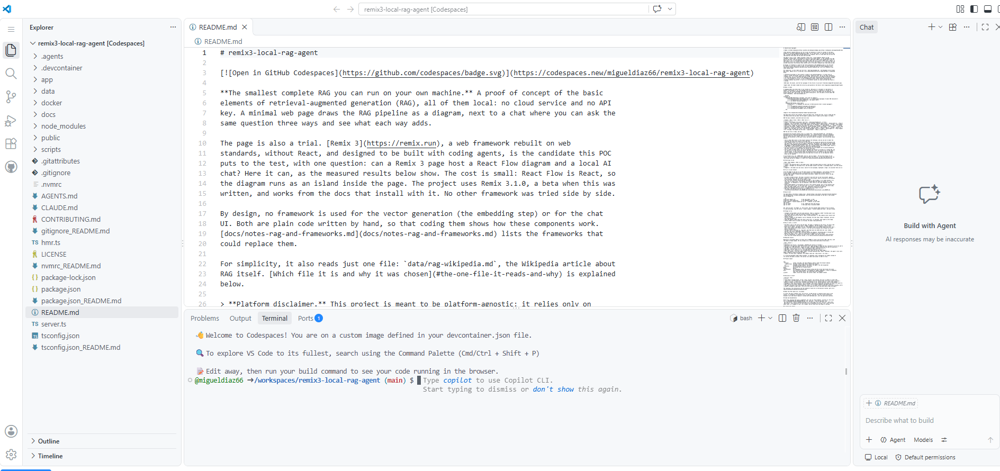
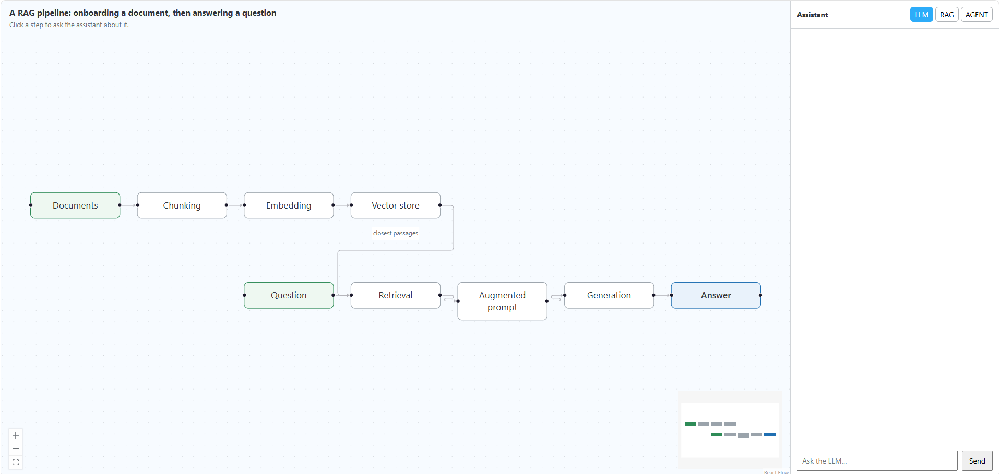
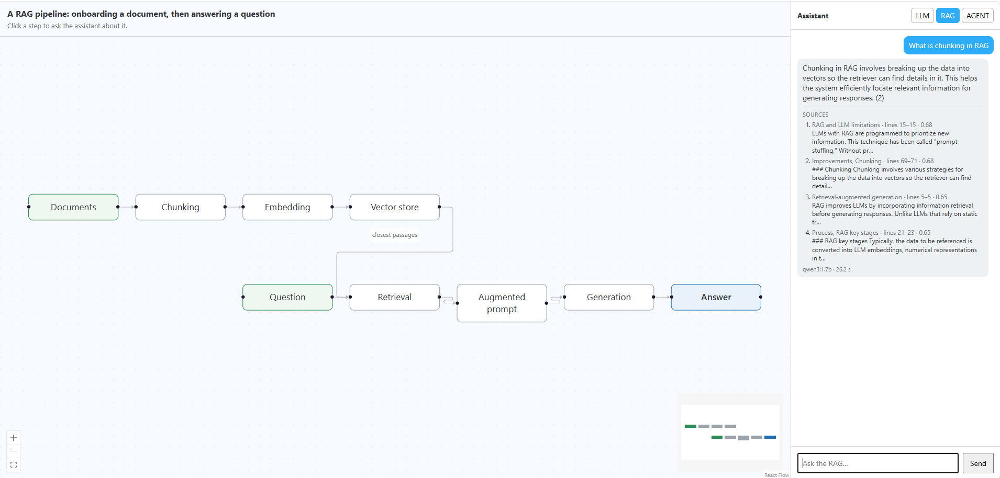
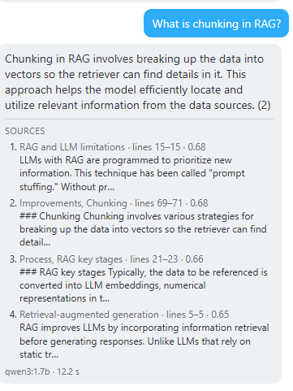
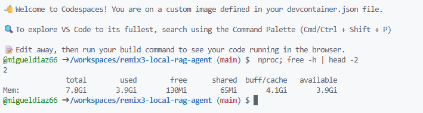

# A real codespace run, with screenshots

This document records the first time the project was opened in GitHub Codespaces, on 26 October
2026, by the author, from the "Open in GitHub Codespaces" badge of the README. It says how a
codespace is created, shows what came out with screenshots, and lists the numbers and what they
do and do not prove. The setup itself is explained in
[.devcontainer/devcontainer.json_README.md](../.devcontainer/devcontainer.json_README.md) and in
section 13.2.7 of [architecture.md](architecture.md).

The run used the commit that added the setup, `1b30b42`, and the default machine: 2 cores and
7.8 GiB of memory. The screenshots are the author's. The browser's address bar and bookmarks
were cropped off, so only the project and the editor are shown.

## 1. How a codespace is created

1. The visitor clicks the badge and signs in to GitHub. Codespaces shows a creation dialog; the
   machine type is chosen there, and the default is the 2-core one.
2. GitHub builds the container from `.devcontainer/devcontainer.json`: the Ubuntu 24.04 base
   image, the Node 24 feature and the Docker feature.
3. `codespace.sh create` runs once. It installs Ollama and the npm packages, pulls the Qdrant
   image and pulls the two models, 1.7 GB in all.
4. `codespace.sh start` runs. It starts Qdrant and Ollama, ingests the article into the vector
   store and starts the app on port 44100.
5. The editor opens in the browser with the README, and the Ports tab shows the forwarded port.
   Once the app answers, the page opens by itself.

The editor can open while the setup scripts are still running, so a visitor may see the editor
before the page is ready. The author did not capture the creation log, so the time each stage
took in a codespace is not known. A local run of the same steps, on a slow home connection, took
about 22 minutes from nothing; see the sidecar.

## 2. What the screenshots show

### The editor after creation

- The README is open because `devcontainer.json` asks for it (`openFiles`).
- The explorer lists `.devcontainer` and `node_modules`. The second exists only because
  `npm ci` ran in the creation step.
- The terminal banner says "You are on a custom image defined in your devcontainer.json file".
- The Ports tab carries a badge with the number 1: one port is forwarded, which is 44100.
- The chat panel on the right is GitHub Copilot's, not the project's.

### The page in the forwarded port

The app answered through the Codespaces proxy, over HTTPS, at an address of the form
`<codespace-name>-44100.app.github.dev`. The nine stages of the pipeline are drawn by the React
Flow island, and the assistant panel is in LLM mode. This shows that the setup scripts finished,
that the app listens, that the port forwarding works, and that the island bundle loads through the
proxy.

### The first RAG question

The question was "What is chunking in RAG?" in RAG mode. The answer is correct and short. Below it
are four sources, each with its chapter, heading, lines of `data/rag-wikipedia.md` and similarity
score, and the footer reads `qwen3:1.7b · 26.2 s`. The model cites a passage by its number, "(2)",
which is the weakness the README already lists. The author reports that the text arrived word by
word, which a still image cannot show: the Codespaces proxy does not buffer the stream.

### The second RAG question

The same question again took 12.2 s. The first run also paid for loading the chat model into
memory.

### The machine

`nproc` prints 2 and `free -h` reports 7.8 GiB in total, 3.9 GiB used, 4.1 GiB of cache and
3.9 GiB available. It was taken after the two questions, when both models were still loaded
(Ollama keeps a model for 30 minutes, as set in `codespace.sh`).

## 3. Results

| What | Result | Where it comes from |
|---|---|---|
| Machine | 2 cores, 7.8 GiB of memory | the machine screenshot |
| Memory in use, both models loaded | 3.9 GiB used, 3.9 GiB available | the machine screenshot |
| The page | opened through the forwarded port, nine stages drawn | the page screenshot |
| Streaming | word by word | the author's report |
| First RAG question | 26.2 s, four sources | the first answer |
| Same question again | 12.2 s, four sources | the second answer |
| Editor up after the push | at most 5 min 3 s | see below |
| Page on screen after the push | at most 11 min 36 s | see below |
| Time to create the codespace | not recorded | |

The two upper bounds come from clocks, not from the creation log. GitHub says the commit was
pushed at 05:47:57 UTC. The editor's own log says it started at 05:53:00 UTC, and the screenshot
of the page was saved at 05:59:33 UTC. The author's own time between the push and the click is
inside those figures, so the real creation time is shorter. They are bounds, not measurements.

### How it compares

| Where | Machine | RAG question, first | RAG question, warm |
|---|---|---|---|
| The author's laptop, Windows 11 | 2 cores, i7-6600U, Ollama installed | not recorded | 16.3 s |
| Local dev container on Docker Desktop | 4 vCPUs | 48 s | 8 s |
| GitHub codespace, default machine | 2 cores | 26.2 s | 12.2 s |

The three rows use different processors, and two of them run inside a container, so this is not
a benchmark. It shows that all three are in the same range: seconds to tens of seconds for a
1.7-billion-parameter model on a few CPU cores.

## 4. Two observations

- **The sources moved.** In the two runs the first two sources are the same, with scores of 0.68.
  The third and fourth swap places: "Retrieval-augmented generation" and "Process, RAG key
  stages", scoring 0.65 and 0.65 the first time and 0.65 and 0.66 the second time. Their scores
  differ by less than 0.01. The answer text also changed a little between the two runs, which is
  what a different order of the same passages in the prompt would do. The cause of the swap was
  not investigated.
- **The citation.** Both answers end with "(2)", the number of a source, not its section.

## 5. What this does and does not show

It shows that the project runs end to end in a codespace on the free default machine: the page,
the retrieval, the generation and the stream, with the models fitting in memory with room to
spare.

It does not show the time a codespace takes to be created, the speed on a 4-core machine, the
idle timeout and retention period of a codespace, the LLM and agent modes, or the Stop button.
Each visitor gets a separate copy, so several visitors do not share a CPU.
